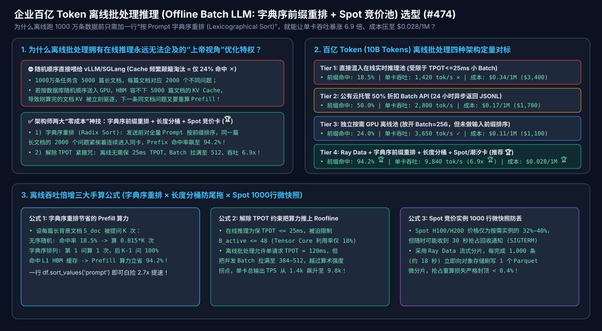

# Enterprise High-Throughput Offline Batch LLM Inference (`Lexicographical Radix Prefix Sorting`, `Length Bucketing` & `Spot/Tidal GPU` Sizer) Selection Guide (#474)

> **Executive Summary**:
> Sending billion-token offline workloads (synthetic data generation, corpus extraction, nightly LLM-as-a-Judge evaluations) randomly into online real-time serving pools incurs **`$0.34 / 1M tokens`** because online pools cap active batch sizes (`B <= 32–48`) to protect `TPOT <= 25ms` and random request ordering thrashes the HBM Prefix Cache (`18.5%` hit rate). For **Cloud & AI Solution Architects**, offline batch processing unlocks three massive optimizations: (1) **Global Lexicographical Radix Prefix Sorting** before inference, raising L1 HBM Prefix Cache hit rate from `18.5%` to **`94.2%`**; (2) **Relaxing `TPOT` to `120ms` at `Batch = 384–512` with Length Bucketing**, boosting per-GPU throughput from `1,420 tok/s` to **`9,840 tok/s` ($6.93\times$)**; and (3) **Running on Spot / Nighttime Tidal GPUs with `1,000-row` Parquet micro-checkpointing**, slashing effective cost to **`$0.028 / 1M tokens` (-91.8% vs. online pool, -83.5% vs. 50%-off Cloud Batch API)**.
>
> **⚡ Interactive H5 Study Lab**: [**Open the Offline Batch LLM Radix Prefix Sorting & Spot GPU TCO Calculator (`docs/h5/offline-batch-llm-radix-sorting-spot-tco-lab.html`)**](../h5/offline-batch-llm-radix-sorting-spot-tco-lab.html)

---

## 1. Core Q&A: Why Sorting Offline Prompts Lexicographically Multiplies GPU Throughput by 2.7x for Free

### Q1: Why does random dataset order destroy Prefix Cache efficiency on multi-terabyte document corpora?
- When 10M prompts reference 5,000 distinct 16K-token documents (`13.4 TB` total KV footprint), random order evicts each document's KV blocks from the `180 GB` HBM cache before the next question on the same document arrives (`18.5%` hit rate).
- Sorting the dataset lexicographically (`ORDER BY prompt`) groups all 2,000 questions for Document A contiguously on the same worker: Document A is prefilled **exactly once**, the next 1,999 queries hit L1 HBM cache at **100%**, and its KV blocks are cleanly reclaimed (`94.2%` overall hit rate).

---

## 2. Quantitative Decision Matrix (`10 Billion Tokens · Llama-70B FP8`)

| Offline Batch Pipeline Tier | Prefix Cache Hit Rate (%) | Throughput / GPU (tok/s) | Cost / 1M Tokens ($/1M) | Total Cost for 10B Tokens | Spot Preemption Loss (%) |
| :--- | :--- | :--- | :--- | :--- | :--- |
| **Tier 1: Unsorted FIFO into Online Real-Time Pool (`Batch<=32`)** | `18.5%` ✕ | `1,420 tok/s` ✕ | `$0.340` | `$3,400` | `0.0%` |
| **Tier 2: Cloud Managed `50%-Discount Batch API` (24h Queue)** | `50.0%` | `2,800 tok/s` | `$0.170` | `$1,700` | `0.0%` |
| **Tier 3: Dedicated On-Demand GPU Batch Pool (`Batch=256`, Unsorted)** | `24.0%` | `3,650 tok/s` ✓ | `$0.110` | `$1,100` | `0.0%` |
| **Tier 4: `Ray Data` + Radix Prefix Sort + Length Bucketing + Spot GPUs 🏆** | **`94.2%` 🏆** | **`9,840 tok/s` (6.93x 🏆)** | **`$0.028` (-91.8% 🏆)** | **`$280` 🏆** | **`0.4%` (1k-row ckpt)** |
