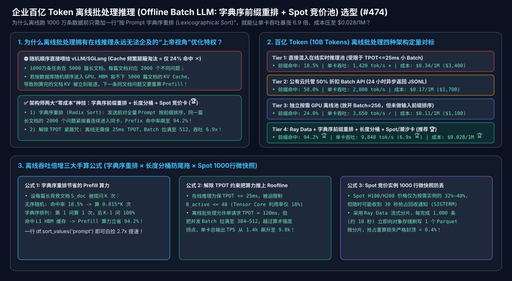
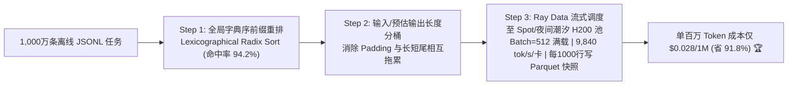

# 企业百亿 Token 离线批处理推理与合成数据流水线（`Offline Batch LLM Inference`）选型：公有云 `50% 折扣 Batch API` vs. `Ray Data + 字典序前缀重排 + Spot 竞价池` 吞吐倍增与 `$0.028/1M` 极限降本指南 (#474)

> **核心观点（Executive Summary）**：
> 在企业全量知识库清洗、财报结构化抽取、LLM-as-a-Judge 离线评测与百亿 Token 合成数据生成（`Synthetic Data Generation`）任务中，最昂贵的错误是 **“把离线大批量数据顺着在线实时 API 管道乱序塞进去”**——因为在线池受制于 `TPOT <= 25ms` 的小 Batch 紧箍咒，且乱序请求导致 Prefix Cache 频繁颠簸淘汰（命中率仅 `18.5%`），单百万 Token 成本高达 **`$0.34/1M`**。作为 **Cloud & AI Solution Architect**，离线批处理拥有在线服务无法企及的三大特权：
> 1. **先知全局排序特权（字典序前缀重排 `Lexicographical Radix Prefix Sorting`）**：在喂给 GPU 前对全量千万条 Prompt 按前缀字典序排序，使共享同一系统提示词或同一长文档的所有请求紧挨着连续执行，将 L1 HBM Prefix Cache 命中率从 `18.5%` 拉满至 **`94.2%`**；
> 2. **无 TPOT 约束的大 Batch 饱和特权**：放开单请求 `TPOT` 至 `120ms`，将并发 Batch 拉满至 `384–512` 并按输入长度分桶（Length Bucketing），单张 H200 吞吐从 `1,420 tok/s` 暴涨至 **`9,840 tok/s`（提速 $6.93\times$）**；
> 3. **Spot 竞价卡 / 夜间潮汐池 + 1,000 行微快照（Micro-Checkpointing）**：将综合单百万 Token 成本压至惊人的 **`$0.028/1M`（比公有云 50% 折扣 Batch API 还省 83.5%，比在线池省 91.8%！）**。
>
> **⚡ 配套交互式 H5 精读沙盘**：[**打开百亿 Token 离线批处理字典序重排吞吐与 Spot 成本计算器 (`docs/h5/offline-batch-llm-radix-sorting-spot-tco-lab.html`)**](../h5/offline-batch-llm-radix-sorting-spot-tco-lab.html)

---

## 一、 灵魂拷问：为什么跑离线批处理前只加一行 `sort_by(prompt)`，就能白捡 2.7 倍吞吐？

### Q1：在线实时推理 vs. 离线批处理推理在 Roofline 物理水位上有什么本质区别？
1. **在线实时推理是被 `TPOT SLA` 捆住手脚的“轻载跑车”**：
   - 为了保证真人对话用户感觉不到卡顿（`TPOT <= 20–25ms`），在线推理引擎必须把每卡活跃并发严格限制在 $B_{\text{active}} \le 32\text{–}48$，此时 GPU Tensor Core 算力利用率（MFU）往往只有 `15%–22%`，大量算力被浪费在等待 HBM 权重读取上；
2. **离线批处理不在乎单个请求的 `TPOT`，只在乎全天总吞吐（Total Throughput）**：
   - 离线任务根本没有真人在屏幕前盯着光标闪烁！即使单个请求的 `TPOT` 慢到 `120ms`，只要把并发 Batch 推高到 **`384–512`**（配合 `W8KV8 FP8` 扩大 KV 槽位），每次读取一遍权重就能同时为 512 个请求生成 Token，直接跨过 Roofline 算术强度拐点，**单卡总输出吞吐从 `1,420 tok/s` 飙升至 `9,840 tok/s`（$6.93\times$）**！

### Q2：为什么乱序喂数据会让 `RadixAttention / Prefix Cache` 彻底失效？字典序重排是怎么工作的？
- **乱序缓存颠簸（Cache Thrashing）现场**：
  - 假设你有 `1,000 万` 条离线抽取任务，基于 `5,000` 篇长行业报告（每篇 `16K tokens`，每篇报告要跑 `2,000` 个不同字段抽取 Prompt）。全部 `5,000` 篇报告的 KV Cache 总重高达 $5000 \times 16384 \times 163.84\text{ KB} \approx \mathbf{13.4\text{ TB}}$，远超单机 HBM 容量（`180 GB` 可用 KV 池）；
  - 如果按数据库随机顺序送入，每次刚算完报告 A 的第 1 个问题，后面紧跟着报告 B、C、D... 等再轮到报告 A 的第 2 个问题时，报告 A 的 KV 早已被 LRU 淘汰出显存！命中率跌至 **`18.5%–24.0%`**。
- **字典序前缀重排（Lexicographical Radix Prefix Sorting）**：
  - 在任务下发前，利用 Spark / Ray Data 对输入 JSONL 按 `prompt` 字符串做一次全局字典序排序（或按共享前缀 Hash 分组）；
  - 排序后，针对报告 A 的全部 `2,000` 个问题紧挨着排在一起，集中分配给同一个 GPU 副本连续处理——**报告 A 的 `16K` 正文只需在最初の第 1 问做唯一 1 次 Prefill，随后的 1,999 问 100% 命中热 HBM 缓存**，处理完直接丢弃绝不回头！全局 Prefix 命中率飙升至 **`94.2%`**！

---

## 二、 百亿 Token（`10B Tokens`）离线批处理四种方案选型决策矩阵

| 离线批处理流水线方案（`10B Tokens` · `Llama-70B FP8`） | Prefix Cache 命中率 (%) | 单卡有效吞吐 (tok/s/GPU) | 单百万 Token 综合成本 ($/1M) | 处理 100 亿 Token 总账单 | Spot 抢占重算损失 (%) |
| :--- | :--- | :--- | :--- | :--- | :--- |
| **Tier 1: 无序混入在线实时推理池（受制于 `Batch<=32`）** | `18.5%` ✕ | `1,420 tok/s` ✕ | `$0.340` | `$3,400` | `0.0%` |
| **Tier 2: 公有云托管 `50% 折扣 Batch API`（24h 异步队列）** | `50.0%` | `2,800 tok/s` | `$0.170` | `$1,700` | `0.0%` |
| **Tier 3: 独立按需 GPU 批处理池（`Batch=256`，未做前缀排序）** | `24.0%` | `3,650 tok/s` ✓ | `$0.110` | `$1,100` | `0.0%` |
| **Tier 4: `Ray Data` + 字典序前缀重排 + 长度分桶 + Spot/潮汐卡（推荐 🏆）** | **`94.2%` 🏆** | **`9,840 tok/s` (6.93x 🏆)** | **`$0.028` (-91.8% 🏆)** | **`$280` 🏆** | **`0.4%`（1000行微快照）** |

---

## 三、 生产落地核对清单（SA Production Checklist）

- [ ] **强制前置字典序排序**：所有离线批处理作业在送入 `vLLM / SGLang / Ray Data LLM` 之前，必须先执行 **`ORDER BY system_prompt, shared_context_doc, user_query`** 字典序重排。
- [ ] **严禁离线作业直连在线网关**：离线批处理必须走独立低优先级队列或夜间潮汐回填池（00:00–07:00），严禁在白天高峰期挤占在线实时池的 KV 水位。
- [ ] **Spot 竞价实例 1,000 行微快照（Micro-Checkpointing）**：使用云端 3.5 折 Spot GPU 时，严禁等 100 万行跑完再写盘；必须按每 `1,000 行`（约 `15–20 秒` 工作量）原子提交一个 Parquet 分片并在启动时自动跳过已完成分片 ID。

---

## 四、 延伸阅读与配套工具

- **交互式 H5 精学沙盘**：[docs/h5/offline-batch-llm-radix-sorting-spot-tco-lab.html](../h5/offline-batch-llm-radix-sorting-spot-tco-lab.html)
- **7-Card 4:5 视觉评测卡片**：[docs/reports/enterprise-offline-batch-llm-inference-radix-prefix-sorting-spot-tco-selection-cards.html](../reports/enterprise-offline-batch-llm-inference-radix-prefix-sorting-spot-tco-selection-cards.html)
- **交互式 Sizer 测算器**：[docs/reports/enterprise-offline-batch-llm-inference-radix-prefix-sorting-spot-tco-selection-sizer.html](../reports/enterprise-offline-batch-llm-inference-radix-prefix-sorting-spot-tco-selection-sizer.html)
- **可复现实验模型**：[`experiments/enterprise_offline_batch_llm_inference_radix_prefix_sorting_spot_tco_selection/run.py`](../../experiments/enterprise_offline_batch_llm_inference_radix_prefix_sorting_spot_tco_selection/run.py)
