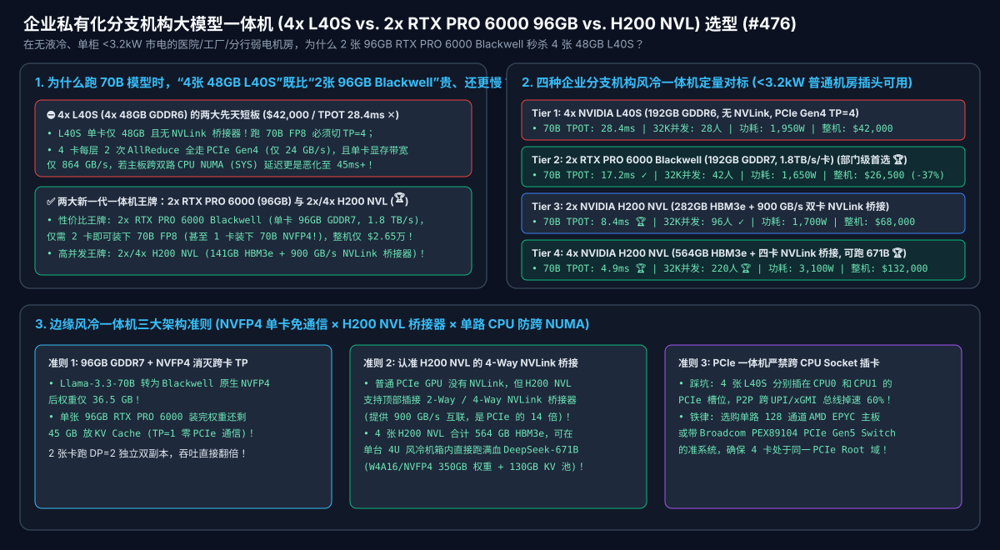

# Enterprise Air-Gapped / Branch On-Premises AI Appliance Sizing Guide: `4x L40S` vs. `2x RTX PRO 6000 Blackwell (96GB)` vs. `2x/4x H200 NVL PCIe` (#476)

> **Executive Summary**:
> Hospitals, manufacturing plants, regional bank branches, and defense sites often require **air-gapped on-premises AI appliances** operating within standard air-cooled server rooms (`< 3.2 kW` per chassis). Legacy appliances built with **`4x NVIDIA L40S (4×48GB GDDR6)`** suffer from `48GB` per-card capacity limits that force `TP=4` across unbridged PCIe Gen4 (`28.4ms TPOT` on `70B FP8` at `$42,000` CapEx). For **Cloud & AI Solution Architects**, modern branch appliances follow a two-tier standard:
> 1. **Departmental Cost-Performance Champion (`30–50 Concurrent Users`, Recommended Tier 2)**: **`2x NVIDIA RTX PRO 6000 Blackwell Server Edition (`2×96GB GDDR7 = 192GB`, `1.8 TB/s/GPU`)`** delivers $2.08\times$ the per-card memory bandwidth of L40S, fits `70B NVFP4` on a single card (`TP=1` zero PCIe traffic!), and cuts appliance CapEx by **36.9% (`$26,500` at `1,650W`)** while speeding up `TPOT` to **`17.2ms`**;
> 2. **Campus Flagship & Single-Box `DeepSeek-671B` (`100–220 Concurrent Users`, Recommended Tier 3 / Tier 4)**: **`2x / 4x NVIDIA H200 NVL PCIe (`141GB HBM3e/GPU` + `900 GB/s` 2/4-Way NVLink Bridge)`** provides up to **`564 GB HBM3e`** in a single `3,100W` 4U air-cooled server, running `DeepSeek-R1 671B (INT4/NVFP4)` or `220` concurrent `32K`-context sessions at **`4.9ms TPOT`**.
>
> **⚡ Interactive H5 Study Lab**: [**Open the On-Premises Edge AI Appliance Sizer (`docs/h5/onprem-ai-appliance-rtx-pro-6000-l40s-h200-nvl-lab.html`)**](../h5/onprem-ai-appliance-rtx-pro-6000-l40s-h200-nvl-lab.html)

---

## 1. Core Q&A: Why 2x 96GB Blackwell Beats 4x 48GB L40S in Both Speed and CapEx

### Q1: Why does doubling per-GPU VRAM from `48 GB` (`L40S`) to `96 GB` (`RTX PRO 6000 Blackwell`) transform PCIe appliance performance?
- With `96 GB GDDR7` (`1.8 TB/s` bandwidth per GPU) and hardware `NVFP4`, a single `RTX PRO 6000` holds the entire `36.5 GB` `Llama-3.3-70B NVFP4` model plus `45 GB` of KV Cache (`TP=1`, zero inter-GPU PCIe AllReduce), or runs `70B FP8` across just 2 cards (`TP=2`) instead of 4 (`TP=4`).

---

## 2. Quantitative Decision Matrix (`< 3.2 kW Air-Cooled Branch Chassis`)

| On-Premises AI Appliance Tier | Total VRAM (GB) | Aggregate Mem BW (TB/s) | `70B FP8` Single-User `TPOT` | Max Concurrent Users (`32K` Ctx) | Wall Power (Watts) | Appliance CapEx ($) |
| :--- | :--- | :--- | :--- | :--- | :--- | :--- |
| **Tier 1: `4x NVIDIA L40S` (`4×48GB GDDR6`, PCIe Gen4 `TP=4`)** | `192 GB` | `3.46 TB/s` | `28.4 ms` | `28 users` | `1,950 W` | `$42,000` |
| **Tier 2: `2x RTX PRO 6000 Blackwell` (`2×96GB GDDR7`, Dept Pick 🏆)** | **`192 GB`** | **`3.60 TB/s`** | **`17.2 ms` ✓** | **`42 users` ✓** | **`1,650 W` 🏆** | **`$26,500` (-36.9% 🏆)** |
| **Tier 3: `2x NVIDIA H200 NVL` (`2×141GB HBM3e` + 2-Way NVLink Bridge)** | `282 GB` | `9.60 TB/s` | **`8.4 ms` 🏆** | `96 users` ✓ | `1,700 W` | `$68,000` |
| **Tier 4: `4x NVIDIA H200 NVL` (`4×141GB HBM3e` + 4-Way NVLink, Fits 671B 🏆)** | **`564 GB` 🏆** | **`19.20 TB/s` 🏆** | **`4.9 ms` 🏆** | **`220 users` 🏆** | `3,100 W` | `$132,000` |
