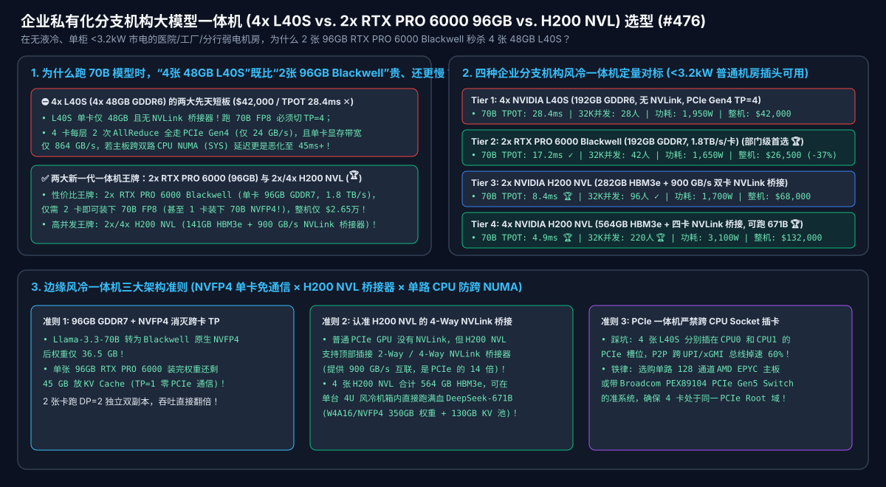
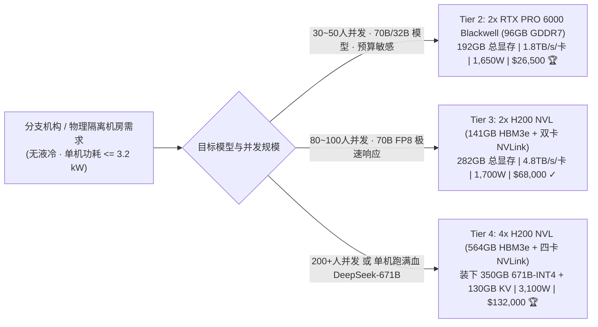

# 企业私有化分支机构大模型一体机（`On-Premises Edge AI Appliance`）选型：`4x L40S` vs. `2x RTX PRO 6000 Blackwell (96GB)` vs. `2x/4x H200 NVL PCIe` 风冷功耗与容量手算指南 (#476)

> **核心观点（Executive Summary）**：
> 在三甲医院院区、工厂制造车间、银行二级分行与涉密研究所等 **物理隔离（Air-Gapped）边缘现场**，往往没有 12kW 高密液冷机柜或 400G RDMA 交换机，只有 **普通 `16A/32A` 市电插座（整机功率上限 `< 3.2 kW`）与标准 4U 风冷机架**。过去一年许多客户盲目采购 **`4x NVIDIA L40S (4×48GB GDDR6)`** 一体机跑 `70B` 模型，结果因为单卡仅 48GB 被迫切 `TP=4` 走无 NVLink 的慢速 PCIe Gen4 总线，不仅整机高达 `$42,000`，单请求 `TPOT` 还慢达 `28.4ms`。作为 **Cloud & AI Solution Architect**，新一代分支机构一体机应按预算与规模分两档选型：
> 1. **部门级高性价比一体机（`30–50 人并发`，推荐 Tier 2）**：选用 **`2x NVIDIA RTX PRO 6000 Blackwell Server Edition（2×96GB GDDR7 = 192GB，1.8 TB/s/卡）`**，显存带宽比 L40S 翻倍（$2.08\times$），且支持硬件 `NVFP4`（单张 96GB 卡即可独立跑 `70B NVFP4` 零跨卡通信！），整机采购价压至 **`$26,500`（比 4x L40S 便宜 36.9%、速度快 39.4%、功耗仅 `1,650W`）**；
> 2. **院区/分行主力与满血 `671B` 一体机（`100–220 人并发`，推荐 Tier 3 / Tier 4）**：选用带顶部 **`NVLink 桥接器（900 GB/s）` 的 `2x / 4x NVIDIA H200 NVL PCIe（141GB HBM3e/卡）`**，4 卡合计 **`564 GB HBM3e`**，在 `3,100W` 标准风冷机箱内即可单机流畅运行 `DeepSeek-V3/R1 671B (W4A16/NVFP4)` 或支撑 **`220 路`** `32K` 上下文并发！
>
> **⚡ 配套交互式 H5 精读沙盘**：[**打开分支机构大模型一体机 (RTX PRO 6000 96GB vs. L40S vs. H200 NVL) 容量与功耗计算器 (`docs/h5/onprem-ai-appliance-rtx-pro-6000-l40s-h200-nvl-lab.html`)**](../h5/onprem-ai-appliance-rtx-pro-6000-l40s-h200-nvl-lab.html)

---

## 一、 灵魂拷问：为什么在风冷一体机里，`2 张 96GB Blackwell` 全面碾压 `4 张 48GB L40S`？

### Q1：同样是 `192 GB` 总显存，为什么 `4x L40S (4×48GB)` 跑 `70B` 比 `2x RTX PRO 6000 Blackwell (2×96GB)` 慢得多？
1. **单卡显存容量决定了你能不能少切一刀 `TP`（减少跨 PCIe 同步税）**：
   - `Llama-3.3-70B / Qwen2.5-72B` 在 `FP8` 下权重约 `72 GB`：
     - **`4x L40S (48GB/卡)`**：2 张卡（`96 GB`）扣掉 15% 安全水位后只剩 `81.6 GB`，装完 `72 GB` 权重只剩 `9.6 GB` 放 KV Cache（并发不到 3 人），因此被迫切成 **`TP=4`**！且 L40S 不支持 NVLink 桥接器，每层 2 次 AllReduce 全走 `PCIe Gen4 x16`（实测仅 `24 GB/s`），通信等待拖累 `TPOT` 恶化至 **`28.4 ms`**；
     - **`2x RTX PRO 6000 Blackwell (96GB/卡)`**：单卡拥有 **96 GB `GDDR7` 显存（带宽高达 `1,800 GB/s`，是 L40S `864 GB/s` 的 2.08 倍！）**。两张卡（`TP=2`）即可宽裕装下 `72 GB FP8` 权重 + `90 GB` KV Cache；更进一步，开启 Blackwell 原生 **`NVFP4`（`36.5 GB` 权重）** 后，**单张 96GB 卡（`TP=1`）就能直接装下整颗 70B 模型 + 45 GB KV Cache，2 张卡跑 `DP=2` 完全零 PCIe 跨卡通信**！

### Q2：如果客户机房没有液冷、不能上 `HGX 8 卡 SXM` 服务器（10.5 kW），但又硬性要求在单台风冷服务器里跑通满血 `DeepSeek-R1 671B`，怎么配硬件？
- **唯一标准答案：`4x NVIDIA H200 NVL PCIe`（配 4-Way NVLink 桥接器）**：
  1. **显存水位手算**：单张 `H200 NVL` 提供 **`141 GB HBM3e`（带宽 `4.8 TB/s`）**，4 张卡合计 **`564 GB HBM3e`**（可用安全水位 $564 \times 0.85 = 479.4\text{ GB}$）；
  2. **装下 `671B` INT4/NVFP4 满血模型**：`DeepSeek-R1 671B` 经 `AWQ INT4 / W4A8` 量化后权重为 **`350 GB`**，装入 4 张 `H200 NVL` 后还剩余 **`129.4 GB HBM3e`** 专门存放 MLA KV Cache（按 `35.14 KB/tok` 计，可同时容纳 **380 万个 Token** 的上下文池！）；
  3. **900 GB/s 四卡硬件 NVLink 桥接**：不同于普通 PCIe 卡，`H200 NVL` 顶部带有专用 NVLink 金手指，通过 4-Way 桥接器将 4 张 PCIe 卡连成 **`900 GB/s` 全互联 NVLink 域**，且整机满载功耗仅 **`3,100W`**（单相 16A/32A 工业插头风冷直插即用）！

---

## 二、 四种企业分支机构风冷一体机选型决策矩阵（`< 3.2 kW` 普通弱电机房可用）

| 分支机构风冷一体机配置 | 总显存容量 (GB) | 聚合显存带宽 (TB/s) | `70B FP8` 单请求 `TPOT` | `32K` 上下文最大并发人数 | 整机满载功耗 (W) | 一体机硬件采购价 (CapEx) |
| :--- | :--- | :--- | :--- | :--- | :--- | :--- |
| **Tier 1: `4x NVIDIA L40S`（`4×48GB GDDR6`，无 NVLink）** | `192 GB` | `3.46 TB/s` | `28.4 ms` | `28 人` | `1,950 W` | `$42,000` |
| **Tier 2: `2x RTX PRO 6000 Blackwell`（`2×96GB GDDR7`，部门首选 🏆）** | **`192 GB`** | **`3.60 TB/s`** | **`17.2 ms` ✓** | **`42 人` ✓** | **`1,650 W` 🏆** | **`$26,500` (-36.9% 🏆)** |
| **Tier 3: `2x NVIDIA H200 NVL`（`2×141GB HBM3e` + 双卡 NVLink 桥接）** | `282 GB` | `9.60 TB/s` | **`8.4 ms` 🏆** | `96 人` ✓ | `1,700 W` | `$68,000` |
| **Tier 4: `4x NVIDIA H200 NVL`（`4×141GB HBM3e` + 四卡 NVLink，可跑 671B 🏆）** | **`564 GB` 🏆** | **`19.20 TB/s` 🏆** | **`4.9 ms` 🏆** | **`220 人` 🏆** | `3,100 W` | `$132,000` |

---

## 三、 生产落地核对清单（SA Production Checklist）

- [ ] **停止新购 48GB 卡拼凑 70B 一体机**：新立项 `70B/72B` 边缘一体机严禁再用 4 张 `48GB` 显卡走 PCIe 拼凑，优先采用 **单卡 `96GB` 的 `RTX PRO 6000 Blackwell Server Edition`** 或 **单卡 `141GB` 的 `H200 NVL`**。
- [ ] **H200 NVL 必配硬件 NVLink 桥接器**：采购 `2x / 4x H200 NVL PCIe` 服务器时，必须在 BOM 中显式勾选原厂 **2-Slot 2-Way 或 4-Way NVLink Bridge**，并核对主板 PCIe 插槽间距与桥接器物理匹配。
- [ ] **单路 128 通道 CPU 防跨 Socket 降速**：若使用无 NVLink 的 PCIe 显卡（如 `RTX PRO 6000` 或 `L40S`），服务器准系统优先选择 **单路（Single-Socket）AMD EPYC 9004/9005（128 条 PCIe Gen5 通道直出）**，彻底杜绝跨双路 CPU `UPI/xGMI` 总线引起的 P2P 延迟翻倍。

---

## 四、 延伸阅读与配套工具

- **交互式 H5 精学沙盘**：[docs/h5/onprem-ai-appliance-rtx-pro-6000-l40s-h200-nvl-lab.html](../h5/onprem-ai-appliance-rtx-pro-6000-l40s-h200-nvl-lab.html)
- **7-Card 4:5 视觉评测卡片**：[docs/reports/enterprise-onprem-edge-ai-appliance-rtx-pro-6000-l40s-h200-nvl-selection-cards.html](../reports/enterprise-onprem-edge-ai-appliance-rtx-pro-6000-l40s-h200-nvl-selection-cards.html)
- **交互式 Sizer 测算器**：[docs/reports/enterprise-onprem-edge-ai-appliance-rtx-pro-6000-l40s-h200-nvl-selection-sizer.html](../reports/enterprise-onprem-edge-ai-appliance-rtx-pro-6000-l40s-h200-nvl-selection-sizer.html)
- **可复现实验模型**：[`experiments/enterprise_onprem_edge_ai_appliance_rtx_pro_6000_l40s_h200_nvl_selection/run.py`](../../experiments/enterprise_onprem_edge_ai_appliance_rtx_pro_6000_l40s_h200_nvl_selection/run.py)
