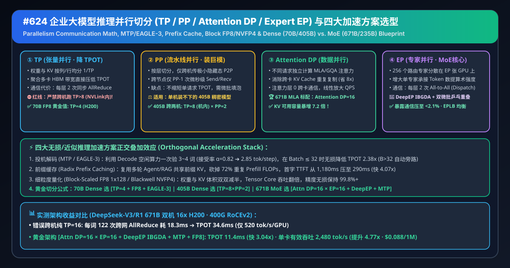

# Enterprise LLM Inference Parallelism (`TP / PP / Attention DP / Expert EP`) Communication Math, 4-Pillar Acceleration (`MTP/EAGLE-3` · `Radix Prefix Caching` · `Block FP8/NVFP4`) & Dense (`70B/405B`) vs. MoE (`DeepSeek 671B / Qwen3-235B`) Optimal Topology Guide (`#624`)

> **Language / 语言**: [简体中文](./enterprise-parallelism-tp-pp-dp-ep-dense-moe-acceleration-sizing-faq.md) | **English** · [📱 Interactive H5 Study Lab (with SVG Diagrams + Parallelism Configurator)](../h5/parallelism-tp-pp-dp-ep-dense-moe-acceleration-lab.html) · [🧮 Interactive Sizer](../reports/enterprise-parallelism-tp-pp-dp-ep-dense-moe-acceleration-sizing-sizer.html) · [🃏 7-Card Visual Report](../reports/enterprise-parallelism-tp-pp-dp-ep-dense-moe-acceleration-sizing-cards.html) · [Back to Catalog](../full-catalog-en.md)

---

## 1. 3-Minute Executive Summary

1. **Bottom-Line Recommendation**:
   - Inference parallelism trades interconnect bandwidth for per-GPU HBM capacity, effective memory bandwidth, and GEMM arithmetic intensity:
     - **`TP` (Tensor Parallelism)**: Shards weights and KV heads `1/TP` to aggregate HBM bandwidth and directly lower single-request **`TPOT`**, at the cost of `2` synchronous `AllReduce` collectives per layer. **Golden Rule: Pin `TP <= 8` strictly inside an intra-node `NVLink` domain (`900–1,800 GB/s`)**.
     - **`PP` (Pipeline Parallelism)**: Shards layers across nodes with only `(PP - 1)` tiny point-to-point hidden-state transfers per step, enabling giant dense models (`405B`) across nodes without `AllReduce` stalls, though it does not reduce single-stream `TPOT`.
     - **`Attention DP` (Data Parallel Attention)**: Runs independent request batches through `MLA / GQA` attention with **zero cross-GPU communication** and **eliminates `TP`-way KV Cache duplication** on `DeepSeek MLA`.
     - **`Expert EP` (Expert Parallelism)**: Distributes `256` routed experts across `EP` GPUs and aggregates tokens cluster-wide via `All-to-All` (`Dispatch + Combine`) so each expert executes at high arithmetic intensity. Pairing **`DeepEP IBGDA` + dual-microbatch ping-pong overlap + `EPLB` redundant hot experts** shrinks exposed cross-node communication to **`< 2.1%`**.
   - On a 2-node `16× H200` (`400G RoCEv2/IB`) deployment of `DeepSeek-V3/R1 671B`, naive cross-node **`TP=16`** triggers `122` inter-node `AllReduce` barriers per token (`18.3 ms` network sync stall, `34.6 ms` `TPOT`, `520 tok/s/GPU`). Switching to **`Attention DP=16 × Expert EP=16 + DeepEP IBGDA + Native MTP + Block FP8`** slashes `P99 TPOT` to **`11.4 ms` (`3.04×` faster)** and boosts compliant throughput to **`2,480 tok/s/GPU` (`4.77×` higher)** at **`$0.088 / 1M tokens`**!

---

## 2. Parallelism & Acceleration Trade-off Matrix

| Dimension | Primary Metric Improved | Network Collective per Layer | Latency / Bandwidth Cost Formula | Architectural Guardrail |
| :--- | :--- | :--- | :--- | :--- |
| **`TP` (Tensor Parallel)** | Lowers **`TPOT`** & **`TTFT`**; shards weights & GQA KV | `2 × AllReduce` (blocking) | $2[\alpha_{\text{link}} + \frac{2(T-1)}{T}\frac{B H b}{\text{BW}}]$ | **Never span `TP > 8` across Ethernet/IB**; keep inside NVLink |
| **`PP` (Pipeline Parallel)** | Fits `>1-node` dense weights (`405B`) | `1 × P2P Send/Recv` at stage boundary | $(P-1) \times \frac{B H b}{\text{BW}_{\text{net}}}$ per token | Requires micro-batching ($M \ge 4P$) to hide pipeline bubbles |
| **`Attention DP`** | Scales cluster **`TPS`** & saves `MLA` KV HBM | **`0` in attention** | $0$ | Mandatory for `DeepSeek MLA` (`35.14 KB/tok`) to avoid KV replication |
| **`Expert EP`** | Raises MoE FFN arithmetic intensity | `2 × All-to-All` (`Dispatch + Combine`) | $2\frac{E-1}{E}\frac{B K H b}{\text{BW}_{\text{RDMA}}}$ | Pair with **`DeepEP IBGDA` + Dual-Microbatch Overlap + `EPLB`** |
| **Speculative (`MTP / EAGLE-3`)** | Cuts **`TPOT` by `1.8×–2.4×`** at low/med batch | Shares target `TP` group | Draft + 1 parallel verify of $\gamma+1$ tokens | Enable at **`B <= 32`** (`2.85 tok/step`); auto-bypass when $B > 32$ |
| **`Radix Prefix Caching`** | Cuts **`TTFT` by `3×–8×`** | Zero on local HBM hit | Saves $2 N_{\text{act}} r_{\text{hit}} S_{\text{in}}$ FLOPs | Keep system prompt & RAG context static at prefix head |
| **`Block FP8 / NVFP4`** | `2×–4×` smaller weights/KV & `2×` Tensor FLOPS | Halves `All-to-All` payload bytes | $0.5\times$ memory & network bytes | Use `1×128 Block FP8` on Hopper/MI325X; `NVFP4` on Blackwell |

---

## 3. Optimal Recipes: Dense (`70B / 405B`) vs. Sparse MoE (`235B / 671B`)

| Model Family | `FP8` Weight Footprint | Hardware Pod | Optimal Parallelism (`TP × PP × DP × EP`) | Acceleration Stack | `P99 TPOT` | Compliant Goodput (`tok/s/GPU`) |
| :--- | :--- | :--- | :--- | :--- | :--- | :--- |
| **`Llama-3.3-70B` (Dense)** | `~70 GB` | `4× H200` (Intra-Node) | **`TP=4, PP=1, DP=2`** (per 8-GPU node) | `Block FP8 + EAGLE-3 + Radix Cache` | **`9.8 ms`** | **`2,150 tok/s/GPU`** |
| **`Llama-3.1-405B` (Dense)** | `~405 GB` | `8× H200` (1 Node) or `16× H100` (2 Nodes) | **`TP=8, PP=1`** (H200) or **`TP=8 × PP=2`** (2×8 H100) | `Block FP8 + FP8 KV + PD Disagg` | **`16.5 ms`** | **`640 tok/s/GPU`** |
| **`Qwen3-235B-A22B` (MoE)** | `~235 GB` (`22B` active) | `4× H200` or `8× H100` | Prefill **`TP=4, EP=4`**; Decode **`Attn DP=4, EP=4`** | `Block FP8 + FlashInfer MoE + EAGLE-3` | **`10.6 ms`** | **`2,620 tok/s/GPU`** |
| **`DeepSeek-V3/R1 671B` (MoE)** 🏆 | `~671 GB + 14 GB MTP` | `16× H200` (2 Nodes, 400G RDMA) | **`Attention DP=16 × Expert EP=16`** (or `EP=32/64` PD) | **`DeepEP IBGDA + Dual-Batch + EPLB + MTP + FlashMLA FP8`** | **`11.4 ms`** (`3.04×` faster than `TP=16`) | **`2,480 tok/s/GPU`** (`4.77×` higher than `TP=16`) |

---

## 4. Pre-Production Checklist for Solution Architects

- [ ] **1. Never Span `TP` Across Inter-Node Ethernet/IB**: Keep `TP <= 8` within intra-node NVLink; use `PP` for giant dense models and `Attention DP × Expert EP` for MoE.
- [ ] **2. Enable `Attention DP` for `DeepSeek MLA`**: Prevent 16-way replication of the shared `512 + 64` compressed KV latent cache.
- [ ] **3. Budget `+14 GB` for `DeepSeek 671B` Native `MTP` Head & Set `max_spec_batch = 32`**: Achieve `2.38×` decode speedup at interactive concurrency while avoiding compute saturation at large batch sizes.
- [ ] **4. Turn On `DeepEP IBGDA` + Dual-Microbatch Overlap + `EPLB`**: Hide `94%+` of `All-to-All` dispatch/combine latency and balance skewed expert routing.
