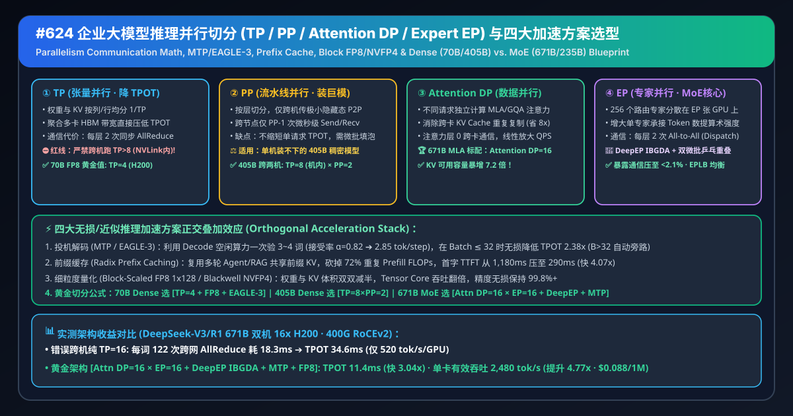
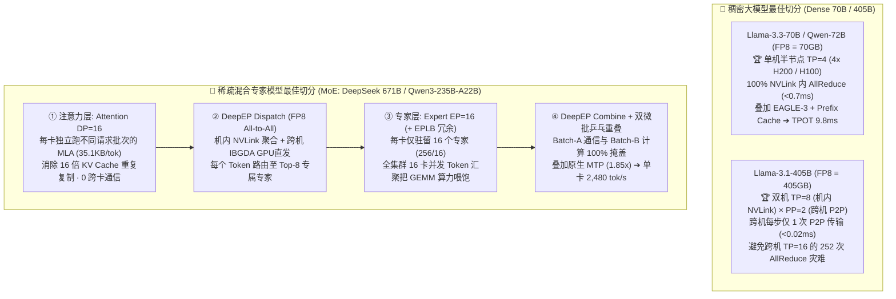

# 企业级大模型推理并行切分（`TP / PP / Attention DP / Expert EP`）通信代价手算、四大无损加速（`MTP / EAGLE-3` · `Radix Prefix Caching` · `Block FP8 / NVFP4`）与 Dense (`70B/405B`) vs. MoE (`DeepSeek 671B / Qwen3-235B`) 最佳切分选型指南（`#624`）

> **Language / 语言**: **简体中文** | [English](./enterprise-parallelism-tp-pp-dp-ep-dense-moe-acceleration-sizing-faq.en.md) · [📱 交互式 H5 精读页（含 SVG 拓扑图 + 并行配比沙盘）](../h5/parallelism-tp-pp-dp-ep-dense-moe-acceleration-lab.html) · [🧮 交互式容量计算器 Sizer](../reports/enterprise-parallelism-tp-pp-dp-ep-dense-moe-acceleration-sizing-sizer.html) · [🃏 7-Card 评测报告](../reports/enterprise-parallelism-tp-pp-dp-ep-dense-moe-acceleration-sizing-cards.html) · [返回总目录](../full-catalog-zh.md)

---

## 一、3 分钟核心结论卡片（Executive Summary）

1. **一句话结论**：
   - 大模型推理并行的本质是**用智算互联带宽换取单卡显存容量、HBM 访存带宽与矩阵算术强度**。不同并行维度改善的指标截然不同：
     - **`TP`（张量并行）**：唯一能直接聚合多卡 HBM 带宽以**压低单请求吐字延迟（`TPOT`）**的手段，但每层引入 `2` 次同步 `AllReduce`，**铁律是锁死在单机/单柜 `NVLink` 域内（`TP <= 8`）**；
     - **`PP`（流水线并行）**：跨节点仅传输 `1` 次微小的隐藏状态向量（`P2P Send/Recv`），用于**装下超大稠密模型（如 `405B`）**，但不缩短单请求 `TPOT`；
     - **`Attention DP`（注意力数据并行）**：不同请求独立计算注意力，**彻底消除跨卡 KV Cache 冗余复制**，线性放大集群 `QPS` 与可用 KV 容量；
     - **`EP`（专家并行）**：专为稀疏 MoE 设计，将 `128–256` 个路由专家分散到多卡上，合并全集群 Token 喂给同一专家以**把 MoE FFN 从访存受限推向算力甜点**，配合 `DeepEP IBGDA` 与双微批乒乓重叠将跨机 `All-to-All` 暴露耗时压至 **`< 2.1%`**。
   - 在双机 `16 张 H200`（`400G RoCEv2/IB`）部署满血 `DeepSeek-V3/R1 671B` 时，若盲目照搬稠密模型的**跨机纯 `TP=16`**，每生成一个 Token 需执行 `122` 次跨网 `AllReduce`（仅网络同步延迟就高达 **`18.3 ms`**，`TPOT` 恶化至 **`34.6 ms`**，单卡吞吐仅 `520 tok/s`）；切换为 **`Attention DP=16 × Expert EP=16 + DeepEP IBGDA + 原生 MTP 投机解码 + Block FP8`**，不仅将 `P99 TPOT` 压至 **`11.4 ms`（提速 `3.04 倍`）**，更将单卡达标有效吞吐推升至 **`2,480 tok/s/GPU`（暴增 `4.77 倍`）**，每百万 Token 成本降至 **`$0.088 / 1M`**！

2. **四大并行维度与三大加速技术速查总表（架构师白板必背）**：

| 并行 / 加速维度 | 改善的核心指标 | 每层网络通信原语与频次 | 通信代价公式（单层单步） | 架构师硬红线与适用边界 |
| :--- | :--- | :--- | :--- | :--- |
| **`TP`（张量并行）** | 降低 **`TPOT`** 与 **`TTFT`**；均分权重与 KV | `2 × AllReduce`（Attention 后 + FFN 后） | $2 \times \left(\alpha_{\text{net}} + \frac{2(T-1)}{T}\frac{B \cdot H \cdot b}{\text{BW}}\right)$ | **严禁跨普通机间网络跑 `TP > 8`**；仅限机内 `NVLink`（`900–1,800 GB/s`） |
| **`PP`（流水线并行）** | 装下超单机显存的巨型 Dense 模型 | 仅在阶段边界 `1 × P2P Send/Recv` | 全模型共 $(P-1)$ 次点对点传输 | 不降低单请求 `TPOT`；需足够并发微批（$M \ge 4P$）填满流水线气泡 |
| **`Attention DP`** | 线性提升系统 **`TPS / QPS`**；省去 KV 复制 | **注意力层 `0` 通信**（进入 MoE 前后做 Gather/Scatter） | $0$（纯 Attention DP） | 完美适配 `DeepSeek MLA`（无法按 KV 头拆大 TP，用 DP 零冗余存 KV） |
| **`Expert EP`（专家并行）** | 提升 MoE 专家算术强度与系统总吞吐 | `2 × All-to-All`（`Dispatch` 分发 + `Combine` 归并） | $2 \times \frac{E-1}{E} \frac{B \cdot K \cdot H \cdot b}{\text{BW}_{\text{RDMA}}}$ | 必须搭配 **`DeepEP (NVLink+RDMA)` + 双微批乒乓重叠 + `EPLB` 冗余专家** |
| **投机解码 (`MTP / EAGLE-3`)** | 单用户 **`TPOT` 降低 `1.8x–2.5x`** | 复用主模型 TP 域，零额外跨机通信 | 草案生成 + 单次并行验证 $K$ 个候选词 | **中低并发（$B \le 24\text{--}32$）开启**；当 $B > 32$ 算力饱和时自动动态关断 |
| **`Radix Prefix Caching`** | 首字 **`TTFT` 降低 `3x–8x`**；省 Prefill 算力 | 命中本地 HBM 零通信；命中 L2 走 RDMA | 省去 $\Delta\text{FLOPs} = 2 N_{\text{act}} \cdot r_{\text{hit}} \cdot S_{\text{in}}$ | 提示词工程必须固定 System Prompt 与知识库在前、动态时间戳置尾 |
| **`Block FP8 / NVFP4` 量化** | 显存减半/四分之一；算力与带宽翻倍 | 激活/All-to-All 传输按 `FP8` 字节减半 | 通信字节量直接乘 $0.5\times$ | Hopper/MI325X 首选 `1x128 Block FP8`；Blackwell 经校准首选硬件 `NVFP4` |

---

## 二、灵魂拷问 Q&A：通信代价手算、MoE vs. Dense 差异与投机解码拐点

### Q1：为什么同样是双机 16 张 H200，跑 `Llama-3.1-405B Dense` 用 `TP=8 × PP=2` 很丝滑，但如果跨两台机器直接开 `TP=16` 就会导致性能彻底崩盘？
- **答**：我们可以用 **Hockney $\alpha\text{-}\beta$ 通信公式** 現場手算：
  - **单次 `AllReduce` 耗时公式**：
    $$T_{\text{AllReduce}} = \alpha_{\text{sync}} + \frac{2(N_{\text{TP}} - 1)}{N_{\text{TP}}} \times \frac{M_{\text{bytes}}}{\text{BW}_{\text{link}}}$$
  - **场景 1（机内 `TP=8` 走 NVLink 4）**：
    - NVLink 硬件同步延迟 $\alpha_{\text{NVLink}} \approx 2.5\ \mu\text{s}$，单卡双向带宽 $\text{BW} = 450\text{ GB/s}$；
    - 在 Decode 阶段（$B=32, H=8192, \text{BF16}$），单次消息体积仅 $M = 32 \times 8192 \times 2 = \mathbf{512\text{ KB}}$；
    - 单层 `2` 次 `AllReduce` 耗时约 $2 \times (2.5 + 1.75 \times 512\text{ KB} / 450\text{ GB/s}) \approx \mathbf{9.0\ \mu\text{s/层}}$，80 层总通信仅 **`0.72 ms`**，完全可忽略！
  - **场景 2（错误做法：跨两台机器开 `TP=16` 走 400G RoCEv2）**：
    - 跨交换机多跳 `AllReduce` 同步延迟飙升至 $\alpha_{\text{RoCE}} \approx \mathbf{140\text{--}160\ \mu\text{s/次}}$；
    - 126 层（405B）或 61 层（671B）每步要执行 **$122\text{--}252$ 次阻塞式跨网 `AllReduce`**！
    - 光是等待网络往返握手延迟就要消耗：$122 \times 150\ \mu\text{s} = \mathbf{18.3\text{ ms/Token}}$（405B 甚至高达 **`37.8 ms/Token`**），直接把 `TPOT` 拖垮！
  - **场景 3（正确做法：`405B Dense` 采用机内 `TP=8` × 跨机 `PP=2`）**：
    - 机内 126 层 `AllReduce` 100% 锁死在高速 NVLink 内，而跨机仅在第 63 层交界处执行 **`1` 次点对点 `P2P Send/Recv`**（耗时 `< 15 \mu\text{s}$），网络通信开销骤降 **`99.9%`**！

---

### Q2：为什么在 `DeepSeek-V3/R1 671B` 这类稀疏 MoE 模型上，生产标准答案不是 `TP=16`，而是 **`Attention DP + Expert EP` 解耦并行**？
- **答**：原因出在 **`MLA` 注意力结构** 与 **稀疏专家激活密度** 的双重物理特性上：
  1. **为什么 Attention 层不能开大 `TP`，而必须开 `Attention DP`？**
     - DeepSeek 的 `MLA`（多头潜在注意力）将 KV 压缩为**全头共享的单一潜在向量**（$d_c=512$ 维）。如果像传统 GQA 那样强行开 `TP=16`，这 `512` 维潜在 KV 无法按头拆分，只能在 **16 张 GPU 上完整复制 16 份相同的 KV Cache**，白白浪费 `93.75%` 的宝贵显存！
     - 改用 **`Attention DP=16`**：16 张 GPU 各自处理不同的用户请求，每份 KV Cache 只在所属的那 `1` 张卡上存 `1` 份，**集群可承载的并发 KV 容量直接扩大 `7.2–16 倍`**，且注意力层跨卡通信为 **`0`**！
  2. **为什么 MoE 专家层必须开 `Expert EP=16/32/64`？**
     - DeepSeek 共有 `256` 个路由专家，每个 Token 仅激活 `8` 个（稀疏度 `1/32`）。若单请求批大小较小，分摊到每个专家上的 Token 只有寥寥 `1–2` 个，每次都要从 HBM 搬运整个专家权重却只算 1 个向量（算术强度 `= 1 FLOP/Byte`，利用率不到 `0.3%`）！
     - 开启 **`Expert EP=16`**：每张 GPU 仅负责存放 `256 / 16 = 16` 个专家，同时把全集群 16 个 `Attention DP` 实例的请求通过 `All-to-All` 汇总过来，**单个专家每次接收的 Token 数扩大 `16 倍`**，直接把 MoE 层的算术强度推高 `16 倍`！
  3. **如何消除 `EP` 带来的跨节点 `All-to-All` 通信开销与热门专家倾斜？**
     - **通信掩盖**：采用 `DeepEP` 的 **NVLink→RDMA 分层转发 / IBGDA（GPU 直接写网卡门铃）** + **Dual-Microbatch（双微批乒乓重叠）**，当 Microbatch-0 在跑 RDMA `All-to-All` 时，GPU Tensor Core 正在满载计算 Microbatch-1 的 MLA/MoE，使暴露通信占比从 `38%` 压降至 **`1.9%`**；
     - **负载均衡**：开启 **`EPLB`（Expert Parallelism Load Balancer）**，基于滑动窗口热度统计将最热的 `8–16` 个专家在多卡间做动态冗余复制，消除木桶效应慢卡等待。

---

### Q3：投机解码（`MTP / EAGLE-3`）、`Prefix Caching` 与 `FP8/NVFP4 量化` 叠加时，各自的收益边界与“投机解码负收益反转点”在哪里？
- **答**：这是架构师做推理调优时最容易踩的坑——**投机解码并非在所有并发下都加速！**
  - **投机解码（`Native MTP / EAGLE-3`）的加速公式与 Batch 拐点**：
    - 设草案模型每次预测 $\gamma = 3$ 个候选 Token，平均接受步长为 $\tau(\alpha) \approx 2.85\text{ Tokens/Step}$（其中单步接受率 $\alpha \approx 0.82$），验证 $1+\gamma=4$ 个 Token 的单步耗时放大系数为 $c(B)$：
      $$\text{Speedup}_{\text{spec}}(B) = \frac{\tau(\alpha)}{c(B) + t_{\text{draft}} / t_{\text{target}}}$$
    - **当并发较小（$B \le 16$，极度显存带宽受限）**：由于权重只需从 HBM 读 1 次，同时验证 4 个 Token 与算 1 个 Token 的耗时几乎一样（$c(B) \approx 1.12$），而 `1 层 MTP / EAGLE-3` 草案开销仅占主模型的 `4%`，因此**单用户吐字速度直接暴增 $\mathbf{2.38\text{ 倍}}$（等效 `TPOT` 从 `22 ms` 降至 `9.2 ms`）**！
    - **当并发过大（$B > 32\text{--}48$，逼近算力屋脊拐点）**：此时 4 倍的验证 Token 量（$4B \ge 128\text{--}192$）使 GPU 进入算力受限区，$c(B)$ 恶化至 `2.6–3.2`，投机解码反而会导致整体吞吐下降！因此**生产引擎必须配置自适应门禁：当活跃 Batch $B \ge 32$ 时自动旁路关闭投机解码**。

---

## 三、主流模型家族（Dense vs. MoE）最佳并行切分与加速配比决策矩阵

| 模型代表 | 权重规模 (`FP8`) | 推荐硬件底座 | 最佳并行切分组合 (`TP × PP × DP × EP`) | 必选加速插件栈 | 实测达标 `P99 TPOT` | 单卡达标吞吐 (`tok/s/GPU`) |
| :--- | :--- | :--- | :--- | :--- | :--- | :--- |
| **`Llama-3.3-70B` / `Qwen2.5-72B` (Dense)** | `~70 GB` | 单机 `4× H200`（或 `8× H100`） | **`TP=4, PP=1, DP=2`**（单机 2 组独立 `TP=4` 实例） | `Block FP8` + `EAGLE-3` ($B\le 28$) + `Radix Cache` | **`9.8 ms`**（无投机 `14.2 ms`） | **`2,150 tok/s/GPU`** |
| **`Llama-3.1-405B` (Giant Dense)** | `~405 GB` | 单机 `8× H200` 或双机 `16× H100` | 单机 H200 选 **`TP=8, PP=1`**；双机 H100 选 **`TP=8 × PP=2`** | `Block FP8` + `FP8 KV` + `Chunked/PD Disagg` | **`16.5 ms`** | **`640 tok/s/GPU`** |
| **`Qwen3-235B-A22B` (Medium MoE)** | `~235 GB`（激活 `22B`） | 单机 `4× H200` 或 `8× H100` | Prefill **`TP=4, EP=4`**；Decode **`Attn DP=4, EP=4`** | `Block FP8` + `FlashInfer MoE` + `EAGLE-3` | **`10.6 ms`** | **`2,620 tok/s/GPU`** |
| **`DeepSeek-V3 / R1 671B` (Frontier MoE)** 🏆 | `~671 GB` + `14 GB MTP` | 双机 `16× H200`（或高吞吐 `32–64× H200` PD 分离） | **`Attention DP=16 × Expert EP=16`**（高吞吐 Decode 可扩至 `EP=32/64`） | **`DeepEP IBGDA` + 双微批重叠 + `EPLB` + 原生 `MTP` + `FlashMLA FP8`** | **`11.4 ms`**（对比跨机 `TP=16` 的 `34.6 ms` 快 **`3.04x`**） | **`2,480 tok/s/GPU`**（较跨机 `TP=16` 提升 **`4.77x`**） |

---

## 四、生产环境并行与加速配置核对清单（SA Pre-Production Checklist）

- [ ] **1. 严守 `TP` 不出 NVLink 域铁律**：检查所有部署 YAML，确保 `tensor_parallel_size <= 8`（H100/H200 HGX 单机）或 `<= 72`（仅限 GB200 NVL72 机柜铜背板域），绝不跨 RoCEv2/IB 交换机配置 `TP=16`；
- [ ] **2. MoE 模型强制启用 `Attention DP + Expert EP` 解耦模式**：在 SGLang（`--enable-dp-attention --ep-size 16 --enable-deepep-moe`）或 vLLM V1 中开启 Attention DP，避免 MLA KV Cache 在多卡间重复拷贝；
- [ ] **3. 预留原生 `MTP` 草案头显存并配置自适应 Batch 阈值**：部署 DeepSeek 671B 时在 `671 GB` 主权重外额外预留 **`14 GB`** 显存加载原生 `MTP` 模块，并设置 `speculative_max_batch_size = 32` 自动熔断保护；
- [ ] **4. 开启 `EPLB` 专家负载均衡与双微批重叠（Dual-Batch Overlap）**：针对生产流量对特定代码/数学专家的倾斜，开启 `EPLB` 冗余专家副本（每卡额外预留 `1–2` 个热门专家槽位），将尾慢卡等待消除 `90%+`。
