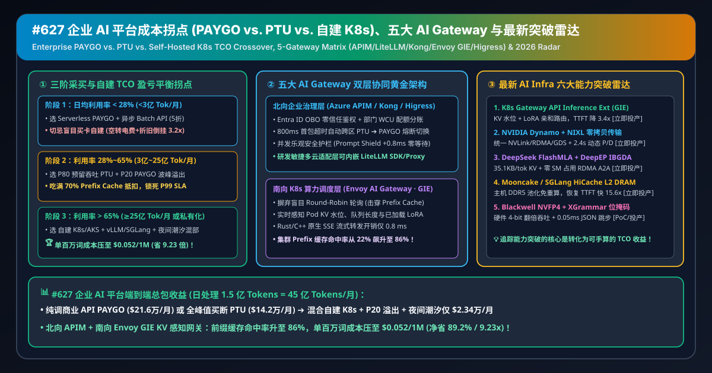

# Enterprise AI Platform End-to-End TCO Inflection Points (`Serverless PAYGO` vs. `Provisioned PTU` vs. `Self-Hosted K8s/AKS + vLLM/SGLang`), 5-Gateway Matrix (`Azure APIM / LiteLLM / Kong / Envoy GIE / Higress`) & 2026 AI Infra Breakthrough Radar (`#627`)

> **Language / 语言**: [简体中文](./enterprise-paygo-ptu-k8s-tco-ai-gateway-breakthrough-radar-faq.md) | **English** · [📱 Interactive H5 Study Lab (with TCO Crossover + Gateway Matrix + Breakthrough Radar)](../h5/paygo-ptu-k8s-tco-ai-gateway-breakthrough-radar-lab.html) · [🧮 Interactive Sizer](../reports/enterprise-paygo-ptu-k8s-tco-ai-gateway-breakthrough-radar-sizer.html) · [🃏 7-Card Visual Report](../reports/enterprise-paygo-ptu-k8s-tco-ai-gateway-breakthrough-radar-cards.html) · [Back to Catalog](../full-catalog-en.md)

---

## 1. 3-Minute Executive Summary

1. **Bottom-Line Recommendation**:
   - **Three-Stage Capacity Procurement & Self-Hosting TCO Law**:
     - **Stage 1 (`< 28%` average daily utilization or `< 300M tokens/mo`)**: Use **Serverless PAYGO + Async Batch API (`50%` discount)**. Self-hosting at `<25%` utilization costs `2.4×–3.2×` more per token due to idle GPU depreciation.
     - **Stage 2 (`28%–65%` utilization or `300M–2.5B tokens/mo`)**: Use **`P80 Provisioned PTU` (with `70%+` Prefix Cache discount) + `P20 Serverless PAYGO` burst spillover**, saving **`44.5%`** vs. sizing PTUs for `100%` peak traffic.
     - **Stage 3 (`> 65%` utilization, `>= 2.5B tokens/mo`, or data sovereignty)**: Deploy **Self-Hosted K8s/AKS (`KAITO + Kueue + vLLM V1 / SGLang`) + Nightly Tidal GPU Backfill (Batch ETL / GRPO)** + `P20` cloud burst spillover, driving unit cost from `$0.480 / 1M` down to **`$0.052 / 1M tokens` (`9.23×` cheaper, saving `$2.31M/yr` at `4.5B tokens/mo`)**!
   - **Two-Tier AI Gateway Architecture**: Pair a **Northbound Enterprise Governance Gateway (`Azure APIM / Kong / Higress`)** for Entra ID OBO auth, `WCU` weighted token-bucket chargeback, and `800ms` multi-region failover with a **Southbound K8s Compute Router (`Envoy AI Gateway / K8s GIE`)** for KV-cache-aware and LoRA-aware pod routing (`86%` prefix cache hit rate vs. `22%` round-robin at `0.8ms` proxy overhead).

---

## 2. Five-Gateway Comparison & 2026 AI Infra Capability Breakthrough Radar

| Gateway | Data-Plane Latency | Core Architectural Strength | Best-Fit SA Role |
| :--- | :--- | :--- | :--- |
| **`Azure APIM (GenAI)`** | `~1.5 ms` | Native Entra ID OBO, PTU pool load balancing, `800ms` failover & Prompt Shields | **Northbound enterprise multi-cloud governance gateway** |
| **`Envoy AI Gateway (K8s GIE)`** 🏆 | **`~0.8 ms`** | **Real-time pod KV-cache watermark, queue-depth & active LoRA adapter routing** | **Southbound K8s/AKS GPU inference ingress standard** |
| **`Kong AI Gateway`** | `~1.2 ms` | Unified legacy REST + multi-LLM enterprise plugin ecosystem | Brownfield Kong enterprise consolidation |
| **`Higress AI Gateway`** | `~1.1 ms` | Native Envoy + Wasm `MCP Server` protocol bridging & semantic caching | Cloud-native K8s + MCP tool gateway |
| **`LiteLLM Proxy`** | `4.5–12 ms` (Python) | 100+ model provider schema normalization & rapid developer onboarding | **Developer PoC, eval harnesses, or sidecar SDK adapter** |

### Top-6 Daily AI Infra Capability Breakthroughs for Solution Architects
1. **`K8s Gateway API Inference Extension (GIE)`**: Raises multi-pod prefix cache hit rate from `22%` to **`86%`** (`3.4×` lower `TTFT`).
2. **`NVIDIA Dynamo + NIXL`**: Zero-copy KV transfer across NVLink/RDMA/DRAM/GDS + **`2.4s` zero-reload P↔D role switching** (`-50%` GPUs).
3. **`DeepSeek FlashMLA + DeepEP (IBGDA)`**: `35.14 KB/tok` KV (`4.66×` smaller) + `<2%` exposed `All-to-All` (`2,480 tok/s/GPU`).
4. **`Mooncake Store / SGLang HiCache`**: Pooled Host Pinned DDR5 L2 KV cache (`15.6×` faster multi-turn session restore).
5. **`Blackwell NVFP4 + FlashInfer 0.2+`**: Hardware micro-scaled 4-bit doubling memory capacity and Tensor Core throughput at `99.5%+` accuracy.
6. **`XGrammar / llguidance`**: `<0.05ms` bitmask + `Jump-Forward` token skipping (`-26.5%` decode steps, `100%` valid JSON).

---

## 3. Pre-Production Checklist

- [ ] **1. Enforce the 3-Stage TCO Crossover Rule (`28%` PTU / `65%` Self-Hosted K8s + Tidal Backfill)**.
- [ ] **2. Meter Quotas in `WCU` (`1×Uncached_In + 0.1×Cached_In + 4×Out`)** rather than raw HTTP request counts.
- [ ] **3. Deploy `Envoy AI Gateway (K8s GIE)`** in front of self-hosted `vLLM / SGLang` pods for KV-aware routing.
