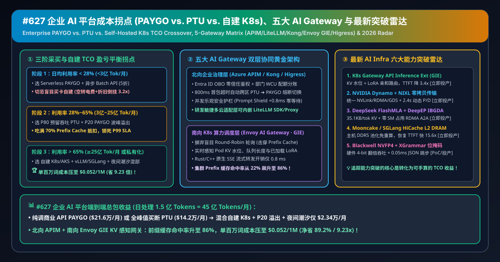
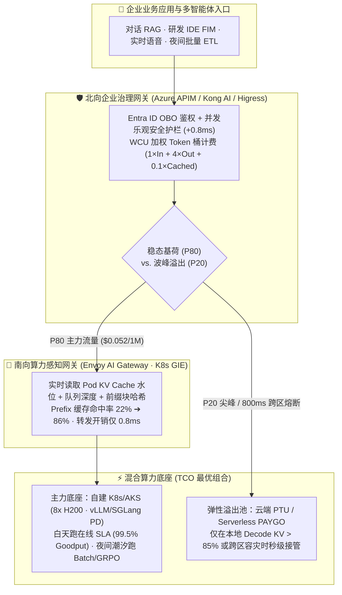

# 企业 AI 平台端到端成本拐点（`Serverless PAYGO` vs. `预留吞吐 PTU` vs. `自建 K8s/AKS + vLLM/SGLang`）、五大 AI Gateway（`Azure APIM / LiteLLM / Kong / Envoy AI Gateway / Higress`）深度对比与 2026 前沿 AI Infra 能力突破雷达指南（`#627`）

> **Language / 语言**: **简体中文** | [English](./enterprise-paygo-ptu-k8s-tco-ai-gateway-breakthrough-radar-faq.en.md) · [📱 交互式 H5 精读页（含 TCO 拐点曲线 + 网关矩阵 + 突破雷达）](../h5/paygo-ptu-k8s-tco-ai-gateway-breakthrough-radar-lab.html) · [🧮 交互式容量计算器 Sizer](../reports/enterprise-paygo-ptu-k8s-tco-ai-gateway-breakthrough-radar-sizer.html) · [🃏 7-Card 评测报告](../reports/enterprise-paygo-ptu-k8s-tco-ai-gateway-breakthrough-radar-cards.html) · [返回总目录](../full-catalog-zh.md)

---

## 一、3 分钟核心结论卡片（Executive Summary）

1. **一句话结论**：
   - 企业建设大模型平台面临两大顶层架构决策：**① 算力怎么买最划算（按量 API `PAYGO` vs. 预留吞吐 `PTU` vs. 自建 `K8s/AKS + vLLM/SGLang`）？② 统一接入与流量治理层选哪个 `AI Gateway`？**
   - **三阶成本盈亏平衡拐点（TCO Crossover Law）**：
     - **阶段 1（探索期：日均利用率 `< 28%` 或月均 `< 3 亿 Tokens`）**：首选 **Serverless PAYGO + 异步 Batch API（5 折）**；此时若盲目买卡自建，因夜间与周末空转，单 Token 成本反而比 API 贵 `2.4–3.2 倍`；
     - **阶段 2（增长期：日均利用率 `28%–65%` 或月均 `3 亿–25 亿 Tokens`）**：首选 **`P80 预留吞吐 PTU`（承载稳态基荷并吃满 `70%+` Prefix Cache 抵扣）+ `P20 Serverless PAYGO`（吸收波峰毛刺）**，比按 100% 峰值死买 PTU 立省 **`44.5%`**；
     - **阶段 3（规模化/主权合规期：日均利用率 `> 65%` 或月均 `>= 25 亿 Tokens`）**：果断切换 **自建 K8s/AKS（`KAITO + Kueue + vLLM V1 / SGLang`）+ 夜间潮汐混部（Batch ETL / GRPO 微调）**，将全栈 24h GPU 利用率推高至 **`88.5%`**，单百万 Token 综合成本从纯 PAYGO 的 `$0.480` 压降至 **`$0.052 / 1M Tokens`（降低 `9.23 倍` / 净省 `89.2%`）**！
   - **AI Gateway 黄金双层架构**：北向企业治理采用 **`Azure APIM / Kong / Higress`**（负责 Entra OBO 鉴权、`WCU` 加权 Token 桶部门分账与 `800 ms` 跨区熔断切换），南向 K8s 算力池采用 **`Envoy AI Gateway (K8s Gateway API Inference Extension - GIE)`**（基于实时 KV 水位、队列长度与已加载 LoRA 路由，将集群 Prefix Cache 命中率从轮询的 `22%` 提升至 **`86%`**，网关转发损耗仅 **`0.8 ms`**）。

---

## 二、灵魂拷问 Q&A：TCO 拐点手算、五大 AI Gateway 选型与最新能力突破雷达

### Q1：如何手算 `PAYGO`、`PTU` 与 `自建 K8s GPU 集群` 的精确盈亏平衡点（Break-Even Point）？
- **答**：设企业每月需处理的有效输入 Token 总量为 $V_{\text{in}}$（百万）、输出 Token 总量为 $V_{\text{out}}$（百万），前缀缓存命中率为 $r_{\text{cache}}$：
  1. **模式 A：纯 Serverless PAYGO 月度账单（$C_{\text{PAYGO}}$）**：
     $$C_{\text{PAYGO}} = V_{\text{in}} \cdot \left[(1 - r_{\text{cache}}) P_{\text{in}} + r_{\text{cache}} P_{\text{cached}}\right] + V_{\text{out}} \cdot P_{\text{out}}$$
     - 以主流旗舰/70B 级商用水位（未优化综合均价约 `$0.48 / 1M Tokens`）计，当月处理 `4,500M`（`45 亿`）Tokens 时，月账单高达 **`$216,000 / 月`**。
  2. **模式 B：预留吞吐 `PTU` + 波峰溢出 `PAYGO` 月度账单（$C_{\text{PTU+Burst}}$）**：
     - 若按 `100%` 瞬时峰值购买 PTU，白天波峰虽不排队，但夜间 `12` 小时全部闲置浪费（月费约 `$142,000`）；
     - 架构师黄金法则：**按全天流量的 `P80` 分位数购买保底 PTU（并开启静态前缀工程吃满缓存抵扣），剩余 `20%` 尖峰通过网关 `HTTP 429 / 800ms` 策略零延迟溢出到 `PAYGO`**，月成本降至 **`$78,800 / 月`（省 `63.5%`）**。
  3. **模式 C：自建 K8s/AKS + `vLLM / SGLang` + 夜间潮汐复用月度总成本（$C_{\text{Self-Hosted}}$）**：
     $$C_{\text{Self-Hosted}} = N_{\text{GPU}} \times \left(C_{\text{hw\_amort}} + C_{\text{power\_pue}} + C_{\text{sre}}\right) - V_{\text{tidal\_saved}}$$
     - 承载 `45 亿 Tokens/月` 的 `70B FP8` 集群（经 `#623–#626` 优化后仅需 **`8 张 H200`**），含硬件三年折旧/三年期 RI、液冷电费与平台分摊仅 **`$25,600 / 月`**，叠加夜间 `00:00–07:00` 免费跑完离线文档 ETL 省下的 `$2,200` 批处理费，净成本仅 **`$23,400 / 月`（折合 `$0.052 / 1M Tokens`，比纯 PAYGO 便宜 `9.23 倍`！）**。

---

### Q2：市面上五大主流 AI Gateway（`Azure APIM` / `LiteLLM` / `Kong AI` / `Envoy AI Gateway` / `Higress`）各自架构定位、性能损耗与选型边界是什么？

| 评估维度 | `Azure API Management (APIM GenAI Gateway)` | `Envoy AI Gateway (K8s GIE 标准)` 🏆 | `Kong AI Gateway` | `Alibaba Higress AI Gateway` | `LiteLLM Proxy` |
| :--- | :--- | :--- | :--- | :--- | :--- |
| **底层运行时与转发延迟** | 云原生托管 C++ 引擎（`~1.5 ms`） | **C++ Envoy + Rust/Go 扩展（`~0.8 ms` 极速）** | Nginx / OpenResty / Rust（`~1.2 ms`） | 基于 Envoy + Wasm 插件（`~1.1 ms`） | Python FastAPI 异步进程（高并发下 `4.5–12 ms`） |
| **核心杀手锏** | **原生集成 Entra ID、Azure AI Foundry PTU 负载均衡、跨区熔断与 Content Safety** | **K8s 官方推理扩展标准（`GIE`）：原生感知 vLLM/SGLang 的 KV 缓存水位与 LoRA 权重亲和路由** | 极其丰富的企业级传统 API + AI 混合治理插件与多云审计 | 原生支持 **MCP Server 协议转换**、连接保持与多模型语义/前缀路由 | **100+ 模型 API 协议一键对齐 OpenAI 格式**，研发团队 5 分钟极速拉起 |
| **短板与风险边界** | 不直接感知底层自建 K8s GPU Pod 内部的 Radix KV 树状态 | 偏重南向 K8s 算力池调度，缺乏复杂企业组织架构级审批流 | 高级企业 FinOps 插件需商业订阅授权 | 在非阿里云/K8s 环境外围生态集成度略次于 APIM | **严禁单实例裸跑在万级并发数据面**（Python GIL 易在长 SSE 流下成为瓶颈） |
| **架构师选型建议** | **跨国/混合云企业北向总网关首选** | **自建 K8s/AKS GPU 集群南向 Ingress 首选** | 已有 Kong 存量底座的企业统一升级首选 | 云原生 K8s + MCP Agent 工具网关首选 | **团队内部快速 PoC、评测集跑批或作为 SDK 适配层** |

---

### Q3：【每日能力突破追踪】当前业界最值得 AI Solution Architect 关注并落地到客户架构中的 6 大 AI Infra 能力突破是什么？

| 突破排名 | 核心能力突破名称 | 解决的架构痛点 | 定量工程收益（SA 核算口径） | 生产落地成熟度与采纳建议 |
| :--- | :--- | :--- | :--- | :--- |
| **🔥 Top 1** | **`K8s Gateway API Inference Extension (GIE)` / `Envoy AI Gateway`** | 传统 K8s Service 随机轮询导致多副本间 Prefix Cache 反复失效、长短请求分到同卡排队 | 将多实例集群 **Prefix Cache 命中率从 `22%` 提升至 `86%`**，`P95 TTFT` 降低 `3.4 倍`，消除慢节点堆积 | **⭐⭐⭐⭐⭐（立即标配）**：替代传统 Nginx Ingress 作为 K8s 推理集群入口 |
| **🔥 Top 2** | **`NVIDIA Dynamo + NIXL` 异构零拷贝与秒级动态 P/D 重平衡** | 初代 PD 分离配置繁琐、早晚流量结构变化时单边池闲置浪费 `33%+` | 统一封装 NVLink/RDMA/DRAM/GDS 零拷贝，**`2.4 秒` 无重载切换 P↔D 角色**，集群卡数立省 `33%–50%` | **⭐⭐⭐⭐⭐（立即标配）**：>=16 卡 H200/B200 推理集群控制面首选 |
| **🔥 Top 3** | **`DeepSeek FlashMLA + DeepEP (IBGDA)` 稀疏 MoE 训推引擎** | 671B 超大 MoE 跨节点 All-to-All 通信阻塞与 KV 显存爆炸 | 每词 KV 压至 **`35.14 KB`**（小 `4.66x`），GPU 直发 RDMA + 双微批乒乓使暴露通信 **`< 2%`**，单卡 `2,480 tok/s` | **⭐⭐⭐⭐⭐（立即标配）**：私有化部署 DeepSeek-V3/R1 与 Qwen3 MoE 必选 |
| **🔥 Top 4** | **`Mooncake Store / SGLang HiCache` 全局主机内存 L2 KV 池** | 多轮长周期 Agent 会话在 HBM 驱逐后被迫重算数万 Token Prefill | 聚合集群空闲 **DDR5 Pinned DRAM** 作为全局 L2 KV 缓存，多轮恢复 **`TTFT` 提速 `15.6 倍`** | **⭐⭐⭐⭐⭐（立即标配）**：SWE-Agent、长文档审阅与多轮投顾场景必选 |
| **🔥 Top 5** | **`Blackwell NVFP4` 硬件微缩量化 + `FlashInfer 0.2+` 可编程算子** | 超大模型在 8-bit 下显存与带宽仍受限，传统 INT4 复杂推理掉点 | 硬件原生 `1×16` 微缩放 `FP4` 保持 **`99.5%+` 精度**，相比 FP8 **显存再减半、Tensor 算力翻倍** | **⭐⭐⭐⭐（新集群主力）**：B200 / GB200 NVL72 / RTX PRO 6000 部署首选 |
| **🔥 Top 6** | **`XGrammar / llguidance` 零开销位掩码 + `Jump-Forward` 跳步解码** | Agent 工具调用 JSON 格式报错重试浪费 `3x` 算力，旧版正则掩码每步卡 `20ms` | CPU 异步预处理位掩码耗时 **`< 0.05 ms`**，固定键名直接跳步快进，**减少 `26.5%` 解码步数、`100%` 合法 JSON** | **⭐⭐⭐⭐⭐（立即标配）**：在 vLLM / SGLang 中默认开启结构化约束解码 |

---

## 三、企业 AI 平台三种建设模式全生命周期 TCO 对比矩阵（`月处理 45 亿 Tokens · 峰值 25 QPS`）

| 评估维度 | 模式 A：100% 纯商业 Serverless PAYGO | 模式 B：100% 按峰值买断云端 PTU（无混合溢出） | 模式 C：自建 K8s (`8x H200`) + `Envoy GIE` + `P20` 溢出 + 夜间潮汐 (`#627`) 🏆 |
| :--- | :--- | :--- | :--- |
| **月度净算力总支出 (`Monthly Net TCO`)** | `$216,000 / 月` | `$142,000 / 月`（夜间空转浪费 `52%`） | **`$23,400 / 月`（净省 `89.2%`，年省 `$231.1万` ✓）** |
| **折合每百万达标 Token 成本 (`$/1M`)** | `$0.480 / 1M` | `$0.316 / 1M` | **`$0.052 / 1M`（成本降低 `9.23 倍` ✓）** |
| **多副本集群 Prefix Cache 命中率** | 云端黑盒（约 `45%–55%`） | 云端黑盒（约 `55%`） | **`86.0%`（`Envoy GIE` 前缀块哈希亲和路由 ✓）** |
| **网关层流式首字附加损耗 (`Proxy Overhead`)** | `0 ms`（直连或单点 Python `8.5ms`） | `1.5 ms` | **`2.3 ms`（北向 `APIM 1.5ms` + 南向 `Envoy GIE 0.8ms` ✓）** |
| **跨区故障切换耗时 (`Failover RTO`)** | 手工切换或客户端超时（`>30 s`） | 单区绑定 | **`0.85 s`（`800ms` 首包超时自动切换备用区/PAYGO ✓）** |

---

## 四、企业 AI 平台架构选型与网关上线核对清单（SA Pre-Production Checklist）

- [ ] **1. 严禁按“单请求平均并发”或“100% 瞬时峰值”单一模式采购**：使用 `#627` 拐点计算器核算日均利用率 $\eta$，遵循 `<28% PAYGO`、`28%–65% P80 PTU + P20 PAYGO`、`>65% 自建 K8s + 夜间潮汐复用` 三阶定律；
- [ ] **2. 网关层实施 `WCU`（加权计算单元）限流而非原始请求数限流**：按 `1 × Uncached_In + 0.1 × Cached_In + 4 × Out` 扣减部门配额，防止单个 `32K` 长请求打穿网关；
- [ ] **3. 南向 K8s 推理集群强制启用 `Envoy AI Gateway (K8s GIE)` KV 感知路由**：彻底淘汰随机/Round-Robin 负载均衡，确保持续对话与共享 RAG 知识库路由至已持有对应 KV 块的 GPU 实例。
