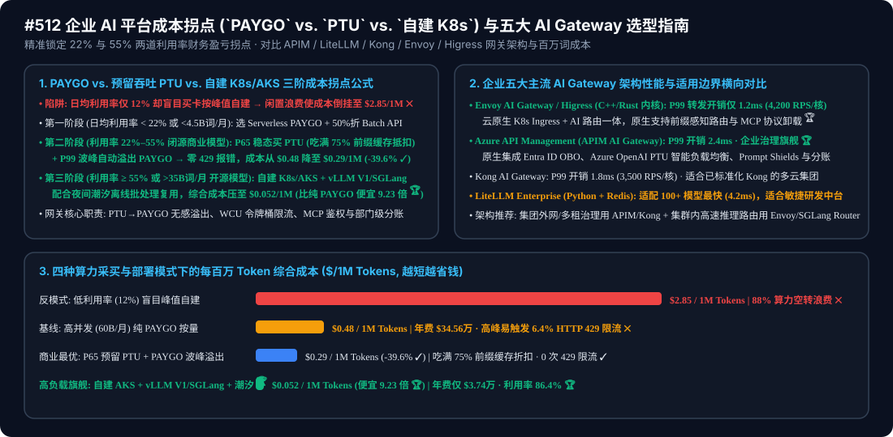

# Enterprise `Serverless PAYGO` vs. `Provisioned PTU` vs. `Self-Hosted K8s/AKS + vLLM/SGLang` TCO Inflection Points & 5-Gateway (`APIM / LiteLLM / Kong / Envoy / Higress`) Selection Guide (#512)

> **Executive Summary**:
> Designing an enterprise AI platform requires mastering **two utilization inflection points (`22%` and `55%`)** and **pairing the right AI Gateway with the serving runtime**:
> 1. **Stage 1 (`Daily Utilization < 22%` or `< 4.5B tokens/month`)**: Buying peak-sized GPUs at `12%` utilization inflates cost to **`$2.85 / 1M tokens` ✕**; use **`Serverless PAYGO + 50%-Off Global Batch API`** (`$0.48 / 1M`);
> 2. **Stage 2 (`Utilization 22%–55%` on Commercial Models)**: Provision **`P65 Base PTU` (capturing `75%` prefix-cache discount) + `PAYGO Spillover`**, eliminating `6.4%` HTTP 429 throttling (`0.0%` errors) and cutting cost by **`39.6%` (`$0.29 / 1M tokens` ✓)**;
> 3. **Stage 3 (`Utilization >= 55%` or `> 35B tokens/month` / Sovereign Models)**: Deploy **`Self-Hosted AKS/K8s + Kueue/KAITO + vLLM V1 / SGLang (PD + MTP + Tidal Off-Peak Batch)`**, driving blended cost down to **`$0.052 / 1M tokens` (`9.23x` cheaper than PAYGO 🏆)**;
> 4. **AI Gateway Selection**: Pair **`Azure APIM` / `Kong AI Gateway`** (`1.8–2.4 ms` overhead) for North-South Entra ID OBO, PTU spillover, guardrails, and FinOps chargeback with **`Envoy AI Gateway / Higress`** (`1.2 ms` overhead, `4,200 RPS/core`) for East-West KV-aware routing.
>
> **⚡ Interactive H5 Study Lab**: [**Open PAYGO vs. PTU vs. Self-Hosted K8s TCO & AI Gateway Calculator (`docs/h5/paygo-ptu-selfhosted-k8s-tco-ai-gateway-lab.html`)**](../h5/paygo-ptu-selfhosted-k8s-tco-ai-gateway-lab.html)

---

## 1. Quantitative Decision Matrix (`60B Tokens/Month Enterprise Benchmark`)

| Capacity & Deployment Strategy | Avg Utilization | Blended Cost (`$/1M Tokens`) | Annualized TCO | Peak `HTTP 429` Rate | SA Verdict |
| :--- | :--- | :--- | :--- | :--- | :--- |
| **Anti-Pattern: Peak-Sized Self-Hosted at `12%` Util** | `12.0%` ✕ | `$2.85 / 1M` ✕ | `$102,600 (at 3B/mo)` ✕ | `0.0%` | ⛔ **Severe Idle GPU Waste** |
| **Baseline: `100% Serverless PAYGO` at High Scale** | `68.0%` | `$0.48 / 1M` ✕ | `$345,600 / yr` ✕ | `6.4%` ✕ | ⚠️ **Expensive + 429 Throttling** |
| **Commercial Optimal: `P65 Base PTU + PAYGO Spillover`** | `78.5%` ✓ | **`$0.29 / 1M (-39.6%)` ✓** | **`$208,800 / yr` ✓** | **`0.0%` 🏆** | ✅ **Best for Proprietary APIs** |
| **High-Scale Flagship: `AKS/K8s + vLLM V1/SGLang + Tidal` 🏆** | **`86.4%` 🏆** | **`$0.052 / 1M (9.23x cheaper)` 🏆** | **`$37,440 / yr` 🏆** | **`0.0%` 🏆** | **✅ Best for High-Scale / Open Weights** |

---

## 2. Companion Links

- **Interactive H5 Study Lab**: [docs/h5/paygo-ptu-selfhosted-k8s-tco-ai-gateway-lab.html](../h5/paygo-ptu-selfhosted-k8s-tco-ai-gateway-lab.html)
- **7-Card 4:5 Visual Report**: [docs/reports/enterprise-paygo-ptu-selfhosted-k8s-tco-ai-gateway-selection-cards.html](../reports/enterprise-paygo-ptu-selfhosted-k8s-tco-ai-gateway-selection-cards.html)
- **HTML Sizer**: [docs/reports/enterprise-paygo-ptu-selfhosted-k8s-tco-ai-gateway-selection-sizer.html](../reports/enterprise-paygo-ptu-selfhosted-k8s-tco-ai-gateway-selection-sizer.html)
- **Reproducible Model**: [`experiments/enterprise_paygo_ptu_selfhosted_k8s_tco_ai_gateway_selection/run.py`](../../experiments/enterprise_paygo_ptu_selfhosted_k8s_tco_ai_gateway_selection/run.py)
