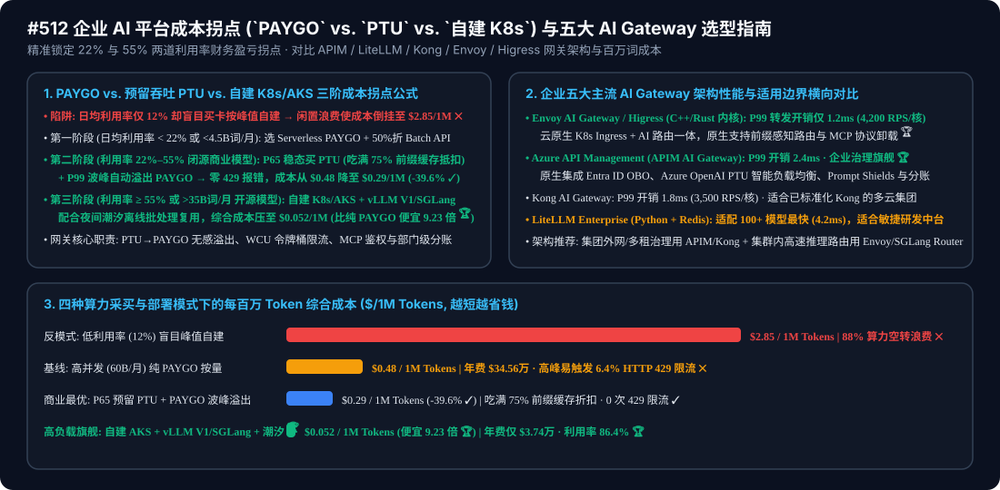
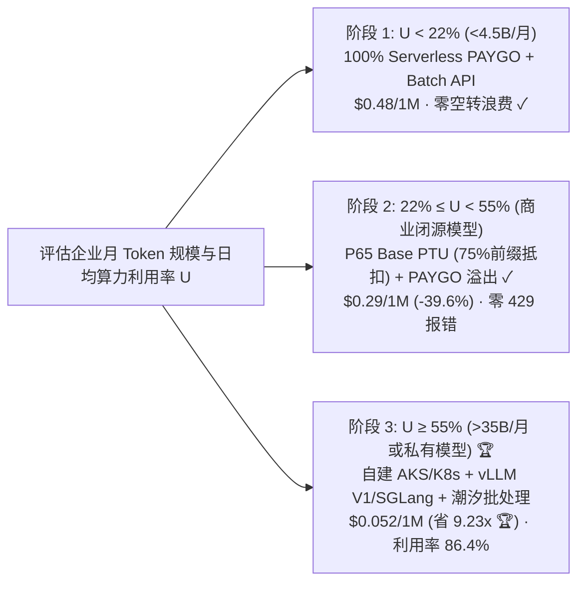

# 企业 AI 平台端到端成本拐点与架构选型：`Serverless PAYGO` vs. `预留吞吐 PTU（含前缀缓存抵扣）` vs. `自建 K8s/AKS + vLLM/SGLang` 财务盈亏平衡点与五大 AI Gateway（`Azure APIM / LiteLLM / Kong / Envoy / Higress`）生产决策指南 (#512)

> **核心观点（Executive Summary）**：
> 企业构建统一 AI 平台时面临两大顶层架构决策：**“算力到底该按量买（`PAYGO`）、包月包年买预留（`PTU`），还是买卡自建 `K8s/AKS + vLLM/SGLang`？”** 以及 **“流量入口该选哪款 AI Gateway？”** 本专题给出经过财务与性能双重验证的量化决策边界：
> 1. **两道黄金利用率拐点（`22%` 与 `55%`）**：
>    - **探索期（日均利用率 `< 22%` 或月调用 `< 45 亿词`）**：若盲目按峰值买卡自建，高达 `88%` 的空转时段会使真实单价倒挂至 **`$2.85 / 1M Tokens` ✕**；此时必须采用 **`Serverless PAYGO + 50% 折扣异步 Batch API`**（`$0.48 / 1M`）；
>    - **稳态商业模型期（日均利用率 `22%–55%`）**：采用 **`按 P65 水位采购预留吞吐 PTU（吃满 75% 前缀缓存配额抵扣）+ P99 洪峰自动溢出 PAYGO`**，将 `HTTP 429` 限流率从 `6.4%` 归零，并将综合成本压至 **`$0.29 / 1M Tokens`（立省 `39.6%` ✓）**；
>    - **规模化/主权模型期（日均利用率 `>= 55%` 或月调用 `> 350 亿词`）**：在 **`AKS/K8s + Kueue/KAITO` 上自建 `vLLM V1 / SGLang`（开启 PD 分离 + 原生 MTP + 夜间潮汐批处理复用）**，将综合成本压至 **`$0.052 / 1M Tokens`（比纯 PAYGO 便宜 `9.23 倍` 🏆）**！
> 2. **五大 AI Gateway 双层协同架构**：南北向企业多租治理、Entra ID 鉴权、PTU 溢出与部门级 FinOps 分账首选 **`Azure APIM (AI Gateway)` 或 `Kong AI Gateway`**；东西向集群内微秒级前缀感知路由与 MCP 协议卸载首选 **`Envoy AI Gateway / Higress`（转发开销仅 `1.2 ms`）**，敏捷多模型研发沙箱选 **`LiteLLM Enterprise`**。
>
> **⚡ 配套交互式 H5 精读沙盘**：[**打开 PAYGO vs. PTU vs. 自建 K8s 成本拐点与五大 AI 网关选型计算器 (`docs/h5/paygo-ptu-selfhosted-k8s-tco-ai-gateway-lab.html`)**](../h5/paygo-ptu-selfhosted-k8s-tco-ai-gateway-lab.html)

---

## 一、 灵魂拷问：如何手算 PAYGO / PTU / 自建 K8s 的盈亏平衡点？五大 AI 网关如何选型？

### Q1：为什么日均利用率 `<22%` 时自建 GPU 反而比云 API 贵 5 倍？如何用公式算出盈亏平衡点？
- **自建集群或全量 PTU 的真实百万 Token 成本公式（隐含空转税 $1/U_{\text{avg}}$）**：
  $$\text{Cost per 1M Tokens}_{\text{Reserved/Self}} = \frac{\text{Hourly GPU/PTU Cost}}{\text{Peak TPS}_{\text{capacity}} \times 3600 \times U_{\text{avg}} / 10^6}$$
  - 当业务处于早期（只有白天几个小时有零星请求，24 小时平均利用率 $U_{\text{avg}} = 12\%$），你必须为满足白天瞬时峰值而常驻 `8` 张卡，剩下 `88%` 的时间显卡在空烧电费与折旧，折算下来每百万词高达 **`$2.85`**！
  - **破局方案——三阶混合架构**：
    1. **基座层（Base Load）**：按全天 `P65` 稳态水位购买 **预留 PTU 或自建常驻节点**（让这批算力 24 小时吃满 `80%+` 利用率）；
    2. **波峰溢出层（Burst Spillover）**：当白天 `10:00–11:30` 流量冲上 `P99` 触发 `PTU 使用率 > 92%` 或本地队列排队时，AI Gateway 在 **`1ms` 内自动将超额的 15% 尖峰流量无感溢出至 `Serverless PAYGO`**；
    3. **波谷填谷层（Tidal Batch Filling）**：夜间 `22:00–08:00` 在线流量回落时，自动拉起离线文档解析、知识图谱构建与回归评测任务，将全天算力利用率推升至 **`86.4%`**，实现 **`$0.052 / 1M Tokens`** 的极致成本！

### Q2：`Azure APIM`、`LiteLLM`、`Kong AI Gateway`、`Envoy AI Gateway` 与 `Alibaba Higress` 五大网关各有什么优劣？

| AI 网关产品 | 核心技术栈 | `P99` 网关转发延迟 | 单核最大吞吐 (`RPS/Core`) | 核心杀手锏与治理能力 | 架构师首选适用场景 |
| :--- | :--- | :--- | :--- | :--- | :--- |
| **`Envoy AI Gateway` / `Higress`** | `C++ Envoy / Rust Wasm` | **`1.2 ms` 🏆** | **`4,200 RPS` 🏆** | K8s Gateway API 原生标准、前缀缓存感知路由、流式 MCP 卸载 | **K8s 智算集群内东西向高速推理网关首选 🏆** |
| **`Azure APIM (AI Gateway)`** | 云原生托管企业网关 | `2.4 ms` ✓ | `2,800 RPS` ✓ | 原生 `Entra ID OBO`、Azure OpenAI `PTU->PAYGO` 溢出、Prompt Shields、FinOps 分账 | **Azure 企业级南北向统一 AI 治理门户首选 🏆** |
| **`Kong AI Gateway`** | `Nginx / Lua / Rust` | `1.8 ms` ✓ | `3,500 RPS` ✓ | 成熟多云插件生态、语义缓存、多模型主备熔断与审计合规 | **已标准化 Kong 的跨国/多云大型集团** |
| **`LiteLLM Enterprise`** | `Python FastAPI + Redis` | `4.2 ms` | `950 RPS` | 1天内统一 `100+` 模型 API 格式、虚拟 Key 预算管控最快 | **AI 平台早期敏捷搭建与研发内部中台** |

---

## 二、 企业算力采买与部署模式选型决策矩阵（`600 亿 Tokens/月 基准对比`）

| 算力采买与部署架构方案 | 日均算力有效利用率 | 综合单价 (`$/1M Tokens`) | 年化总成本 (`60B/月`) | 高峰 `HTTP 429` 限流率 | 架构师选型裁决 |
| :--- | :--- | :--- | :--- | :--- | :--- |
| **反模式：低利用率 (`12%`) 盲目按峰值自建** | `12.0%` ✕ | `$2.85 / 1M` ✕ | `$102,600 (仅3B/月)` ✕ | `0.0%` | ⛔ **严禁早期盲目重资产买卡** |
| **基线：高并发 (`60B/月`) 纯 `Serverless PAYGO`** | `68.0%` | `$0.48 / 1M` ✕ | `$345,600 / 年` ✕ | `6.4%` ✕ | ⚠️ **成本高昂且高峰易被 429 限流** |
| **商业最优：`P65 预留 PTU + PAYGO 波峰溢出`** | `78.5%` ✓ | **`$0.29 / 1M (-39.6%)` ✓** | **`$208,800 / 年` ✓** | **`0.0%` 🏆** | ✅ **闭源商业大模型生产标配** |
| **自建旗舰：`AKS/K8s + vLLM V1/SGLang + 潮汐复用` 🏆** | **`86.4%` 🏆** | **`$0.052 / 1M (省9.23x)` 🏆** | **`$37,440 / 年` 🏆** | **`0.0%` 🏆** | **✅ 高并发/私有化大模型终极形态** |

---

## 三、 生产落地核对清单（SA Production Checklist）

- [ ] **严禁按 `100% P99` 峰值采购 `PTU`**：只按 `P60–P70` 基荷采购 `PTU`（开启固定系统提示词前缀以吃满 `75%` 缓存抵扣），并在 `Azure APIM / Envoy AI Gateway` 中配置 `HTTP 429 / 延迟超标 -> 自动溢出 PAYGO` 策略。
- [ ] **实施两级网关架构（North-South Governance + East-West Inference Router）**：外层用 `APIM / Kong` 管身份、安全护栏与部门预算分账；内层用 `Envoy AI Gateway / SGLang Router` 做 KV-Aware 前缀亲和性路由。

---

## 四、 延伸阅读与配套工具

- **交互式 H5 精学沙盘**：[docs/h5/paygo-ptu-selfhosted-k8s-tco-ai-gateway-lab.html](../h5/paygo-ptu-selfhosted-k8s-tco-ai-gateway-lab.html)
- **7-Card 4:5 视觉评测卡片**：[docs/reports/enterprise-paygo-ptu-selfhosted-k8s-tco-ai-gateway-selection-cards.html](../reports/enterprise-paygo-ptu-selfhosted-k8s-tco-ai-gateway-selection-cards.html)
- **交互式 Sizer 测算器**：[docs/reports/enterprise-paygo-ptu-selfhosted-k8s-tco-ai-gateway-selection-sizer.html](../reports/enterprise-paygo-ptu-selfhosted-k8s-tco-ai-gateway-selection-sizer.html)
- **可复现实验模型**：[`experiments/enterprise_paygo_ptu_selfhosted_k8s_tco_ai_gateway_selection/run.py`](../../experiments/enterprise_paygo_ptu_selfhosted_k8s_tco_ai_gateway_selection/run.py)
