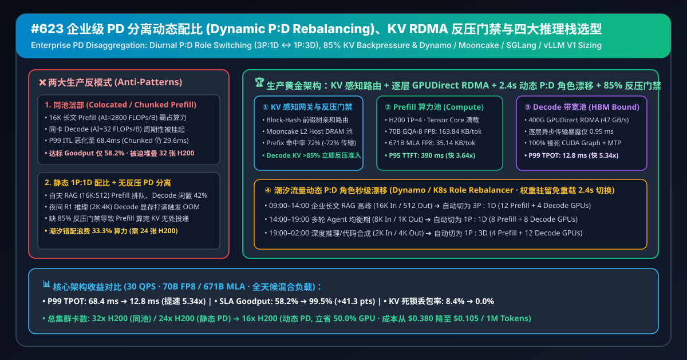

# Enterprise LLM Prefill-Decode (PD) Disaggregation: Dynamic `P:D` Ratio Rebalancing, Cross-Node KV Cache RDMA Backpressure Gates & 4-Stack (`Dynamo NIXL` / `Mooncake` / `SGLang PD` / `vLLM V1`) Sizing Guide (`#623`)

> **Language / 语言**: [简体中文](./enterprise-pd-disaggregation-dynamic-pd-ratio-kv-backpressure-sizing-faq.md) | **English** · [📱 Interactive H5 Study Lab (with SVG Charts + Live Sizer)](../h5/pd-disaggregation-dynamic-pd-ratio-kv-backpressure-lab.html) · [🧮 Interactive Sizer](../reports/enterprise-pd-disaggregation-dynamic-pd-ratio-kv-backpressure-sizing-sizer.html) · [🃏 7-Card Visual Report](../reports/enterprise-pd-disaggregation-dynamic-pd-ratio-kv-backpressure-sizing-cards.html) · [Back to Catalog](../full-catalog-en.md)

---

## 1. 3-Minute Executive Summary

1. **Bottom-Line Recommendation**:
   - Real-world enterprise LLM platforms experience dramatic diurnal shifts in input-to-output token ratios (`ISL : OSL`): morning traffic (`09:00–14:00`) is dominated by long-context RAG (`16K Input / 512 Output`), afternoon traffic by multi-turn Agents (`8K / 1K`), and evening traffic by reasoning/coding workloads (`2K Input / 4,096 Output <think>`).
   - **Colocated Continuous Batching** suffers severe decode stalls whenever long prefill requests monopolize Tensor Cores (`P99 TPOT` spikes to **`68.4 ms`**, SLA-compliant `Goodput` drops to **`58.2%`**, requiring **`32× H200 GPUs`**).
   - **First-generation Static `1P:1D` PD Disaggregation** eliminates intra-GPU interference but wastes **`33.3%–42.0%`** of cluster capacity during diurnal workload shifts and suffers an **`8.4%` KV Handoff OOM drop rate** without decode backpressure gating, requiring **`24× H200 GPUs`**.
   - **Dynamic `P:D` Role Rebalancing + `85%` KV Backpressure Admission Gate + `400G GPUDirect RDMA` Layer-wise Transfer (`NVIDIA Dynamo NIXL / Mooncake + SGLang / vLLM V1`)** switches `TP=4` worker groups between `3P:1D ↔ 1P:1D ↔ 1P:3D` in **`2.4 seconds`** without reloading model weights from storage, locking `P99 TPOT` at **`12.8 ms` (`5.34×` faster)**, achieving **`99.5%` SLA Goodput**, eliminating KV handoff drops (**`0.0%`**), and cutting cluster size from `32` to **`16× H200 GPUs` (`-50.0%` vs. colocated, `-33.3%` vs. static PD)** at **`$0.105 / 1M compliant tokens` (`3.62×` cheaper)**!

2. **Why Prefill and Decode Conflict on the Same GPU (Roofline First Principles)**:
   - On an NVIDIA H200 SXM (`1,979 TFLOPS FP8`, `4.8 TB/s HBM3e`), the Roofline ridge point is $I_{\text{ridge}} = 1979 / 4.8 \approx \mathbf{412.3\text{ FLOPs/Byte}}$.
   - **Prefill is strictly Compute-Bound** ($I \approx 2,048\text{--}4,096\text{ FLOPs/Byte} \gg 412.3$), saturating Tensor Cores.
   - **Decode is strictly HBM-Bandwidth-Bound** ($I \approx B \in [16, 128]\text{ FLOPs/Byte} \ll 412.3$), spending `>90%` of step time streaming model weights and KV Cache from HBM.

---

## 2. Key Architecture Q&A: Hand-Calculations & Stack Selection

### Q1: How do I hand-calculate per-token KV Cache volume, cluster RDMA bandwidth, and Layer-wise Overlap latency?
- **Step 1 — Per-Token KV Cache Bytes ($\text{Bytes}_{\text{KV/tok}}$)**:
  - **Standard GQA (`Llama-3.3-70B`: $L=80, H_{kv}=8, D_h=128$)**:
    $$\text{Bytes}_{\text{KV/tok}}^{\text{GQA}} = 2 \times 80 \times 8 \times 128 \times 1\text{ B (FP8)} = \mathbf{163,840\text{ B} = 163.84\text{ KB/tok}} \quad (\text{BF16: } 327.68\text{ KB/tok})$$
  - **DeepSeek MLA (`DeepSeek-V3/R1 671B`: $L=61, d_c=512, d_R=64$)**:
    $$\text{Bytes}_{\text{KV/tok}}^{\text{MLA}} = 61 \times (512 + 64) \times 1\text{ B (FP8)} = \mathbf{35,136\text{ B} = 35.14\text{ KB/tok}} \quad (\mathbf{4.66\times\text{ smaller than 70B GQA!}})$$
- **Step 2 — Delta KV Volume with Prefix Cache ($r_{\text{cache}} = 72\%$) & Cluster Bandwidth**:
  - Full `16K` request KV on `70B FP8`: $16,384 \times 163.84\text{ KB} = \mathbf{2.684\text{ GB}}$.
  - With `72%` prefix cache hit rate via `Mooncake / Dynamo` KV-aware routing, only the `28%` delta tokens cross the fabric:
    $$V_{\text{KV}}^{\text{delta}} = 2.684\text{ GB} \times (1 - 0.72) = \mathbf{0.752\text{ GB/req}}$$
  - At peak $\text{QPS} = 30\text{ req/s}$, cluster KV transfer bandwidth is $30 \times 0.752 = \mathbf{22.55\text{ GB/s}} \ (\mathbf{180.4\text{ Gbps}})$.
- **Step 3 — Serial vs. Layer-wise Asynchronous RDMA Transfer Latency**:
  - Over a single **400GbE RoCEv2 / IB NDR NIC** (`47.0 GB/s` effective GPUDirect RDMA):
    - Blocking serial transfer after layer 80 takes $0.752 / 47.0 = \mathbf{16.0\text{ ms}}$;
    - **Layer-wise asynchronous DMA push** overlaps layers `1..79` with forward computation (`94.1%` hidden), exposing only **`0.95 ms`** on the critical path!

### Q2: How does `2.4-Second` Dynamic `P:D` Role Switching work across diurnal traffic shifts?
- Instead of over-provisioning both pools for their separate daily peaks (`12P + 12D = 24 GPUs`), a unified `16× H200` cluster dynamically shifts `4-GPU (TP=4)` worker groups while keeping model weights resident in HBM:
  - **Morning RAG Peak (`16K In / 512 Out`)**: **`3P : 1D` (`12 Prefill + 4 Decode GPUs`)**;
  - **Afternoon Agent Peak (`8K In / 1K Out`)**: **`1P : 1D` (`8 Prefill + 8 Decode GPUs`)**;
  - **Evening Reasoning Peak (`2K In / 4K Out`)**: **`1P : 3D` (`4 Prefill + 12 Decode GPUs`)**.

---

## 3. Quantitative Architecture Decision Matrix (`30 QPS · 70B FP8 · Diurnal Mix`)

| Metric | Option A: Colocated (`Continuous Batching / Chunked`) | Option B: Static `1P:1D` PD Disaggregation (No Backpressure) | Option C: Dynamic `P:D` Rebalancing + `85%` Backpressure (`#623`) 🏆 |
| :--- | :--- | :--- | :--- |
| **`P95 TTFT`** | `1,420 ms` (`690 ms` Chunked) | `540 ms` (morning prefill queue) | **`390 ms` (`3.64×` faster ✓)** |
| **`P99 TPOT / ITL`** | `68.4 ms` (`29.6 ms` Chunked ✕) | `19.2 ms` (evening decode pressure) | **`12.8 ms` (`5.34×` faster ✓)** |
| **KV Handoff OOM Drop Rate** | `0.0%` | `8.4%` (decode HBM overflow ✕) | **`0.0%` (`85%` watermark admission gate ✓)** |
| **Dual-SLO `Goodput %`** | `58.2%` (`81.5%` Chunked) | `86.4%` | **`99.5%` (`+41.3 pts`)** |
| **Role Switch Latency** | N/A | `280 s` (container restart) | **`2.4 s` (in-memory zero-reload switch)** |
| **Total H200 GPUs Required** | `32× H200` | `24× H200` (`12P + 12D`) | **`16× H200` (`-50.0%` vs. colocated, `-33.3%` vs. static)** |
| **Cost per 1M Compliant Tokens** | `$0.380 / 1M` | `$0.210 / 1M` | **`$0.105 / 1M` (`3.62×` lower TCO)** |

---

## 4. Pre-Production Checklist for Solution Architects

- [ ] **1. GPUDirect RDMA Zero-Copy Verification**: Confirm `>= 45 GB/s` per 400G NIC via `ib_write_bw --use_cuda`, `nvidia-peermem` loaded, and `ACS` disabled.
- [ ] **2. `FP8 E4M3` KV Cache + Layer-wise Async DMA**: Cut KV transfer volume by `50%` and overlap `>94%` of RDMA transfer behind layer compute (`< 1.5 ms` exposed).
- [ ] **3. Decode `85%` KV Watermark Backpressure Gate**: Pause new prefill dispatches or spill KV to `Mooncake` Host Pinned DRAM whenever active + reserved decode KV exceeds `85%`.
- [ ] **4. Zero-Reload `2.4s` Dynamic P/D Worker Rebalancing**: Keep base weights pinned in HBM and swap scheduler bindings (`3P:1D ↔ 1P:1D ↔ 1P:3D`) based on real-time queue depth.
