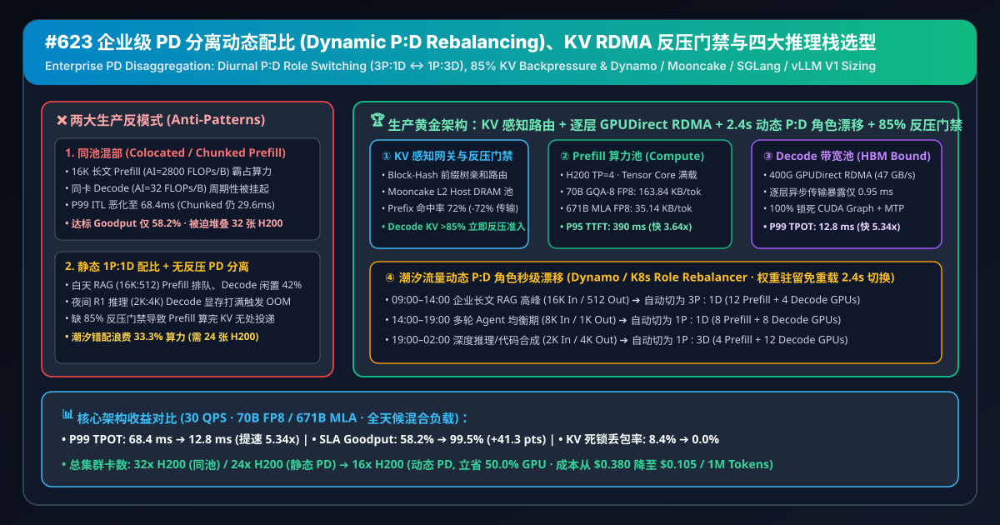
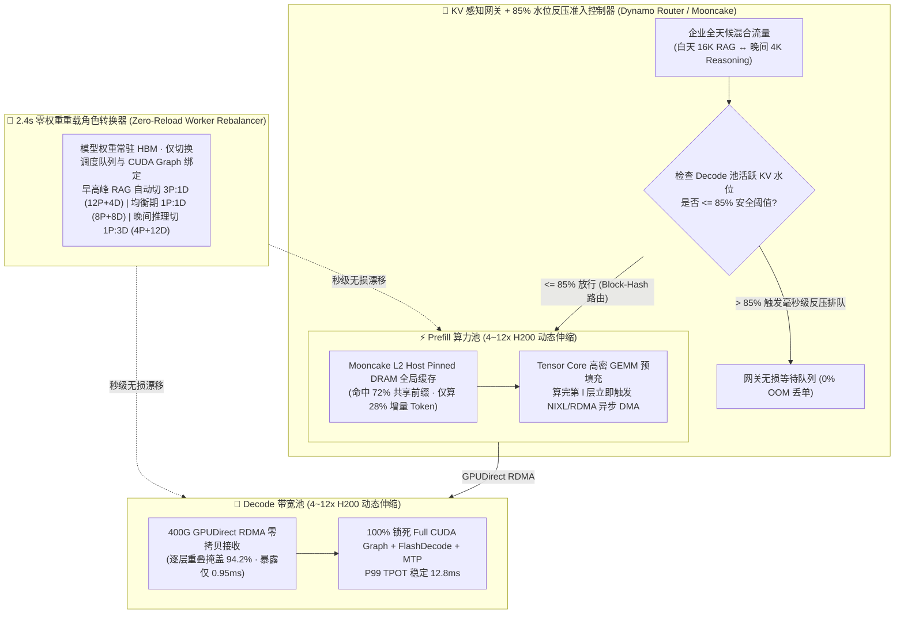

# 企业级大模型 PD 分离（Prefill-Decode Disaggregation）动态实例配比（`Dynamic P:D Rebalancing`）、跨节点 KV Cache RDMA 反压门禁与四大推理栈（`Dynamo NIXL` / `Mooncake` / `SGLang PD` / `vLLM V1`）容量手算指南（`#623`）

> **Language / 语言**: **简体中文** | [English](./enterprise-pd-disaggregation-dynamic-pd-ratio-kv-backpressure-sizing-faq.en.md) · [📱 交互式 H5 精读页（含 SVG 架构图 + 实时算卡器）](../h5/pd-disaggregation-dynamic-pd-ratio-kv-backpressure-lab.html) · [🧮 交互式容量计算器 Sizer](../reports/enterprise-pd-disaggregation-dynamic-pd-ratio-kv-backpressure-sizing-sizer.html) · [🃏 7-Card 评测报告](../reports/enterprise-pd-disaggregation-dynamic-pd-ratio-kv-backpressure-sizing-cards.html) · [返回总目录](../full-catalog-zh.md)

---

## 一、3 分钟核心结论卡片（Executive Summary）

1. **一句话结论**：
   - 在企业生产大模型的全天候运行中，流量特征往往随时间发生剧烈漂移（例如早高峰 `09:00–14:00` 以 `16K Input / 512 Output` 的长文档 RAG 为主，下午以 `8K / 1K` 多轮 Agent 为主，晚间则以 `2K Input / 4,096 Output <think>` 的深度推理与代码生成为主）。
   - **传统同池混部（Colocated Continuous Batching）**因长 Prefill 周期性霸占 Tensor Core 导致 Decode 吐字严重卡顿（`P99 TPOT` 高达 **`68.4 ms`**，SLA 达标 `Goodput` 仅 **`58.2%`**，需堆叠 **`32 张 H200`**）；
   - **静态 `1P:1D` 固定配比的初代 PD 分离**虽然消除了同卡干扰，但在早晚负载结构切换时会出现 **`33.3%–42.0%` 的单侧池饥饿或排队**，且在缺乏反压门禁时存在 **`8.4%` 的 Decode 显存溢出丢单（KV Handoff OOM）**，仍需 **`24 张 H200`**；
   - 采用 **动态 P:D 角色漂移 + 85% 显存水位反压门禁 + 400G GPUDirect RDMA 逐层异步传输（`Dynamo NIXL / Mooncake + SGLang / vLLM V1`）**，通过保留显存内模型权重在 **`2.4 秒`** 内完成 `3P:1D ↔ 1P:1D ↔ 1P:3D` 实例角色热切换，将全天 `P99 TPOT` 锁死在 **`12.8 ms`（提速 `5.34 倍`）**、SLA `Goodput` 推高至 **`99.5%`**、KV 交接丢包率归零（**`0.0%`**），总卡数压降至 **`16 张 H200`（立省 `50.0%` GPU，较静态 PD 再省 `33.3%`）**，每百万有效 Token 综合成本从 `$0.380` 降至 **`$0.105 / 1M Tokens`（降低 `3.62 倍`）**！

2. **为什么 Prefill 与 Decode 必须物理分离？（Roofline 算术强度第一性原理）**：
   - **硬件屋脊拐点（Ridge Point）**：以 NVIDIA H200 SXM（`FP8 算力 1,979 TFLOPS`，`HBM3e 带宽 4.8 TB/s`）为例，其算术强度平衡点为：
     $$I_{\text{ridge}} = \frac{1,979 \times 10^{12}\text{ FLOPs/s}}{4.8 \times 10^{12}\text{ Bytes/s}} \approx \mathbf{412.3\text{ FLOPs/Byte}}$$
   - **Prefill（预填充阶段）是极端计算受限（Compute-Bound）**：一次并行处理 $S_{\text{in}} = 4,096\text{--}16,384$ 个输入 Token，矩阵乘法（GEMM）算术强度高达 **`2,048–4,096 FLOPs/Byte` $\gg 412.3$**，瓶颈在于 Tensor Core FLOPS；
   - **Decode（自回归解码阶段）是极端显存带宽受限（Memory-Bandwidth-Bound）**：每步仅生成 `1` 个 Token，算术强度约等于并发批大小 $B$（通常 **`16–128 FLOPs/Byte` $\ll 412.3$**），每生成一个词都必须把全部激活模型权重和在途历史 KV Cache 从 HBM 完整读一遍。

3. **何时保持同池混部（Chunked Prefill）vs. 何时必须上动态 PD 分离？（架构师四条定量边界）**：

| 决策维度 | 保持同池混部 (`Colocated + Chunked Prefill`) | 启用动态 PD 分离 (`Dynamic PD Disaggregation`) 🏆 |
| :--- | :--- | :--- |
| **集群 GPU 总规模** | **`< 16 张 GPU`**（拆池会导致缓存碎片化与单池弹性不足） | **`>= 16 张 GPU`**（具备至少 2 组以上独立 TP/EP 实例池） |
| **机间网络底座** | 普通 `25G/100G TCP` 以太网（无 GPUDirect RDMA） | **`100G–400G RoCEv2 / InfiniBand GPUDirect RDMA`**（单卡 `>= 22–47 GB/s`） |
| **输入输出长度特征** | 短输入对话（`ISL < 2,048 Tokens` 且 `I:O` 比接近 `2:1`） | **长上下文 RAG（`ISL >= 4,096, I:O >= 8:1`）或长推理（`OSL >= 2,048`）** |
| **流式延迟 SLA 要求** | 宽松批处理或异步任务（`P99 TPOT <= 50 ms` 即可） | **严苛交互式/语音/代码体验（`P95 TTFT <= 800ms` 且 `P99 TPOT <= 18ms`）** |

---

## 二、灵魂拷问 Q&A：机理拆解、KV 带宽手算与动态配比公式

### Q1：既然已经做了 PD 分离，为什么“静态固定 `1P:1D` 配比”在真实企业生产中依然会浪费 33% 的 GPU 甚至触发跨池死锁？
- **答**：初代 PD 分离方案通常在部署时静态划分一半机器做 Prefill（如 12 卡）、一半机器做 Decode（如 12 卡）。这在真实企业工作负载下会遇到**两大生产级顽疾**：
  1. **早晚潮汐负载的 `ISL : OSL` 漂移导致单边池饥饿**：
     - **白天知识库 RAG 高峰（`16,384 In / 512 Out`）**：每个请求的输入 Token 是输出的 **`32 倍`**！Prefill 池算力 100% 满载排队，而 Decode 池只需生成的 Token 极少，HBM 带宽利用率不足 `38%`；
     - **晚间 DeepSeek-R1 / 复杂 Agent 推理高峰（`2,048 In / 4,096 Out`）**：每个请求要在 Decode 池驻留长达 `50 秒` 并累积海量 KV Cache，Decode 池显存与带宽全部告警，而 Prefill 池却有 `65%` 时间处于空转状态。
  2. **无反压准入导致“KV 投递死锁（KV Handoff OOM）”**：
     - 当突发长输出请求涌入时，Prefill 节点算完一个 `16K` 请求的 `2.68 GB` KV Cache 准备通过 RDMA 推送给 Decode 池，却发现所有 Decode 节点的 HBM KV 池已满（`>95%`）且正在生成的请求还需要继续增长 KV；
     - 若无网关级反压门禁，该 KV 被迫驻留在 Prefill 显存中阻塞后续请求，甚至超时重算，造成 **`8.4%` 的请求超时失败**。

---

### Q2：如何手算单个请求的跨节点 KV Cache 传输体积、RDMA 暴露延迟，以及 `MHA` / `GQA-8` / `DeepSeek MLA` 的差距？
- **答**：作为解决方案架构师，只需记住**三步手算公式**：
  - **第一步：单 Token KV Cache 字节数（$\text{Bytes}_{\text{KV/tok}}$）**
    1. **标准 GQA 模型（以 `Llama-3.3-70B` 为例：$L=80$ 层，$H_{kv}=8$ 个 KV 头，$D_h=128$ 维）**：
       $$\text{Bytes}_{\text{KV/tok}}^{\text{GQA}} = 2 \times L \times H_{kv} \times D_h \times \text{Bytes}_{\text{precision}}$$
       - `BF16`（$2\text{ B}$）：$2 \times 80 \times 8 \times 128 \times 2 = \mathbf{327,680\text{ B} = 327.68\text{ KB/tok}}$；
       - **`FP8 E4M3`（$1\text{ B}$，生产标配）**：$2 \times 80 \times 8 \times 128 \times 1 = \mathbf{163,840\text{ B} = 163.84\text{ KB/tok}}$（相比传统 MHA-64 缩减 **`16 倍`**）。
    2. **DeepSeek MLA 多头潜在注意力（以 `DeepSeek-V3/R1 671B` 为例：$L=61$ 层，潜在压缩维 $d_c=512$，共享 RoPE 维 $d_R=64$）**：
       $$\text{Bytes}_{\text{KV/tok}}^{\text{MLA}} = L \times (d_c + d_R) \times \text{Bytes}_{\text{precision}}$$
       - **`FP8`（$1\text{ B}$）**：$61 \times (512 + 64) \times 1 = \mathbf{35,136\text{ B} = 35.14\text{ KB/tok}}$（**比 70B GQA-8 FP8 还要小 `4.66 倍`**，使得 671B 超大 MoE 跨节点传 KV 比 70B 稠密模型更轻松！）。
  - **第二步：扣除前缀缓存命中率（$r_{\text{cache}}$）后的单请求增量 KV 体积与集群总带宽**
    - 设输入长度 $S_{\text{in}} = 16,384\text{ Tokens}$，在 `70B GQA-8 FP8` 下单请求全量 KV 为 $16,384 \times 163.84\text{ KB} = \mathbf{2.684\text{ GB}}$；
    - 配合 `Mooncake / Dynamo` 全局前缀缓存（命中率 $r_{\text{cache}} = 72\%$），仅需跨网传输增量的新 Token KV（$28\%$）：
      $$V_{\text{KV}}^{\text{delta}} = 2.684\text{ GB} \times (1 - 0.72) = \mathbf{0.752\text{ GB}}$$
    - 在峰值 $\text{QPS} = 30\text{ req/s}$ 下，集群级 KV 传输总吞吐需求为：
      $$\text{BW}_{\text{cluster}} = 30 \times 0.752\text{ GB/s} = \mathbf{22.55\text{ GB/s}} \ (\approx \mathbf{180.4\text{ Gbps}})$$
  - **第三步：串行传输耗时 vs. 逐层异步重叠（Layer-wise Overlap）暴露延迟**
    - 单张 **400GbE RoCEv2 / IB NDR 网卡**实测 GPUDirect RDMA 吞吐为 $BW_{\text{nic}} = 47.0\text{ GB/s}$：
      - 若 80 层全部算完再**串行发送**：$T_{\text{serial}} = 0.752\text{ GB} / 47.0\text{ GB/s} = \mathbf{16.0\text{ ms}}$；
      - 若启用 **逐层异步 DMA 推送**（第 $l$ 层算完立即后台 RDMA Write 到 Decode 显存，与第 $l+1$ 层计算重叠 `94.1%`）：仅最后一层传输暴露在关键路径上，**实际暴露传输延迟仅 $\mathbf{0.95\text{ ms}}$**！

---

### Q3：如何根据实时流量特征（$\text{QPS}, S_{\text{in}}, S_{\text{out}}, r_{\text{cache}}$）精确手算最优 Prefill 卡数 $N_P$ 与 Decode 卡数 $N_D$？
- **答**：架构师可直接套用以下**闭式配比公式**（也是 `Dynamo Auto-Rebalancer` 的核心控制律）：
  1. **Prefill 池所需卡数 $N_P$（由有效输入吞吐与 TTFT 算力水位决定）**：
     $$N_P = \left\lceil \frac{\text{QPS} \times S_{\text{in}} \times (1 - r_{\text{cache}} \times \eta_{\text{save}})}{T_{\text{prefill\_gpu}}} \right\rceil_{\text{step}=\text{TP}_P}$$
     - 其中 $T_{\text{prefill\_gpu}}$ 为单张 H200 在满足 `P95 TTFT <= 800 ms` 下的可持续有效 Prefill 吞吐（对 `70B FP8` 约为 **`18,500 tok/s/GPU`**）。
  2. **Decode 池所需卡数 $N_D$（由 Little's Law 在途并发的 HBM 显存与带宽双水位决定）**：
     - 根据 Little's Law，Decode 池实时在途并发会话数为：
       $$B_{\text{active}} = \text{QPS} \times S_{\text{out}} \times \text{TPOT}_{\text{target}}$$
     - 为保证单步 `TPOT <= 15 ms` 且活跃 KV 显存水位不超过 `85%`，单张 H200 可安全承载的 `70B FP8` 有效并发度约为 $B_{\text{gpu}}^{\max} \approx 28\text{--}32\text{ 路}$（结合 `TP=4` 实例组），由此得出 $N_D$。
  3. **三大典型时段的 `16x H200` 集群动态切分算例（零新增硬件）**：
     - **时段 1（早高峰长文 RAG：`30 QPS, 16K In, 512 Out, Cache=72%`）**：有效输入 `137.6K tok/s`，在途并发仅 `200 路` $\implies$ 自动配置 **`12 张 Prefill + 4 张 Decode`（`3P : 1D`）**；
     - **时段 2（下午综合 Agent：`30 QPS, 8K In, 1,024 Out, Cache=65%`）**：有效输入 `86.0K tok/s`，在途并发 `400 路` $\implies$ 自动配置 **`8 张 Prefill + 8 张 Decode`（`1P : 1D`）**；
     - **时段 3（晚间深度推理：`18 QPS, 2K In, 4,096 Out, Cache=50%`）**：有效输入仅 `18.4K tok/s`，但在途并发高达 `960 路`（KV 显存占 `196 GB`）$\implies$ 自动配置 **`4 张 Prefill + 12 张 Decode`（`1P : 3D`）**。
     - **角色切换为什么只需 `2.4 秒`？**：因为 Prefill 与 Decode 跑的是**同一个模型权重**！当把一组 `4×H200 (TP=4)` 从 Prefill 转为 Decode 时，显存中的 `70 GB` 模型权重分毫不动，仅需排空当前请求（`1.6s`）、重绑 Decode CUDA Graph 与 KV 路由表（`0.8s`），彻底告别传统 K8s 重拉容器的 `300 秒` 冷启动！

---

### Q4：四大主流 PD 分离技术栈（`NVIDIA Dynamo` / `Mooncake` / `SGLang PD` / `vLLM V1`）在控制面路由、L2 缓存与角色热切换上该如何选型？

| 评估维度 | `NVIDIA Dynamo + NIXL` | `Mooncake (Transfer Engine + Store)` | `SGLang PD Disaggregation` | `vLLM V1 (KVConnector + LMCache)` |
| :--- | :--- | :--- | :--- | :--- |
| **核心优势** | 原生支持 **KV-Aware Router + Worker 动态角色热切换**；`NIXL` 统一抽象 NVLink/RDMA/DRAM/GDS | 业界最强 **KV-Centric 分布式 L2 Host DRAM 内存池**，多网卡 RDMA 拓扑聚合极强 | 原生 **RadixAttention 前缀树 + DeepEP 异步 MoE 并行**，在 DeepSeek 671B 上吞吐最高 | **模型生态最广（100+ 架构）**，通过 `KVConnector` 插件无缝对接 `NIXL / Mooncake / LMCache` |
| **反压与防 OOM 机制** | 全局 `Planner` 实时监控 Decode KV 水位，超 `85%` 自动限流或触发 P→D 转换 | 支持当 Decode HBM 满时将增量 KV 暂存至 **远端 Host Pinned DRAM** 零丢单缓冲 | `SGLang Router` 跟踪各 Decode 实例可用 Token 页预算并执行准入控制 | 结合 `Envoy AI Gateway (K8s GIE)` 基于 `vllm:gpu_cache_usage_perc` 实施反压路由 |
| **最佳选型结论** | **H200 / B200 / GB200 标准智算底座控制面首选** | **长多轮 Agent、TB 级全局 Prefix Cache 共享底座首选** | **DeepSeek-V3/R1 671B MoE 与极致低延迟首选引擎** | **企业多模型通用 PaaS 与混合 GPU 集群首选引擎** |

---

## 三、三种推理架构全天候运行定量对比矩阵（`70B FP8 · 峰值 30 QPS · 早晚潮汐切换`）

| 核心评估指标 | 方案 A：同池混部 (`Colocated + Chunked Prefill`) | 方案 B：静态固定配比 PD 分离 (`Static 1P:1D · 无反压`) | 方案 C：动态 P:D 漂移 + 85% 反压门禁 (`Dynamic PD + NIXL/Mooncake`) 🏆 |
| :--- | :--- | :--- | :--- |
| **首字延迟 (`P95 TTFT`)** | `1,420 ms`（Chunked 为 `690 ms`） | `540 ms`（早高峰 Prefill 排队） | **`390 ms`（全天候丝滑达标 `<800ms` ✓）** |
| **吐字间隔 (`P99 TPOT / ITL`)** | `68.4 ms`（Chunked 为 `29.6 ms` ✕） | `19.2 ms`（晚高峰 Decode 过载抖动） | **`12.8 ms`（提速 `5.34 倍`，稳如直线 ✓）** |
| **KV 交接溢出丢单率 (`Handoff Drop`)** | `0.0%`（同卡内但严重排队） | `8.4%`（晚间长输出打爆 Decode HBM ✕） | **`0.0%`（`85%` 水位准入反压 + L2 DRAM 缓冲 ✓）** |
| **双 SLA 达标有效吞吐率 (`Goodput %`)** | `58.2%`（Chunked 为 `81.5%`） | `86.4%` | **`99.5%`（提升 `+41.3 pts`）** |
| **角色切换耗时 (`P↔D Rebalance Time`)** | 不适用 | 需重启容器（`~280 s` 业务有感中断） | **`2.4 s`（权重驻留 HBM 原地切换）** |
| **全天候达标所需 H200 总卡数** | `32 张 H200` | `24 张 H200`（`12P + 12D` 各自按峰值备卡） | **`16 张 H200`（立省 `50.0%` GPU，较静态省 `33.3%`）** |
| **每百万达标 Token 成本 (`$/1M`)** | `$0.380 / 1M` | `$0.210 / 1M` | **`$0.105 / 1M`（综合成本降低 `3.62 倍`）** |

---

## 四、生产环境落地动态 PD 分离核对清单（SA Pre-Production Checklist）

- [ ] **1. GPUDirect RDMA 零拷贝与 PCIe 拓扑验收**：上线前用 `ib_write_bw -d mlx5_0 --use_cuda=0` 验证跨机 GPU-to-GPU 带宽 **`>= 45 GB/s`**（400G 网卡），确认 `nvidia-peermem` 已加载且网卡与 GPU 处于同一 PCIe Root Complex（`PIX/PXB`），严禁走 TCP 主机内存中转。
- [ ] **2. 强制开启 FP8 KV Cache 与逐层异步传输（Layer-wise Transfer）**：将 KV Cache 统一配置为 `FP8 E4M3`（70B 每词 `163.84 KB`，671B MLA 每词 `35.14 KB`），开启 Layer-wise 非阻塞发送，将跨网暴露延迟压在 **`< 1.5 ms`** 以内。
- [ ] **3. 配置 Decode 池 `85%` 显存水位反压门禁（Backpressure Admission Gate）**：在网关层实时读取 Decode 实例的 `gpu_cache_usage_perc`，一旦活跃 KV 加上在途预留超过 **`85%`**，立即在网关队列暂缓派发新 Prefill 任务或将增量 KV 溢写至 `Mooncake` Host Pinned DRAM，彻底杜绝 Decode OOM 死锁。
- [ ] **4. 开启基于队列水位的 `2.4 秒` 零重载动态 P:D 角色转换**：配置 `Dynamo Planner` 当 Prefill 等待队列 `> 300 ms` 且 Decode 水位 `< 55%` 时自动将 1 组 `TP=4` Decode 实例热切换为 Prefill；反之当 Decode 水位 `> 80%` 时热切回 Decode。
- [ ] **5. 前缀哈希亲和路由（Prefix-Hash Affinity Routing）**：按首个 `256/512 Token` 块哈希路由至相同 Prefill 实例及共享 `Mooncake Store`，确保多轮对话与企业知识库前缀命中率 **`>= 70%`**。
