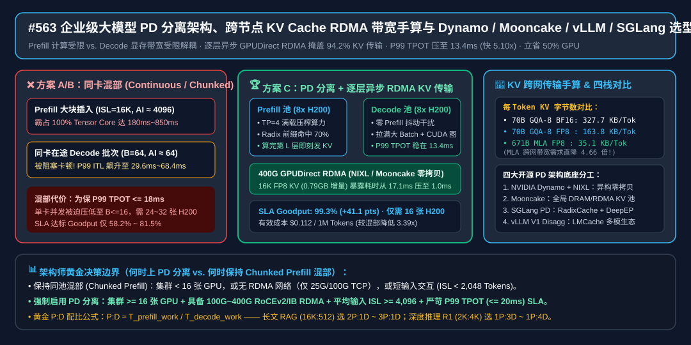

# Enterprise LLM Prefill-Decode (PD) Disaggregation Architecture, Cross-Node KV Cache RDMA Bandwidth Hand-Calculation & Four-Stack (`Dynamo` / `Mooncake` / `vLLM V1` / `SGLang`) Selection Guide (`#563`)

> **Language / 语言**: [简体中文](./enterprise-pd-disaggregation-kv-rdma-dynamo-mooncake-sizing-faq.md) | **English** · [📱 Interactive H5 Study Lab (SVG Diagrams + Live Sizer)](../h5/pd-disaggregation-kv-rdma-dynamo-mooncake-vllm-sglang-lab.html) · [🧮 Interactive HTML Sizer](../reports/enterprise-pd-disaggregation-kv-rdma-dynamo-mooncake-sizing-sizer.html) · [🃏 7-Card Visual Report](../reports/enterprise-pd-disaggregation-kv-rdma-dynamo-mooncake-sizing-cards.html) · [Back to Catalog](../full-catalog-en.md)

---

## 1. 3-Minute Executive Summary

1. **Bottom-Line Conclusion**:
   - Under enterprise long-context high-concurrency workloads (`16K Input + 512 Output` RAG or multi-turn agents at `30 Peak QPS`, targeting `P95 TTFT <= 800 ms` and `P99 TPOT <= 18 ms`), traditional **Colocated Continuous Batching** suffers severe head-of-line blocking as compute-heavy Prefills monopolize Tensor Cores, pushing `P99 TPOT` to **`68.4 ms`** and dropping SLA-compliant `Goodput` to **`58.2%`**.
   - Even with **Chunked Prefill (`2,048-token` chunks)** enabled, tail `P99 TPOT` remains at **`29.6 ms`** (violating the `18 ms` target) and requires over-provisioning **`24x H200 GPUs`**.
   - Adopting **PD Disaggregation (`NVIDIA Dynamo / Mooncake + 400G GPUDirect RDMA + Layer-wise Async KV Transfer`)** physically isolates the compute-bound Prefill pool (`8x H200`) from the memory-bandwidth-bound Decode pool (`8x H200`). Layer-wise non-blocking RDMA hides **`94.2%`** of cross-node KV transfer time (`17.1 ms -> 1.0 ms` exposed), locks `P99 TPOT` at **`13.4 ms` (`5.10x` faster)**, raises SLA `Goodput` to **`99.3%`**, cuts fleet size from `32` to **`16x H200 GPUs` (`-50.0%` GPUs)**, and reduces effective cost per 1M goodput tokens from `$0.380` to **`$0.112` (`3.39x` lower)**!
2. **Why Prefill and Decode Collide on the Same GPU (Roofline First Principles)**:
   - **Prefill is Compute-Bound**: Processing thousands of prompt tokens in parallel yields an arithmetic intensity of **`2,000–4,096 FLOPs/Byte`**, far above the H200 Roofline ridge point (`~412 FLOPs/Byte`).
   - **Decode is HBM-Bandwidth-Bound**: Generating `1` token per step per active request yields an arithmetic intensity approximately equal to batch size $B$ (`16–128 FLOPs/Byte`), spending >90% of execution time streaming model weights and KV Cache from HBM3e.
   - **When To Stay Colocated vs. Disaggregate**: Keep **Colocated + Chunked Prefill** when cluster size is `< 16 GPUs`, when RDMA is unavailable (TCP-only), or when prompts are short (`ISL < 2,048`). Mandate **PD Disaggregation** when cluster size is `>= 16 GPUs` with `100G–400G RoCEv2/IB RDMA`, `ISL >= 4,096`, and strict `P99 TPOT <= 20 ms` SLAs.

---

## 2. Deep-Dive Q&A: Hand-Calculations for KV Cache RDMA Bandwidth & P:D Pool Sizing

### Q1: How do Solution Architects hand-calculate per-request KV Cache size and cluster-wide RDMA bandwidth for PD Disaggregation?
- **Answer**:
  1. **Per-Token KV Cache Footprint ($\text{Bytes}_{\text{KV/tok}}$)**:
     - **`Llama-3.3-70B` (`GQA-8`, $L=80, H_{kv}=8, D_h=128$)**:
       - `BF16` ($2\text{ Bytes}$): $2 \times 80 \times 8 \times 128 \times 2 = \mathbf{327.68\text{ KB/Token}}$
       - `FP8 E4M3 KV` ($1\text{ Byte}$): $2 \times 80 \times 8 \times 128 \times 1 = \mathbf{163.84\text{ KB/Token}}$
     - **`DeepSeek-V3/R1 671B` (`MLA`, $L=61, d_c=512, d_R=64$)**:
       - `FP8 KV` ($1\text{ Byte}$): $61 \times (512 + 64) \times 1 = \mathbf{35.14\text{ KB/Token}}$ (**`4.66x` smaller** than 70B GQA-8 FP8!).
  2. **Incremental KV Payload per Request ($S_{\text{in}}=16,384$, Prefix Cache Hit Rate $r_{\text{cache}}=70\%$)**:
     - Full 16K KV (`70B FP8`): $16,384 \times 163.84\text{ KB} = \mathbf{2.684\text{ GB}}$.
     - Delta KV transferred across RDMA ($30\%$ uncached): $2.684\text{ GB} \times 0.30 = \mathbf{0.805\text{ GB}}$.
  3. **Exposed Transfer Latency with Layer-wise Overlap on 400G GPUDirect RDMA (`47.0 GB/s` effective)**:
     - Serial blocking transfer after layer 80: $0.805 / 47.0 = \mathbf{17.1\text{ ms}}$.
     - Layer-wise async DMA (`NIXL / Mooncake` overlaps layers $1..79$ with compute): only **`1.0 ms`** exposed (`94.2%` hidden).
  4. **Cluster Aggregate KV Bandwidth at `30 Peak QPS`**:
     - $\text{BW}_{\text{cluster}} = 30 \times 0.805\text{ GB/s} = \mathbf{24.15\text{ GB/s}} \ (\approx \mathbf{193.2\text{ Gbps}})$, easily served by multi-rail 400G RoCEv2/IB NICs.

---

### Q2: How do `NVIDIA Dynamo (NIXL)`, `Mooncake`, `SGLang PD`, and `vLLM V1 Disaggregated` compare?

| Dimension | `NVIDIA Dynamo + NIXL` | `Mooncake` | `SGLang PD Disaggregation` | `vLLM V1 + LMCache` |
| :--- | :--- | :--- | :--- | :--- |
| **Core Strength** | Datacenter control plane + `NIXL` heterogeneous zero-copy transport & dynamic P/D worker autoscaling | KV-centric distributed Host Pinned DRAM + multi-NIC RDMA global KV pool | Native `RadixAttention` tree + layer-wise RDMA + `DeepEP` MoE integration | Broadest `100+` model ecosystem + pluggable `KVConnector` & K8s integration |
| **Best Fit** | Standardized H200 / B200 / GB200 NVL72 enterprise AI factories | Multi-turn long-context agents needing TB-scale pooled DRAM KV cache | DeepSeek-V3/R1 671B MoE & ultra-low-latency agent pipelines | Multi-model enterprise PaaS platforms on Kubernetes |

---

## 3. Quantitative Architecture Decision Matrix (`30 QPS · 16K In / 512 Out · 70B FP8`)

| Metric | Scheme A: Colocated Continuous Batching | Scheme B: Colocated + Chunked Prefill (`2K`) | Scheme C: PD Disaggregation (`Dynamo/Mooncake + 400G RDMA`) 🏆 |
| :--- | :--- | :--- | :--- |
| **`P95 TTFT`** | `1,420 ms` (SLA Breach ✕) | `690 ms` | **`410 ms` (`3.46x` faster)** |
| **`P99 TPOT / ITL`** | `68.4 ms` (Severe Stutter ✕) | `29.6 ms` (Misses `18ms` SLA ✕) | **`13.4 ms` (`5.10x` faster ✓)** |
| **SLA-Compliant `Goodput %`** | `58.2%` | `81.5%` | **`99.3%` (`+41.1 pts`)** |
| **Compliant `Goodput tok/s/GPU`** | `480 tok/s` | `760 tok/s` | **`1,620 tok/s` (`3.38x`)** |
| **Exposed KV Transfer Latency** | `0 ms` | `0 ms` | **`1.0 ms` (`94.2%` hidden)** |
| **Required H200 Fleet Size** | `32x H200 GPUs` | `24x H200 GPUs` | **`16x H200 GPUs` (`8P + 8D`, `-50.0%` GPUs)** |
| **Effective Cost (`$/1M Goodput Tokens`)** | `$0.380 / 1M` | `$0.245 / 1M` | **`$0.112 / 1M` (`3.39x` lower)** |

---

## 4. Solution Architect Pre-Production Checklist

- [ ] **Verify GPUDirect RDMA Zero-Copy (`>= 45 GB/s` per 400G NIC)** with `nvidia-peermem` loaded and PCIe `ACS` disabled.
- [ ] **Enable `FP8 E4M3` KV Cache & Layer-wise Non-Blocking Transfer** (`< 2 ms` exposed handoff overhead).
- [ ] **Deploy KV-Aware Prefix Routing** (`>= 65%` prefix hit rate across P and D pools).
- [ ] **Configure Decode HBM Admission Backpressure at `85%` Watermark** to prevent post-Prefill KV drop deadlocks.
