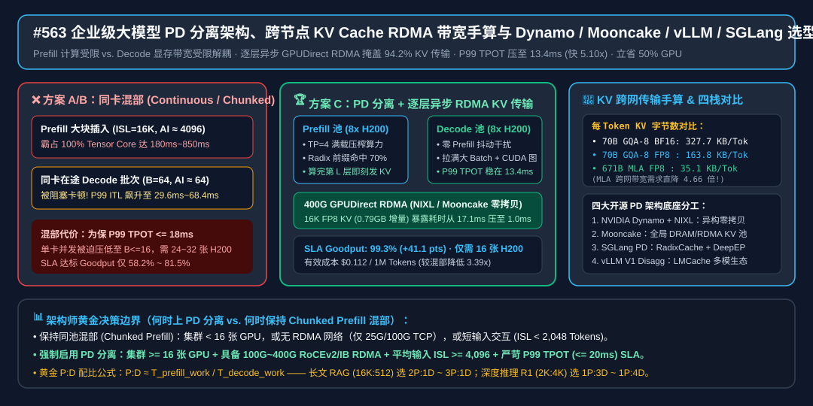
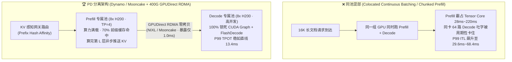

# 企业级大模型 PD 分离（Prefill-Decode Disaggregation）架构实战、跨节点 KV Cache RDMA 带宽手算与四大推理栈（`Dynamo` / `Mooncake` / `vLLM V1` / `SGLang`）选型指南（`#563`）

> **Language / 语言**: **简体中文** | [English](./enterprise-pd-disaggregation-kv-rdma-dynamo-mooncake-sizing-faq.en.md) · [📱 交互式 H5 精读页（含 SVG 图表 + 实时算卡器）](../h5/pd-disaggregation-kv-rdma-dynamo-mooncake-vllm-sglang-lab.html) · [🧮 交互式算卡器 Sizer](../reports/enterprise-pd-disaggregation-kv-rdma-dynamo-mooncake-sizing-sizer.html) · [🃏 7-Card 评测报告](../reports/enterprise-pd-disaggregation-kv-rdma-dynamo-mooncake-sizing-cards.html) · [返回总目录](../full-catalog-zh.md)

---

## 一、3 分钟核心结论卡片（Executive Summary）

1. **一句话结论**：
   - 在企业高并发长上下文场景（如 `16K Input + 512 Output` 的企业知识库 RAG 或多轮 Agent，峰值 `30 QPS`，要求 `P95 TTFT <= 800 ms` 且 `P99 TPOT <= 18 ms`）下，传统的**同卡混部连续批处理（Colocated Continuous Batching）**会因长 Prefill 抢占 Tensor Core 导致 Decode 吐字严重卡顿（`P99 TPOT` 恶化至 **`68.4 ms`**，SLA 达标有效吞吐 `Goodput` 仅 **`58.2%`**）；
   - 即便开启 **Chunked Prefill（分块预填充）**，仍存在 **`29.6 ms`** 的尾部抖动与双阶段算子减速，需堆叠 **`24 张 H200`** 才能勉强扛住流量；
   - 采用 **PD 分离架构（`NVIDIA Dynamo / Mooncake + 400G GPUDirect RDMA + 逐层异步 KV 传输`）**，将计算密集型 Prefill 池（`8 张 H200`）与访存带宽密集型 Decode 池（`8 张 H200`）物理隔离，不仅把跨节点 KV 传输暴露延迟从 `17.1 ms` 压缩至 **`1.0 ms`（掩盖 `94.2%`）**，更将 `P99 TPOT` 稳定在 **`13.4 ms`（提速 `5.10 倍`）**、SLA `Goodput` 推升至 **`99.3%`**，所需总卡数从 `32 张` 降至 **`16 张 H200`（立省 `50.0%` GPU）**，单百万有效 Token 成本从 `$0.380` 降至 **`$0.112`（降低 `3.39 倍`）**！
2. **为什么 Prefill 与 Decode 放在同一张 GPU 上天然水火不容？（Roofline 第一性原理）**：
   - **Prefill（预填充阶段）是典型的算力受限（Compute-Bound）**：一次处理上万个输入 Token，矩阵乘法维度大，算术强度（Arithmetic Intensity）高达 **`2,000–4,096 FLOPs/Byte`**，远超 H200 的屋脊拐点（`~412 FLOPs/Byte`），目标是把 Tensor Core 算力吃满；
   - **Decode（自回归解码阶段）是典型的显存带宽受限（Memory-Bandwidth-Bound）**：每个并发请求每步只生成 `1` 个 Token，算术强度约等于批大小 $B$（通常 `16–128 FLOPs/Byte`），90% 以上时间花在从 HBM 高带宽显存搬运模型权重和历史 KV Cache 上；
   - **混部冲突根源**：当一个 `16K Token` 的长请求进入混部实例做 Prefill 时，会瞬间独占 GPU 算力达 `180–450 ms`，导致同卡正在流式输出的数十个 Decode 请求被迫挂起等待（形成周期性“卡顿尖峰”）。
3. **何时必须上 PD 分离 vs. 何时保持同池混部？（架构师四条硬边界）**：
   - **保持同池混部（开启 `Chunked Prefill`）**：① 集群总规模 **`< 16 张 GPU`**；② 机间无 RDMA 网络（仅有普通 `25G/100G TCP` 以太网）；③ 短提示词交互（平均 `ISL < 2,048 Tokens`）；④ 离线异步批处理任务（不敏感 `P99 ITL`）。
   - **果断切换 PD 分离架构**：① 集群规模 **`>= 16 张 GPU`**；② 具备 **`100G–400G RoCEv2 / InfiniBand GPUDirect RDMA`**；③ 平均输入 **`ISL >= 4,096 Tokens`** 且输入输出悬殊（如 RAG `I:O >= 8:1` 或 Reasoning `1:2`）；④ 业务要求严苛的流式体验（`P99 TPOT/ITL <= 20 ms`）。

---

## 二、灵魂拷问 Q&A：机理拆解、KV 带宽手算与四大推理栈对比

### Q1：很多团队认为“开启 vLLM / SGLang 的 Chunked Prefill 就能解决混部卡顿”，为什么在 16K+ 长上下文高并发下 Chunked Prefill 依然会失守 SLA？
- **答**：`Chunked Prefill` 将一个 `16K` 的长输入切分成例如 `8 个 2,048 Token` 的小块，在每个小块中顺带捎上当前在途的 Decode Token 一起跑前向（Piggybacking）。它确实消除了数百毫秒的极端停顿，但带来了**三重隐性架构税**：
  1. **每步时延被 Chunk 大小硬绑定**：跑一个 `2,048 Token` 的 Prefill Chunk 仍需约 `24–32 ms`，这意味着哪怕 Decode 本身只需 `11 ms`，混入 Chunk 后的单步耗时也会直接突破 `25–30 ms`，无法满足语音/代码/流畅对话 `< 18 ms` 的 `P99 ITL` 红线；
  2. **破坏 Decode 阶段的 CUDA Graph 与算子甜点**：纯 Decode 批次可以通过 `Piecewise / Full CUDA Graph` 将 CPU 启动开销压至 `0.15 ms` 并使用专门针对小矩阵优化的 `FlashDecode` 内核；一旦与动态长度的 Prefill Chunk 拼在一起，矩阵形状退化，有效算力利用率下降 `18%–25%`；
  3. **HBM 带宽双向挤压**：Prefill Chunk 在计算注意力时还需反复读取前序 Chunk 的历史 KV Cache（当切块越细，重复读取历史 KV 的带宽放大倍数越高），反而抢走了 Decode 赖以生存的 HBM 带宽。

---

### Q2：PD 分离最核心的工程瓶颈是“把 Prefill 算出的 KV Cache 传给 Decode 节点”。作为架构师，如何手算单个请求的 KV Cache 体积与全集群所需的 RDMA 网络带宽？
- **答**：这是架构师评审 PD 分离网络方案时的**必考手算公式**。
  - **第一步：计算单个 Token 的 KV Cache 字节数（$\text{Bytes}_{\text{KV/tok}}$）**
    - **标准 MHA / GQA 模型（以 `Llama-3.3-70B` 为例，层数 $L=80$，KV 头数 $H_{kv}=8$，头维 $D_h=128$）**：
      $$\text{Bytes}_{\text{KV/tok}} = 2 \ (\text{K与V}) \times L \times H_{kv} \times D_h \times \text{Bytes}_{\text{elem}}$$
      - 若采用 `BF16/FP16`（$2\text{ Bytes}$）：$2 \times 80 \times 8 \times 128 \times 2 = \mathbf{327,680\text{ Bytes} \approx 327.68\text{ KB/Token}}$；
      - 若采用 **`FP8 E4M3 KV Cache`**（$1\text{ Byte}$，生产首选）：$2 \times 80 \times 8 \times 128 \times 1 = \mathbf{163,840\text{ Bytes} \approx 163.84\text{ KB/Token}}$。
    - **DeepSeek MLA 架构（以 `DeepSeek-V3/R1 671B` 为例，层数 $L=61$，压缩潜向量 $d_c=512$，解耦共享 RoPE 维 $d_R=64$）**：
      $$\text{Bytes}_{\text{KV/tok}}^{\text{MLA}} = L \times (d_c + d_R) \times \text{Bytes}_{\text{elem}}$$
      - 采用 `FP8 KV`（$1\text{ Byte}$）：$61 \times (512 + 64) \times 1 = \mathbf{35,136\text{ Bytes} \approx 35.14\text{ KB/Token}}$（**比 70B GQA-8 FP8 还要小 `4.66 倍`**，天然适合跨节点 PD 分离！）。
  - **第二步：计算单次请求的增量跨网传输量（扣除 Prefix Cache 命中率 $r_{\text{cache}}$）**
    - 设平均输入长度 $S_{\text{in}} = 16,384\text{ Tokens}$，以 `70B GQA-8 FP8` 为例，完整单请求 KV 体积为：
      $$V_{\text{KV}}^{\text{full}} = 16,384 \times 163.84\text{ KB} = \mathbf{2.684\text{ GB} \ (2.50\text{ GiB})}$$
    - 当通过 KV 感知路由命中 Decode/全局池 $r_{\text{cache}} = 70\%$ 的共享前缀时，仅需跨网传输增量的新 Token KV（$30\%$）：
      $$V_{\text{KV}}^{\text{delta}} = 2.684\text{ GB} \times (1 - 0.70) = \mathbf{0.805\text{ GB}}$$
  - **第三步：计算单请求网络传输耗时与“逐层异步流水线（Layer-wise Overlap）”收益**
    - 在单张 **400GbE RoCEv2 / InfiniBand NDR 网卡**（实测 GPUDirect RDMA 有效吞吐 `47.0 GB/s`）上：
      - 若等 80 层全部算完再**串行阻塞发送**：传输耗时 $T_{\text{serial}} = 0.805\text{ GB} / 47.0\text{ GB/s} = \mathbf{17.1\text{ ms}}$；
      - 若采用 `NVIDIA Dynamo (NIXL)` 或 `Mooncake` 的**逐层异步非阻塞传输**（Prefill 算完第 $l$ 层立即由后台 DMA 队列推送第 $l$ 层 KV，与第 $l+1$ 层矩阵计算完全重叠）：仅最后一层（第 80 层）的 KV 传输暴露在关键路径上，**实际暴露传输延迟骤降至 $\mathbf{1.0\text{ ms}}$（掩盖率高达 `94.2%`）**！
  - **第四步：计算集群级总 KV 传输带宽需求（$\text{BW}_{\text{cluster}}$）**
    - 当集群承载峰值 $\text{QPS} = 30\text{ req/s}$ 时：
      $$\text{BW}_{\text{cluster}} = \text{QPS} \times V_{\text{KV}}^{\text{delta}} = 30 \times 0.805\text{ GB/s} = \mathbf{24.15\text{ GB/s}} \ (\approx \mathbf{193.2\text{ Gbps}})$$
    - 分摊到 2 台 8 卡 Prefill 节点（每节点配 `4~8 张 400G RDMA 网卡`，单节点聚合出口 `200–376 GB/s`），网络带宽水位仅占 **`6.4%–12.1%`**，完全充裕；但若退化到无 RDMA 的普通 `25GbE TCP` 主机网卡（实测仅 `2.2 GB/s`），单请求传输就要卡死 **`366 ms`**，此时绝不可开启跨机 PD 分离！

---

### Q3：如何科学确定 Prefill 池与 Decode 池的 GPU 卡数配比（`P:D Ratio`）？
- **答**：切忌拍脑袋按 `1:1` 固定划分！最优 `P:D` 实例配比取决于**业务请求的输入输出长度比（`ISL : OSL`）与前缀缓存命中率**。
  - **架构师速算准则**：分别用“三道水位线”算出支撑峰值 `QPS` 所需的 Prefill 卡数 $N_P$（由有效输入 Token 吞吐 $\text{TPS}_{\text{in}} = \text{QPS} \times S_{\text{in}} \times (1 - r_{\text{cache}})$ 与 `TTFT` SLA 决定）和 Decode 卡数 $N_D$（由 Little's Law 在途并发 $B_{\text{active}} = \text{QPS} \times S_{\text{out}} \times \text{TPOT}$ 的 KV 显存与 HBM 带宽决定）：
    1. **长文档 RAG / 合同审阅 / 代码库问答（`ISL=16K~32K, OSL=512`，重 Prefill）**：推荐 **`2P : 1D` 至 `3P : 1D`**；
    2. **企业综合对话与多轮 Agent（`ISL=8K~16K, OSL=512~1K`，开启 70% Prefix Cache）**：推荐 **`1P : 1D`**（如本算例 `8P + 8D = 16 张 H200`）；
    3. **深度推理模型（`DeepSeek-R1 / QwQ`，`ISL=2K, OSL=4K~8K <think>`，重 Decode）**：推荐 **`1P : 3D` 至 `1P : 4D`**。

---

### Q4：当前主流四大 PD 分离开源与企业技术栈（`NVIDIA Dynamo` / `Mooncake` / `vLLM V1 Disagg` / `SGLang PD`）各自架构优劣势与选型边界是什么？

| 技术维度 | `NVIDIA Dynamo + NIXL` | `Mooncake (Kimi / 开源社区)` | `SGLang PD Disaggregation` | `vLLM V1 + LMCache / Disagg` |
| :--- | :--- | :--- | :--- | :--- |
| **核心架构定位** | 面向数据中心级多节点解耦推理的控制面与异构零拷贝传输库（`NIXL`） | 以 KV Cache 为中心（KV-Centric）的全局分布式内存+RDMA 存储与调度引擎 | 原生集成 `RadixAttention` 前缀树、逐层异步 RDMA 传输与 `DeepEP` MoE 并行 | 标准化连接器 API（`KVConnector`）+ `LMCache` 跨实例分层 KV 共享 |
| **KV 跨网传输引擎** | `NIXL`（统一封装 NVLink、GPUDirect RDMA、Host DRAM、GDS 存储零拷贝） | `Mooncake Transfer Engine`（支持多网卡聚合 RDMA 拓扑感知路由与空闲 DRAM 池化） | 基于 `Mooncake / NVSHMEM / GPUDirect RDMA` 非阻塞逐层传输 | `PyNcclPipe / LMCache / MooncakeStore` 插件化后端 |
| **核心杀手锏** | 具备全局 **KV-Aware Router** + 动态 GPU 池扩缩容（可根据队列水位在 P 与 D 之间秒级转换角色） | 能将集群所有服务器闲置的 **CPU Host Pinned DRAM 聚合成 TB 级全局 L2 KV 缓存池** | 在 **DeepSeek 671B MoE（`Attention DP + Expert EP`）与高命中 Agent 前缀复用** 上吞吐领先 | **模型覆盖广度第一**（100+ 架构开箱即用），K8s/KServe 云原生生态最成熟 |
| **最佳适用场景** | 大规模 NVIDIA H200 / B200 / GB200 NVL72 智算中心标准底座 | 超长多轮会话、TB 级全局 Prefix Cache 卸载与多引擎共享内存池 | DeepSeek-V3/R1 满血版、复杂结构化 Agent 与极致低延迟场景 | 企业多模型标准化 PaaS 平台、异构 GPU 共池与平滑演进团队 |

---

## 三、三种推理架构方案定量对比矩阵（`30 QPS · 16K In / 512 Out · 70B FP8`）

| 评估指标 | 方案 A：同池混部 (`Colocated Continuous Batching`) | 方案 B：同池混部 + 分块预填充 (`Chunked Prefill`) | 方案 C：PD 分离 (`Dynamo/Mooncake + 400G RDMA`) 🏆 |
| :--- | :--- | :--- | :--- |
| **首字延迟 (`P95 TTFT`)** | `1,420 ms`（排队严重超标 ✕） | `690 ms` | **`410 ms`（提速 `3.46x`）** |
| **吐字间隔延迟 (`P99 TPOT / ITL`)** | `68.4 ms`（周期性长卡顿 ✕） | `29.6 ms`（仍超 `18ms` 红线 ✕） | **`13.4 ms`（提速 `5.10x`，丝滑流式 ✓）** |
| **双 SLA 达标有效吞吐率 (`Goodput %`)** | `58.2%` | `81.5%` | **`99.3%`（提升 `+41.1 pts`）** |
| **单卡达标有效吞吐 (`Goodput tok/s/GPU`)** | `480 tok/s` | `760 tok/s` | **`1,620 tok/s`（提升 `3.38x`）** |
| **跨节点 KV 传输暴露耗时** | `0 ms`（同卡内） | `0 ms`（同卡内） | **`1.0 ms`（逐层异步掩盖 `94.2%`）** |
| **满足 SLA 所需 H200 总卡数** | `32 张 H200` | `24 张 H200` | **`16 张 H200`（`8P + 8D`，立省 `50.0%` GPU）** |
| **每百万达标 Token 综合成本 (`$/1M`)** | `$0.380 / 1M` | `$0.245 / 1M` | **`$0.112 / 1M`（成本降低 `3.39 倍`）** |

---

## 四、生产环境落地 PD 分离核对清单（SA Pre-Production Checklist）

- [ ] **1. GPUDirect RDMA 零拷贝链路验收**：上线前运行 `perftest (ib_write_bw)` 与 `nccl-tests`，确认 `nvidia-peermem` 已加载、PCIe `ACS` 已关闭，单张 400G 网卡实测 GPU-to-GPU 带宽 **`>= 45 GB/s`**（绝不允许退化到走 CPU 内存中转的 TCP Bounce Buffer）。
- [ ] **2. 开启 FP8 KV Cache 与逐层异步传输（Layer-wise Transfer）**：强制将 KV Cache 量化为 `FP8 E4M3`（传输体积立减 `50%`），并在引擎中开启 Layer-wise 非阻塞发送，确保 KV 跨网暴露延迟 `< 2 ms`。
- [ ] **3. 部署 KV 感知网关路由（KV-Aware Prefix Router）**：在 Prefill 池前端部署 `Dynamo Router / SGLang Router`，按请求前缀块哈希（Block Hash）将相同知识库/System Prompt 的请求路由至同一实例或全局 `Mooncake` DRAM 池，保证 `>= 65%` 前缀命中率。
- [ ] **4. 配置 Decode 池过载反压门禁（Backpressure Watermark）**：当 Decode 池的活跃 KV 显存水位超过 **`85%`** 时，网关立即暂停向 Prefill 池派发新请求（防止 Prefill 算完 KV 却发现 Decode 池无显存接收而引发死锁丢弃）。
- [ ] **5. 自动弹性角色转换（Dynamic P/D Rebalancing）**：针对早晚流量结构变化（白天多长文检索重 Prefill、夜间多长思维链合成重 Decode），通过 `Dynamo` 或 K8s 标签自动调整 `P:D` 实例配比。
