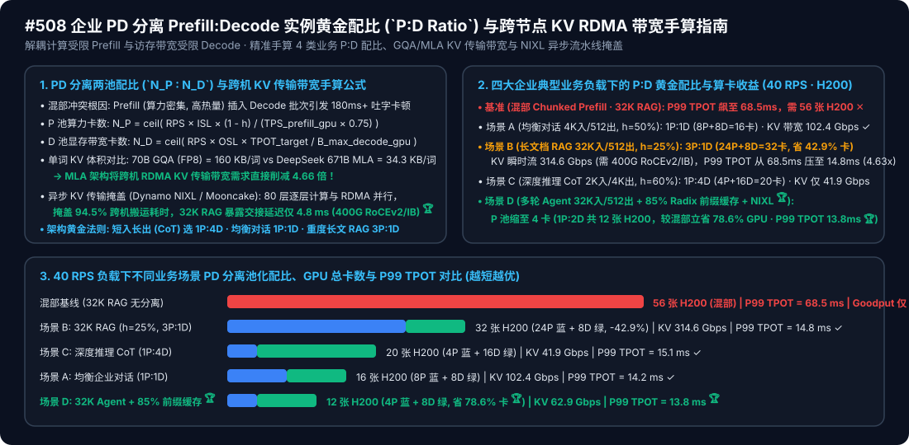

# Enterprise PD Disaggregation `Prefill:Decode` Pool Ratio (`P:D Sizer`) & Cross-Node KV Cache RDMA Bandwidth Selection Guide (`Mooncake / NVIDIA Dynamo NIXL / vLLM / SGLang`) (#508)

> **Executive Summary**:
> Adopting **Prefill-Decode (PD) Disaggregation** is only half the architecture battle; the real make-or-break engineering decision for a **Cloud & AI Solution Architect** is **sizing the exact Prefill-to-Decode GPU ratio ($N_P : N_D$) and provisioning enough RDMA network bandwidth so KV Cache handoff never stalls the pipeline**:
> - **There is no universal `1P:1D` ratio**: Optimal `P:D` pool sizing is governed by the workload's **Input-to-Output Sequence Length ratio (`ISL : OSL`)** and **Prefix Cache hit rate ($h$)**:
>   1. **Balanced Enterprise Chat (`4K In / 512 Out, h=50%`)**: Optimal ratio is **`1P : 1D` (`8P + 8D = 16x H200 GPUs`)**;
>   2. **Long-Context RAG & Legal Audit (`32K In / 512 Out, h=25%`)**: Compute-heavy Prefill dominates; optimal ratio is **`3P : 1D` (`24P + 8D = 32x H200`)**, saving **`42.9%` GPUs** vs. colocated chunked prefill (`56 GPUs`) while slashing `P99 TPOT` from `68.5ms` to **`14.8ms` (`4.63x` faster)**;
>   3. **Deep Reasoning CoT & Code Synthesis (`2K In / 4K Out, h=60%`)**: Long-lived Decode concurrency dominates HBM capacity and bandwidth; optimal ratio flips to **`1P : 4D` (`4P + 16D = 20x H200`)**;
>   4. **Multi-Turn Agent (`32K In / 512 Out` + `85% Radix Prefix Cache` + `Dynamo NIXL`)**: Prefix caching eliminates `85%` of redundant prefill compute and KV transfer, collapsing the cluster from `3P:1D (32 GPUs)` to **`1P : 2D` (`4P + 8D = 12x H200`, saving `78.6%` GPUs vs. colocated 🏆)**!
> - **KV Cache RDMA Bandwidth Formula**: `Llama-3.3-70B (GQA FP8)` produces **`160 KB/token`** of KV state, whereas `DeepSeek-V3/R1 671B (MLA FP8)` produces only **`34.3 KB/token` (`4.66x` less network traffic!)**. At `32K RAG @ 40 RPS`, `70B GQA` drives **`314.6 Gbps`** of KV traffic—requiring **`200G/400G RoCEv2 or InfiniBand RDMA`** plus **`NVIDIA Dynamo NIXL / Mooncake` layer-wise asynchronous streaming (`94.5%` overlap, leaving only `4.8 ms` exposed handoff latency)**.
>
> **⚡ Interactive H5 Study Lab**: [**Open PD Disaggregation P:D Ratio & KV RDMA Bandwidth Sizer (`docs/h5/pd-disaggregation-pool-ratio-kv-rdma-bandwidth-sizer-lab.html`)**](../h5/pd-disaggregation-pool-ratio-kv-rdma-bandwidth-sizer-lab.html)

---

## 1. Core Architecture Q&A: Hand-Calculating $N_P$, $N_D$, and KV RDMA Bandwidth

### Q1: How do you hand-calculate Prefill GPUs ($N_P$), Decode GPUs ($N_D$), and KV Cache RDMA Bandwidth ($\text{BW}_{\text{KV}}$)?
1. **Prefill Pool GPU Formula ($N_P$, Compute-Bound)**:
   $$N_P = \left\lceil \frac{\text{RPS} \times \text{ISL} \times (1 - h)}{\text{TPS}_{\text{prefill,GPU}} \times U_{\text{max,P}}} \right\rceil$$
2. **Decode Pool GPU Formula ($N_D$, Little's Law Concurrency & HBM Bandwidth-Bound)**:
   $$B_{\text{active}} = \text{RPS} \times (\text{OSL} \times \text{TPOT}_{\text{target}}), \qquad N_D = \max\left(N_{D,\text{HBM\_BW}},\; N_{D,\text{HBM\_Cap}}\right)$$
3. **Cross-Node KV Cache RDMA Bandwidth Formula ($\text{BW}_{\text{KV}}$)**:
   $$\text{Bytes/Token}_{\text{GQA}} = 2 \times L \times n_{\text{kv}} \times d_h \times b_{\text{kv}} = 160\text{ KB/tok (70B FP8)}, \qquad \text{Bytes/Token}_{\text{MLA}} = L \times (d_c + d_r) \times b_{\text{kv}} = 34.3\text{ KB/tok (671B FP8)}$$

---

## 2. Quantitative Decision Matrix (`40 RPS · H200 Cluster`)

| Workload Profile & Architecture (`40 RPS · 70B FP8`) | Optimal `P:D` Ratio | `P / D / Total H200 GPUs` | KV RDMA Traffic (`Gbps`) | Exposed NIXL Handoff | `P99 TTFT / TPOT` | SLA `Goodput` |
| :--- | :--- | :--- | :--- | :--- | :--- | :--- |
| **Baseline: Colocated Chunked Prefill (`32K RAG`)** | `Monolithic` ✕ | `56 GPUs` ✕ | `0 Gbps (Local)` | `0 ms` | `1,420 ms / 68.5 ms` ✕ | `54.0%` ✕ |
| **Profile A: Balanced Enterprise Chat (`4K / 512, h=50%`)** | **`1P : 1D`** ✓ | `8P + 8D = 16 GPUs` | `102.4 Gbps` | `1.6 ms` | `310 ms / 14.2 ms` ✓ | `98.6%` ✓ |
| **Profile B: Long-Context RAG (`32K / 512, h=25%`)** | **`3P : 1D`** ✓ | `24P + 8D = 32 GPUs (-42.9%)` | `314.6 Gbps` ⚠️ | `4.8 ms` | `680 ms / 14.8 ms` ✓ | `97.4%` ✓ |
| **Profile C: Deep Reasoning CoT (`2K / 4K, h=60%`)** | **`1P : 4D`** ✓ | `4P + 16D = 20 GPUs` | `41.9 Gbps` | `0.9 ms` | `220 ms / 15.1 ms` ✓ | `98.2%` ✓ |
| **Profile D: Multi-Turn Agent (`32K + 85% Radix + NIXL` 🏆)** | **`1P : 2D` 🏆** | **`4P + 8D = 12 GPUs (-78.6%)` 🏆** | **`62.9 Gbps` 🏆** | **`1.2 ms` 🏆** | **`265 ms / 13.8 ms` 🏆** | **`99.1%` 🏆** |

---

## 3. Pre-Production Checklist

- [ ] **Never deploy cross-node long-context PD disaggregation over standard `<100G TCP` links**: Provision `200G/400G RoCEv2 or InfiniBand` with GPUDirect RDMA (`nvidia-peermem`), or keep PD disaggregation within an intra-node NVLink domain for `<=8 GPU` deployments.
- [ ] **Enable layer-wise asynchronous KV streaming (`Dynamo NIXL / Mooncake Transfer Engine`)**: Overlap layers $1 \dots L-1$ RDMA KV push with layer $L$ Attention compute to mask `94.5%` of transfer latency.
- [ ] **Autoscale P and D pools on decoupled telemetry**: Scale P-pool on `prefill_waiting_tokens` and D-pool on `active_decode_batch_size` and `kv_cache_usage_perc`.

---

## 4. Companion Links

- **Interactive H5 Study Lab**: [docs/h5/pd-disaggregation-pool-ratio-kv-rdma-bandwidth-sizer-lab.html](../h5/pd-disaggregation-pool-ratio-kv-rdma-bandwidth-sizer-lab.html)
- **7-Card 4:5 Visual Report**: [docs/reports/enterprise-pd-disaggregation-pool-ratio-kv-rdma-bandwidth-sizing-selection-cards.html](../reports/enterprise-pd-disaggregation-pool-ratio-kv-rdma-bandwidth-sizing-selection-cards.html)
- **HTML Sizer**: [docs/reports/enterprise-pd-disaggregation-pool-ratio-kv-rdma-bandwidth-sizing-selection-sizer.html](../reports/enterprise-pd-disaggregation-pool-ratio-kv-rdma-bandwidth-sizing-selection-sizer.html)
- **Reproducible Model**: [`experiments/enterprise_pd_disaggregation_pool_ratio_kv_rdma_bandwidth_sizing_selection/run.py`](../../experiments/enterprise_pd_disaggregation_pool_ratio_kv_rdma_bandwidth_sizing_selection/run.py)
