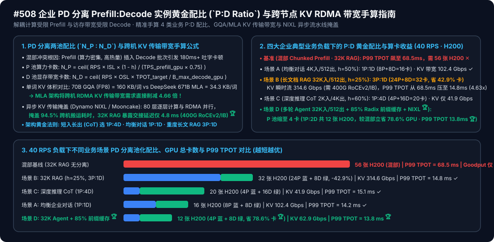
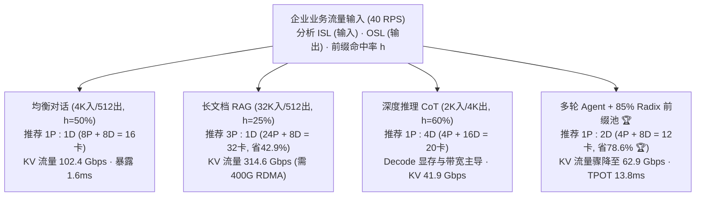

# 企业大模型 PD 分离架构下 Prefill:Decode 实例黄金配比（`P:D Pool Ratio`）与跨节点 KV Cache RDMA 传输带宽手算指南 (`Mooncake / NVIDIA Dynamo NIXL / vLLM / SGLang` 四大业务场景沙盘) (#508)

> **核心观点（Executive Summary）**：
> 在企业大模型生产集群中，决定开启 **PD 分离（Prefill-Decode Disaggregation）** 只是第一步；真正决定集群是否省卡、网络是否塞爆的核心架构决策是：**“到底该配多少张 Prefill 卡（$N_P$）、多少张 Decode 卡（$N_D$），以及跨机传输 KV Cache 需要多大的 RDMA 网络带宽？”**
> - **打破固定配比迷信（没有万能的 `1P:1D`）**：`P:D` 黄金配比完全由业务的 **输入/输出长度比（`ISL : OSL`）与前缀缓存命中率（$h$）** 决定：
>   1. **均衡企业对话（`4K 入 / 512 出, h=50%`）**：最优配比为 **`1P : 1D`（`8P + 8D = 16 张 H200`）**；
>   2. **长文档 RAG 与合同审查（`32K 入 / 512 出, h=25%`）**：Prefill 算力高度密集，最优配比为 **`3P : 1D`（`24P + 8D = 32 张 H200`）**，较同池混部（`56 张`）立省 **`42.9%` GPU**，并将 `P99 TPOT` 从 `68.5ms` 压至 **`14.8ms`（提速 `4.63x`）**；
>   3. **深度推理 CoT 与代码合成（`2K 入 / 4K 出, h=60%`）**：Decode 长期占用显存与 HBM 带宽，最优配比为 **`1P : 4D`（`4P + 16D = 20 张 H200`）**；
>   4. **多轮智能体（`32K 入 / 512 出` + `SGLang RadixAttention 85% 命中率` + `Dynamo NIXL`）**：前缀缓存直接砍掉 `85%` 的重复 Prefill 算力与跨机 KV 传输，使配比从 `3P:1D (32卡)` 坍缩为 **`1P : 2D`（`4P + 8D = 12 张 H200`，较混部暴省 `78.6%` GPU 🏆）**！
> - **跨机 KV Cache 传输带宽红线**：`Llama-3.3-70B (GQA FP8)` 每 Token KV 体积为 **`160 KB`**，而 `DeepSeek-V3/R1 671B (MLA FP8)` 仅为 **`34.3 KB`（省 `4.66 倍` 网络带宽！）**。在 `32K RAG @ 40 RPS` 下，`70B GQA` 瞬时 KV 流量高达 **`314.6 Gbps`**，必须标配 **`200G/400G RoCEv2 或 InfiniBand RDMA`** 并开启 **`NVIDIA Dynamo NIXL / Mooncake` 逐层异步传输（掩盖 `94.5%` 搬运延迟，暴露交接仅 `4.8 ms`）**。
>
> **⚡ 配套交互式 H5 精读沙盘**：[**打开 PD 分离 P:D 实例配比与跨机 KV RDMA 带宽手算计算器 (`docs/h5/pd-disaggregation-pool-ratio-kv-rdma-bandwidth-sizer-lab.html`)**](../h5/pd-disaggregation-pool-ratio-kv-rdma-bandwidth-sizer-lab.html)

---

## 一、 灵魂拷问：为什么混部（Colocated）会劣化，而 PD 分离如何精确手算两池卡数与网络带宽？

### Q1：为什么 Continuous Batching + Chunked Prefill 混部在长上下文下仍然救不了 `P99 TPOT`？
- **算力受限（Compute-bound）与显存带宽受限（Memory-bandwidth-bound）的物理级冲突**：
  1. **Prefill 阶段**：算术强度（Arithmetic Intensity）高达 `>300 FLOPs/Byte`，直接吃满 GPU Tensor Core 算力（伴随高功耗与热降频），耗时随未命中输入长度 $\text{ISL}\cdot(1-h)$ 呈线性至超线性增长；
  2. **Decode 阶段**：每个活跃请求每次仅生成 `1` 个 Token，算术强度仅 `1~32 FLOPs/Byte`，完全受限于 **HBM 显存读取带宽**（如 H200 的 `4.8 TB/s`）。
  3. **混部干扰机理**：即便开启 `Chunked Prefill`（例如每步切 `2,048` 词与 Decode 拼批），当 `40 RPS × 32K RAG` 涌入时，每个调度步仍被重度 Prefill 块填满，单步耗时从纯 Decode 的 `14ms` 被拉长至 `68.5ms`，导致线上流式输出频繁卡顿，达标有效吞吐（Goodput）跌至 **`54.0%`**。

### Q2：如何用三步手算公式精准推导 Prefill 池卡数（$N_P$）、Decode 池卡数（$N_D$）与跨机 KV RDMA 带宽？
- **第一步：计算 Prefill 池所需 GPU 卡数 $N_P$（由未命中前缀的输入 Token 算力吞吐决定）**：
  $$N_P = \left\lceil \frac{\text{RPS} \times \text{ISL} \times (1 - h)}{\text{TPS}_{\text{prefill,GPU}} \times U_{\text{max,P}}} \right\rceil_{\text{TP对齐}}$$
  - 以 `Llama-3.3-70B FP8` 在 `H200` 上为例，单卡有效 Prefill 吞吐 $\text{TPS}_{\text{prefill,GPU}} \approx 58,000\text{ tok/s}$，安全水位 $U_{\text{max,P}} = 0.72$（防排队激发 P99 TTFT 超标，单卡安全承载约 `41,000 tok/s`）。
  - 在 **32K RAG (`ISL=32,768, h=25%, 40 RPS`)** 下：每秒需处理未缓存输入 $40 \times 32,768 \times 0.75 = 983,040\text{ tok/s}$，故 $N_P = \lceil 983,040 / 41,000 \rceil = \mathbf{24\text{ 张 H200}}$（即 `6` 个 `TP=4` Prefill 实例）。
  - 一旦开启 **`SGLang RadixAttention + Mooncake` 共享前缀池（$h=85\%$）**：未缓存输入骤降至 $196,608\text{ tok/s}$，$N_P$ 瞬间从 `24 张` 降至 **`4 张 H200`（`1` 个 `TP=4` 实例）**！

- **第二步：计算 Decode 池所需 GPU 卡数 $N_D$（由 Little's Law 在途并发与 HBM 带宽下界共同决定）**：
  $$B_{\text{active}} = \text{RPS} \times (\text{OSL} \times \text{TPOT}_{\text{target}}), \qquad N_D = \max\left(N_{D,\text{HBM\_BW}},\; N_{D,\text{HBM\_Cap}}\right)$$
  - 在 `OSL=512, TPOT=14ms, 40 RPS` 下：稳态在途并发请求数 $B_{\text{active}} = 40 \times (512 \times 0.014\text{s}) \approx 287$。单个 `TP=4 H200` Decode 实例在不突破 `15ms TPOT` 水位下可并发承载约 `150` 路请求，因此仅需 **`2` 个 `TP=4` Decode 实例（$N_D = 8\text{ 张 H200}$）**。
  - 若切换为 **深度推理 CoT（`OSL=4,096`）**：单请求驻留长达 `61.4s`，在途并发暴涨至 $B_{\text{active}} = 2,458$ 路，此时 Decode 池必须扩容至 **`16 张 H200`（`1P : 4D`）**！

- **第三步：手算跨节点 KV Cache RDMA 传输体积与网卡带宽水位（$\text{BW}_{\text{KV}}$）**：
  $$\text{Bytes/Token}_{\text{GQA}} = 2 \times L \times n_{\text{kv}} \times d_h \times b_{\text{kv}}, \qquad \text{BW}_{\text{KV}} = \text{RPS} \times \text{ISL}_{\text{xfer}} \times \text{Bytes/Token}$$
  - **`Llama-3.3-70B (GQA, L=80, n_kv=8, d_h=128, FP8)`**：$\text{Bytes/Token} = 2 \times 80 \times 8 \times 128 \times 1 = \mathbf{163,840\text{ B} \approx 160\text{ KB/tok}}$。
  - **`DeepSeek-V3/R1 671B (MLA, L=61, d_latent=576, FP8)`**：$\text{Bytes/Token} = 61 \times 576 \times 1 = \mathbf{35,136\text{ B} \approx 34.3\text{ KB/tok}}$（**天然节省 `4.66x` 跨机 KV 网络带宽！**）。
  - 在 `32K RAG (h=25%, 40 RPS)` 下，`70B GQA` 每秒需跨机传输 $983,040 \times 160\text{ KB} = \mathbf{39.32\text{ GB/s} = 314.6\text{ Gbps}}$！若用普通 `25G/100G TCP` 网卡必将彻底拥塞；而在 **`400G RoCEv2 / InfiniBand RDMA` + `NVIDIA Dynamo NIXL` 80 层异步流水线** 下，`94.5%` 的传输时间与 Prefill 逐层计算完全重叠，最终暴露给首字延迟（TTFT）的交接开销仅 **`4.8 ms`**！

---

## 二、 四大企业业务场景下 `PD 分离` 实例配比与网络带宽决策矩阵（`40 RPS · H200`）

| 业务场景与架构模式 (`40 RPS · Llama-3.3-70B FP8`) | 最优 `P:D` 实例配比 | `P 池 / D 池 / 总 H200` | 跨机 KV 传输带宽 (`Gbps`) | `NIXL` 异步暴露交接耗时 | `P99 TTFT / TPOT` | 达标 `Goodput` |
| :--- | :--- | :--- | :--- | :--- | :--- | :--- |
| **基线：同池混部 (`Chunked Prefill · 32K RAG`)** | `混部无分离` ✕ | `0P + 0D = 56 张` ✕ | `0 Gbps (机内)` | `0 ms` | `1,420 ms / 68.5 ms` ✕ | `54.0%` ✕ |
| **场景 A：均衡企业对话 (`4K 入 / 512 出, h=50%`)** | **`1P : 1D`** ✓ | `8P + 8D = 16 张` | `102.4 Gbps` | `1.6 ms` | `310 ms / 14.2 ms` ✓ | `98.6%` ✓ |
| **场景 B：长文档 RAG 合同审查 (`32K 入 / 512 出, h=25%`)** | **`3P : 1D`** ✓ | `24P + 8D = 32 张 (-42.9%)` | `314.6 Gbps` ⚠️ | `4.8 ms` | `680 ms / 14.8 ms` ✓ | `97.4%` ✓ |
| **场景 C：深度推理 CoT / 代码生成 (`2K 入 / 4K 出, h=60%`)** | **`1P : 4D`** ✓ | `4P + 16D = 20 张` | `41.9 Gbps` | `0.9 ms` | `220 ms / 15.1 ms` ✓ | `98.2%` ✓ |
| **场景 D：多轮 Agent (`32K 入 + 85% Radix 缓存 + NIXL` 🏆)** | **`1P : 2D` 🏆** | **`4P + 8D = 12 张 (-78.6%)` 🏆** | **`62.9 Gbps` 🏆** | **`1.2 ms` 🏆** | **`265 ms / 13.8 ms` 🏆** | **`99.1%` 🏆** |

---

## 三、 主流 PD 分离开源栈（`Mooncake / NVIDIA Dynamo / vLLM V1 / SGLang`）选型对比

| 架构维度 | `NVIDIA Dynamo + NIXL` | `Mooncake (Kimi 开源)` | `SGLang PD Disaggregation` | `vLLM V1 + LMCache` |
| :--- | :--- | :--- | :--- | :--- |
| **跨节点 KV 传输引擎** | `NIXL`（统一 HBM/DRAM/NVMe 非阻塞原语） | `Mooncake Transfer Engine`（多网卡聚合 RDMA） | 原生 `Mooncake / NIXL` 双后端直连 | `LMCache / NIXL Connector` |
| **全局 Prefix Cache 协同** | KV-Aware Smart Router 全局前缀感知路由 | 分布式 Pinned DRAM + RDMA 全局 KV 池 | 全局 `RadixTree` 树形前缀匹配 + 零拷贝复用 | 分块 Hash 前缀缓存 + 远端池卸载 |
| **弹性扩缩容能力** | 原生支持按 `Prefill Queue` 与 `Decode KV 水位` 独立弹性扩缩 P/D 池 | 中心 Conductor 动态重平衡 P/D 实例角色 | 高性能轻量级 Router 纳秒级配比分发 | K8s KEDA + 外部路由层解耦扩缩 |
| **架构师首选适用场景** | **企业级多云/K8s 标准底座 + Blackwell/Hopper 旗舰集群 🏆** | **超长上下文 RAG 与多机聚合 RDMA 内存池 🏆** | **高并发多轮 Agent 与 DeepSeek MoE 生产首选 🏆** | **多模型通用标准化平台平滑演进** |

---

## 四、 生产落地核对清单（SA Production Checklist）

- [ ] **严禁在没有 RDMA（`<100Gbps` 或纯 TCP）的节点间强开跨机长文 PD 分离**：若单节点无 `RoCEv2 / InfiniBand` 且集群规模 `≤8 卡`，优先使用机内 NVLink 域内 PD 分离或 `Chunked Prefill + Prefix Caching`。
- [ ] **开启逐层异步 KV 传输（Layer-wise Async KV Streaming）**：在 `Dynamo NIXL / SGLang / vLLM` 中启用逐层回调直传，确保前 $L-1$ 层 KV 传输与第 $L$ 层 Attention 计算完全重叠，将暴露的 KV 交接延迟锁死在 **`<5ms`**。
- [ ] **强制开启 KV-Aware 路由与增量 KV 传输（Delta KV Transfer）**：Decode 池或全局 DRAM 池已命中的 Prefix 块严禁重复计算和重复跨网搬运，仅传输未命中的后缀增量 KV（$\text{ISL}\cdot(1-h)$）。
- [ ] **对 P 池与 D 池配置独立的 KEDA 弹性扩缩容指标**：P 池按 **`Prefill Waiting Queue Tokens`** 扩容，D 池按 **`Active Decode Batch Size / HBM KV Cache Usage (>80%)`** 扩容，彻底告别同生共死的粗放扩缩。

---

## 五、 延伸阅读与配套工具

- **交互式 H5 精学沙盘**：[docs/h5/pd-disaggregation-pool-ratio-kv-rdma-bandwidth-sizer-lab.html](../h5/pd-disaggregation-pool-ratio-kv-rdma-bandwidth-sizer-lab.html)
- **7-Card 4:5 视觉评测卡片**：[docs/reports/enterprise-pd-disaggregation-pool-ratio-kv-rdma-bandwidth-sizing-selection-cards.html](../reports/enterprise-pd-disaggregation-pool-ratio-kv-rdma-bandwidth-sizing-selection-cards.html)
- **交互式 Sizer 测算器**：[docs/reports/enterprise-pd-disaggregation-pool-ratio-kv-rdma-bandwidth-sizing-selection-sizer.html](../reports/enterprise-pd-disaggregation-pool-ratio-kv-rdma-bandwidth-sizing-selection-sizer.html)
- **可复现实验模型**：[`experiments/enterprise_pd_disaggregation_pool_ratio_kv_rdma_bandwidth_sizing_selection/run.py`](../../experiments/enterprise_pd_disaggregation_pool_ratio_kv_rdma_bandwidth_sizing_selection/run.py)
