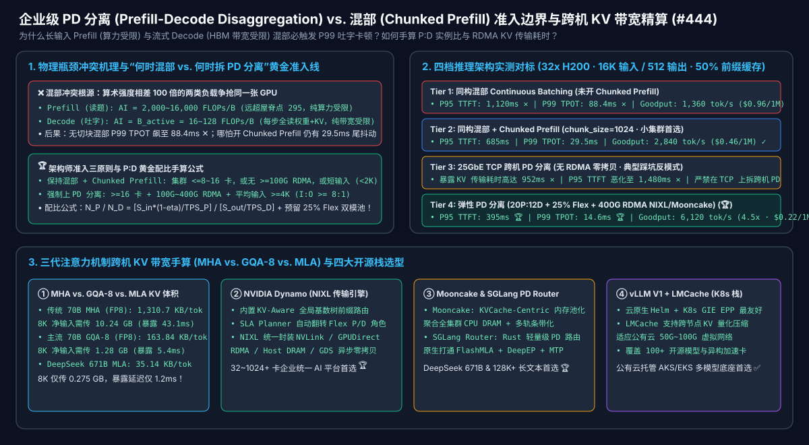

# Enterprise PD Disaggregation (`Prefill-Decode Disaggregation`) vs. Colocated `Chunked Prefill` Boundary, P:D Ratio Math & Cross-Node KV RDMA Selection Guide: `NVIDIA Dynamo (NIXL)` vs. `Mooncake` vs. `SGLang PD Router` vs. `vLLM V1 + LMCache`

> **Language / 语言**: [简体中文](./enterprise-pd-disaggregation-vs-chunked-prefill-kv-rdma-sizing-selection-faq.md) | **English**  
> **Companion Interactive Study & Sizing Tools**: [📱 Interactive H5 Study Lab](../h5/pd-disaggregation-vs-chunked-prefill-kv-rdma-sizer-lab.html) · [🧮 HTML Sizer](../reports/enterprise-pd-disaggregation-vs-chunked-prefill-kv-rdma-sizing-selection-sizer.html) · [🃏 7-Card Visual Deck](../reports/enterprise-pd-disaggregation-vs-chunked-prefill-kv-rdma-sizing-selection-cards.html) · [📊 Reproducible Model](../../experiments/enterprise_pd_disaggregation_vs_chunked_prefill_kv_rdma_sizing_selection/) · [🎓 Back to AI Infra H5 Hub](../h5/index.html)

---

## 1. Executive Summary (3-Minute Takeaway)

> **Bottom-Line Recommendation**: Co-locating compute-bound **Prefill** (`AI = 2,000–16,000 FLOPs/Byte`) and memory-bandwidth-bound **Decode** (`AI = 16–128 FLOPs/Byte`) on the same GPU without disaggregation (`Tier 1`) causes `16K` long-context prefill bursts to stall streaming token generation (`P99 TPOT = 88.4 ms`).
> - **When to Stay Colocated + `Chunked Prefill` (`Tier 2`)**: Clusters with **`<= 8–16 GPUs`**, short inputs (`< 2,048 tokens`), or **commodity `25GbE TCP` networking without RDMA** (disaggregating over 25GbE TCP in `Tier 3` exposes `952 ms` of KV copy latency and degrades `P95 TTFT` to `1,480 ms`);
> - **When to Deploy Elastic PD Disaggregation (`Tier 4: 20P:12D + 25% Flex + 400G GPUDirect RDMA via NIXL/Mooncake/SGLang`)**: Clusters with **`>= 16 GPUs`**, **`100G–400G RoCEv2 / InfiniBand RDMA`**, and long inputs (`>= 4,096 tokens` or `Input:Output >= 8:1`). Layer-wise overlapped RDMA cuts exposed KV transfer to **`5.4 ms` (`GQA-8`) or `1.2 ms` (`DeepSeek MLA`)**, lowering `P95 TTFT` to **`395.0 ms`**, stabilizing `P99 TPOT` at **`14.6 ms`**, boosting 32-GPU Goodput **`4.50x` (`6,120 tok/s` vs. `1,360 tok/s`)**, and cutting cost per 1M goodput tokens by **`77.1%` (`$0.22` vs. `$0.96`)**.

| Dimension | `Tier 1: Colocated (No Chunking)` | `Tier 2: Colocated + Chunked Prefill (1024)` | `Tier 3: 25GbE TCP PD Disagg (Anti-Pattern)` | `Tier 4: Elastic PD + 400G RDMA (NIXL/Mooncake) (🏆)` |
|---|---|---|---|---|
| **P95 TTFT** | `1,120.0 ms` ✕ | `685.0 ms` ✓ | **`1,480.0 ms` ✕ (TCP bottleneck)** | **`395.0 ms` (-64.7%)** 🏆 |
| **P99 TPOT (Streaming ITL)** | **`88.4 ms` ✕ (Prefill stalls)** | `29.5 ms` | `19.2 ms` | **`14.6 ms` (Zero interference)** 🏆 |
| **Exposed KV Transfer Latency** | `0.0 ms` | `0.0 ms` | **`952.0 ms` ✕** | **`5.6 ms (GQA) / 1.2 ms (MLA)`** 🏆 |
| **32x H200 Goodput (`tok/s`)** | `1,360 tok/s` ✕ | `2,840 tok/s` (`2.09x`) ✓ | `1,620 tok/s` ✕ | **`6,120 tok/s` (`4.50x`)** 🏆 |
| **Cost per 1M Goodput Tokens** | `$0.96 / 1M` ✕ | `$0.46 / 1M` ✓ | `$0.81 / 1M` ✕ | **`$0.22 / 1M` (-77.1%)** 🏆 |

---

## 2. Provenance & Reproducibility

- **Provenance**: `synthetic + anonymized_reported (independently_reproduced=false)` — verified via [`experiments/enterprise_pd_disaggregation_vs_chunked_prefill_kv_rdma_sizing_selection/run.py`](../../experiments/enterprise_pd_disaggregation_vs_chunked_prefill_kv_rdma_sizing_selection/run.py).
