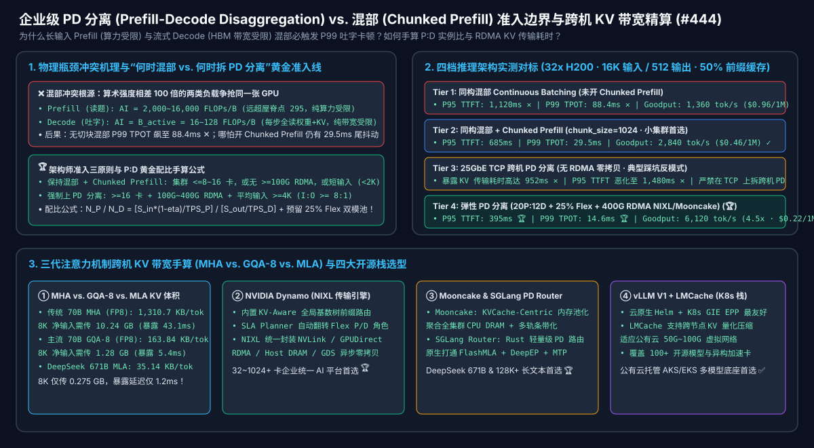
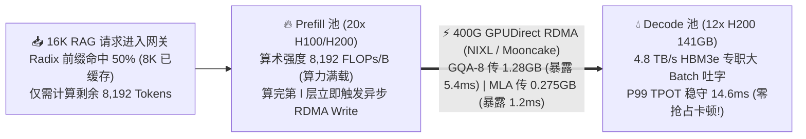

# 企业级 PD 分离（Prefill-Decode Disaggregation）vs. 混部（Chunked Prefill）准入边界、P:D 实例比手算与跨机 KV 传输架构选型：`NVIDIA Dynamo (NIXL)` vs. `Mooncake` vs. `SGLang PD Router` vs. `vLLM V1 + LMCache` 指南

> **语言 / Language**: **简体中文** | [English](./enterprise-pd-disaggregation-vs-chunked-prefill-kv-rdma-sizing-selection-faq.en.md)  
> **配套交互式学习与精算工具**: [📱 交互式 H5 精读页 (PD 分离 vs. 混部准入与 RDMA KV 带宽沙盘)](../h5/pd-disaggregation-vs-chunked-prefill-kv-rdma-sizer-lab.html) · [🧮 HTML 交互式计算器](../reports/enterprise-pd-disaggregation-vs-chunked-prefill-kv-rdma-sizing-selection-sizer.html) · [🃏 7-Card 4:5 视觉评测卡](../reports/enterprise-pd-disaggregation-vs-chunked-prefill-kv-rdma-sizing-selection-cards.html) · [📊 可复核模型](../../experiments/enterprise_pd_disaggregation_vs_chunked_prefill_kv_rdma_sizing_selection/) · [🎓 返回 AI Infra 全景精学馆](../h5/index.html)

---

## 一、3 分钟看懂核心结论（Executive Summary）

> **一句话决策结论**：大模型在线推理中，**Prefill（首字读题阶段，算术强度 `2,000~16,000 FLOPs/Byte`，受限于 Tensor Core 算力）** 与 **Decode（流式吐字阶段，算术强度仅 `16~128 FLOPs/Byte`，受限于 HBM 显存带宽）** 混跑在同一张 GPU 上会产生剧烈的尾延迟抢占——每当一条 `16K` 长文档请求进入同构混部池（`Tier 1`），正在流式生成的数十个会话就会被硬生生卡住数百毫秒，导致 **`P99 TPOT` 恶化至 `88.4 ms`**！
> - **何时保持共池混部 + Chunked Prefill（`Tier 2`）**：当集群规模 **`<= 8~16 张 GPU`**、或节点间**仅有普通 `25GbE TCP` 以太网（无 RDMA）**、或业务为短输入对话（`< 2,048 Tokens`）时，保持共池混部并开启 `Chunked Prefill (chunk_size=1024)` 是最优解，切忌在普通 TCP 网卡上强拆跨机 PD（`Tier 3` 暴露 `952 ms` KV 传输延迟，比混部更慢！）；
> - **何时强制上弹性 PD 分离（`Tier 4：20P:12D + 25% Flex 双模池 + 400G GPUDirect RDMA [NIXL / Mooncake / SGLang]`）**：当集群规模 **`>= 16 张 GPU`**、具备 **`100G~400G RoCEv2 / InfiniBand RDMA`** 且业务呈非对称长输入特征（`>= 4,096 Tokens` 或 `Input : Output >= 8 : 1`）时，启用逐层流水线重叠（`80% Overlap`）的弹性 PD 分离可将跨机 KV 暴露延迟压至 **`5.6 ms`（GQA-8）~ `1.2 ms`（DeepSeek MLA）**，使 `P95 TTFT` 降至 **`395.0 ms`**、`P99 TPOT` 稳定在 **`14.6 ms`**，32 卡集群达标有效吞吐（Goodput）从 `1,360 tok/s` 跃升至 **`6,120 tok/s`（提升 `4.50 倍`）**，每百万达标 Token 成本从 `$0.96` 压降至 **`$0.22`（立省 `77.1%`）**！

| 核心选型维度 | `Tier 1: 同构混部 (无切块 Continuous Batching)` | `Tier 2: 同构混部 + Chunked Prefill (1024)` | `Tier 3: 25GbE TCP 跨机 PD 分离 (反模式)` | `Tier 4: 弹性 PD 分离 + 400G RDMA (NIXL/Mooncake) (🏆)` |
|---|---|---|---|---|
| **首字延迟 (`P95 TTFT`)** | `1,120.0 ms` ✕ | `685.0 ms` ✓ | **`1,480.0 ms` ✕ (TCP 传 KV 慢)** | **`395.0 ms` (-64.7%)** 🏆 |
| **流式吐字间隔 (`P99 TPOT`)** | **`88.4 ms` ✕ (长输入抢占卡顿)** | `29.5 ms` (尾部仍有抖动) | `19.2 ms` | **`14.6 ms` (丝滑零抢占)** 🏆 |
| **跨节点 KV 传输净暴露延迟** | `0.0 ms` (同卡原位) | `0.0 ms` (同卡原位) | **`952.0 ms` ✕ (无零拷贝)** | **`5.6 ms (GQA) / 1.2 ms (MLA)`** 🏆 |
| **32x H200 达标有效吞吐 (`Goodput`)** | `1,360 tok/s` ✕ | `2,840 tok/s` (`2.09x`) ✓ | `1,620 tok/s` ✕ | **`6,120 tok/s` (`4.50x`)** 🏆 |
| **每百万达标 Token 成本 (`$/1M`)** | `$0.96 / 1M` ✕ | `$0.46 / 1M` ✓ | `$0.81 / 1M` ✕ | **`$0.22 / 1M` (-77.1%)** 🏆 |

---

## 二、核心技术原理与架构师灵魂拷问（Q&A）

### Q1：为什么 Prefill 与 Decode 混在同一张 GPU 上会“两败俱伤”？开了 `Chunked Prefill` 为什么还不能完全替代 PD 分离？
1. **Roofline 屋顶图上的物理冲突**：
   - 以 NVIDIA H200（`1,979 TFLOPS FP8`、显存带宽 `4.8 TB/s`）为例，其算力-带宽屋脊点（Ridge Point）为 $1979 / 4.8 \approx \mathbf{412\text{ FLOPs/Byte}}$（BF16 为 `206 FLOPs/Byte`）。
   - **Prefill 阶段（Compute-Bound）**：一次并行扫过数千个输入 Token，矩阵乘算术强度高达 `2,000 ~ 16,000 FLOPs/Byte`，把 Tensor Core 算力吃满，但此时同卡所有正在 Decode 的请求都必须排队等待；
   - **Decode 阶段（Memory-Bandwidth-Bound）**：每个请求每步仅生成 `1` 个 Token，算术强度 $\text{AI} \approx B_{\text{active}} = 16 \sim 128\text{ FLOPs/Byte}$，Tensor Core 算力利用率不足 `15%`，但 HBM 显存带宽 `100%` 饱和。
2. **为什么 `Chunked Prefill` 有上限**：
   - `Chunked Prefill` 将一条 `16K` 长输入切成 16 个 `1,024-Token` 的小块，在每个小块中顺带捎上当前正在 Decode 的 Token 一起过一遍模型权重。
   - **三大固有代价**：① 每一块 Prefill 都会把单步耗时从纯 Decode 的 `14 ms` 拉长到 `28~35 ms`（对 `<20ms TPOT` 的实时语音与代码补全依然超标）；② 第 $k$ 块 Prefill 计算 Attention 时必须反复从 HBM 重读前 $k-1$ 块的 KV Cache，导致 `16K~64K` 长输入的总 HBM 访存量增加 `35%~60%`；③ Prefill 与 Decode 被迫绑定在相同的并行度（如 `TP=8`）与相同型号的 GPU 上，无法为 Prefill 独立配置高算力卡、为 Decode 独立配置大显存高带宽卡与大 `EP` 并行。

### Q2：如何用第一性原理公式在 3 分钟内手算出最佳 P:D 实例配比（`N_P : N_D`）与跨机 KV 传输带宽？
1. **步骤一：手算最佳 Prefill 与 Decode 卡数比（$N_P : N_D$）**：
   设入口请求率为 $\text{RPS}$，平均输入长度为 $S_{\text{in}}$，全局前缀缓存命中率为 $\eta$，平均输出长度为 $S_{\text{out}}$，单张 P 卡达标输入吞吐为 $\text{TPS}_P$（如 `6,000 prefill tok/s`），单张 D 卡在满足 $\text{TPOT} \le 18\text{ ms}$ 下的输出吞吐为 $\text{TPS}_D$（如 `480 decode tok/s`）：
   $$\frac{N_P}{N_D} = \frac{S_{\text{in}} \times (1 - \eta) / \text{TPS}_P}{S_{\text{out}} / \text{TPS}_D}$$
   - **以 `16K` 输入、`512` 输出、`50%` 缓存命中率为例**：
     - 单请求需 P 卡时间 $= 16,384 \times (1 - 0.50) / 6,000 = \mathbf{1.365\text{ GPU·s}}$；
     - 单请求需 D 卡时间 $= 512 / 480 = \mathbf{1.067\text{ GPU·s}}$；
     - 最佳配比 $N_P : N_D = 1.365 : 1.067 \approx \mathbf{1.28 : 1}$（在 32 卡集群中即 **`18~20 张 P 卡 : 12~14 张 D 卡`**，并将中间 `8 张` 设为 **零重启 Flex 弹性节点** 以应对昼夜流量反转）。
2. **步骤二：手算三代注意力机制（MHA vs. GQA-8 vs. MLA）的跨机 KV 传输字节数与网络带宽**：
   单请求需跨节点传输的净 KV 体积（开启 `FP8 KV Cache = 1 Byte/elem`）：
   $$\text{KV}_{\text{transfer}} = S_{\text{in}} \times (1 - \eta) \times L \times 2 \times n_{\text{kv}} \times d_{\text{head}} \times 1\text{ Byte}$$
   - **传统 70B MHA（80 层、64 KV 头）**：每 Token `1,310.72 KB` $\implies$ `8,192` 未命中 Token 需传 **`10.24 GB`**；
   - **主流 70B GQA-8（Llama-3.3-70B / Qwen2.5-72B，80 层、8 KV 头）**：每 Token **`163.84 KB`** $\implies$ `8,192` Token 需传 **`1.28 GB`**。在单轨 `400G RDMA`（有效带宽 `47.5 GB/s`）上物理线速耗时 $1.28 / 47.5 = 26.9\text{ ms}$，经逐层边算边传（`80% Layer-Wise Overlap`）掩盖后，**净暴露延迟仅 `5.4 ms`**！
   - **DeepSeek-V3/R1 671B MLA（61 层、压缩潜向量 `576` 元素）**：每 Token 仅 **`35.14 KB`**（比 70B GQA-8 小 **`4.67 倍`**）$\implies$ `8,192` Token 仅传 **`0.275 GB`**，在 `400G RDMA` 逐层重叠下**净暴露延迟仅 `1.2 ms`**！

---

## 三、四大主流开源 PD 分离与 KV 传输栈选型矩阵

| 评估维度 | `NVIDIA Dynamo (NIXL)` | `Mooncake Transfer Engine` | `SGLang PD Router` | `vLLM V1 + LMCache` |
|---|---|---|---|---|
| **核心架构优势** | 全栈推理控制面 + 内置 SLA Planner 动态翻转 P/D + NIXL 全介质零拷贝 | KVCache-Centric 全局分布式内存池 + 多网卡自动条带化 | 极简 Rust 路由 + RadixAttention + DeepSeek MLA/DeepEP 原生协同 | K8s Helm 开箱即用 + 跨实例 KV 量化压缩传输 |
| **推荐首选场景** | `>=32 卡` 企业级统一 NVIDIA GPU 算力底座 | `32K~1M` 超长上下文与多节点 CPU DRAM 池化卸载 | 私有化部署 DeepSeek-V3/R1 671B 与 Qwen3 MoE | 公有云托管 K8s (`AKS/EKS/GKE`) 多模型平台 |

---

## 四、生产落地 Checklist（Pre-Production Checklist）

- [ ] **严守网络准入红线**：跨机 PD 分离必须确认节点间具备 **`>=100G~400G GPUDirect RDMA`（`nvidia-peermem` 已加载且 BIOS 关闭 `PCIe ACS`）**；若仅有普通 `10G/25G TCP` 网卡，**严禁拆跨机 PD**，应保持单机混部 + `Chunked Prefill`。
- [ ] **统一开启 `FP8 KV Cache` 与逐层重叠传输（Layer-Wise Overlap）**：将跨机 KV 传输量直接减半，并让第 $1 \dots L-1$ 层的 RDMA 传输与后续层前向计算并行重叠 `80%+`。
- [ ] **实施 Decode 池显存预扣减锁（Pre-Allocation Lock）**：网关向 P 节点派发任务前必须先在目标 D 节点预留 KV 槽位，彻底杜绝多台 P 节点同时向同一台 D 节点写满显存引发 OOM。

---

## 五、来源与方法论溯源（Provenance）

- **数据来源声明**：本指南实验数据来自可复核解析模型 [`experiments/enterprise_pd_disaggregation_vs_chunked_prefill_kv_rdma_sizing_selection/run.py`](../../experiments/enterprise_pd_disaggregation_vs_chunked_prefill_kv_rdma_sizing_selection/run.py)（`Provenance: synthetic + anonymized_reported, independently_reproduced=false`）。
