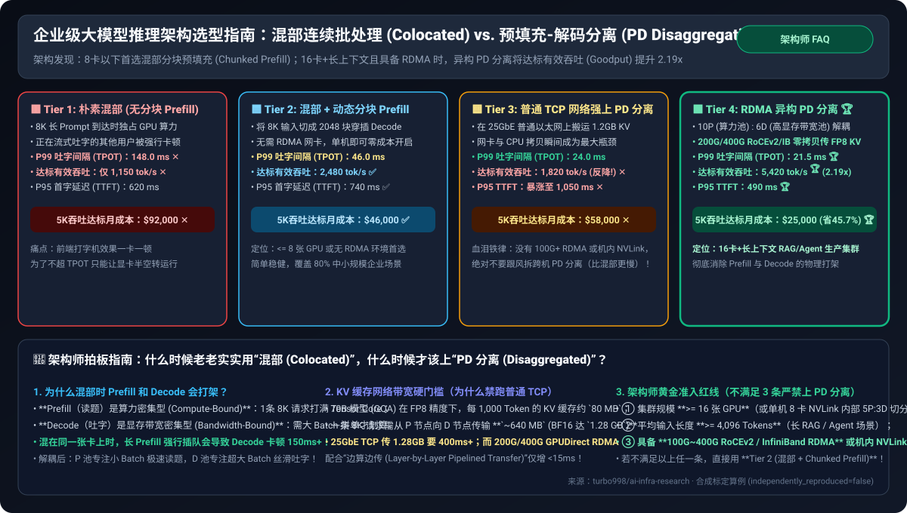

# Enterprise High-Throughput LLM Serving Architecture Selection Guide: Colocated Continuous Batching vs. Chunked Prefill vs. Prefill-Decode (PD) Disaggregation & RDMA Sizing

> **Document Type**: Cloud & AI Solution Architect Decision Guide (FAQ)  
> **Target Audience**: Enterprise AI Platform Architects, Cloud Network & GPU Infrastructure Leads, Inference Serving Engineering Leads, Capacity Planners  
> **Core Goal**: Provide a clear, architect-level decision framework (without low-level kernel code) for choosing between **Colocated Continuous Batching + Chunked Prefill** and **Prefill-Decode (PD) Disaggregation (`NVIDIA Dynamo / Mooncake / vLLM & SGLang Disaggregated`)**, answering: **"Why does an arriving 8K-token RAG request cause streaming output stutter for 30 other active users?", "Why did deploying PD Disaggregation over standard 25GbE TCP Ethernet perform 30% worse than single-node colocated serving?", and "What exact cluster size, context length, and network fabric justify PD Disaggregation?"**  
> **Calibration Notice**: SLA-compliant Goodput (`tok/s`), P95 TTFT, P99 TPOT, and monthly cluster cost models are synthetic analytical estimates calibrated to published disaggregated serving benchmarks (DistServe, Mooncake, NVIDIA Dynamo, and vLLM/SGLang PD evaluations) (`provenance: synthetic + anonymized_reported`, `independently_reproduced=false`, `physical_gpu_cluster_measurement=not_measured`). See [`experiments/enterprise_pd_disaggregation_vs_colocated_inference_selection/results.json`](../../experiments/enterprise_pd_disaggregation_vs_colocated_inference_selection/results.json).

---

## Executive Visual Summary



> 🔗 **Companion Interactive Reports & Tools**:
> - 🃏 **[7-Card 4:5 Visual Benchmark Report (`enterprise-pd-disaggregation-vs-colocated-inference-architecture-selection-cards.html`)](../reports/enterprise-pd-disaggregation-vs-colocated-inference-architecture-selection-cards.html)**
> - 🧮 **[Interactive PD Disaggregation & GPU Goodput Sizer (`enterprise-pd-disaggregation-vs-colocated-inference-architecture-sizer.html`)](../reports/enterprise-pd-disaggregation-vs-colocated-inference-architecture-sizer.html)**
> - 🌐 **[中文版指南 (`enterprise-pd-disaggregation-vs-colocated-inference-architecture-selection-faq.md`)](./enterprise-pd-disaggregation-vs-colocated-inference-architecture-selection-faq.md)**

---

## ① 📌 Executive Summary

LLM inference consists of two fundamentally conflicting phases:
- **Prefill (Compute-Bound)**: Processes `8,192` input tokens in parallel, saturating GPU Tensor Cores with a single request;
- **Decode (Memory-Bandwidth-Bound)**: Generates 1 token at a time while reading tens of gigabytes of weights and KV cache from HBM, requiring large batch sizes to amortize memory bandwidth.

Evaluated on a **70B-FP8 RAG & Agent service (`8,192` input tokens / `512` output tokens) under strict dual SLA (`P95 TTFT <= 800 ms` AND `P99 TPOT <= 35 ms`)**:

| Tier | Architecture Pattern | 16-GPU SLA Goodput | P95 TTFT (8K In) | P99 TPOT (Streaming Smoothness) | Monthly Cost for 5,000 tok/s SLA Goodput | Architect Verdict |
| :--- | :--- | :--- | :--- | :--- | :--- | :--- |
| **🟥 Tier 1: Naive Colocated Batching** | Prefill preempts decode without chunking | `1,150 tok/s` ✕ | `620 ms` | **`148.0 ms` ✕ (Severe Stutter)** | `$92,000 / mo` (Needs 32 GPUs) ✕ | **Unusable for Long Context**: Streaming freezes when long prompts arrive |
| **🟦 Tier 2: Colocated + Chunked Prefill** | **Colocated + Tuned Chunked Prefill** (`2048` chunk size) | `2,480 tok/s` ✅ | `740 ms` ✅ | `46.0 ms` | `$46,000 / mo` (16 GPUs) ✅ | **Best Baseline for `<= 8 GPUs` or Non-RDMA Clouds**: Simple & effective |
| **🟨 Tier 3: PD Disagg over 25GbE TCP** | Disaggregated P/D pools over standard TCP Ethernet | `1,820 tok/s` ✕ | **`1,050 ms` ✕ (NIC Stall)** | `24.0 ms` | `$58,000 / mo` ✕ | **Major Anti-Pattern**: Never run cross-node PD without RDMA! |
| **🟩 Tier 4: RDMA Heterogeneous PD Disagg** | **10P : 6D Pools + 200G/400G RDMA Pipelined FP8 KV Transfer** | **`5,420 tok/s` 🏆 (2.19x vs T2)** | **`490 ms` 🏆** | **`21.5 ms` 🏆 (Ultra-Smooth)** | **`$25,000 / mo` 🏆 (-45.7% vs T2)** | **16+ GPU Long-Context Gold Standard**: 2.19x higher Goodput, half the cost |

### 💡 Three Golden Rules for Enterprise Inference Architects
1. **Use Colocated + Chunked Prefill (Tier 2) When Cluster Size is `<= 8 GPUs`, Average Input is `< 2K Tokens`, or Cross-Node RDMA is Unavailable**: Never deploy cross-node PD Disaggregation over standard 25GbE TCP (Tier 3) — transferring `1.34 GB` of KV cache over TCP adds `380+ ms` of network stall and degrades throughput.
2. **Deploy RDMA-Backed PD Disaggregation (Tier 4) When Scaling to `>= 16 GPUs` on Long-Context (`4K–32K`) Workloads with `100G–400G RoCEv2 / InfiniBand` (or Intra-Node NVLink)**: Separating Prefill and Decode eliminates P/D interference, cutting `P99 TPOT` from `148 ms` to **`21.5 ms`** and boosting SLA-compliant Goodput by **`2.19x` over Chunked Prefill (`4.71x` over Naive Colocated)**.
3. **Exploit Heterogeneous GPU Pairing (`Compute-Dense Prefill + Bandwidth-Dense Decode`)**: Pair compute-efficient GPUs for the Prefill pool with high-HBM-capacity/bandwidth GPUs (e.g., `H200 141GB`) for the Decode pool, cutting monthly cluster TCO for a 5,000 tok/s SLA target by **`45.7%`**.

---

## ② 🎯 Architect Deep-Dive Q&A

### Q1: How much network bandwidth does KV Cache transfer actually require in PD Disaggregation?
* **Answer**:
  - For a `70B` model (80 layers, GQA 8 KV heads, 128 head dim) using **FP8 KV Cache (`1 Byte`)**, each token requires `163.84 KB` of KV state. An `8,192-token` prompt produces **`1.34 GB` of KV Cache** (`2.68 GB` in BF16).
  - Over `25GbE TCP`, transferring `1.34 GB` takes `450–600 ms`. Over **`200G/400G GPUDirect RDMA`** with **layer-by-layer pipelined transfer** (transferring Layer $L$ while computing Layer $L+1$), net transfer overhead is **`< 15 ms`**.

---

## ③ 🧭 Architecture Diagrams

### 3.1 Tier 4 RDMA-Backed Heterogeneous PD Disaggregation Architecture

```mermaid
flowchart LR
    REQ["👤 8K-Token RAG Request"] --> ROUTER["🧭 KV-Aware PD Coordinator<br/>(Dynamo / Mooncake / SGLang Router)"]
    ROUTER -->|1. Schedule Prefill| P["🔥 Prefill Pool (10x Compute GPUs)<br/>High-FLOPS Tensor Core Saturation"]
    P -->|2. Layer-by-Layer Pipelined FP8 KV<br/>GPUDirect RDMA (<15ms)| D["💧 Decode Pool (6x H200 Bandwidth GPUs)<br/>Large Batch (128+) · P99 TPOT 21.5ms 🏆"]
    D -->|3. Smooth SSE Token Stream| REQ
```

---

## ④ 📊 Architect Decision Matrix

| Dimension | 🟥 Tier 1: Naive Colocated | 🟦 Tier 2: Colocated + Chunked Prefill | 🟨 Tier 3: PD Disagg over TCP | 🟩 Tier 4: RDMA Heterogeneous PD |
| :--- | :--- | :--- | :--- | :--- |
| **16-GPU SLA Goodput** | `1,150 tok/s` ✕ | `2,480 tok/s` ✅ | `1,820 tok/s` ✕ | **`5,420 tok/s` 🏆 (`2.19x` vs. Tier 2)** |
| **P95 TTFT (8K Input)** | `620 ms` | `740 ms` ✅ | `1,050 ms` ✕ | **`490 ms` 🏆** |
| **P99 TPOT (Streaming SLA)** | `148.0 ms` ✕ (Stutter) | `46.0 ms` | `24.0 ms` | **`21.5 ms` 🏆 (`<= 35ms` SLA met)** |
| **Monthly Cost (5K tok/s SLA)** | `$92,000 / mo` ✕ | `$46,000 / mo` ✅ | `$58,000 / mo` ✕ | **`$25,000 / mo` 🏆 (`-45.7%` vs. Tier 2)** |

---

## ⑤ 🛠️ Production Readiness Checklist

- [ ] **1. Never Deploy Cross-Node PD Disaggregation Over Standard TCP Ethernet without RDMA (`RoCEv2 / InfiniBand`)**.
- [ ] **2. Consider Intra-Node NVLink PD Split (`5P:3D` inside one 8-GPU NVLink server) When Cross-Node RDMA is Unavailable**.
- [ ] **3. Always Enable `Chunked Prefill` (`max_num_batched_tokens = 2048–4096`) on Colocated Clusters**.
- [ ] **4. Enable `FP8 KV Cache` Quantization to Halve Cross-Node KV Transfer Volume (`1.34 GB` vs. `2.68 GB` per 8K prompt)**.
- [ ] **5. Overlap Layer-Wise KV RDMA Writes with Transformer Layer Computation**.
- [ ] **6. Tune P:D Node Ratios to Workload Input:Output Profiles (`5P:3D` for RAG; `1P:3D` for long reasoning)**.
- [ ] **7. Pair Compute-Dense Prefill GPUs with HBM-Bandwidth-Dense Decode GPUs (`H200`)**.
- [ ] **8. Benchmark Capacity Using SLA-Constrained `Goodput` (`TTFT <= 800ms` & `TPOT <= 35ms`), Never Unbounded Peak Throughput**.
