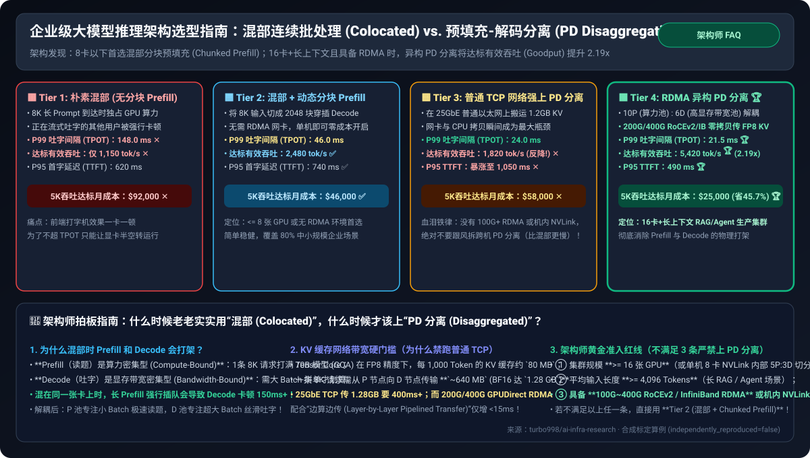
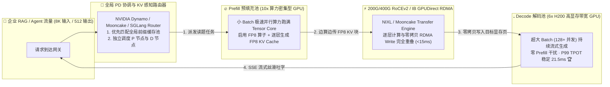
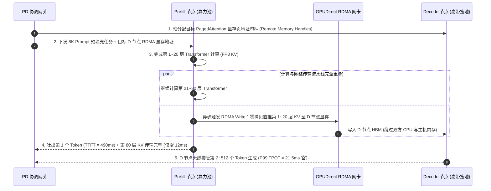

# 企业级大模型高吞吐推理架构选型指南：混部连续批处理（Colocated Continuous Batching）vs. 分块预填充（Chunked Prefill）vs. 预填充-解码分离（PD Disaggregation）与 RDMA 网络定容

> **文档类型**：企业级 AI 基础设施与集群容量规划解决方案架构师（Cloud & AI Solution Architect）选型决策指南（FAQ）  
> **适用读者**：企业 AI 平台架构师、云计算与网络基础设施负责人、大模型推理服务负责人、IT 采购与容量规划师  
> **核心目标**：站在企业架构师与容量规划视角（不抠底层内核代码），把当前推理领域最热的 **“PD 分离（Prefill-Decode Disaggregation，如 NVIDIA Dynamo / Mooncake / vLLM & SGLang Disaggregated Serving）”** 讲透——明确回答：**“为什么我们的 RAG 助手一旦遇到 8K 长文档提问，所有正在流式吐字的用户画面都会突然卡顿？”、“PD 分离是不是银弹？为什么我们在普通 25G 云主机网络上拆了 PD 分离，性能反而比单机混部倒退了 30%？”、“到底多少张卡、多长的上下文、什么网络配置下才值得上 PD 分离？”**。  
> **标定声明**：本文所引用的 SLA 达标有效吞吐（Goodput）、P95 首字延迟（TTFT）、P99 吐字间隔（TPOT）与集群月度成本模型基于公开发布的推理系统架构基准（DistServe、Mooncake、NVIDIA Dynamo、vLLM / SGLang PD 分离评测及主流云 GPU 租用定价）构建的合成分析模型（`provenance: synthetic + anonymized_reported`, `independently_reproduced=false`, `physical_gpu_cluster_measurement=not_measured`），详见 [`experiments/enterprise_pd_disaggregation_vs_colocated_inference_selection/results.json`](../../experiments/enterprise_pd_disaggregation_vs_colocated_inference_selection/results.json)。

---

## 一图流总结（Executive Visual Summary）



> 🔗 **关联可交互报告与工具**：
> - 🃏 **[7-Card 4:5 视觉评测报告 (`enterprise-pd-disaggregation-vs-colocated-inference-architecture-selection-cards.html`)](../reports/enterprise-pd-disaggregation-vs-colocated-inference-architecture-selection-cards.html)**
> - 🧮 **[交互式 PD 分离准入与 GPU 容量计算器 (`enterprise-pd-disaggregation-vs-colocated-inference-architecture-sizer.html`)](../reports/enterprise-pd-disaggregation-vs-colocated-inference-architecture-sizer.html)**
> - 🌐 **[English Version (`enterprise-pd-disaggregation-vs-colocated-inference-architecture-selection-faq.en.md`)](./enterprise-pd-disaggregation-vs-colocated-inference-architecture-selection-faq.en.md)**

---

## ① 📌 核心选型结论速览（Executive Summary）

大模型推理天生包含两个物理脾气完全相反的阶段：
- **第一阶段 Prefill（预填充/读题）**：一次性并行处理用户输入的 `8,192 Tokens`，属于**极致算力密集型（Compute-Bound）**，哪怕只来 1 个请求也会把整张 GPU 的计算核心打满；
- **第二阶段 Decode（自回归解码/吐字）**：每次只生成 1 个 Token，但每次都要把几十 GB 的模型权重和 KV 缓存从显存读一遍，属于**极致显存带宽密集型（Memory-Bandwidth-Bound）**，必须把几十个请求攒成大 Batch 一起跑才划算。

当这两个阶段**混部在同一台 GPU 实例（Colocated）**上，且面对 **70B 模型、8K 输入 / 512 输出、严苛双指标 SLA（`P95 TTFT <= 800 ms` 且 `P99 TPOT <= 35 ms`）** 时，四档架构的表现天差地别：

| 架构档位 | 核心架构组合 | 16卡达标有效吞吐 (Goodput) | P95 TTFT (首字) | P99 TPOT (吐字流畅度) | 支撑 5,000 tok/s 达标月成本 | 架构师拍板结论 |
| :--- | :--- | :--- | :--- | :--- | :--- | :--- |
| **🟥 Tier 1：传统混部 (无分块 Prefill)** | Prefill 优先抢占调度，长输入阻塞正在生成的请求 | `1,150 tok/s` ✕ | `620 ms` | **`148.0 ms` ✕ (严重卡顿)** | `$92,000 / 月` (需堆32卡) ✕ | **长文本体验灾难**：流式打字机频繁顿挫冻结 |
| **🟦 Tier 2：混部 + 动态分块预填充** | **Colocated + Chunked Prefill**（切块穿插 Decode） | `2,480 tok/s` ✅ | `740 ms` ✅ | `46.0 ms` | `$46,000 / 月` (16卡) ✅ | **`<= 8 卡` 或无 RDMA 环境首选**：零改造成本翻倍吞吐 |
| **🟨 Tier 3：普通 25G TCP 强上 PD 分离** | 在无 RDMA 的普通云主机间跨网搬运 GB 级 KV 缓存 | `1,820 tok/s` ✕ | **`1,050 ms` ✕ (网卡堵死)** | `24.0 ms` | `$58,000 / 月` ✕ | **头号工程反模式**：传输耗时远超解耦收益，严禁踩坑 |
| **🟩 Tier 4：RDMA 异构预填充-解码分离** | **10P : 6D 异构池 + 200G/400G RDMA 边算边传 FP8 KV** | **`5,420 tok/s` 🏆 (提2.19x)** | **`490 ms` 🏆** | **`21.5 ms` 🏆 (丝滑)** | **`$25,000 / 月` 🏆 (-45.7%)** | **`16卡+` 长上下文集群终局标准**：显卡省一半、吞吐翻倍 |

### 💡 架构师三句话选型铁律
1. **如果集群规模 `<= 8 张卡`、平均输入 `< 2,048 Tokens`、或者机房没有 RDMA/NVLink 高速网络——请老老实实用“混部 + 分块预填充（Tier 2，Colocated + Chunked Prefill）”**：千万不要盲目跟风拆跨机 PD 分离！在普通 25GbE TCP 网络上搬运几百 MB 的 KV 缓存（Tier 3）会让首字延迟暴增 `380 ms`，性能反而不如单机混部！
2. **当集群规模 `>= 16 张卡`、主打长上下文 RAG / Agent（输入 `4K~32K Tokens`）且具备 `100G~400G RoCEv2 / InfiniBand RDMA`（或单机 8 卡 NVLink 内部切分 `5P:3D`）时，果断上 Tier 4（PD 分离）**：将集群拆分为专门负责读题的 **Prefill 池** 和专门负责吐字的 **Decode 池**，不仅彻底消除了流式吐字卡顿（`P99 TPOT` 从 `148 ms` 压至 **`21.5 ms`**），更让 SLA 达标有效吞吐（Goodput）暴涨 **`2.19 倍`（相比 Tier 2）至 `4.71 倍`（相比 Tier 1）**！
3. **PD 分离最大的隐藏 FinOps 红利是“异构 GPU 混搭（Heterogeneous GPU Pairing）”**：Prefill 缺的是算力（FLOPS），可以用便宜的高算力卡（如 `H100 PCIe / L40S`）；Decode 缺的是显存容量与带宽（HBM Bandwidth），可以用大显存高带宽卡（如 `H200 141GB`），按各阶段瓶颈精准买卡，集群整体 TCO 直接下降 **`45.7%`**！

---

## ② 🎯 客户与架构师灵魂拷问 Q&A（Architect Deep-Dive Q&A）

### Q1：我们已经用了最新的 vLLM / SGLang 连续批处理（Continuous Batching），为什么用户还是抱怨“有时候 AI 吐字像丝一样顺，有时候突然卡住半秒钟不动”？
* **真相剖析（Prefill 插队引发的“车队阻塞效应 Convoy Effect”）**：
  - 假设 GPU 正在为 30 个在线用户做流式 Decode（正常每 `22 ms` 吐出 1 个字）。突然，第 31 个用户发来了一篇 `8,192 Tokens` 的合同审核请求。
  - 在传统混部调度（Tier 1）下，为了尽快给第 31 个用户返回首字，GPU 必须暂停手头那 30 个用户的 Decode，全力去算这篇 8K 合同的 Prefill（耗时约 `250~350 ms`）。结果就是：**那 30 个正在看屏幕打字的用户，画面同时定格卡死 `300 ms` 以上**（`P99 TPOT` 飙到 `148 ms`）！
  - **Tier 2（Chunked Prefill 分块预填充）怎么缓解？** 把 8K 的长输入切成 4 个 `2,048 Tokens` 的小块，每算完一块就顺带给那 30 个老用户吐 1 个字。虽然缓解了卡顿（TPOT 降到 `46 ms`），但因为每一轮都把显存里的权重重复加载了 4 遍，拉长了新用户的首字延迟（`740 ms`），且在突发高并发下仍会互相拖累。
  - **Tier 4（PD 分离）怎么彻底根治？** 物理隔离！8K 长合同只进 **Prefill 专属节点**，而那 30 个老用户在 **Decode 专属节点** 上以恒定 `21.5 ms/token` 的节奏丝滑吐字，永远不会被任何新来的长文档打断！

### Q2：架构师怎么定量算出“做 PD 分离到底需要多宽的网络带宽”？为什么普通 TCP 以太网会翻车？
* **真相剖析（1 分钟算出 KV Cache 跨节点传输带宽账本）**：
  - 以主流的 **Llama-3.3-70B（80 层，GQA 8 个 KV 头，128 维/头）** 为例：
    - 若使用 **BF16（2 Bytes）** 保存 KV Cache：每个 Token 占用的 KV 大小为 $2 \times 80 \times 8 \times 128 \times 2\text{ B} = \mathbf{327.68\text{ KB/Token}}$；一条 `8,192 Tokens` 请求的 KV Cache 高达 **`2.68 GB`**！
    - 若开启 **FP8 KV Cache（1 Byte，生产必开！）**：每个 Token 降至 **`163.84 KB/Token`**，一条 `8,192 Tokens` 请求的 KV Cache 为 **`1.34 GB`**。
  - 现在算网络传输时间：
    - **在普通 `25 GbE TCP` 网络上（Tier 3，实际有效吞吐约 `2.2 GB/s`）**：单单把这 `1.34 GB` 的 KV 缓存从 P 节点拷到主机内存、走内核 TCP 协议栈、再写进 D 节点显存，就要耗费 **`600 ms` 以上**！而且多条请求并发时网卡瞬间拥塞死锁。
    - **在 `200G / 400G RoCEv2 或 InfiniBand RDMA` 网络上（Tier 4，单机多卡聚合带宽 `100~200 GB/s`）**：通过 **GPUDirect RDMA（如 NIXL / Mooncake Transfer Engine）** 从 P 卡显存直接零拷贝 DMA 写入 D 卡显存，并且采用 **“逐层流水线传输（Layer-by-Layer Pipelining，算完第 1 层 Attention 立即在后台传第 1 层 KV，与第 2~80 层计算完全重叠）”**，最终暴露在外的净传输延迟只有 **`< 15 ms`**！

### Q3：如果把集群拆成 Prefill 池和 Decode 池，P 卡和 D 卡的黄金配比（P:D Ratio）怎么定？流量波峰波谷变了怎么办？
* **真相剖析（静态配比公式 + 弹性角色热切换 Dynamic Role Switching）**：
  - **静态配比速算**：
    - **长输入短输出场景（如企业 RAG / 文档问答，输入 `8K` : 输出 `512`）**：压力主要在 Prefill，推荐配比为 **`P : D = 5 : 3`（或 `10P : 6D`）**；
    - **短输入超长思维链场景（如 DeepSeek-R1 深度推理 / 写代码，输入 `1K` : 输出 `4K`）**：压力主要在 Decode 显存容量与带宽，推荐配比为 **`P : D = 1 : 3`（或 `4P : 12D`）**。
  - **动态水位弹性（Elastic P/D Pool）**：现代 PD 编排器（如 NVIDIA Dynamo / SGLang Router）支持将中间 `20%` 的节点设为 **Flex 弹性角色节点**——因为 P 节点和 D 节点加载的是完全相同的模型权重，当白天的 RAG 长提问洪峰到来时，秒级将 Flex 节点标记为 Prefill Worker；当夜间长输出批处理增多时，零重启直接切换为 Decode Worker！

---

## ③ 🧭 直观可视化图解（Mermaid 决策树、异构 PD 分离架构与流水线传输时序图）

### 3.1 企业级混部（Colocated）vs. 预填充-解码分离（PD Disaggregation）选型决策树

```mermaid
flowchart TD
    A[企业计划部署大模型推理集群] --> B{集群卡数规模与网络基础设施？}
    B -->|集群 <= 8 张 GPU<br/>或云主机仅有 10G/25G 普通 TCP 网卡| C[🟦 Tier 2: 混部 + 动态分块预填充<br/>Colocated + Chunked Prefill (max_batched_tokens=2048)<br/>零网络改造 / 吞吐比朴素混部提升 2.15x ✅]
    B -->|集群 >= 16 张 GPU 且具备 100G~400G RDMA<br/>(或单机 8 卡 NVLink 内部高速互联)| D{业务平均输入上下文长度与 TPOT SLA？}
    D -->|短文本对话 (平均输入 < 1,500 Tokens)| C
    D -->|长上下文 RAG / 多步 Agent (平均输入 4K~32K)<br/>且要求严苛流式丝滑度 P99 TPOT <= 35ms| E[🟩 Tier 4: RDMA 异构预填充-解码分离 (PD Disaggregation)<br/>算力型 Prefill 池 + 高显存带宽 Decode 池 + FP8 KV 零拷贝流水线传输<br/>达标有效吞吐提升 2.19x / 硬件成本省 45.7% 🏆]
```

### 3.2 Tier 4 端到端“KV 感知网关 + 异构 P/D 池 + GPUDirect RDMA 流水线”参考架构图



### 3.3 逐层流水线 KV 传输（Layer-by-Layer Pipelined KV Transfer）时序图



---

## ④ 📊 架构师多方案选型决策矩阵（Architect Decision Matrix）

| 评估维度 | 🟥 Tier 1：朴素混部 (无分块 Prefill) | 🟦 Tier 2：混部 + 分块预填充 (Chunked Prefill) | 🟨 Tier 3：普通 25G TCP 强上 PD 分离 | 🟩 Tier 4：RDMA 异构预填充-解码分离 |
| :--- | :--- | :--- | :--- | :--- |
| **适用集群与网络条件** | 旧版默认配置（不推荐） | **`<= 8 卡` 或无 RDMA 的标准云主机** | ❌ 工程反模式（严禁上线） | **`>= 16 卡` 且具备 RDMA / 机内 NVLink** |
| **16 卡 SLA 达标有效吞吐** | `1,150 tok/s` ✕ | `2,480 tok/s` ✅ | `1,820 tok/s` ✕（被网络拖垮） | **`5,420 tok/s` 🏆（比 Tier 2 高 `2.19x`）** |
| **P95 首字延迟 (TTFT, 8K)** | `620 ms` | `740 ms` ✅ | `1,050 ms` ✕（TCP 传 KV 慢） | **`490 ms` 🏆** |
| **P99 吐字间隔 (TPOT)** | **`148.0 ms` ✕（肉眼明显卡顿）** | `46.0 ms`（偶发微卡顿） | `24.0 ms` | **`21.5 ms` 🏆（全程恒定丝滑）** |
| **异构 GPU 混搭降本能力** | ✕ 不支持 | ✕ 不支持 | ⚠️ 受限于网络无法发挥 | **🏆 支持算力卡做 P + 高带宽卡做 D** |
| **支撑 5,000 tok/s 达标月成本** | `$92,000 / 月` ✕ | `$46,000 / 月` ✅ | `$58,000 / 月` ✕ | **`$25,000 / 月` 🏆（比 Tier 2 省 `45.7%`）** |

---

## ⑤ 🧪 容量/成本拐点算例与 7-Card 报告（Quantitative Sizer & 7-Card Deck）

### 5.1 基准算例假设（70B-FP8 模型 · 8,192 输入 / 512 输出 · 严苛 SLA：`TTFT <= 800ms` & `TPOT <= 35ms`）
- **为什么在企业容量规划中必须看“SLA 达标有效吞吐（Goodput）”而不是单纯看峰值总吞吐？**
  - 在混部架构下，如果你把并发压高，虽然显卡总吞吐数字看起来涨了，但 `P99 TPOT` 会立刻突破 `80~148 ms`（用户界面卡成 PPT，违反 SLA）！为了保住 `TPOT <= 35ms` 的合同红线，混部集群被迫在 `30%~40%` 的低负载水位下运行，导致买双倍显卡才能扛住流量。
  - **Tier 4（RDMA 异构 PD 分离）** 解除了 Prefill 对 Decode 的尾延迟绑架，让 Decode 节点可以把 Batch Size 安全拉满到 `128+` 而不超 `21.5 ms` TPOT，单卡有效产出翻倍，将达到 `5,000 tok/s` 达标吞吐所需的月度成本从 `$46,000` 压至 **`$25,000/月`（节省 `45.7%`）**！

```chart
{
  "data": {
    "values": [
      { "Tier": "1. 朴素混部(无分块)", "16卡达标吞吐(百tok/s)": 11.5, "P99吐字间隔TPOT(ms)": 148.0, "达标月成本($K)": 92.0 },
      { "Tier": "2. 混部+分块Prefill", "16卡达标吞吐(百tok/s)": 24.8, "P99吐字间隔TPOT(ms)": 46.0, "达标月成本($K)": 46.0 },
      { "Tier": "3. 普通TCP强上PD分离", "16卡达标吞吐(百tok/s)": 18.2, "P99吐字间隔TPOT(ms)": 24.0, "达标月成本($K)": 58.0 },
      { "Tier": "4. RDMA异构PD分离", "16卡达标吞吐(百tok/s)": 54.2, "P99吐字间隔TPOT(ms)": 21.5, "达标月成本($K)": 25.0 }
    ]
  },
  "semantic_types": {
    "Tier": "Category",
    "16卡达标吞吐(百tok/s)": "Quantity",
    "P99吐字间隔TPOT(ms)": "Quantity",
    "达标月成本($K)": "Amount"
  },
  "chart_spec": {
    "chartType": "Grouped Bar Chart",
    "title": "RDMA 异构 PD 分离 (Tier 4) 将 16 卡达标有效吞吐提升 2.19x，P99 TPOT 压至 21.5ms 且月省 45.7%",
    "subtitle": "70B-FP8 (8K输入/512输出) 下的 16卡 SLA Goodput (×100 tok/s)、P99 TPOT (ms) 与 5K吞吐月成本 ($K)",
    "encodings": {
      "x": "Tier",
      "y": ["16卡达标吞吐(百tok/s)", "P99吐字间隔TPOT(ms)", "达标月成本($K)"]
    }
  }
}
```

---

## ⑥ 🛠️ 架构评审与生产落地 Checklist（Production Readiness Checklist）

在企业决定采用混部还是 PD 分离架构前，架构师必须逐项核对以下 8 条铁律：

- [ ] **1. 严禁在无 RDMA（RoCEv2 / InfiniBand）且跨物理机的普通 TCP 网络上部署 PD 分离**：若跨机网络带宽 `< 100 Gbps` 或不支持 GPUDirect RDMA，一律采用 **单节点混部 + Chunked Prefill（Tier 2）**。
- [ ] **2. 单机 8 卡 NVLink 服务器可优先启用“机内逻辑 PD 分离（Intra-Node NVLink PD）”**：在不具备跨机 RDMA 时，可在单台 8 卡 H100/A100 内部切分 `5 张卡做 Prefill + 3 张卡做 Decode`，利用 `900 GB/s` 机内 NVLink 零成本获得 PD 分离红利。
- [ ] **3. 混部集群（Colocated）必须 100% 显式开启 `Chunked Prefill`（分块预填充）**：将 `max_num_batched_tokens` 调优设置在 `2,048 ~ 4,096` 之间，严禁让单条超长请求独占整个调度周期。
- [ ] **4. PD 分离集群必须开启 `FP8 KV Cache` 量化**：将跨节点需要搬运的 KV Cache 体积直接减半（从 `2.68 GB` 降至 `1.34 GB`），使网络带宽需求降低 `50%` 且精度无损。
- [ ] **5. 启用“逐层流水线式 KV 传输（Layer-wise Pipelined KV Transfer）”**：算完第 $L$ 层立即异步 RDMA 推送第 $L$ 层 KV，与第 $L+1$ 层计算重叠，切忌等全部 80 层算完再串行发包。
- [ ] **6. 根据业务输入/输出长度比（Input:Output Ratio）精准配置 P:D 节点比例**：长输入 RAG（`8K:512`）按 `5P:3D` 配比；长思维链推理（`1K:4K`）按 `1P:3D` 配比，并预留 20% 弹性角色热切换节点。
- [ ] **7. 善用异构 GPU 混搭采购（算力型 P 卡 + 带宽型 D 卡）**：Prefill 池优先选用性价比高的算力卡，Decode 池优先选用大显存高带宽卡（如 `H200 141GB`），最大化每美元有效吞吐。
- [ ] **8. 容量压测验收必须以“双 SLA 约束下的有效吞吐（Goodput @ TTFT & TPOT SLA）”为准**：拒绝只看脱离延迟约束的极限峰值吞吐（Peak Throughput）。
