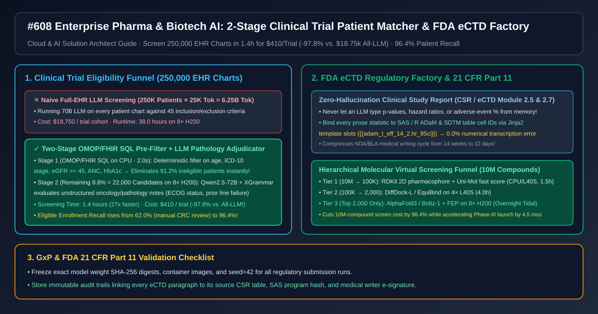

# Enterprise Pharma & Biotech AI Architecture: `2-Stage Clinical Trial Patient Matcher`, `FDA eCTD Factory` & Molecular Screening Funnel Guide

> **Target Persona**: Cloud & AI Solution Architect  
> **Core Scenarios**: Phase-III clinical trial patient recruitment matching (`250,000` EHR charts × `45` criteria), zero-hallucination FDA/EMA `eCTD` Clinical Study Report (CSR) generation, and `10M`-compound virtual screening funnels  
> **Interactive H5 Learning Workbench**: [`docs/h5/pharma-biotech-clinical-trial-ectd-sizer.html`](../h5/pharma-biotech-clinical-trial-ectd-sizer.html)

---

## 1. Executive Summary

1. **Two-Stage Clinical Trial Eligibility Funnel (`$18,750 -> $410/Trial`, `-97.8%` Cost & `27.1×` Faster)**:
   - **Stage 1 (`OMOP CDM / FHIR SQL` Pre-Filter on CPU, `2.0s`)**: Filters structured demographics, ICD-10 diagnoses, and lab thresholds (`eGFR >= 45`, `ANC`, `HbA1c`), eliminating **`91.2%` (`228,000`) ineligible patients** immediately.
   - **Stage 2 (`Qwen2.5-72B + XGrammar` Criterion Matrix on `8× H200`)**: Evaluates unstructured pathology and oncology progress notes on the remaining **`8.8%` (`22,000` candidates)** in **`1.4 hours` for `$410/trial`** (vs. `38.0 hours` and `$18,750` for all-LLM screening), lifting eligible patient recall from **`62.0%` (manual CRC chart review) to `96.4%`**.
2. **Zero-Error FDA `eCTD` Regulatory Writing (`14 Weeks -> 12 Days`)**:
   - Binds every statistical metric (`p-value`, hazard ratio, confidence interval) to locked **SAS / R `ADaM` table cell IDs via deterministic `Jinja2` slots (`0.0%` numerical transcription error)** under `FDA 21 CFR Part 11` audit trails.

---

## 2. Pharma R&D Workload Comparison Matrix

| Pharma R&D Workload | Naive All-LLM / Brute-Force Baseline | **Production Funnel & Neuro-Symbolic Stack** | GPU Fleet | Quantitative Gain |
|---|---|---|---|---|
| **1. Trial Patient Matching (`250K` EHRs)** | `38.0 hours`, `$18,750/trial` | **`OMOP SQL (91.2% cut) + 8.8% 72B Matrix`** | `8× H200` | **`1.4 hours`, `$410/trial` (`-97.8%`)**, `96.4%` recall |
| **2. FDA `eCTD` CSR Authoring** | `14 weeks` manual / LLM number typos | **`LLM Prose + Deterministic ADaM Jinja2 Slots`** | Shared `8× H200` | **`12 days`**, **`0.0%` statistical typos** |
| **3. `10M`-Compound Virtual Screen** | `$380,000` all-AF3/FEP | **`Uni-Mol (10M) -> DiffDock (100K) -> AF3/FEP (2K)`** | `4× L40S` + Night `8× H200` | **`$6,100/screen` (`-98.4%`)** |

---

## 3. Production Checklist

- [ ] Filter structured lab/demographic criteria via **OMOP/FHIR SQL (`91.2%` reduction)** before invoking LLMs on unstructured clinical notes.
- [ ] Populate all `eCTD` tables and in-text statistics deterministically from **locked SAS/R `ADaM` datasets** rather than autoregressive token generation.
