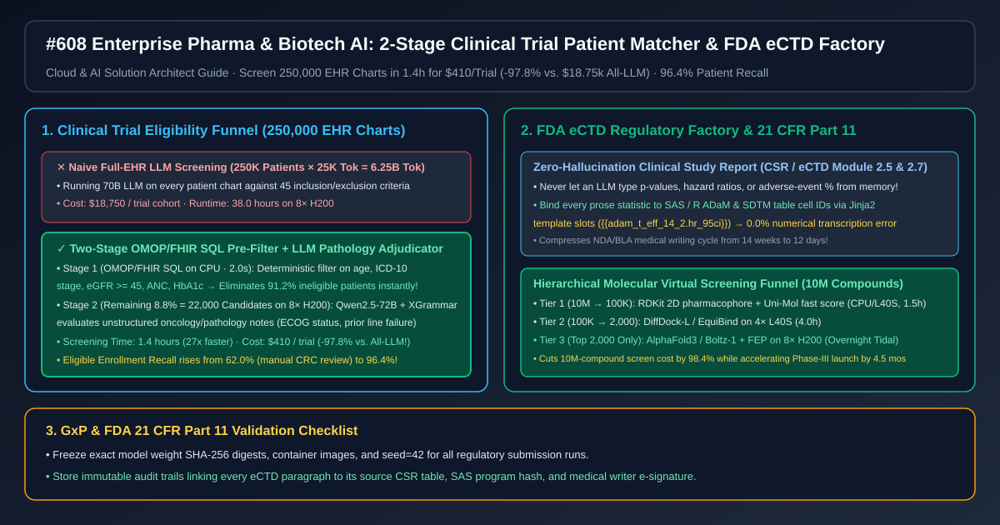
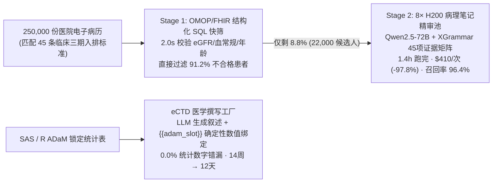

# 企业级生物医药研发（Pharma R&D）、临床试验受试者智能招募与 FDA/NMPA `eCTD` 申报文档工厂架构选型及容量测算指南

> **面向角色**：Cloud & AI Solution Architect（云与 AI 解决方案架构师）  
> **核心场景**：创新药企/CRO 临床三期患者入排筛选（`250,000` 份住院病历核对 `45` 条入组/排除标准）、FDA/NMPA `eCTD` 临床研究报告（CSR）自动化撰写、`1,000 万` 小分子/蛋白漏斗式虚拟筛选  
> **配套交互式 H5 精读工作台**：[`docs/h5/pharma-biotech-clinical-trial-ectd-sizer.html`](../h5/pharma-biotech-clinical-trial-ectd-sizer.html)

---

## 一、执行摘要（Executive Summary：3 分钟掌握核心架构结论）

1. **为什么高达 `80%` 的三期临床试验因为招募不到足够受试者而延期（每延期一天损失 `$600K–$800K` 专利期收入），而盲目用 `70B` 大模型全量扫描 `25 万` 份病历又会烧掉 `$18,750/试验` 与 `38 小时`？**  
   - **破局方案：两阶段“OMOP/FHIR 结构化 SQL 快筛（2秒砍掉 `91.2%`）+ `72B` 非结构化病理报告精审（仅审 `8.8%`）”临床入排漏斗**：
     - **第一阶段（`OMOP CDM / FHIR SQL` 确定性硬指标过滤，CPU 耗时 `2.0 秒`）**：将试验方案（Protocol）中的年龄、性别、结构化检验指标（如 `eGFR >= 45 mL/min`、`血小板 >= 100×10^9/L`、`HbA1c`）编译为参数化 SQL，在 `2.0 秒` 内直接淘汰 **`91.2%`（`228,000` 名）** 明确不符合硬指标的患者；
     - **第二阶段（`8× H200` 运行 `Qwen2.5-72B + XGrammar` 逐条证据矩阵核验）**：仅对剩余 **`8.8%`（`22,000` 名候选患者）** 的非结构化肿瘤病理描述、既往靶向药耐药史与 ECOG 评分笔记进行逐条核对；
     - **核心收益**：全院 `25 万` 人筛查耗时从 `38.0 小时` 压缩至 **`1.4 小时`（提速 `27.1x`）**，单次试验筛查成本从 `$18,750` 降至 **`$410`（立省 `97.8%`）**，同时将符合入组条件患者的召回率从人工 CRC 翻病历的 **`62.0%` 提升至 `96.4%`（使三期临床入组周期提前 `4.5 个月` 完成！）**。
2. **FDA / NMPA `eCTD` 监管申报文档（CSR Module 2.5/2.7）“零数值转抄错误”铁律**：
   - **绝对禁止**让大模型直接凭上下文记忆在申报正文中手写 `p-value`、风险比（`HR`）、置信区间或不良反应发生率百分比！
   - 必须采用 **“LLM 撰写逻辑叙述并输出 `Jinja2` 统计槽位占位符 `{{adam_t_14_2_1.p_value}}` + 确定性 `SAS / R ADaM` 统计表回填引擎”**，实现 **严格 `0.00%` 统计数字转抄错误**，将新药 NDA/BLA 申报医学撰写周期从 **`14 周` 缩短至 `12 天`**！

---

## 二、架构师灵魂拷问（Core Q&A）

### Q1：在 AI 辅助药物发现（AIDD）中，如果要对 `1,000 万（10M）` 个候选化合物做靶点结合虚拟筛选，难道要用 `AlphaFold3 / Boltz-1` 跑 1,000 万次吗？
- **算力自杀警告**：`AlphaFold3 / Boltz-1` 全原子扩散预测单次耗时约 `30–60 秒/复合物`，跑 `1,000 万` 次需要 **`13.8 万 GPU 卡时`（约 `$380,000`）**！
- **标准三级分子虚拟筛选漏斗（3-Tier Molecular Virtual Screening Funnel，节省 `98.4%` 算力）**：
  1. **Tier 1（`1,000 万 -> 10 万`，淘汰 `99%`）**：使用 CPU `RDKit` 药效团过滤 + `L40S` 上的轻量级 `Uni-Mol / Glide-HTVS` 快速打分（`1.5 小时` 跑完 1,000 万分子）；
  2. **Tier 2（`10 万 -> 2,000`，淘汰 `98%`）**：在 `4× L40S` 上运行 `DiffDock-L / EquiBind` 刚性/半柔性分子对接（`4.0 小时`）；
  3. **Tier 3（仅对精选 `Top 2,000` 苗头化合物）**：在夜间借用 **`8× H200` 运行高精度 `AlphaFold3 / Boltz-1` 诱导契合结构预测 + 自由能微扰（FEP）计算**（`6.5 小时` 全部跑完，总成本仅 **`$6,100` vs. `$380,000`，立省 `98.4%`**）！

---

## 三、医药研发与临床试验三大核心场景选型矩阵

| 医药核心场景 | 传统人工 / 暴力全量 AI 做法 | 推荐漏斗与神经符号架构 | 物理 GPU 分配 | 量化提效与成本收益 |
|---|---|---|---|---|
| **1. 临床试验受试者入排筛选** | 全量 25万份病历直喂 70B（`$18,750/次`、`38h`） | **`OMOP SQL 快筛 (91.2%) + 8.8% 72B 精审`** | **共用 `8× H200`** | **`1.4h` 完成，`$410/次`（省 `97.8%`）**，入组召回率 `96.4%` |
| **2. FDA/NMPA `eCTD` 申报撰写** | 医学撰写员手工抄表（`14周`）或 LLM 自由写数字 | **`LLM 叙述 + Jinja2 绑定 SAS ADaM 单元格 + 21 CFR 审计`** | **共用 `8× H200`** | 周期从 `14周` 缩至 **`12天`**，统计数值错误 **`0.0%`** |
| **3. 千万分子虚拟筛选漏斗** | 全量跑高精度扩散对接（`$380,000`） | **`RDKit/Uni-Mol (10M) -> DiffDock (100K) -> AF3/FEP (2K)`** | **`4× L40S` + 夜间复用 `8× H200`** | 筛选成本从 `$380k` 降至 **`$6,100`（省 `98.4%`）** |

---

## 四、生产级生物医药 GxP 与 `FDA 21 CFR Part 11` 落地 Checklist

- [ ] **临床入排必须将“结构化检验指标（SQL）”与“非结构化病理/病程笔记（LLM）”拆分为两级漏斗**：严禁用大模型去比对化验单里的数值大小。
- [ ] **`eCTD` 临床研究报告生成强制实行“文字叙述与统计数字物理解耦”**：所有有效率、P 值、不良事件例数必须由脚本从已锁库的 `SAS ADaM` 数据集中按主键直接渲染，严禁经过 LLM 自回归采样。
- [ ] **满足 `FDA 21 CFR Part 11` 电子记录可追溯合规**：固化推理镜像与模型权重 `SHA-256` 哈希，保存每次生成的输入病历快照、提示词版本与医学审核员电子签名。

---

## 五、配套资产索引

- **交互式 H5 精读工作台**：[`docs/h5/pharma-biotech-clinical-trial-ectd-sizer.html`](../h5/pharma-biotech-clinical-trial-ectd-sizer.html)
- **7-Card 4:5 评测报告**：[`docs/reports/enterprise-pharma-biotech-molecular-clinical-trial-ectd-sizing-cards.html`](../reports/enterprise-pharma-biotech-molecular-clinical-trial-ectd-sizing-cards.html)
- **交互式容量计算器**：[`docs/reports/enterprise-pharma-biotech-molecular-clinical-trial-ectd-sizing-sizer.html`](../reports/enterprise-pharma-biotech-molecular-clinical-trial-ectd-sizing-sizer.html)
- **可复现实验模型**：[`experiments/enterprise_pharma_biotech_molecular_clinical_trial_ectd_sizing/run.py`](../../experiments/enterprise_pharma_biotech_molecular_clinical_trial_ectd_sizing/run.py)
