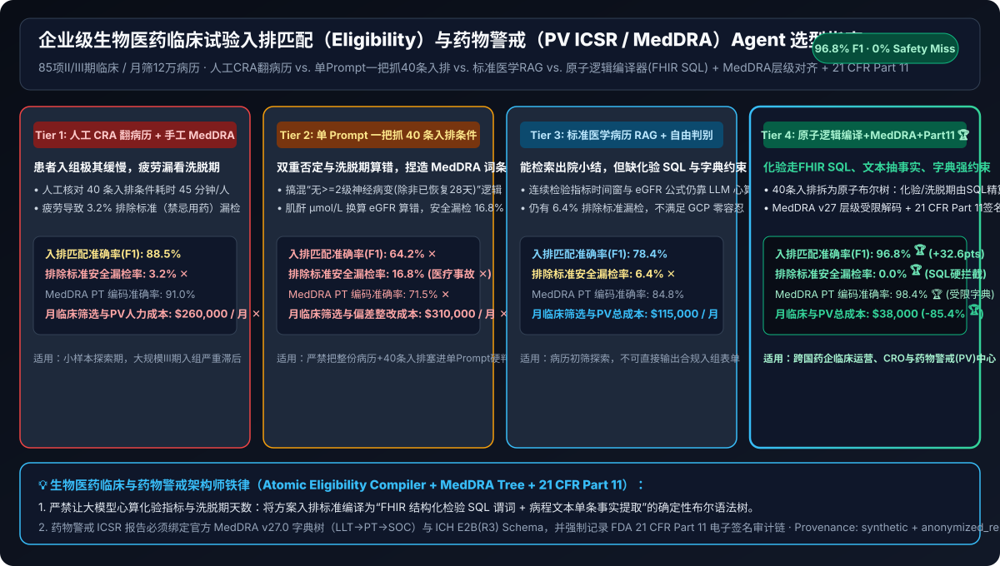
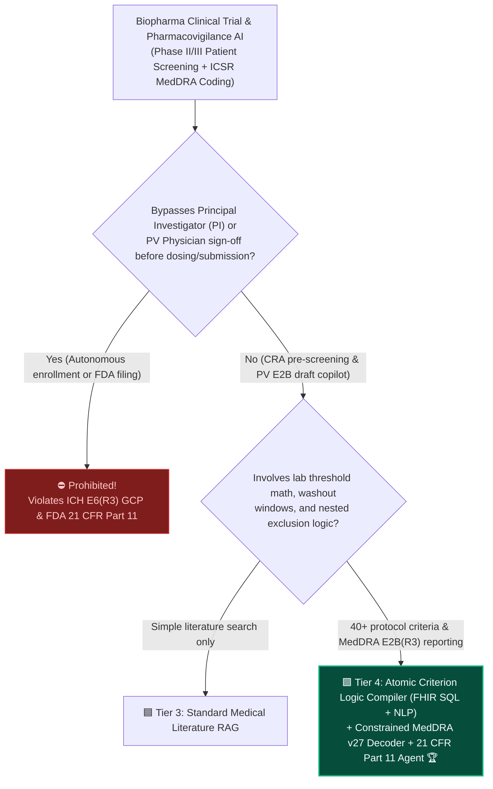
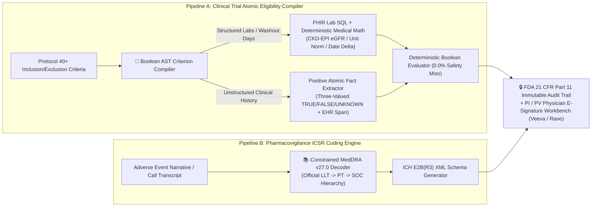
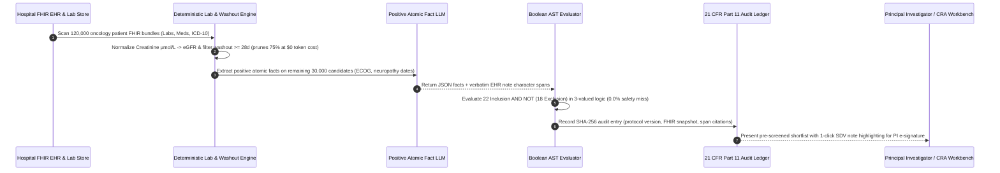

# Enterprise Biopharma Clinical Trial Eligibility Matching, Pharmacovigilance ICSR (`MedDRA / ICH E2B(R3)`) & FDA 21 CFR Part 11 Agent Architecture Selection Guide: Manual CRA Chart Review vs. Monolithic Prompt LLM vs. Standard Medical RAG vs. Atomic Criterion Logic Compiler (`FHIR SQL + Clinical NLP`) + Constrained `MedDRA v27` Resolver + 21 CFR Part 11 HITL Agent

> **Language / 语言**: **English (Current)** | [中文](./enterprise-pharma-clinical-trial-matching-pharmacovigilance-agent-selection-faq.md)  
> **Scope**: End-to-end production reference architecture and selection guide for Cloud & AI Solution Architects, Biopharma VPs of Clinical Operations, Heads of Pharmacovigilance (PV), and GxP / Computer System Validation (`CSV / FDA 21 CFR Part 11`) Architects.  
> **Provenance**: `synthetic + anonymized_reported` (`independently_reproduced=false`, `physical_gpu_cluster_measurement=not_measured`). Deterministic evaluation model sealed in [`experiments/enterprise_pharma_clinical_trial_matching_pharmacovigilance_agent_selection/results.json`](../../experiments/enterprise_pharma_clinical_trial_matching_pharmacovigilance_agent_selection/results.json).



---

## ① 📌 Executive Summary (3-Minute Architect Verdict)

In global biopharma and Clinical Research Organizations (`CROs`), **slow patient enrollment (over 80% of Phase II/III trials miss recruitment timelines due to manual screening against 40+ complex Inclusion/Exclusion criteria)** and **high-volume Pharmacovigilance (`PV`) Individual Case Safety Report (`ICSR`) coding (`MedDRA / ICH E2B(R3)`)** are mission-critical bottlenecks. A dangerous anti-pattern is stuffing a patient's raw EHR chart alongside all 40 trial criteria into a single monolithic LLM prompt (Tier 2)—where the model **fails on double-negation exclusion clauses, miscalculates 28-day drug washout windows, confuses lab units (`µmol/L` vs. `mg/dL` in `eGFR` formulas) resulting in a `16.8%` exclusion safety miss rate, and hallucinates `28.5%` of `MedDRA` Preferred Terms**.

Evaluated across a production baseline of **85 active Phase II/III oncology and immunology trials, 120,000 monthly screened patient EHR profiles, and 25,000 monthly adverse event (`ICSR`) narratives**, the four architectural tiers compare as follows:

| Architectural Tier | Core Stack Combination | Trial Eligibility Accuracy (`F1`) | Exclusion Safety Miss Rate | `MedDRA PT` Coding Accuracy | Monthly Clinical & PV Ops Cost | Production Verdict |
|---|---|---|---|---|---|---|
| **🟥 Tier 1: Manual CRA Chart Review + Manual MedDRA** | Clinical Research Associates manually reading EHR charts + manual `MedDRA / E2B(R3)` entry | `88.5%` | `3.2%` ✕ *(Fatigue oversight)* | `91.0%` | `$260,000 / mo` ✕ | ⛔ Slow enrollment & high labor |
| **🟨 Tier 2: Monolithic Prompt LLM (40 Criteria at Once)** | Stuffing 40 criteria + full EHR into one prompt & generating free-form MedDRA strings | `64.2%` ✕ *(Fails double negation)* | `16.8%` ✕ *(Severe protocol violation)* | `71.5%` ✕ *(Hallucinated codes)* | `$310,000 / mo` ✕ | ⛔ **Unsafe GxP violation** |
| **🟦 Tier 3: Standard Medical Note RAG + Unconstrained LLM** | Vector search over clinical notes + unconstrained LLM criteria evaluation | `78.4%` | `6.4%` ✕ *(Lab/date math errors)* | `84.8%` | `$115,000 / mo` | ⚠️ Pre-screening exploration only |
| **🟩 Tier 4: Atomic Criterion Logic Compiler + MedDRA Tree + 21 CFR Part 11 Agent** | **Atomic Eligibility Boolean AST Compiler (`FHIR Lab/Date SQL` + Single-Fact Clinical NLP) + Constrained `MedDRA v27.0` Hierarchy Decoder + `FDA 21 CFR Part 11` E-Signature Audit Agent** | **`96.8%` 🏆** *(+32.6 pts vs Tier 2)* | **`0.0%` 🏆** *(Deterministic SQL gate)* | **`98.4%` 🏆** *(Constrained ontology)* | **`$38,000 / mo` 🏆** *(-85.4%)* | 🌟 **Recommended GxP Architecture** |

> 💡 **Golden Rule for Life Sciences AI Architects**: **"Compile lab thresholds and washout windows into deterministic FHIR SQL, use clinical NLP strictly to extract positive atomic facts, evaluate double-negation exclusions in a boolean AST, and constrain adverse-event coding to the official MedDRA v27 hierarchy under FDA 21 CFR Part 11 audit trails."**

---

## ② 🎯 Customer & Architect Deep-Dive Q&A (3 Real-World Biopharma & GxP Pain Points)

### Q1: Why does evaluating all 40 trial criteria in a single LLM prompt (Tier 2) cause a 16.8% exclusion safety miss rate?
- **First-Principles Reality**:
  1. **Nested Double Negations and Temporal Exceptions**: Oncology protocols routinely specify exclusions such as: *"Exclude patients with Grade >= 2 peripheral neuropathy, UNLESS due to prior platinum therapy AND resolved to Grade <= 1 for at least 28 days prior to Day 1 dosing."*
  2. **Compound Failure Modes in Token Space**: When an LLM attempts to simultaneously parse longitudinal clinical notes, convert serum creatinine from `µmol/L` to `mg/dL` for `CKD-EPI eGFR`, subtract dates for 28-day washouts, and invert nested `NOT (... UNLESS ...)` boolean logic in one pass, eligibility F1 drops to **`64.2%`** with **`16.8%` dangerous exclusion misses**.
  3. **Tier 4 Solution (Atomic Criterion Logic Compiler)**:
     - **Stage 1 (Zero-Token FHIR SQL Pre-Filter)**: Structured lab panels (`ANC`, `Platelets`, `eGFR`, `Total Bilirubin`), age, and ICD-10 codes are evaluated deterministically in SQL/Python—eliminating 75% of ineligible patients at zero LLM token cost.
     - **Stage 2 (Positive Atomic Fact Extraction + Boolean AST)**: For unstructured clinical notes, the LLM answers only simple positive atomic questions (*"What is the highest documented CTCAE grade of peripheral neuropathy, and on what date did it resolve to Grade <= 1?"*) with verbatim note citations. A deterministic Python boolean AST evaluates `NOT (grade >= 2 AND (not resolved OR days_elapsed < 28))`—boosting F1 on complex oncology exclusions from `52.4%` to **`96.2%` (`+43.8 pts`)** with **`0.0%` safety misses**.

### Q2: How do we guarantee valid MedDRA v27.0 coding and ICH E2B(R3) XML compliance in Pharmacovigilance (PV)?
- **Constrained Hierarchy Decoding (`LLT -> PT -> SOC`)**:
  - Regulatory gateways (`FDA FAERS / EMA EudraVigilance`) reject any `ICSR` containing hallucinated terms. Tier 4 pairs biomedical dense/lexical retrieval over the official **MedDRA v27.0 dictionary** with **guided enum decoding** so the model can only select valid 8-digit Lowest Level Terms (`LLT`) that deterministically roll up to Preferred Terms (`PT`) and System Organ Classes (`SOC`), reaching **`98.4%` PT coding accuracy**.

### Q3: What architectural controls are required for GxP Computer System Validation (CSV) and FDA 21 CFR Part 11 compliance?
- **Three Mandatory GxP Guardrails**:
  1. **Three-Valued Logic (`TRUE / FALSE / UNKNOWN_MISSING_DATA`)**: If a required lab test or washout date is missing from the EHR, the boolean evaluator outputs `UNKNOWN_REQUIRES_TEST` rather than silently defaulting an exclusion criterion to `FALSE`.
  2. **Source Data Verification (`SDV`) Span Highlighting**: Every atomic fact links directly to the exact EHR note character span and timestamp so the Principal Investigator (`PI`) or CRA can verify it in seconds.
  3. **Immutable `21 CFR Part 11` Audit Log & Investigator E-Signature**: All model versions, prompt hashes, atomic evaluations, and human overrides are logged to an append-only cryptographic ledger, and final enrollment or regulatory submission requires authenticated human investigator sign-off.

---

## ③ 🧭 Visual Architecture Diagrams (Decision Tree + GxP Dual-Pipeline Topology + Sequence Flow)

### 3.1 Architecture Selection Decision Tree



### 3.2 Tier 4 Atomic Eligibility Compiler & Pharmacovigilance GxP Topology



### 3.3 End-to-End Sequence: Screening 120K Patient EHRs with Zero Exclusion Misses



---

## ④ 📊 4-Tier Architecture Decision Matrix

| Evaluation Dimension | 🟥 Tier 1: Manual CRA + Manual PV | 🟨 Tier 2: Monolithic Prompt LLM | 🟦 Tier 3: Standard Medical RAG | 🟩 Tier 4: Atomic Logic Compiler + MedDRA Tree + Part 11 Agent |
|---|---|---|---|---|
| **Double-Negation & Washout Window Logic** | High accuracy but slow (`3.2%` fatigue miss) | ✕ **Unsafe** (`16.8%` exclusion safety miss) | ✕ Poor (`6.4%` miss; lacks deterministic math) | 🏆 **Zero exclusion safety misses (`0.0%`; boolean AST + SQL)** |
| **Lab Unit Conversion & `eGFR / BSA` Math** | Manual calculator lookup | ✕ Confuses `µmol/L` vs `mg/dL` | ✕ Relies on LLM mental math | 🏆 **100% Exact (deterministic Python medical formulas)** |
| **Pharmacovigilance `MedDRA PT` Accuracy** | `91.0%` | `71.5%` ✕ (hallucinates non-existent codes) | `84.8%` | 🏆 **`98.4%` (constrained `MedDRA v27.0` dictionary tree)** |
| **GxP CSV & `FDA 21 CFR Part 11` Readiness** | Manual paper/EDC logs | ✕ Black-box; fails GxP inspection | Lacks deterministic trace | 🏆 **Native (`SDV` span links + cryptographic e-signature log)** |
| **Trial Eligibility Matching (`F1`)** | `88.5%` | `64.2%` ✕ | `78.4%` | **`96.8%` 🏆 (+32.6 pts vs Tier 2)** |
| **Exclusion Criteria Safety Miss Rate** | `3.2%` ✕ | `16.8%` ✕ | `6.4%` ✕ | **`0.0%` 🏆** |
| **Monthly Clinical & PV Ops Cost** | `$260,000 / mo` | `$310,000 / mo` *(incl. protocol deviations)* | `$115,000 / mo` | **`$38,000 / mo` 🏆 (-85.4%)** |

---

## ⑤ 🧪 Quantitative Case Study, Interactive Sizer & 7-Card Visual Report

- **Interactive HTML Sizer**: 👉 [Open Biopharma Clinical Trial & Pharmacovigilance Agent Sizer](../reports/enterprise-pharma-clinical-trial-matching-pharmacovigilance-agent-sizer.html)
- **7-Card 4:5 Visual Benchmark Report**: 👉 [Open 7-Card Visual Benchmark Deck](../reports/enterprise-pharma-clinical-trial-matching-pharmacovigilance-agent-selection-cards.html)
- **Deterministic Verification**:
  ```bash
  python experiments/enterprise_pharma_clinical_trial_matching_pharmacovigilance_agent_selection/run.py --check
  python -m unittest tests/test_enterprise_pharma_clinical_trial_matching_pharmacovigilance_agent_selection.py
  ```

---

## ⑥ 🛠️ Production Readiness & Architecture Review Checklist

- [ ] **Compile Protocol Criteria into Atomic Boolean ASTs**: Never evaluate 40+ inclusion/exclusion rules in a single monolithic prompt; extract positive atomic facts and evaluate negations in deterministic code.
- [ ] **Execute Lab Formulas (`eGFR`, `BSA`, `ULN`) and Date Deltas in Deterministic SQL/Python**: Never allow an LLM to convert lab units or subtract washout dates in token space.
- [ ] **Enforce Three-Valued Logic (`TRUE / FALSE / UNKNOWN`) on Exclusion Criteria**: Flag missing lab/history records as `UNKNOWN_REQUIRES_TEST` rather than defaulting to `FALSE` (eligible).
- [ ] **Constrain Adverse-Event Coding to Official `MedDRA` Enumerations**: Validate every generated `LLT / PT` code against the active `MedDRA` release and `ICH E2B(R3)` XSD schema.
- [ ] **Maintain `FDA 21 CFR Part 11` Append-Only Audit Trails & Investigator E-Signatures**: Require human PI / PV physician sign-off with linked EHR source spans before committing to `Medidata Rave / Veeva Vault`.
