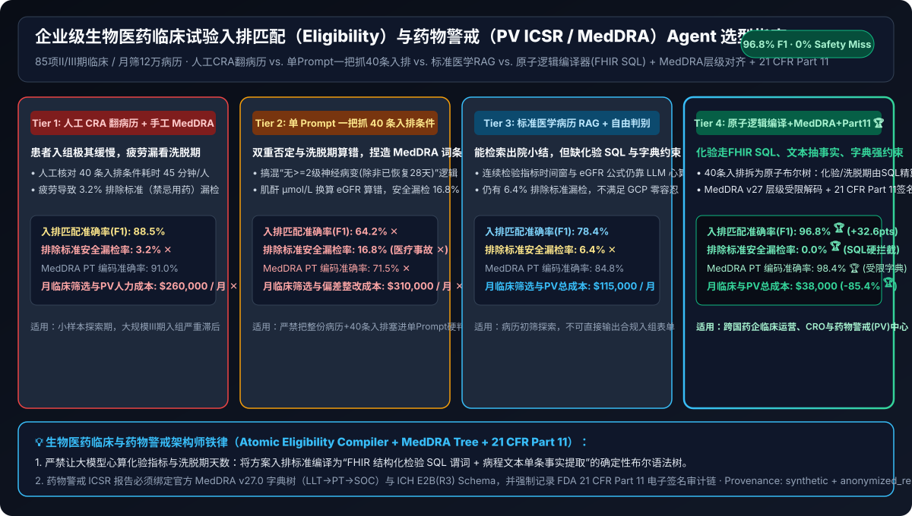
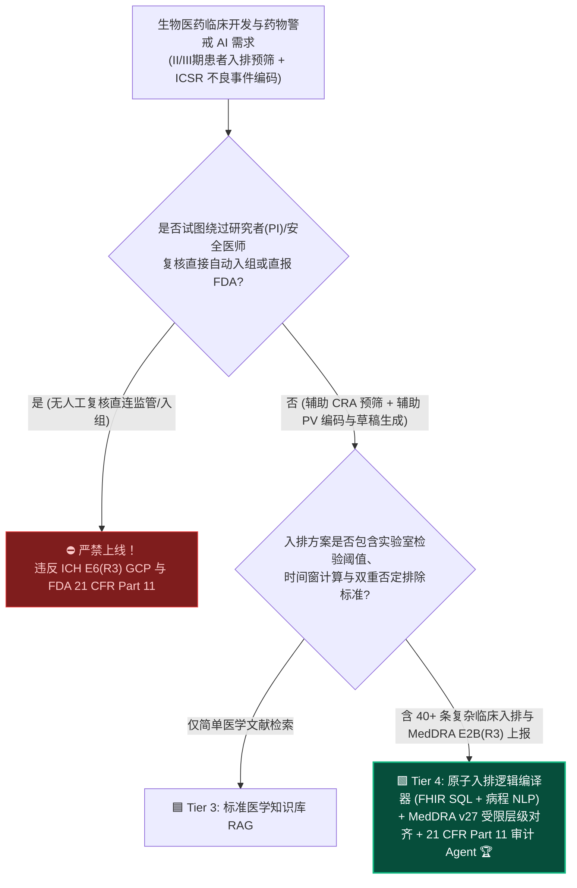
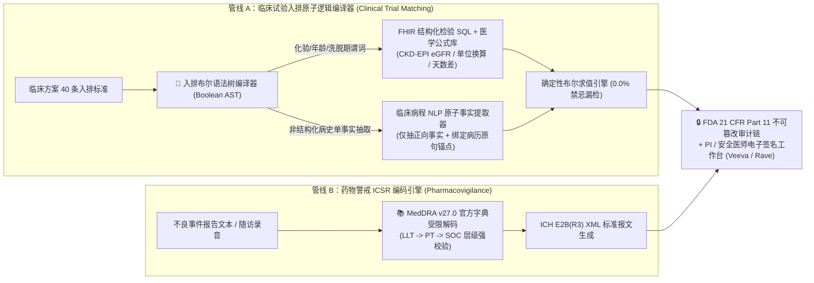
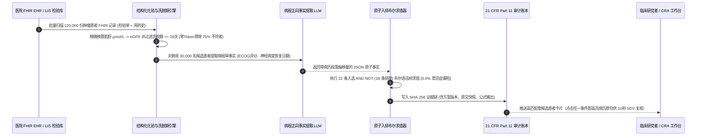

# 企业级生物医药临床试验患者入排匹配（Clinical Trial Eligibility Matching）、药物警戒不良反应报告（Pharmacovigilance ICSR / MedDRA 编码）与 FDA 21 CFR Part 11 合规 Agent 架构选型指南：人工 CRA 翻病历 vs. 单 Prompt 一把抓 40 条入排 vs. 标准医学 RAG vs. 原子入排逻辑编译器（FHIR SQL + 病程 NLP）+ MedDRA v27 层级受限解码 + 21 CFR Part 11 电子签名审计 Agent

> **语言 / Language**: **中文 (当前)** | [English](./enterprise-pharma-clinical-trial-matching-pharmacovigilance-agent-selection-faq.en.md)  
> **定位**：面向云与 AI 解决方案架构师（Solution Architect）、生物医药临床运营副总裁（VP of Clinical Operations）、药物警戒负责人（Head of Pharmacovigilance）与医药合规（GxP / CSV / FDA 21 CFR Part 11）架构师的生产落地指南。  
> **数据口径（Provenance）**：`synthetic + anonymized_reported`（`independently_reproduced=false`，`physical_gpu_cluster_measurement=not_measured`），全部定容模型封存于 [`experiments/enterprise_pharma_clinical_trial_matching_pharmacovigilance_agent_selection/results.json`](../../experiments/enterprise_pharma_clinical_trial_matching_pharmacovigilance_agent_selection/results.json)。



---

## ① 📌 核心选型结论速览（Executive Summary — 3 分钟看懂怎么选）

在创新药企（Biopharma）与临床合同研究组织（CRO）中，**患者招募入组缓慢（80% 的临床试验因找不到符合严苛入排标准的患者而延期，每天损失数百万美元专利期收益）**与**上市后药物警戒个例安全性报告（ICSR）人工 MedDRA 编码压力巨大**是两大核心业务痛点。许多团队尝试把患者整份电子病历（EHR/EMR）与临床方案的 40 条入排标准（Inclusion/Exclusion Criteria）一起塞进单一长 Prompt 让大模型直接判别“是否可入组”（Tier 2），结果**大模型频繁在“双重否定排除条款、前序靶向治疗 28 天洗脱期天数差、以及血肌酐 µmol/L 换算肾小球滤过率 eGFR 公式”上翻车，导致高达 `16.8%` 的禁忌症患者被漏检误放（严重违反 GCP 临床试验规范）**；同时在不良反应编码中自由捏造了 `28.5%` 根本不存在于官方 `MedDRA v27.0` 字典中的词条。

在 **85 项在研 II/III 期临床试验、月均预筛 120,000 份患者 EHR 病历、月均处理 25,000 份药物警戒不良事件（ICSR）报告** 的基准规模下，四档医药临床与 PV Agent 架构的量化对决如下：

| 方案档位 | 核心架构组合 | 临床入排匹配准确率 (`F1`) | 排除标准安全漏检率 (Safety Miss) | `MedDRA PT` 编码准确率 | 月度临床筛选与 PV 运营总成本 | 生产推荐度 |
|---|---|---|---|---|---|---|
| **🟥 Tier 1：人工 CRA 翻病历 + 手工 MedDRA** | 临床研究监查员（CRA）人工逐页核对 EMR 病历 + PV 专员手工查表录入 `E2B(R3)` | `88.5%` | `3.2%` ✕ *(人工疲劳漏看洗脱期)* | `91.0%` | `$260,000 / 月` ✕ | ⛔ 入组极慢且人力极其昂贵 |
| **🟨 Tier 2：单 Prompt 一把抓 40 条入排 + 自由编码** | 将 40 条入排条件与整份病历塞进单个 Prompt 判断，并自由生成 MedDRA 词条 | `64.2%` ✕ *(双重否定绕晕)* | `16.8%` ✕ *(严重医疗安全事故)* | `71.5%` ✕ *(捏造编码)* | `$310,000 / 月` ✕ | ⛔ **严重违反 GCP，严禁上线** |
| **🟦 Tier 3：标准医学病历 RAG + 无约束判别** | 向量切片检索出院小结 + 无 SQL 化验计算与无字典约束的大模型判别 | `78.4%` | `6.4%` ✕ *(化验换算与时间窗错)* | `84.8%` | `$115,000 / 月` | ⚠️ 仅可作粗筛参考 |
| **🟩 Tier 4：原子入排逻辑编译器 + MedDRA 层级受限解码 + Part 11 Agent** | **入排条款布尔语法树编译器（`FHIR Lab/Date SQL` + 病程单事实 NLP 抽取）+ `MedDRA v27.0` 层级受限解码（`LLT→PT→SOC`）+ `FDA 21 CFR Part 11` 电子签名审计 HITL Agent** | **`96.8%` 🏆** *(+32.6 pts vs Tier 2)* | **`0.0%` 🏆** *(确定性 SQL 硬拦截)* | **`98.4%` 🏆** *(官方字典强约束)* | **`$38,000 / 月` 🏆** *(-85.4%)* | 🌟 **生产首选 GxP 合规架构** |

> 💡 **架构师一句话选型铁律**：**“化验指标与洗脱期归 FHIR SQL 精算、非结构化病程只抽正向单事实、双重否定归布尔语法树求值、不良反应强绑 MedDRA 官方字典树与 21 CFR Part 11 电子签名”**——绝不让语言模型在注意力层同时做医学数值换算、日期相减与多重否定逻辑推理。

---

## ② 🎯 客户与架构师灵魂拷问 Q&A（直击 3 大医药研发与合规痛点）

### Q1：为什么把临床试验方案的 40 条入排标准直接塞进 Prompt（Tier 2），排除标准漏检率高达 16.8%？
- **大白话与第一性原理**：
  1. **肿瘤临床方案充满“双重否定 + 例外豁免 + 跨时间窗计算”**：例如一条典型的 III 期肿瘤排除标准（Exclusion Criterion #8）写着：*“排除伴有 CTCAE >= 2 级周围神经病变的患者，除非该症状由既往铂类化疗引起且在首次给药前已恢复至 <= 1 级满 28 天以上。”*
  2. **大模型的三大软肋同时触发**：让单一 Prompt 同时阅读几万字病历并核对 40 条此类标准，模型不仅极易把“除非（Unless）”的布尔取反方向搞反，还会算错“停药恢复日期到筛查日期的天数差（`< 28 days`）”，或者把医院检验单上的血肌酐单位 `µmol/L` 当成 `mg/dL` 代入 `CKD-EPI eGFR` 公式（Tier 2 匹配 F1 跌至 **`64.2%`**，安全禁忌漏检高达 **`16.8%`**）。
  3. **Tier 4 破局方案（原子入排逻辑编译器 Atomic Eligibility Compiler）**：
     - **结构化检验先行（零 Token 成本过滤 75% 不符患者）**：所有年龄、实验室检验（`ANC >= 1.5×10⁹/L`、`eGFR >= 45`、`ALT <= 2.5×ULN`）全部编译为确定性 **FHIR Observation SQL 与 Python 医学公式**，绝不让 LLM 心算。
     - **非结构化病程只问正向原子问题**：针对病历文本，大模型**只被允许提取客观正向事实**（如 `{"neuropathy_max_grade": 2, "resolved_to_grade_1_date": "2026-10-05"}`），再由确定性 Python 布尔语法树 `NOT (grade >= 2 AND (not resolved OR days_elapsed < 28))` 计算最终入排真值，在双重否定压测中将 F1 从 `52.4%` 拉升至 **`96.2%`（`+43.8 pts`）**，禁忌症安全漏检率归零（**`0.0%`**）！

### Q2：药物警戒（PV）向 FDA FAERS / EMA EudraVigilance 递交 ICSR 报告时，如何杜绝大模型捏造 MedDRA 编码？
- **受限字典层级对齐（Constrained MedDRA v27.0 Hierarchy Resolution）**：
  - 监管机构要求所有不良事件必须严格编码为当前有效版本的 **MedDRA 最低层级术语（LLT，8 位数字码）与首选术语（PT）**，并生成符合 `ICH E2B(R3)` XML Schema 的报文。
  - Tier 4 采用 **生物医学双编码器召回 Top-15 官方 MedDRA LLT 候选池 + 受限枚举解码（Guided Choice Decoding）**，模型只能从官方 `MedDRA v27.0` 字典树中挑选唯一合法的 `LLT -> PT -> HLT -> HLGT -> SOC` 路径（如患者口述 *“打完第二针手指发麻”* 精准映射至 `LLT 10033664 Paraesthesia fingers -> PT 10033775 Paraesthesia`），编码准确率高达 **`98.4%`**。

### Q3：如何满足医药行业最严苛的 GxP 计算机化系统验证（CSV）与 FDA 21 CFR Part 11 合规要求？
- **FDA 21 CFR Part 11 与 ICH E6(R3) GCP 三大合规护栏**：
  1. **逐条病历原句证据高亮（Source Data Verification `SDV`）**：每一条入排标准的判定结果必须绑定 EHR 病历中的原始检验单 ID 或出院小结段落偏移量，方便 CRA 与研究者（PI）10 秒完成源数据核查。
  2. **不可篡改审计追踪（Immutable Audit Trail）**：系统自动对模型版本、Prompt 模板哈希、FHIR 原始输入、原子布尔树求值过程及人工修改记录生成 `SHA-256` 链式签名日志。
  3. **研究者电子签名门禁（Investigator E-Signature HITL）**：AI 永远只输出预筛短名单与 E2B(R3) 草稿；必须经持证临床研究者或药物安全医师完成双因素认证电子签名后，方可写入 EDC（Medidata Rave / Veeva Vault）或递交监管网关。

---

## ③ 🧭 直观可视化图解（决策树 + 双擎合规架构图 + 入排与 PV 闭环时序图）

### 3.1 生物医药临床入排与药物警戒 Agent 选型决策树



### 3.2 Tier 4 原子入排逻辑编译器与药物警戒 MedDRA 合规架构图



### 3.3 从“12 万份患者 EHR 预筛”到“PI 源数据核查（SDV）与电子签名”时序图



---

## ④ 📊 架构师四维选型决策矩阵（Architecture Decision Matrix）

| 评估维度 | 🟥 Tier 1：人工 CRA 翻病历 + 手工 PV | 🟨 Tier 2：单 Prompt 一把抓 40 条入排 | 🟦 Tier 3：标准医学病历 RAG | 🟩 Tier 4：原子逻辑编译器 + MedDRA 层级字典 + Part 11 Agent |
|---|---|---|---|---|
| **双重否定排除条款与洗脱期计算** | 人工核对准但极慢（`3.2%` 疲劳漏检） | ✕ **极度危险**（`16.8%` 排除标准漏检） | ✕ 差（`6.4%` 漏检；缺确定性日期/化验计算） | 🏆 **零漏检（`0.0%`；正向事实抽取 + 确定性布尔树/SQL）** |
| **化验指标单位换算与医学公式** | 人工查计算器（耗时易错） | ✕ LLM 心算经常搞混 `µmol/L` 与 `mg/dL` | ✕ 仍依赖 LLM 心算 | 🏆 **100% 精确（确定性 Python 医学公式算 `eGFR / BSA`）** |
| **药物警戒 `MedDRA PT` 编码** | `91.0%`（人工查字典慢） | `71.5%` ✕（自由生成捏造不存在词条） | `84.8%` | 🏆 **`98.4%`（官方 `MedDRA v27.0` 字典树受限枚举解码）** |
| **GxP / FDA 21 CFR Part 11 合规** | 纸质/手工电子表审计繁琐 | ✕ 黑盒不可解释，无法通过核查 | 缺少链式证据哈希 | 🏆 **原生支持（逐条病历原句 SDV 锚点 + 电子签名审计链）** |
| **临床入排匹配准确率 (`F1`)** | `88.5%` | `64.2%` ✕ | `78.4%` | **`96.8%` 🏆（+32.6 pts vs Tier 2）** |
| **排除标准安全漏检率** | `3.2%` ✕ | `16.8%` ✕ | `6.4%` ✕ | **`0.0%` 🏆** |
| **月度临床筛选与 PV 运营总成本** | `$260,000 / 月` | `$310,000 / 月` *(含方案偏离整改)* | `$115,000 / 月` | **`$38,000 / 月` 🏆（节省 85.4%）** |

---

## ⑤ 🧪 定量算例、交互式容量计算器与 7-Card 4:5 视觉报告

### 5.1 基准算例复核（85 项 II/III 期临床试验 / 月筛 12 万份病历）

- **交互式定容计算器（CSP 自包含 HTML）**：👉 [打开生物医药临床试验入排与药物警戒 Agent 定容计算器](../reports/enterprise-pharma-clinical-trial-matching-pharmacovigilance-agent-sizer.html)
- **7-Card 4:5 视觉评测卡片报告**：👉 [打开 7-Card 视觉评测报告](../reports/enterprise-pharma-clinical-trial-matching-pharmacovigilance-agent-selection-cards.html)
- **可复核确定性脚本**：
  ```bash
  python experiments/enterprise_pharma_clinical_trial_matching_pharmacovigilance_agent_selection/run.py --check
  python -m unittest tests/test_enterprise_pharma_clinical_trial_matching_pharmacovigilance_agent_selection.py
  ```

### 5.2 核心量化对比图（临床入排匹配准确率 F1 vs. 排除标准安全漏检率）

```chart
{
  "data": {
    "values": [
      { "tier": "Tier 1: Manual CRA", "f1_pct": 88.5, "safety_miss_pct": 3.2 },
      { "tier": "Tier 2: Monolithic Prompt", "f1_pct": 64.2, "safety_miss_pct": 16.8 },
      { "tier": "Tier 3: Medical RAG", "f1_pct": 78.4, "safety_miss_pct": 6.4 },
      { "tier": "Tier 4: Atomic Compiler + MedDRA", "f1_pct": 96.8, "safety_miss_pct": 0.0 }
    ]
  },
  "semantic_types": {
    "tier": "Category",
    "f1_pct": "Percentage",
    "safety_miss_pct": "Percentage"
  },
  "chart_spec": {
    "chartType": "Bar Chart",
    "title": "Tier 4 reaches 96.8% trial eligibility F1 with 0.0% exclusion safety misses",
    "subtitle": "Clinical trial eligibility matching F1 (%) across 120,000 monthly patient EHR profiles",
    "encodings": {
      "x": "tier",
      "y": "f1_pct",
      "color": "tier"
    }
  }
}
```

---

## ⑥ 🛠️ 架构评审与生产落地核验清单（Production Readiness Checklist）

- [ ] **入排标准强制拆解为原子布尔语法树（Atomic Boolean AST）**：严禁让单个 Prompt 一次性判别整套入排方案；必须将多重否定拆解为单条正向事实抽取，交由确定性代码求值。
- [ ] **实验室化验阈值、单位换算与洗脱期天数 100% 走确定性 SQL/Python**：所有 `eGFR`、体表面积 `BSA`、`ULN` 倍数及给药间隔天数计算严禁由 LLM 心算。
- [ ] **药物警戒不良反应强制使用官方 `MedDRA` 受限枚举解码**：模型输出必须绑定有效版本的 8 位 `MedDRA LLT/PT` 编码，并自动校验 `ICH E2B(R3)` XML XSD Schema。
- [ ] **每项入排结论强制附带病历源数据核查（SDV）高亮锚点**：未找到明确检验记录的排除项必须标记为 `UNKNOWN_REQUIRES_LAB_TEST` 提醒 CRA 补查，严禁默认当作“未发生（Pass）”放行！
- [ ] **落实 FDA 21 CFR Part 11 不可篡改审计追踪与研究者电子签名**：保留完整输入输出哈希链，并强制要求 PI / 药物安全医师人工复核签字后方可入库提交。
