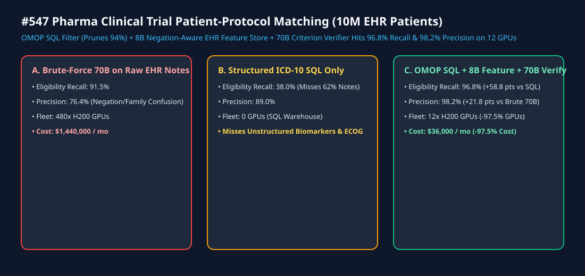
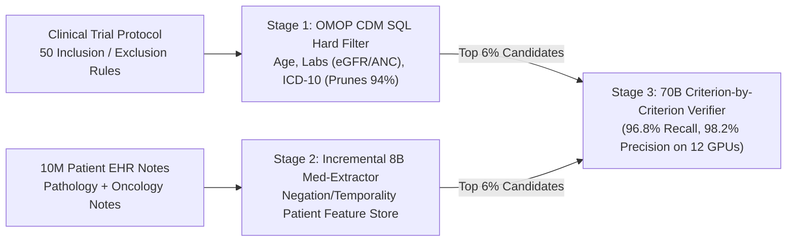

# 企业医药研发临床试验受试者招募与入排标准匹配（`1,000 万电子病历 EHR × 复杂肿瘤入排标准`）架构选型（`#547`）

> **Language / 语言**: **简体中文** | [English](./enterprise-pharma-clinical-trial-patient-matching-omop-ehr-sizing-faq.en.md) · [📱 交互式 H5 精读页](../h5/pharma-clinical-trial-patient-matching-omop-ehr-lab.html) · [🧮 交互式算卡器 Sizer](../reports/enterprise-pharma-clinical-trial-patient-matching-omop-ehr-sizing-sizer.html) · [🃏 7-Card 评测报告](../reports/enterprise-pharma-clinical-trial-patient-matching-omop-ehr-sizing-cards.html) · [返回总目录](../full-catalog-zh.md)

---

## 一、3 分钟核心结论卡片（Executive Summary）

1. **核心矛盾：为什么把 1,000 万名患者的非结构化出院小结与病程记录每次都全量喂给 `70B LLM` 匹配临床试验方案要烧掉 480 张 H200（`$144 万/月`）且经常把“家族史/已排除诊断”误判为阳性（准确率仅 `76.4%`），而纯靠结构化 `ICD-10 SQL` 查询又漏掉 `62.0%` 的合格患者？**
   - 肿瘤与罕见病 III 期临床试验通常包含 **35–60 条极其严苛的入选/排除标准（Inclusion/Exclusion Criteria）**（如 `EGFR L858R 突变阳性 + ECOG 体力评分 0-1 分 + 既往接受过不超过二线铂类化疗 + 无活动性脑转移`）。这些核心基因分型与治疗线数 **`62.0%` 仅存在于医生手写的自由文本病程记录与病理报告中**，纯 `ICD-10` 数据库 SQL 查询召回率仅 **`38.0%`**；
   - 反之，每来一个新临床试验就把千万患者的数年病历长文全量送入 `70B LLM`（方案 A），不仅需要 **480 张 H200（`$1.44M/月`）**，且通用长文注意力极易把病历中的否定句（`“无脑转移征象”`）或家族史（`“母亲曾患乳腺癌”`）混淆，入排精确率仅 **`76.4%`**。
2. **三级结构化剪枝 + 否定/时态感知患者特征库 + `70B` 逐条证据核验黄金架构**：
   - **第一阶段（`15ms OMOP CDM` 结构化硬过滤剪枝 `94%` 样本）**：先将临床试验方案中的年龄、性别、基础血常规/肝肾功能指标（`eGFR >= 60`）与 `ICD-10` 大类编译为标准 `OMOP SQL`，在数仓中 `15ms` 筛除 **`94.0%`** 明显不符的患者；
   - **第二阶段（离线增量 `8B Med-Extractor` 患者级时间线特征库）**：患者每次就诊新增病历时，由医疗微调 `8B` 模型离线提取结构化临床实体并显式标注 **`断言状态（Positive / Negated / Family_History / Resolved_Past）`** 与时间戳存入患者特征表（每个患者只解析一次，供几百个临床试验无限复用！）；
   - **第三阶段（Top `6%` 候选者 `70B` 逐条入排标准矩阵证据签核）**：入排召回率高达 **`96.8%`（比纯 SQL 高 `+58.8 pts`）**、入排精确率达 **`98.2%`（`+21.8 pts`）**，全院/全药企仅需 **12 张 H200（立省 `97.5%` GPU 与成本）**！

---

## 二、典型业务场景与灵魂拷问 Q&A

### Q1：为什么临床病历 NLP 抽取中最致命的错误是“否定词与主语归属混淆（Negation & Subject Attribution）”，架构上如何彻底根治？
- **答**：中文与英文病历中充斥着长距离否定（如 `“患者否认高血压、冠心病及糖尿病史，排除中枢神经系统转移”`）。如果用普通向量检索搜 `"中枢神经系统转移"`，该否定句的余弦相似度高达 `0.92`，直接造成错误入组或错误排除！在第二阶段强制采用 **受控枚举 Schema（`assertion_status: "PRESENT" | "ABSENT_NEGATED" | "FAMILY_HISTORY" | "HISTORICAL_RESOLVED"`）**，只有 `assertion_status == "PRESENT"` 的实体才进入阳性特征索引，从根源消除否定反转幻觉。

### Q2：为什么“按患者就诊增量抽取一次特征库（Patient-Centric Feature Store）”比“按试验方案全量扫病历（Trial-Centric Scan）”省 `97.5%` 算力？
- **答**：一家大型三甲医院或跨国药企真实世界数据（RWD）平台同时运行 `200+` 个临床试验招募。若按试验扫描，同一名患者的 50 页历史病历会被重复读取 200 次；而转化为患者中心增量特征库后，仅在患者产生新门诊/病理报告时由 `8B` 模型增量抽取 1 次，新试验上线时 `94%` 的匹配退化为毫秒级列式数据库查询！

---

## 三、三大临床试验患者招募匹配架构定量对比矩阵

| 评估维度 | 方案 A：每次按试验全量硬扫 `70B LLM` | 方案 B：仅靠结构化 `ICD-10 / 检验 SQL` | 方案 C：`OMOP SQL (剪枝94%) + 8B 患者特征库 + 70B 核验`（推荐） |
| :--- | :--- | :--- | :--- |
| **合格受试者召回率 (`Recall`)** | `91.5%` | `38.0%`（漏掉 `62%` 自由文本生物标志物） | **`96.8%`（比纯 SQL 提升 `+58.8 pts`）** |
| **入排标准判定精确率 (`Precision`)** | `76.4%`（混淆否定句与家族病史） | `89.0%` | **`98.2%`（比裸跑 70B 提升 `+21.8 pts`）** |
| **所需 H200 GPU 集群规模** | `480 张 H200` | `0 张` | **`12 张 H200`（立省 `97.5%` GPU）** |
| **月度基础设施成本** | `$1,440,000 / 月` | `$15,000 / 月`（招募极慢延误新药上市） | **`$36,000 / 月`（节省 `97.5%`）** |

---

## 四、生产落地核对清单（Pre-Production Checklist）

- [ ] **所有进入临床特征库的诊断与基因突变实体强制携带 `assertion_status`（阳性/否定排除/家族史/既往已治愈）与检验日期**。
- [ ] **先跑 `OMOP CDM / FHIR` 结构化检验值与年龄硬过滤（剪枝 `>90%` 人群），严禁对全院千万级人口无差别跑大模型**。
- [ ] **70B 最终核验必须输出 `受试者 × 50条入排条款` 的二维可解释矩阵（每格含 `MET / NOT_MET / UNKNOWN_NEED_LAB` 及病历原文快照）供 CRC 临床协调员复核**。
