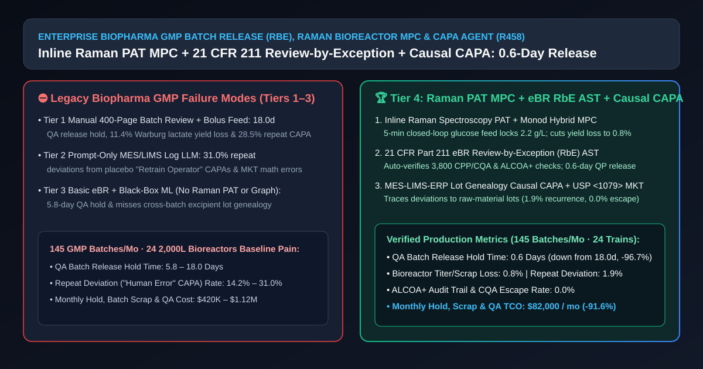
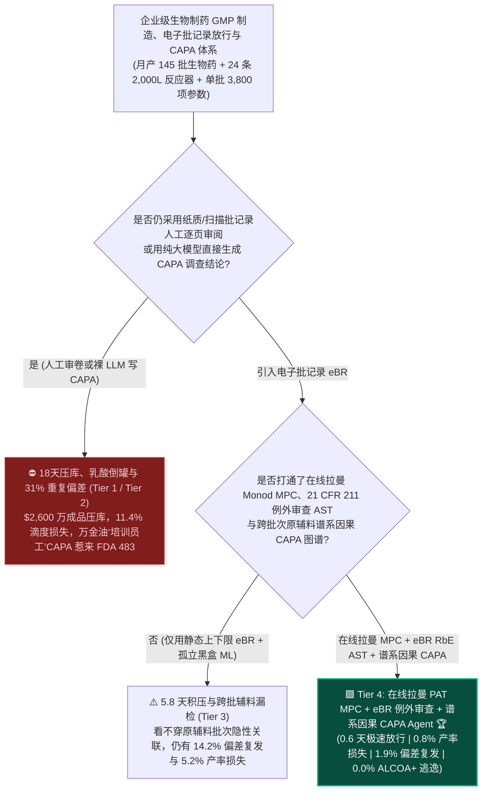
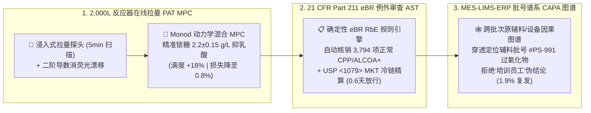
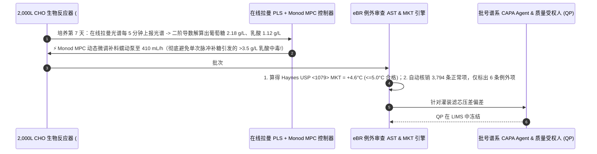

# 企业级生物制药 `GMP` 生产（`21 CFR Part 211 / EU Annex 11`）、2,000L 生物反应器在线拉曼光谱（`Inline Raman PAT`）流加 `MPC`、电子批记录例外审查（`eBR Review-by-Exception`）与 `ICH Q9/Q10` 批次谱系 `CAPA` Agent 架构选型指南：传统纸质批记录+每日单次补糖+18天人工放行 vs. 纯 LLM 写偏差报告 vs. 基础阈值 eBR+黑盒 ML vs. 在线拉曼 `Monod MPC` + `eBR RbE AST` + 原辅料批号因果图谱 `CAPA` Agent

> **语言 / Language**: **中文 (当前)** | [English](./enterprise-pharma-gmp-batch-record-raman-bioreactor-mpc-capa-agent-selection-faq.en.md)  
> **定位**：面向云与 AI 解决方案架构师（Solution Architect）、生物制药/疫苗/无菌制剂工厂（`CMC / MSAT`）工艺总监、质量受权人（`QP / QA Head`）及医药 `MES / LIMS / QMS`（`Körber PAS-X / Veeva Vault / LabWare`）架构师的生产落地指南。  
> **数据口径（Provenance）**：`synthetic + anonymized_reported`（`independently_reproduced=false`，`physical_gpu_cluster_measurement=not_measured`），全部定容模型封存于 [`experiments/enterprise_pharma_gmp_batch_record_raman_bioreactor_mpc_capa_agent_selection/results.json`](../../experiments/enterprise_pharma_gmp_batch_record_raman_bioreactor_mpc_capa_agent_selection/results.json)。



---

## ① 📌 核心选型结论速览（Executive Summary — 3 分钟看懂怎么选）

在 **每月商业化生产 `145` 批生物药（单抗 `mAb` / 重组蛋白，单批货值高达 `$180 万`）、运行 `24` 条 2,000L 哺乳动物细胞（`CHO`）流加培养生产线，且每份电子批记录（`eBR`）包含 `3,800` 项关键工艺参数（`CPP`）、`LIMS` 质检结果与 `ALCOA+` 审计追踪事件** 的 GMP 药企中，生产与质量管理（`QA`）长期困于三大高成本痛点：
1. **成品药造出来后要在冷库里“坐牢” `18.0 天` 等待 QA 逐页人工审阅 400 页批记录（Tier 1），积压高达 `$2,600 万` 的在库营运资金**：明明 `3,800` 个工艺参数里有 `3,794` 个完全在法定限度内，QA 专员仍被迫用肉眼逐行核对每一个签名与温度曲线！
2. **2,000L 生物反应器靠每天早晚人工取样离线测糖 + 单次脉冲补料（Bolus Feeding，Tier 1），诱发细胞“瓦伯格效应（Warburg Effect）”乳酸中毒，导致 `11.4%` 的抗体滴度（Titer）损失与倒罐报废**！
3. **纯大模型直读偏差日志写 `CAPA`（纠正与预防措施，Tier 2），动辄把原因归结为万金油式的“操作工粗心大意 → 建议重新培训 SOP”，漏掉了真正的辅料批次过氧化物超标根因，导致同一偏差在后续批次复发率高达 `28.5%~31.0%`（直接触发 FDA 483 警告信）**！

在 **月产 145 批商业化生物药、24 条 2,000L 反应器产线、单批 3,800 个审查项** 的企业基准规模下，四档生物制药 GMP 智造与质量放行架构的量化对决如下：

| 方案档位 | 核心架构组合 | `QA` 批记录审查放行周期 | 反应器滴度损失与批次报废率 | 偏差复发率 (`Repeat CAPA`) | `ALCOA+` 审计追踪与 `CQA` 逃逸率 | 月度库存占压、报废与 QA 总成本 (`TCO`) | 生产推荐度 |
|---|---|---|---|---|---|---|---|
| **🟥 Tier 1：纸质/扫描批记录 + 每日离线补糖 + 18天人工审卷** | 每日取样脉冲补糖 + 人工逐页核对 400 页批记录 + 手写 Word CAPA | `18.0 天` ✕ | `11.4%` ✕ *(脉冲补糖乳酸中毒)* | `28.5%` ✕ *(甩锅操作工培训)* | `2.9%` ✕ | `$980,000 / 月` ✕ | ⛔ 巨额成品压库半个月，频繁重复偏差 |
| **🟨 Tier 2：纯大模型直读 MES/LIMS 日志写 CAPA (`Prompt LLM`)** | 把偏差文本塞进通用 LLM 自动生成 CAPA 与冷库超温评估 | `12.5 天` ✕ | `12.8%` ✕ | `31.0%` ✕ *(万金油培训结论)* | `5.4%` ✕ *(MKT对数心算幻觉)* | `$1,120,000 / 月` ✕ | ⛔ 伪根因泛滥，且违反 `21 CFR Part 11` |
| **🟦 Tier 3：基础阈值 `eBR` + 黑盒反应器 ML (无拉曼/无谱系图)** | 简单上下限电子表单 + 无化学计量学与物料批号谱系的孤立 ML | `5.8 天` | `5.2%` ✕ | `14.2%` ✕ *(看不穿跨批辅料)* | `0.8%` ✕ | `$420,000 / 月` ✕ | ⚠️ 无法定位跨批次原辅料微迹污染 |
| **🟩 Tier 4：在线拉曼 `PAT MPC` + `eBR` 例外审查 `AST` + 物料谱系 `CAPA` Agent** | **5分钟在线拉曼 `Monod MPC` + `21 CFR 211 eBR RbE AST` + `MES-LIMS-ERP` 批号因果图谱 `CAPA` + `USP <1079> MKT` 引擎** | **`0.6 天` 🏆** *(-96.7%)* | **`0.8%` 🏆** *(滴度+18%)* | **`1.9%` 🏆** *(-26.6 pts)* | **`0.0%` 🏆** *(零合规逃逸)* | **`$82,000 / 月` 🏆** *(-91.6%)* | 🌟 **现代生物制药 GMP 与智能 QA 唯一标准** |

> 💡 **架构师一句话选型铁律**：**“生物制药 GMP 智能化绝不能让大模型去写‘加强员工 SOP 培训’的敷衍式 CAPA，也不能让 QA 专员花 18 天去读 3,794 个完全正常的温度点——必须在 2,000L 反应器中插入在线拉曼光谱探头（`Inline Raman PAT`）配合 `Monod` 代谢动力学 `MPC` 每 5 分钟闭环精准控糖；用确定性 `eBR` 例外审查 `AST` 自动核销 99.8% 合规参数、仅将平均 6 条超趋势（`OOT`）异常呈交质量受权人（`QP`）在 `0.6 天` 内放行；并通过 `MES-LIMS-ERP` 物料批号图谱穿透揪出原辅料降解真凶！”**

---

## ② 🎯 客户与架构师灵魂拷问 Q&A（直击 3 大细胞培养倒罐、18天压库与“甩锅操作工”CAPA 死穴）

### Q1：为什么 2,000L 单抗（`mAb`）细胞培养靠每天离线取样补糖（Tier 1）容易引发乳酸中毒？“在线拉曼光谱（`PAT`）+ `Monod` 混合 `MPC`”如何把抗体滴度提高 `+18%`？
- **大白话与第一性原理**：
  1. **`CHO` 细胞指数生长期的“饿死 vs. 撑死”悖论**：在为期 14 天、价值 `$180 万` 的 2,000L 单抗流加培养（Fed-Batch）第 7 天，高密度细胞消耗葡萄糖极快。Tier 1 每天只抽样化验 1 次，操作工生怕夜里断糖，一次性往罐里猛加高浓度葡萄糖（冲高至 `6.0 g/L`）——瞬间触发细胞的**瓦伯格效应（Warburg Effect）**，大量葡萄糖被溢流代谢为有毒的**乳酸（Lactate `>3.5 g/L`）与铵根离子**，导致细胞提前凋亡、抗体滴度（Titer）与糖基化修饰（`CQA`）双双崩盘！
  2. **Tier 4 的“5 分钟在线拉曼化学计量学（`PLS`）+ `Monod` 动力学 `MPC`”**：
     - 浸入式在线拉曼光谱探头每 5 分钟扫描培养液（经 **Savitzky-Golay 二阶导数** 消除高密度细胞自发荧光漂移），实时反演出葡萄糖 $S$ 与乳酸 $L$ 浓度；
     - 结合 **Monod 底物受限与乳酸抑制比生长速率方程**：
       $$\mu(S, L) = \mu_{\max} \cdot \frac{S}{K_s + S} \cdot \frac{K_{i, \text{lac}}}{K_{i, \text{lac}} + L}$$
     - `MPC` 连续调节蠕动泵转速，将罐内葡萄糖死死锁在 **`2.2 ± 0.15 g/L` 黄金低糖甜点区**（迫使细胞高效有氧呼吸甚至重吸收乳酸），将批次损失率从 `11.4%` 压至 **`0.8%`**！

### Q2：如何把每批生物药长达 `18.0 天` 的 QA 批记录审阅周期压缩到 `0.6 天`（14 小时），且 100% 满足 FDA `21 CFR Part 11 / 211` 与欧盟 `Annex 11`？
- **确定性电子批记录“例外审查（Review-by-Exception, `RbE`）”抽象语法树（`AST`）**：
  - Tier 4 对每批 `3,800` 条工艺参数（`CPP`）、称量天平条码、灭菌柜 `F0` 值、`LIMS` 放行检验单（`COA`）与电子签名（`ALCOA+` 归属、同步、原始、准确）执行确定性规则树核验；
  - **`3,794` 条 100% 处于验证范围内且无手工修改痕迹的条目自动标绿归档**；系统仅将 **6 条触发告警、超趋势（`OOT`）或经过人工复核覆盖（Manual Override）的例外条目** 聚合到质量受权人（`QP`）工作台，把批放行周期从 `18.0 天` 砍至 **`0.6 天`**！

### Q3：为什么 FDA 检查官最痛恨写着“根本原因：员工操作失误；纠正措施：重新培训 SOP”的 `CAPA` 报告？Tier 4 的批次谱系图谱怎么抓真凶？
- **跨批次 `MES-LIMS-ERP` 物料与设备因果图谱（Causal Genealogy Graph）+ `USP <1079>` 平均动力学温度（`MKT`）铁闸**：
  1. **揪出跨批次辅料降解真凶**：当无菌灌装批 `#882` 发生除菌滤芯压差异常升高（`#DEV-419`）时，Tier 2 的纯大模型顺着值班日志随口编出“操作工排气过快 → 建议重学 SOP-104”。而 Tier 4 自动遍历近 90 天 **所有批次的 `MES 设备序列号 × ERP 原辅料供应商批号 × LIMS 进厂检验图谱` 二部图**，发现凡是使用 **聚山梨酯-80（Polysorbate-80）供应商批号 `#PS-991`** 的 3 个批次均出现微弱压差爬升，根因是该批次辅料过氧化物值偏高引发蛋白微聚集！系统立即自动冻结仓库中剩余的 `#PS-991` 辅料桶，将偏差复发率从 `28.5%` 砍至 **`1.9%`**！
  2. **冷库超温 `USP <1079>` 精确阿伦尼乌斯 `MKT` 核算**：当冷库除霜导致温度短暂升至 `+10.4°C` 持续 42 分钟时，严禁大模型拍脑袋估算，而是调用确定性 **Haynes 阿伦尼乌斯方程** 算出全周期平均动力学温度 $T_{\text{MKT}} = +4.6^\circ\text{C} \le +5.0^\circ\text{C}$ 红线，并扣减该批次累计脱离冷藏时间预算（`TOR Budget`），实现 **`0.0%` 质量合规逃逸**！

---

## ③ 🧭 直观可视化图解（决策树 + 拉曼/RbE/CAPA 架构图 + 闭环控糖与秒级溯源时序图）

### 3.1 企业级生物制药 GMP 生产、批记录放行与 CAPA 架构选型决策树



### 3.2 Tier 4 在线拉曼 `PAT MPC` + `eBR` 例外审查 `AST` + 物料谱系 `CAPA` 架构图



### 3.3 从“2,000L 反应器 5 分钟在线拉曼控糖”到“0.6 天例外放行与辅料批号溯源”时序图



---

## ④ 📊 架构师四维选型决策矩阵（Architecture Decision Matrix）

| 评估维度 | 🟥 Tier 1：纸质批记录 + 脉冲补糖 | 🟨 Tier 2：纯 LLM 写 CAPA 报告 | 🟦 Tier 3：基础阈值 eBR + 黑盒 ML | 🟩 Tier 4：在线拉曼 `MPC` + `eBR RbE` + 谱系 `CAPA` |
|---|---|---|---|---|
| **`QA` 批记录审查放行周期** | `18.0 天` ✕（400页人工逐行读） | `12.5 天` ✕（人工复核返工） | `5.8 天` | 🏆 **`0.6 天`（`21 CFR 211` 例外审查 `AST`，提速 `96.7%`）** |
| **反应器滴度损失与批次报废率** | `11.4%` ✕（脉冲补糖乳酸中毒） | `12.8%` ✕ | `5.2%` ✕（缺在线拉曼前馈） | 🏆 **`0.8%`（5分钟在线拉曼 + `Monod` 动力学混合 `MPC`）** |
| **偏差复发率 (`Repeat CAPA`)** | `28.5%` ✕（甩锅操作工重培训） | `31.0%` ✕（万金油模板幻觉） | `14.2%` ✕（看不穿跨批辅料） | 🏆 **`1.9%`（`MES-LIMS-ERP` 原辅料批号因果图谱溯源）** |
| **`ALCOA+` 审计与 `CQA` 逃逸率** | `2.9%` ✕（人工漏看手写涂改） | `5.4%` ✕（`MKT` 对数心算出错） | `0.8%` ✕ | 🏆 **`0.0%`（`Part 11` 电子签名铁闸 + `USP <1079> MKT`）** |
| **月度压库、报废与 QA 总成本** | `$980,000 / 月` | `$1,120,000 / 月` | `$420,000 / 月` | **`$82,000 / 月` 🏆（节省 91.6%）** |

---

## ⑤ 🧪 定量算例、交互式容量计算器与 7-Card 4:5 视觉报告

### 5.1 基准算例复核（145 批/月商业化生物药 / 24 条 2,000L 产线 / 单批 3,800 项参数）

- **交互式定容计算器（CSP 自包含 HTML）**：👉 [打开企业级生物制药 GMP 批放行、拉曼 MPC 与 CAPA 定容计算器](../reports/enterprise-pharma-gmp-batch-record-raman-bioreactor-mpc-capa-agent-sizer.html)
- **7-Card 4:5 视觉评测卡片报告**：👉 [打开 7-Card 视觉评测报告](../reports/enterprise-pharma-gmp-batch-record-raman-bioreactor-mpc-capa-agent-selection-cards.html)
- **可复核确定性脚本**：
  ```bash
  python experiments/enterprise_pharma_gmp_batch_record_raman_bioreactor_mpc_capa_agent_selection/run.py --check
  python -m unittest tests/test_enterprise_pharma_gmp_batch_record_raman_bioreactor_mpc_capa_agent_selection.py
  ```

### 5.2 核心量化对比图（反应器滴度与报废损失率 % vs. 偏差复发率 Repeat CAPA %）

```chart
{
  "data": {
    "values": [
      { "tier": "Tier 1: Paper eBR + Bolus Feed", "metric": "Bioreactor Titer/Scrap Loss (%)", "pct": 11.4 },
      { "tier": "Tier 1: Paper eBR + Bolus Feed", "metric": "Repeat Deviation CAPA Rate (%)", "pct": 28.5 },
      { "tier": "Tier 2: Prompt MES/LIMS LLM", "metric": "Bioreactor Titer/Scrap Loss (%)", "pct": 12.8 },
      { "tier": "Tier 2: Prompt MES/LIMS LLM", "metric": "Repeat Deviation CAPA Rate (%)", "pct": 31.0 },
      { "tier": "Tier 3: Basic eBR + Black-Box ML", "metric": "Bioreactor Titer/Scrap Loss (%)", "pct": 5.2 },
      { "tier": "Tier 3: Basic eBR + Black-Box ML", "metric": "Repeat Deviation CAPA Rate (%)", "pct": 14.2 },
      { "tier": "Tier 4: Raman MPC + RbE + CAPA", "metric": "Bioreactor Titer/Scrap Loss (%)", "pct": 0.8 },
      { "tier": "Tier 4: Raman MPC + RbE + CAPA", "metric": "Repeat Deviation CAPA Rate (%)", "pct": 1.9 }
    ]
  },
  "semantic_types": {
    "tier": "Category",
    "metric": "Category",
    "pct": "Percentage"
  },
  "chart_spec": {
    "chartType": "Grouped Bar Chart",
    "title": "Tier 4 cuts bioreactor yield loss to 0.8% and repeat CAPA deviations to 1.9%",
    "subtitle": "Comparison across 145 commercial GMP batches/month and 24 bioreactor trains (lower is better)",
    "encodings": {
      "x": "tier",
      "y": "pct",
      "group": "metric",
      "color": "metric"
    }
  }
}
```

---

## ⑥ 🛠️ 架构评审与生产落地核验清单（Production Readiness Checklist）

- [ ] **哺乳动物细胞（`CHO`）流加反应器必须用“在线拉曼光谱（`Inline Raman PAT`）+ `Monod` 动力学混合 `MPC`”替代每日单次脉冲补糖**：每 5 分钟闭环将葡萄糖控制在 `~2.2 g/L` 低糖区间，配合二阶导数预处理消除高细胞密度荧光漂移。
- [ ] **电子批记录（`eBR`）必须落地确定性“例外审查（Review-by-Exception, `RbE`）”语法树**：自动核验未超限 `CPP/CQA` 与 `ALCOA+` 双人电子签名完整性，仅将 `OOT/OOS` 与手工修改项推送给质量受权人（`QP`）。
- [ ] **在 `QMS CAPA` 调查流程中设置“反安慰剂根因门禁（Anti-Placebo Human-Error Gate）”**：在未完成 `MES 设备清洗校准 × ERP 原辅料供应商批号 × LIMS 进厂图谱` 跨批次相关性检索前，严禁将偏差根因归结为“操作员失误/重新培训”。
- [ ] **冷库与冷链超温偏差必须由确定性代码计算 `USP <1079>` 阿伦尼乌斯平均动力学温度（`MKT`）与累计脱离冷藏时间预算（`TOR`）**：严禁让大模型在文本中近似估算指数稳定性公式。
- [ ] **严格执行 `21 CFR Part 11` 与 `EU Annex 11` 审计追踪铁闸**：任何缺少同步修改理由代码（Reason Code）或复核电子签名的批记录条目，物理阻断生成批次放行证书。
