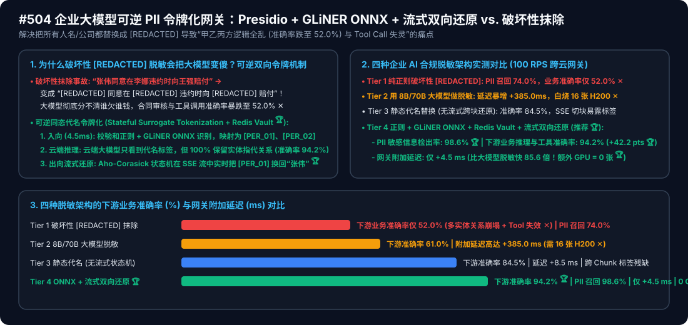

# Enterprise Reversible PII Tokenization (`Presidio + GLiNER ONNX + Redis Vault` vs. Destructive `[REDACTED]`) & Cloud Compliance Gateway Guide (#504)

> **Executive Summary**:
> Scrubbing prompts sent to cloud LLMs with naive **Destructive `[REDACTED]` Masking** collapses multi-party contract reasoning and breaks downstream tool calls because every person, company, and account number becomes an identical `[REDACTED]` token (**downstream task accuracy plunges from `94.2%` to `52.0%` ✕**). Conversely, running an **`8B/70B LLM` Scrubber** on every prompt adds **`+385.0 ms` latency** and burns **`16x H200 GPUs`** at `100 RPS`. For **Cloud & AI Solution Architects**, combining **Checksum-Regex + `GLiNER / DeBERTa-v3 ONNX` NER + Session-Consistent Surrogate Pseudonyms (`[PER_01]`, `[ORG_02]`) in an Ephemeral Redis Vault + Streaming SSE `Aho-Corasick` Re-Hydration** achieves **`98.6%` PII recall**, preserves **`94.2%` downstream reasoning & tool accuracy (`+42.2 pts`)**, and adds only **`+4.5 ms` gateway latency** with **`0` extra GPUs**.
>
> **⚡ Interactive H5 Study Lab**: [**Open the Enterprise Reversible PII Tokenization & Streaming Re-Hydration Gateway Lab (`docs/h5/pii-reversible-tokenization-vault-gateway-lab.html`)**](../h5/pii-reversible-tokenization-vault-gateway-lab.html)

---

## 1. Quantitative Decision Matrix (`100 RPS Enterprise Cloud Compliance Gateway`)

| PII Masking & Gateway Architecture | PII Recall | Downstream Task Acc | Gateway Overhead | Extra Scrubber GPUs |
| :--- | :--- | :--- | :--- | :--- |
| **Tier 1: Destructive `[REDACTED]` Regex Masking** | `74.0%` ✕ | `52.0%` ✕ | `+1.2 ms` | `0 GPUs` |
| **Tier 2: `8B/70B LLM`-Based PII Scrubber** | `97.5%` ✓ | `61.0%` ✕ | `+385.0 ms` ✕ | `16 GPUs` ✕ |
| **Tier 3: Static Pseudonyms (No Streaming Hold)** | `96.8%` ✓ | `84.5%` | `+8.5 ms` | `0 GPUs` |
| **Tier 4: Regex + `GLiNER ONNX` + `Redis Vault` + Streaming 🏆** | **`98.6%` 🏆** | **`94.2% (+42.2 pts)` 🏆** | **`+4.5 ms` 🏆** | **`0 GPUs` 🏆** |
