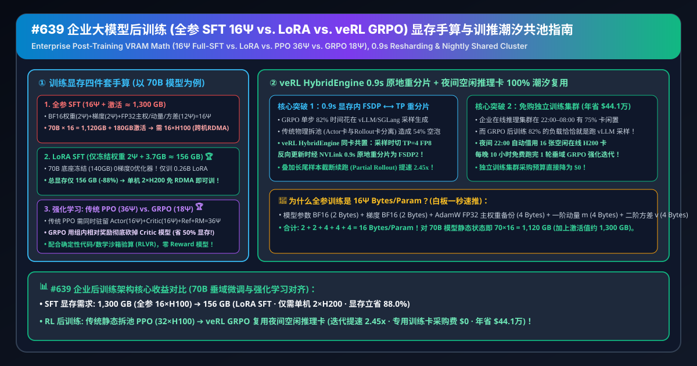

# Enterprise LLM Post-Training (`Full-Param SFT 16Ψ` vs. `LoRA SFT` vs. `veRL/slime GRPO RL`) VRAM 4-Component Math, `0.9s` In-Memory Weight Resharding & Nightly Shared Inference-Training Cluster Sizer (`#639`)

> **Language / 语言**: [简体中文](./enterprise-post-training-16psi-lora-grpo-verl-shared-cluster-faq.md) | **English** · [📱 Interactive H5 Study Lab (with 16Ψ VRAM Calculator + veRL GRPO Sandbox)](../h5/post-training-16psi-lora-grpo-verl-shared-cluster-lab.html) · [🧮 Interactive Sizer](../reports/enterprise-post-training-16psi-lora-grpo-verl-shared-cluster-sizer.html) · [🃏 7-Card Visual Report](../reports/enterprise-post-training-16psi-lora-grpo-verl-shared-cluster-cards.html) · [Back to Catalog](../full-catalog-en.md)

---

## 1. 3-Minute Executive Summary

1. **Bottom-Line Recommendation**:
   - **Four-Component Training VRAM Law (`16Ψ` for Full-Param vs. `2Ψ` for LoRA)**:
     - Full-parameter mixed-precision AdamW SFT requires $2\Psi\text{ (BF16 weights)} + 2\Psi\text{ (BF16 grads)} + 12\Psi\text{ (FP32 master weights, } m, v) = \mathbf{16\Psi\text{ Bytes/Param}}$ (`1,120 GB` static + `180 GB` activations = **`1,300 GB`** for `70B`, requiring `16× H100` across 2 RDMA nodes).
     - **`LoRA SFT` (`r=32`)** freezes the `70B` base (`140 GB`, zero base gradients/optimizer states), slashing total VRAM by **`88.0%` to `156 GB`** — fitting comfortably on **`2× H200 GPUs` inside a single server without RDMA**!
   - **`veRL HybridEngine / slime` `GRPO` + Nightly Inference Cluster Sharing (`$0` Dedicated Training Cluster CapEx)**:
     - `GRPO` eliminates the `16Ψ` Critic model (`-50%` RL memory vs. `PPO`), while `veRL HybridEngine` reshards weights in-memory between `FSDP2` training and `vLLM TP=4 FP8` rollout in **`0.9 seconds`** over NVLink (cutting pipeline bubble from `54.0%` to **`8.4%`**, **`2.45×` faster iteration**).
     - Because `82%` of each GRPO step is simply `vLLM` inference rollout, harvesting `16` idle nighttime online inference GPUs (`22:00–08:00`) saves **`$441,600/yr`** in dedicated training hardware!

---

## 2. Quantitative Post-Training Comparison Matrix (`70B` Domain Alignment)

| Metric | Option A: Full-Param SFT (`16Ψ`) + Disaggregated `PPO` (`36Ψ`) | Option B: Cloud Fine-Tuning API | Option C: `LoRA SFT` (`2× H200`) + Nightly Shared `veRL GRPO` (`#639`) 🏆 |
| :--- | :--- | :--- | :--- |
| **`70B SFT` VRAM & Min GPUs** | `1,300 GB` (`16× H100` + RDMA ✕) | Cloud black-box | **`156 GB` (`2× H200` single-node, `-88.0%` VRAM ✓)** |
| **RL Pipeline Bubble & Speedup** | `54.0%` bubble (`1.00×` ✕) | No custom RLVR | **`8.4%` bubble (`0.9s` resharding, `2.45×` faster ✓)** |
| **Dedicated Training GPU Spend** | `$36,800 – $73,600 / mo` | `$18,500 / mo` | **`$0 / mo` (reuses nighttime inference GPUs, saves `$441.6K/yr` ✓)** |
