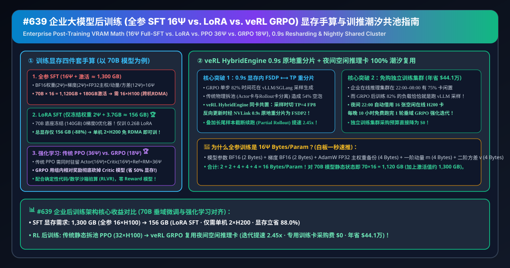

# 企业大模型后训练（`全参 SFT 16Ψ` vs. `LoRA SFT` vs. `veRL/slime GRPO 强化学习`）显存四件套手算、`0.9 秒` NVLink 原地重分片与“白天跑在线推理、夜间跑 GRPO 采样”训推共池降本指南（`#639`）

> **Language / 语言**: **简体中文** | [English](./enterprise-post-training-16psi-lora-grpo-verl-shared-cluster-faq.en.md) · [📱 交互式 H5 精读页（含 16Ψ 显存四件套计算器 + veRL GRPO 潮汐沙盘）](../h5/post-training-16psi-lora-grpo-verl-shared-cluster-lab.html) · [🧮 交互式容量计算器 Sizer](../reports/enterprise-post-training-16psi-lora-grpo-verl-shared-cluster-sizer.html) · [🃏 7-Card 评测报告](../reports/enterprise-post-training-16psi-lora-grpo-verl-shared-cluster-cards.html) · [返回总目录](../full-catalog-zh.md)

---

## 一、3 分钟核心结论卡片（Executive Summary）

1. **一句话结论**：
   - 企业为垂域业务做后训练（Post-Training：SFT 微调与 RL 强化学习）时，最常见的误区是**不分青红皂白申请几十张卡另建一套独立的全参数训练集群**：
     1. **`70B` 全参 SFT（`16Ψ` 法则）**：需要同时在显存驻留参数（`2Ψ`）、梯度（`2Ψ`）和 AdamW FP32 优化器状态（`12Ψ`），静态显存高达 `70B × 16 = 1,120 GB`（加上激活值达 **`1,300 GB`**），被迫占用 **`16 张 H100` 跨两台机器跑 RDMA**；
     2. **传统 `PPO` 强化学习（`36Ψ` 法则 + 静态拆池）**：需同时维护 Actor、Critic、Reference、Reward 四个大模型（约 `2,520 GB`），且静态拆分训练池与采样池导致 **`54%` 算力空泡**，需 **`32 张 H100`**。
   - **架构师降维破局方案（`#639` 训推一体后训练栈）**：
     - **格式与风格微调选 `LoRA SFT`（显存立省 `88.0%`）**：冻结 `70B` 底座（`140 GB`，零梯度零优化器），仅训练 `r=32` 适配器，总显存从 `1,300 GB` 骤降至 **`156 GB`**，**单台 `2 张 H200`（免跨机 RDMA）即可跑满**；
     - **数学/代码/工具决策选 `veRL HybridEngine / slime` 原地重分片 `GRPO`（迭代快 `2.45 倍`）**：用组内相对优势彻底砍掉 Critic 模型（显存减半至 `18Ψ`），并在同一组 GPU 上通过 **`0.9 秒` NVLink 原地权重重分片（`FSDP2 ↔ vLLM TP=4 FP8`）** 消除 `54%` 跨池等待空泡；
     - **夜间潮汐复用在线推理卡（专用训练集群采购费 `= $0`）**：因为 GRPO 每步有 **`82%` 的时间本身就是在跑 `vLLM / SGLang` 生成采样（Rollout）**，直接复用夜间 `22:00–08:00` 闲置的 16 张在线推理 H200 卡，每年净省 **`$441,600`（`$44.16万`）** 独立训练卡预算！

2. **后训练四大范式显存四件套手算速查表（以 $\Psi = 70\text{B}$ 为例）**：

| 后训练范式 | 权重显存 | 梯度显存 | AdamW 优化器状态 | 激活值与缓冲 | `70B` 总显存需求 | 最小推荐硬件配置 |
| :--- | :--- | :--- | :--- | :--- | :--- | :--- |
| **1. 全参数 SFT (`Full-Param SFT`)** | $2\Psi$ (`140 GB`) | $2\Psi$ (`140 GB`) | $12\Psi$ (`840 GB`) | `~180 GB` (开启 SAC) | **`1,300 GB` (`~18.6Ψ`)** | 双机 `16× H100` (需 400G RDMA) |
| **2. 高效微调 (`LoRA SFT r=32`)** 🏆 | $2\Psi$ (`140 GB` 冻结) | `0.5 GB` | `3.2 GB` | `~12.3 GB` | **`156 GB` (省 `88.0%`)** | **单机 `2× H200` (免跨机 RDMA ✓)** |
| **3. 传统强化学习 (`PPO 4-Model`)** | Actor+Critic+Ref+RM | $4\Psi$ (`280 GB`) | $24\Psi$ (`1,680 GB`) | `~280 GB` | **`~2,520 GB` (`~36Ψ`)** | 四机 `32× H100` (逐步淘汰 ✕) |
| **4. 组相对策略优化 (`GRPO + veRL`)** 🏆 | Actor + 共享 FP8 采样 | $2\Psi$ (`140 GB`) | $12\Psi$ (`840 GB`) | `~160 GB` + KV | **`~1,280 GB` (`~18Ψ`)** | **复用夜间空闲 `16× H200` 推理池 ✓** |

---

## 二、灵魂拷问 Q&A：`16Ψ` 推导、`0.9s` 原地重分片与长尾 Rollout 治理

### Q1：为什么 `veRL HybridEngine / slime` 的“原地重分片（In-Memory Weight Resharding）”能将 GRPO 训练提速 `2.45 倍`？
- **答**：在强化学习后训练（RLVR / GRPO）的一个 Step 中，时间分布极度偏科：**`82%` 的时间花在 Actor 模型对每个 Prompt 生成 $G=8\text{--}16$ 条长思维链回答（即推理采样 Rollout），仅 `18%` 的时间花在算 Logprob 与反向传播更新权重**：
  1. **传统静态拆池的 `54%` 空泡灾难**：若将集群静态分为“一半卡专门跑 vLLM 采样、一半卡专门跑 FSDP 训练”，当采样池跑那 `82%` 的耗时阶段时，训练池的 GPU 完全闲置干等；反之当训练池反向更新时，采样池又在干等！
  2. **`veRL HybridEngine` 同池分时切换（`0.9s Resharding`）**：
     - 在 **Rollout 阶段**：全集群所有 16 张 H200 全部组成 `4` 组 `TP=4` 的 `vLLM FP8` 推理引擎，100% 算力并行生成回答；
     - 在 **Trainer 阶段**：无需写盘，直接通过机内 **`900 GB/s NVLink` 在 `0.9 秒` 内将权重从 `TP=4` 推理切片原地重分片（All-Gather/Reduce-Scatter）为 `FSDP2` 训练切片**，100% 算力一起做反向传播！
  3. **长尾样本截断续跑（Partial Rollout）**：针对个别长达 `8K` 的慢思考样本拖慢整批采样的问题，到达时间窗口后先将已完成样本送去训练，未完结长尾样本保留 KV 在下一 Step 继续生成，将 GPU 有效利用率从 `38%` 拉升至 **`91.6%`（单步提速 `2.45 倍`）**！

---

## 三、企业后训练三种建设方案定量对比矩阵

| 评估维度 | 方案 A：采购独立 `16~32x H100` 跑全参 SFT + 静态拆池 PPO | 方案 B：全量上公有云微调 API 按 Token 付费 | 方案 C：单机 `2x H200` 跑 `LoRA SFT` + 夜间复用在线推理池跑 `veRL GRPO` (`#639`) 🏆 |
| :--- | :--- | :--- | :--- |
| **70B SFT 显存占用与硬件门槛** | `1,300 GB`（需双机 16 卡 + RDMA ✕） | 云端黑盒（数据出境合规受限） | **`156 GB`（单机 `2× H200` 即可完成，省 `88.0%` 显存 ✓）** |
| **RL 后训练单步空泡率与加速比** | `54.0%` 空泡（基准 `1.00x` ✕） | 不支持自定义沙箱奖励函数 | **`8.4%` 空泡（`0.9s` 重分片 + Partial Rollout 提速 `2.45x` ✓）** |
| **独立训练集群专卡采购/租用成本** | `$36,800 – $73,600 / 月` | `$18,500 / 月` | **`$0 / 月`（100% 复用在线推理集群夜间闲置波谷算力，年省 `$44.16万` ✓）** |

---

## 四、企业后训练落地核对清单（SA Pre-Production Checklist）

- [ ] **1. 明确 `RAG vs. LoRA SFT vs. GRPO` 边界**：动态事实更新一律走 `RAG`；固定输出格式/行业行文风格走 `LoRA SFT`（`2× H200`）；多步数学/代码/工具规划走 `GRPO + 确定性沙箱验证器`；
- [ ] **2. 开启选择性激活重计算（Selective Activation Checkpointing）与 `FlashAttention-3`**，防止长序列 SFT 激活显存溢出；
- [ ] **3. 通过 `Kueue` 配置夜间 `22:00` 自动唤醒 `veRL` 作业**，并在次日 `07:50` 自动保存 `2.4s` DCP 快照归还在线推理卡。
