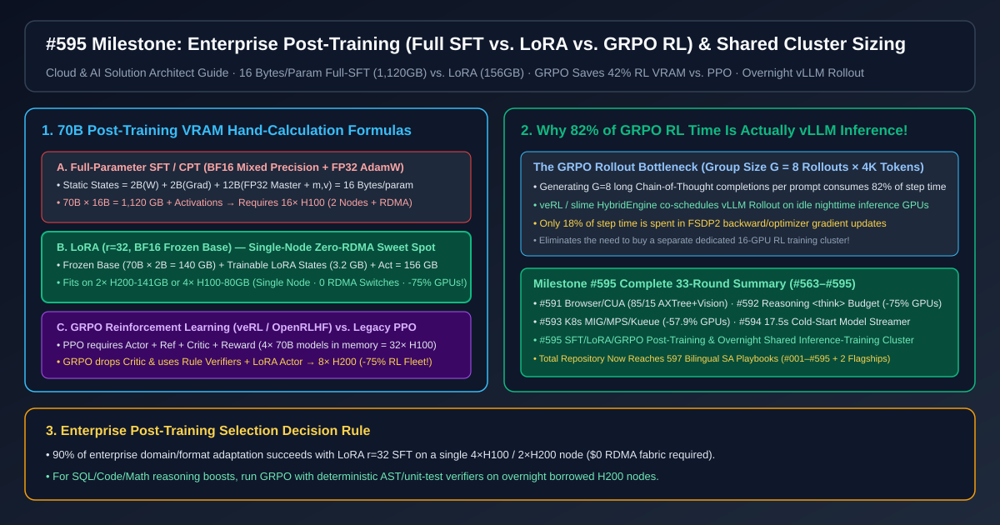

# Milestone `#595`: Enterprise Post-Training (`Full-Param SFT` vs. `LoRA` vs. `GRPO RL`) VRAM Hand-Calculation & Shared Inference-Training Cluster Guide

> **Target Persona**: Cloud & AI Solution Architect  
> **Core Scenarios**: Weekly enterprise domain adaptation (`Llama-Factory / Axolotl`), SQL/Code/Risk reinforcement learning (`veRL / OpenRLHF GRPO`), and sizing shared inference-training GPU fleets  
> **Interactive H5 Learning Workbench**: [`docs/h5/post-training-sft-lora-grpo-cluster-sizer.html`](../h5/post-training-sft-lora-grpo-cluster-sizer.html)

---

## 1. Executive Summary

1. **The `16 Bytes/Param` Full-SFT Wall vs. Single-Node `LoRA` (`1,300 GB` vs. `156 GB` on `70B`)**:
   - Full-parameter mixed-precision training (`2B` BF16 weights + `2B` BF16 grads + `12B` FP32 master weights & AdamW $m,v$ states = **`16 Bytes/param`**) requires **`1,120 GB` static VRAM + `180 GB` activations = `1,300 GB`**, forcing a **`16× H100` (`2`-node RDMA) cluster**.
   - **`LoRA (r=32, BF16 frozen base)`** requires just **`156 GB` total VRAM**, fitting inside a **single `2× H200-141GB` or `4× H100-80GB` node (`-75%` GPUs, zero cross-node RDMA switches required)**.
2. **Why `GRPO` Cuts RL VRAM by `42%+` vs. `PPO` and Runs on Overnight Borrowed Inference GPUs**:
   - `GRPO` eliminates the `70B` Value/Critic model and shares the single frozen `70B` base between `Actor` (LoRA enabled) and `Reference` (LoRA disabled).
   - Because **82% of GRPO step time is spent in `vLLM` group rollout generation ($G=8$)**, enterprises run weekly `veRL` GRPO jobs overnight (`22:00–06:00`) on their existing daytime `8× H200` inference node — saving **`$441,600/year`** vs. procuring a separate dedicated training cluster!

---

## 2. Post-Training VRAM & Hardware Matrix (`70B` Model · `8K` Context)

| Paradigm | Static Model + Optimizer VRAM | Total VRAM (with Act / Rollout) | Minimum GPU Fleet | Cross-Node RDMA Needed? |
|---|---|---|---|---|
| **`QLoRA SFT` (`NF4 + r=32`)** | `41.7 GB` | **`52 GB`** | **`1× H100` or `2× L40S`** | No |
| **`LoRA SFT` (`BF16 + r=32`)** | `143.2 GB` | **`156 GB`** | **`2× H200` or `4× H100`** | **No (Single Node)** |
| **`veRL GRPO` (`LoRA + vLLM Rollout`)** | `146.0 GB` (+ KV pool) | **`520 GB`** | **`4×–8× H200` (1 Node)** | **No (Single Node)** |
| **`Full-Param SFT / PPO`** | `1,120–2,400 GB` | **`1,300–2,800 GB`** | **`16×–32× H100` (2–4 Nodes)** | **Yes (400G IB/RoCEv2)** |

---

## 3. Production Checklist

- [ ] Share a single frozen base model between `Actor` and `Reference` via adapter toggling in `DPO` and `GRPO`.
- [ ] Use **`veRL` HybridEngine** on overnight borrowed `H200` inference nodes to run weekly `LoRA SFT` and `GRPO` post-training at `$0` extra GPU CapEx.
