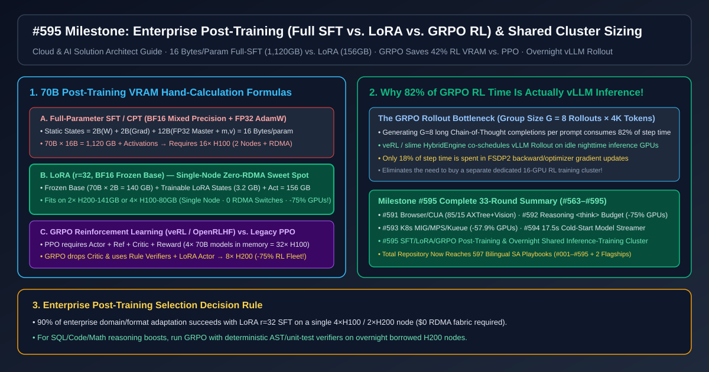
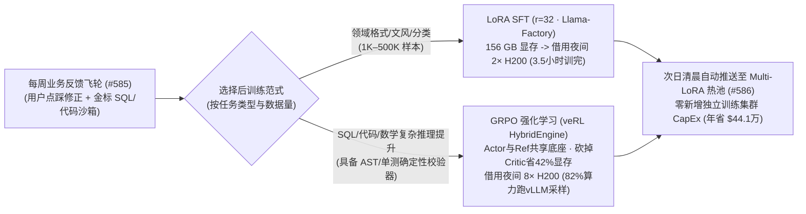

# 第 595 篇里程碑：企业级大模型后训练（`Full-Param SFT` vs. `LoRA` vs. `GRPO 强化学习`）显存手算公式与“训推共池潮汐复用”架构选型指南

> **面向角色**：Cloud & AI Solution Architect（云与 AI 解决方案架构师）  
> **核心场景**：企业每周领域微调（`Llama-Factory / Axolotl`）、SQL/代码/风控强化学习后训练（`veRL / OpenRLHF GRPO`）、评估是否需要单独采购跨机 InfiniBand 训练集群  
> **配套交互式 H5 精读工作台**：[`docs/h5/post-training-sft-lora-grpo-cluster-sizer.html`](../h5/post-training-sft-lora-grpo-cluster-sizer.html)

---

## 一、执行摘要（Executive Summary：3 分钟掌握核心架构结论）

1. **为什么 `90%` 的企业根本不需要为了“微调 `70B` 模型”去单独采购昂贵的跨机 InfiniBand 训练集群？**  
   - **全量参数微调（Full-Parameter SFT）的 `16 Bytes/Param` 显存鸿沟**：在混合精度（`BF16` 权重 `2B` + `BF16` 梯度 `2B` + `FP32` 主权重备份 `4B` + `FP32 AdamW` 一阶动量 $m$ 与二阶方差 $v$ `8B` = **`16 Bytes/参数`**）下，仅 `70B` 模型的静态训练状态就高达 **$70 \times 16 = \mathbf{1,120\text{ GB}}$**！加上激活值（Activations）后至少需要 **`16× H100-80GB`（跨 2 台 8 卡节点 + 高速 RDMA 网络跑 FSDP2 / ZeRO-3）**。
   - **`LoRA (r=32, BF16 冻结底座)` 的单机破局（立省 `75%` 显卡且免除跨机 RDMA）**：冻结的 `70B` 底座仅占 **`140 GB`**，可训练参数占比 `< 0.5%`（AdamW 状态仅 `3.2 GB`），总显存仅需 **`156 GB`**——**单台 `2× H200-141GB` 或 `4× H100-80GB` 节点即可在机内 NVLink 下全速完成微调，完全不需要跨机 RDMA 交换机**！
2. **为什么 2025–2026 企业强化学习后训练全面从 `PPO` 转向 `GRPO (Group Relative Policy Optimization)`？**  
   - **显存削减 `42%+`**：传统 `PPO` 必须在显存中同时维护 **4 个模型**（`Actor` 策略模型 + `Reference` 参考模型 + `Critic/Value` 价值模型 + `Reward` 奖励模型），训 `70B` 至少要 **`32× H100`**；而 **`GRPO` 彻底砍掉了同尺寸的 `Critic` 价值模型**（通过对同一 Prompt 采样 $G=8$ 条输出计算组内相对优势分数），并用 **确定性规则校验器（SQL AST 校验 / 单测沙箱 / 数学验算）** 替代 `Reward` 模型！
   - **82% 算力本质是 `vLLM` 推理（训推共池黄金机会）**：在 `GRPO` 每个训练 Step 中，**高达 `82%` 的时间花在 `vLLM` 生成 $G=8$ 条长思维链候选回答（Rollout Generation）上**，只有 `18%` 的时间在做反向传播！因此企业完全可以在夜间 `22:00–06:00` **直接借用白天在线推理的 `8× H200` 集群跑 `veRL / OpenRLHF` 强化学习**，省下整套独立训练集群采购（年省 **`$44.1 万`**）！

---

## 二、架构师灵魂拷问（Core Q&A）

### Q1：手算 `70B` 模型在不同后训练范式（`Full SFT`、`LoRA`、`QLoRA`、`DPO`、`GRPO`）下的精确显存水位线公式是什么？
给定模型参数量 $\Phi$（十亿，如 $\Phi = 70$）：
1. **全参微调 `Full-Param SFT / CPT (BF16 + FP32 AdamW + ZeRO-3/FSDP2)`**：
   $$M_{\text{Full-SFT}} = 16 \Phi + M_{\text{act}}(\text{SeqLen}, \text{GradCkpt}) \approx 1,120\text{ GB} + 180\text{ GB} = \mathbf{1,300\text{ GB}} \implies \mathbf{16\times\text{H100}\text{ (2 节点)}}$$
2. **低秩微调 `LoRA (r=32, BF16 Base)`**：
   $$M_{\text{LoRA}} = 2 \Phi + 16 \Phi_{\text{LoRA}} + M_{\text{act}} \approx 140\text{ GB} + 3.2\text{ GB} + 12.8\text{ GB} = \mathbf{156\text{ GB}} \implies \mathbf{2\times\text{H200}\text{ 或 }4\times\text{H100}}$$
3. **量化低秩微调 `QLoRA (NF4 Base + BF16 LoRA)`**：
   $$M_{\text{QLoRA}} = 0.55 \Phi + 16 \Phi_{\text{LoRA}} + M_{\text{act}} \approx 38.5\text{ GB} + 3.2\text{ GB} + 10.3\text{ GB} = \mathbf{52\text{ GB}} \implies \mathbf{1\times\text{H100-80GB}\text{ (单卡可训 70B!)}}$$
4. **组相对策略优化 `GRPO (LoRA Actor + Frozen Ref Sharing + vLLM Rollout)`**：
   - 由于 `LoRA` 模式下 **冻结底座加上适配器就是 `Actor`、关闭适配器开关就是 `Reference` 模型**（`Actor` 与 `Ref` **100% 共享同一份底座权重，零额外 Ref 显存**！），加上 `vLLM` 采样 KV Cache 池，仅需 **`8× H200-141GB`（单台 8 卡节点）** 即可全速完成 `70B` 强化学习后训练！

### Q2：在什么时候必须咬牙上 `Full-Parameter CPT（全参继续预训练）`，什么时候严禁上全参微调？
- **90% 场景严禁上全参微调**：当你的语料少于 `10 亿（1B）Tokens`（如几万条客服问答、几千份企业合同、或者几千条 Text-to-SQL 金标对）时，跑全参微调不仅贵 `4–8 倍`，还会引发严重的 **灾难性遗忘（Catastrophic Forgetting，把底座原有的通用推理能力训傻）**；此时 **`LoRA (r=32) + DoRA / NEFTune`** 在准确率与抗遗忘性上全面胜出。
- **仅在以下 10% 场景启动全参 CPT**：需要将模型迁移至全新的小语种（如藏语/东南亚小语种）或百亿 Token 级专有科学编码（如生物基因序列、专有芯片 EDA 网表），且拥有 `> 10B Tokens` 高质量清洗语料。

---

## 三、五大后训练范式显存与硬件选型矩阵（以 `70B` 模型、`8K` 序列长度为例）

| 后训练范式 | 静态模型与优化器显存 | 含激活/Rollout 总显存 | 最低推荐 GPU 配置 | 是否需要跨机 RDMA 网络 | 核心适用场景 |
|---|---|---|---|---|---|
| **1. `QLoRA SFT` (`NF4 + r=32`)** | `41.7 GB` | **`52 GB`** | **`1× H100-80GB` 或 `2× L40S`** | 否（单卡/单机） | 预算受限团队验证 70B 微调可行性 |
| **2. `LoRA SFT` (`BF16 + r=32`)** | `143.2 GB` | **`156 GB`** | **`2× H200` 或 `4× H100`** | **否（单机 NVLink 闭环）** | **90% 企业领域知识格式、客服话术、多租户适配器主力方案** |
| **3. `LoRA DPO` (`Actor+Ref 共享底座`)** | `144.8 GB` | **`172 GB`** | **`2× H200` 或 `4× H100`** | 否（单机 NVLink） | 人类偏好对齐、拒答边界微调 |
| **4. `veRL GRPO` (`LoRA + vLLM Rollout`)** | `146.0 GB` (+ KV 池) | **`520 GB`** | **`4×–8× H200`（单节点）** | **否（单机 8 卡即可）** | **Text-to-SQL、代码生成、风控计算等有确定性判分器的推理跃迁** |
| **5. `Full-Param SFT / PPO`** | `1,120 GB` (`PPO` 达 `2,400GB+`) | **`1,300–2,800 GB`** | **`16×–32× H100`（2–4 节点）** | **必须（400G IB / RoCEv2）** | 百亿 Token 全新语种继续预训练（CPT） |

---

## 四、生产级企业后训练与训推共池落地 Checklist

- [ ] **优先使用 `LoRA / DoRA (r=32)` 使得 `Actor` 与 `Reference` 模型在 `DPO / GRPO` 中 100% 共享同一份冻结底座权重**：避免在显存里同时塞入两份完整的 `140 GB` 底座副本。
- [ ] **在 `GRPO` 中使用 `veRL` 或 `OpenRLHF` 的 `HybridEngine` 训推一体权重原地转换**：在同一个 GPU 上完成 `vLLM Rollout 采样` 后，通过原地显存重分片（Zero-Copy Weight Resharding）瞬间切换为 `FSDP2` 训练态，消除训练池与采样池跨卡拷贝停顿。
- [ ] **将每周例行微调任务编排进 `Kueue` 夜间潮汐队列（`22:00–06:00`）**：直接复用日间在线推理的 `H200` 节点完成每周模型迭代，将训练好的 `268 MB` LoRA 权重在次日早上热挂载至 `#586 Multi-LoRA` 推理池，形成零硬件闲置的闭环数据飞轮！

---

## 五、配套资产索引

- **交互式 H5 精读工作台**：[`docs/h5/post-training-sft-lora-grpo-cluster-sizer.html`](../h5/post-training-sft-lora-grpo-cluster-sizer.html)
- **7-Card 4:5 评测报告**：[`docs/reports/enterprise-post-training-sft-lora-grpo-shared-cluster-sizing-cards.html`](../reports/enterprise-post-training-sft-lora-grpo-shared-cluster-sizing-cards.html)
- **交互式容量计算器**：[`docs/reports/enterprise-post-training-sft-lora-grpo-shared-cluster-sizing-sizer.html`](../reports/enterprise-post-training-sft-lora-grpo-shared-cluster-sizing-sizer.html)
- **可复现实验模型**：[`experiments/enterprise_post_training_sft_lora_grpo_shared_cluster_sizing/run.py`](../../experiments/enterprise_post_training_sft_lora_grpo_shared_cluster_sizing/run.py)
