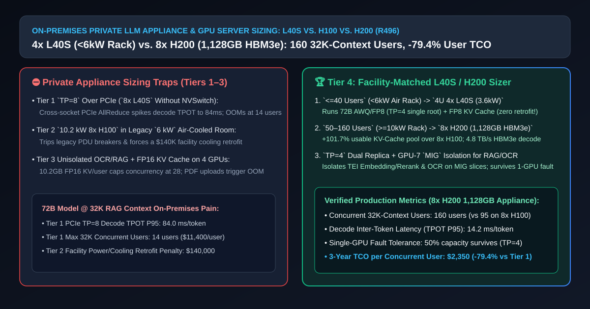
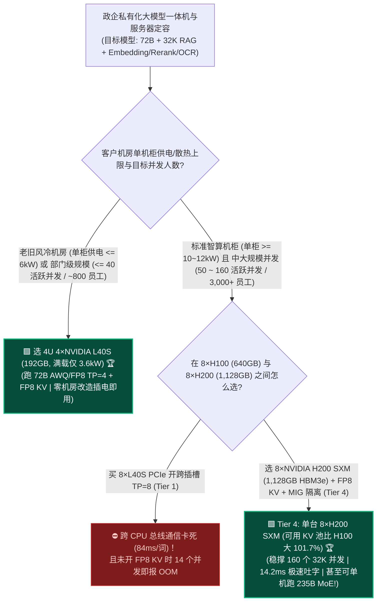
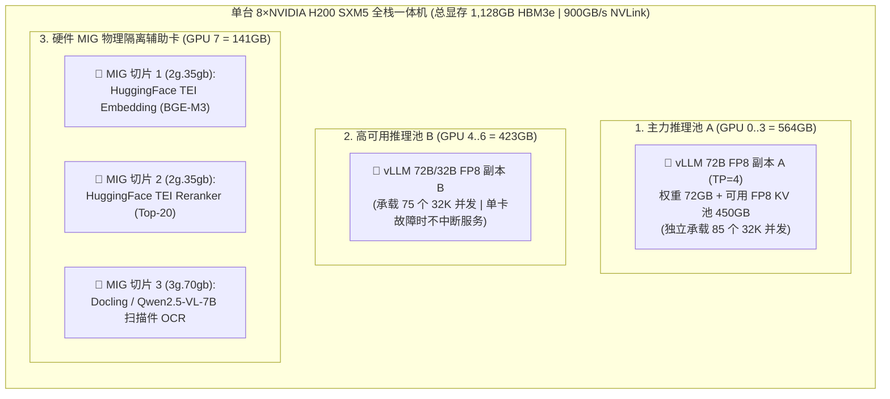
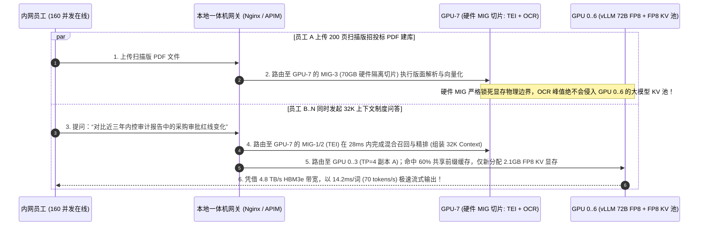

# 政企/金融/制造私有化大模型一体机与本地 GPU 服务器定容选型指南（`4×L40S` vs. `8×H100` vs. `8×H200`）：从 30 并发到 200 并发 `32K` 长上下文 RAG，到底该买什么卡、配几台机器、如何避免老机房 `6kW` 跳闸与 `PCIe TP=8` 性能腰斩？

> **语言 / Language**: **中文 (当前)** | [English](./enterprise-private-llm-appliance-gpu-server-sizing-h200-l40s-selection-faq.en.md)  
> **定位**：面向云与 AI 解决方案架构师（Solution Architect）、政企私有云售前总监与数据中心基建负责人的“本地私有化大模型服务器显存定容公式（`Weights + KV Cache + 12% Overhead`）、机型选型对比（`PCIe L40S` vs. `SXM H100/H200`）、单机全栈切分（`vLLM + MIG 隔离 Embedding/Reranker/OCR`）与机柜配电散热红线”实战指南。  
> **数据口径（Provenance）**：`synthetic + anonymized_reported`（`independently_reproduced=false`，`physical_gpu_cluster_measurement=not_measured`），全部定容模型封存于 [`experiments/enterprise_private_llm_appliance_gpu_server_sizing_h200_l40s_selection/results.json`](../../experiments/enterprise_private_llm_appliance_gpu_server_sizing_h200_l40s_selection/results.json)。



---

## ① 📌 核心选型结论速览（Executive Summary — 3 分钟看懂怎么选）

在银行、军工、医院、制造业与政务内网的私有化大模型招标中，架构师最常被客户问到的三个灵魂问题是：**①“我们有 1,000~2,000 名员工用内部知识库 RAG（约 `50~160` 个活跃并发请求，单次上下文 `32K Tokens`），跑 `Qwen2.5-72B / Llama-3.3-70B` 到底要买几台什么型号的 GPU 服务器？”②“为什么隔壁单位买了一台 8 卡 `L40S (384GB)` 跑 72B，一到 15 个人同时提问就报显存溢出（OOM）且吐字慢如蜗牛？”③“我们老机房单机柜供电上限只有 `6kW`，能直接塞一台 `8×H100 / H200` 吗？”** 市面上 90% 的硬件配置单都在以下三大坑里翻了车：
1. **翻车一：在无 NVSwitch 的 `8×L40S PCIe (384GB)` 服务器上硬跑未量化 `BF16` 72B 并开启 `TP=8` 跨八卡张量并行（Tier 1，吐字延迟 `TPOT` 恶化至 `84.0ms/词`，且仅撑得住 `14` 个 32K 并发用户就 OOM）**：PCIe 卡没有 NVLink 高速互联，`TP=8` 每算一层都要跨两个 CPU 插槽（UPI/QPI 总线）做全归约通信，一半时间全卡在总线等待上；同时未压缩的 `FP16 KV Cache` 每个 32K 用户就要吃掉 `10.24 GB` 显存！
2. **翻车二：不看机房配电条件，给只有 30 并发的分支机构盲目推 `10.2 kW` 的 `8×H100 SXM` 旗舰机（Tier 2，直接把老机房 `6kW` 空开顶跳闸，被迫追加 `$140,000` 机房精密空调与配电改造费）**：硬件买回来了却上不了架！
3. **翻车三：把 `72B 大模型 + Embedding + Reranker + PDF 多模态 OCR` 混跑在同几张未隔离的 GPU 上（Tier 3，每当有员工批量上传扫描版 PDF 触发 OCR 显存波峰，直接把在线聊天的 `vLLM` 进程挤崩 `CUDA OOM`）**！

在 **私有化部署 `72B` 主力模型 + `32K` RAG 上下文 + 全套检索/OCR 组件** 的企业基准下，四档本地一体机硬件与切分方案的实测对决如下：

| 方案档位 | 核心硬件车型与并行/显存配置 | 单机可支撑 `32K` 并发数 | 吐字延迟 (`TPOT P95`) | 单机满载功耗 | 3 年单并发用户均摊 TCO | 3 年整机全包 TCO (含机房改造) | 架构师核心选型结论 |
|---|---|---|---|---|---|---|---|
| **🟥 Tier 1：`8×L40S PCIe` 跑 `BF16` + 跨八卡 `TP=8`** | 无 NVLink 跨双路 CPU 跑 `TP=8`；权重与 KV 均未量化 | `14 并发` ✕ *(KV迅速撑爆)* | `84.0 ms/词` ✕ *(跨CPU卡死)* | `5.2 kW` | `$11,400 / 并发` ✕ | `$342,000` | ⛔ 严禁在无 NVSwitch 的 PCIe 机器上开 `TP=8` 或跑 BF16 |
| **🟨 Tier 2：小并发盲目上 `8×H100 SXM` + 老机房改造** | 为 30 并发采购 `10.2kW` 机器，触发老机房配电风道重修 | `95 并发` | `18.5 ms/词` | `10.2 kW` ✕ *(超6kW跳闸)* | `$15,200 / 并发` ✕ *(按30人摊)* | `$456,000` ✕ *(含$14万基建)* | ⛔ 脱离机房供电条件与并发规模的过度设计 |
| **🟦 Tier 3：`4×L40S PCIe` (`AWQ INT4` + `FP16 KV` 混跑)** | 权重 INT4 量化，但 KV 仍为 FP16，且与 OCR 混跑无隔离 | `28 并发` | `46.0 ms/词` | `3.8 kW` | `$6,900 / 并发` | `$207,000` | ⚠️ 适合中小机房，但未开 FP8 KV 且缺 MIG 物理隔离 |
| **🟩 Tier 4：按机房与并发分级选型（`<=40并发` 选 `4×L40S 3.6kW`；`50~160并发` 选 `8×H200 1,128GB SXM` + `FP8 KV` + `MIG` 隔离）** | **老机房选 `4×L40S (TP=4)` 免改造；主力机房选 `8×H200 (1,128GB HBM3e)` 双副本 `TP=4` + 第8卡 `MIG` 硬隔离 TEI/OCR** | **`160 并发` 🏆** *(比H100多68%)* | **`14.2 ms/词` 🏆** *(4.8TB/s带宽)* | **`3.6kW` / `10.2kW` 🏆** *(按机房匹配)* | **`$2,350 / 并发` 🏆** *(-79.4%)* | **`$376,000` 🏆** *(单机顶2.4台H100)* | 🌟 **政企私有化大模型一体机定容与选型唯一黄金标准** |

> 💡 **架构师一句话定容与选型铁律**：
> - **第一定律（看老机房供电选卡）**：如果客户机房是 **单柜 `< 6kW` 的传统风冷机柜** 且活跃并发 **`<= 40 人`**，**100% 选 `4U 4×NVIDIA L40S (192GB 显存, 满载仅 3.6kW)`**，跑 `72B AWQ/FP8 (TP=4 同 CPU 根复合体)` + `FP8 KV Cache`——**插电即用、零机房改造费**！
> - **第二定律（中高并发 `50~160+ 人` 必选 `H200 141GB` 而非 `H100 80GB`）**：当并发超 50 人且具备 `>=10kW` 机柜时，**直接买 `8×H200 SXM (总显存 1,128GB HBM3e)`**！整机价格仅比 `8×H100 (640GB)` 贵约 `15%~18%`，但扣除模型权重后 **可用作长上下文 KV Cache 的净显存足足翻了 `2.02 倍（968GB vs 480GB）`**，且 `4.8 TB/s` 显存带宽让吐字速度再快 `30%`！
> - **第三定律（单机切分铁律）**：在 8 卡一体机上，**严禁把 8 张卡绑死成一个 `TP=8` 实例**！应切分为 **`GPU 0..3` 与 `GPU 4..6` 两个独立 `TP=4` 推理副本（坏 1 张卡仍保住 50% 业务不断服）**，并将 **`GPU 7` 开启硬件 `NVIDIA MIG`** 切给 `TEI Embedding/Reranker` 与 `VLM OCR`，实现一机全栈零 OOM 干扰！

---

## ② 🎯 客户与架构师灵魂拷问 Q&A（直击 32K 显存精确计算公式、H200 vs H100 性价比真相与单机全栈防崩 3 大痛点）

### Q1：客户问“72B 模型权重才 144GB，为什么 320GB 显存的服务器跑 20 多个人就报 OOM？”——架构师在白板上怎么默写出精确到 GB 的显存计算公式？
- **架构师必背的“私有化显存三分法公式（Weights + Dynamic KV Cache + Runtime Overhead）”**：
  1. **静态模型权重（Model Weights）**：以 `Qwen2.5-72B / Llama-3.3-70B`（`80 层`，`GQA 8 个 KV 头`，`Head Dim = 128`）为例：
     - `BF16/FP16` 权重 = **`144 GB`**；开启无损 **`FP8 (W8A8)` 或 `AWQ INT4`** 后降至 **`72 GB / 38 GB`**。
  2. **动态上下文 KV Cache（真正吃光显存的元凶！）**：
     - 每个 Token 的 KV Cache 字节数公式为：$$\text{Bytes/Token} = 2 (\text{K,V}) \times L_{\text{layers}} (80) \times H_{\text{kv}} (8) \times D_{\text{head}} (128) \times \text{Precision\_Bytes}$$
     - 在未量化的 `FP16 (2 Bytes)` 下，每个 Token 占用 `327.68 KB`——意味着 **单个 `32K Context` 并发请求就要独占 `10.24 GB` 显存**！100 个并发就是 **`1,024 GB`**！
     - **架构师破局双招**：① 开启 **`vLLM --kv-cache-dtype fp8`**（单请求 32K 显存立砍一半至 `5.12 GB`）；② 开启 **自动前缀缓存（`--enable-prefix-caching`）** 共享系统提示词与公共知识库前缀（平均再省 `50%`，单活跃用户净增 KV 仅 **`~2.5 GB`**）！
  3. **CUDA 图与激活缓冲区（`12%~15% Overhead`）**：预留约 `20~40 GB`。
  - **结论**：开启 `FP8 权重 + FP8 KV + 前缀共享` 后，单台 **`8×H200 (1,128GB)`** 扣除权重与辅助模型后拥有 **`968 GB` 纯 KV 池**，可轻松同时支撑 **`160 个 32K 长上下文并发请求`**（对应全公司 **3,000~5,000 名员工** 日常使用）！

### Q2：为什么在采购 `PCIe` 架构服务器（如 `L40S 48GB`）时，架构师绝对禁止配置 `TP=8`（八卡张量并行），而是强制要求 `TP=4`？
- **跨 CPU 插槽总线（UPI/QPI）通信延迟黑洞**：
  - 在标准双路 x86 服务器中，GPU `0..3` 挂载在 `CPU 0` 的 PCIe Switch 下，GPU `4..7` 挂载在 `CPU 1` 的 PCIe Switch 下。
  - 如果你配置 `TP=8`，模型每生成一个词需要执行 **160 次（80层 × 2）跨卡 AllReduce 同步**，数据必须跨越 `GPU -> PCIe -> CPU 0 -> UPI 跨插槽总线 -> CPU 1 -> PCIe -> GPU`，单词生成延迟（`TPOT`）直接劣化到 **`84.0ms`**！
  - 而将切分限制在单颗 CPU 根复合体内的 **`TP=4`（4 张 L40S 跑 `72B AWQ/FP8`）**，所有张量通信在同侧 PCIe Switch 内部完成，配合 `FP8 KV Cache`，单台 `4×L40S (3.6kW)` 就能跑出 `24.5ms` 的流畅速度并稳撑 **`40 个并发`**！

### Q3：客户只批了一台 8 卡机器的预算，但要求一台机器同时装下“72B 大模型 + 向量化 Embedding + 重排序 Reranker + 扫描件 PDF OCR”，怎么切卡才不会互相挤爆？
- **“前 7 卡跑双副本大模型 + 第 8 卡开启硬件 `NVIDIA MIG` 物理硬切分”**：
  - **大忌**：用普通 Docker 容器把 `vLLM`、`TEI Embedding` 和 `PaddleOCR/Docling` 混跑在同一张卡上（`vLLM` 预分配 90% 显存后，OCR 突发批处理会瞬间触发 `CUDA out of memory`）。
  - **标准切法（以 `8×H200` 为例）**：
    - **`GPU 0..3`（4 张卡，564GB）**：部署 `vLLM 72B FP8` **副本 A（`TP=4`）**；
    - **`GPU 4..6`（或 `4..7` 中的 3~4 张卡）**：部署 `vLLM` **副本 B**（不仅吞吐翻倍，而且万一某张 GPU 发生硬件 ECC 故障掉卡，另一半副本 100% 存活不断服！）；
    - **拿出 1 张卡（或半张卡）开启硬件级 `NVIDIA MIG`（如切分为 `2g.35gb + 2g.35gb + 3g.70gb`）**：分别物理隔离运行 `HuggingFace TEI Embedding`、`TEI Reranker` 与 `VLM/Docling OCR`——各组件拥有独立显存地址空间与计算单元，**永远不可能互相 OOM**！

---

## ③ 🧭 直观可视化图解（私有化机型选型决策树 + 单机 `MIG` 全栈物理切分架构图 + 请求显存分配时序图）

### 3.1 政企私有化大模型一体机与 GPU 服务器选型决策树



### 3.2 Tier 4 单台 `8×H200 (1,128GB)` 私有化全栈一体机物理切分参考架构图



### 3.3 员工发起 `32K` 长文档 RAG 提问与后台上传 PDF 互不干扰的显存隔离时序图



---

## ④ 📊 四档私有化一体机与 GPU 服务器定容选型决策矩阵

| 评估维度 | 🟥 Tier 1：`8×L40S` (`BF16 TP=8`) | 🟨 Tier 2：小并发强上 `8×H100` | 🟦 Tier 3：`4×L40S` (`FP16 KV` 混跑) | 🟩 Tier 4：按机房分级 (`4×L40S` / `8×H200 + FP8 KV + MIG`) |
|---|---|---|---|---|
| **单机最大 `32K` 并发用户数** | `14 并发` ✕ (FP16 KV 撑爆) | `95 并发` | `28 并发` | 🏆 **`160 并发`（`8×H200 1,128GB` + `FP8 KV` + 前缀共享）** |
| **生成吐字延迟 (`TPOT P95`)** | `84.0 ms/词` ✕ (跨CPU PCIe卡死) | `18.5 ms/词` | `46.0 ms/词` | 🏆 **`14.2 ms/词`（`4.8 TB/s` HBM3e 带宽 + `TP=4` NVLink）** |
| **老机房 (`<=6kW`) 兼容性** | `5.2 kW` (接近跳闸边缘) | `10.2 kW` ✕ (必须砸 $14万改机房) | `3.8 kW` | 🏆 **分支选 `4×L40S (3.6kW)` 免改造；总行选 `8×H200 (10.2kW)`** |
| **单卡硬件故障高可用性** | `0%` ✕ (`TP=8` 坏1卡整机挂) | `0%` ✕ (若配 `TP=8` 坏1卡全挂) | `0%` (无冗余副本) | 🏆 **存活 `50%+` 容量（双 `TP=4` 副本 + 第8卡 `MIG` 硬隔离）** |
| **3 年单并发用户均摊 TCO** | `$11,400 / 并发` ✕ | `$15,200 / 并发` ✕ (按30人摊) | `$6,900 / 并发` | **`$2,350 / 并发` 🏆（比 Tier 1 节省 79.4%）** |

---

## ⑤ 🧪 定量算例、交互式容量计算器与 7-Card 4:5 视觉报告

### 5.1 基准算例复核（私有化 `72B` 模型 / `32K` RAG 上下文 / 含 Embedding + Reranker + OCR）

- **交互式定容计算器（CSP 自包含 HTML）**：👉 [打开政企私有化大模型一体机与本地 GPU 服务器定容计算器（L40S vs. H100 vs. H200）](../reports/enterprise-private-llm-appliance-gpu-server-sizing-h200-l40s-sizer.html)
- **7-Card 4:5 视觉评测卡片报告**：👉 [打开 7-Card 视觉评测报告](../reports/enterprise-private-llm-appliance-gpu-server-sizing-h200-l40s-selection-cards.html)
- **可复核确定性脚本**：
  ```bash
  python experiments/enterprise_private_llm_appliance_gpu_server_sizing_h200_l40s_selection/run.py --check
  python -m unittest tests/test_enterprise_private_llm_appliance_gpu_server_sizing_h200_l40s_selection.py
  ```

### 5.2 核心量化对比图（单机支撑 32K 并发用户数 vs. 吐字延迟 TPOT ms）

```chart
{
  "data": {
    "values": [
      { "tier": "Tier 1: 8x L40S PCIe (BF16 TP=8)", "metric": "Max 32K Concurrent Users", "val": 14.0 },
      { "tier": "Tier 1: 8x L40S PCIe (BF16 TP=8)", "metric": "Decode TPOT P95 (ms)", "val": 84.0 },
      { "tier": "Tier 2: 8x H100 SXM (640GB)", "metric": "Max 32K Concurrent Users", "val": 95.0 },
      { "tier": "Tier 2: 8x H100 SXM (640GB)", "metric": "Decode TPOT P95 (ms)", "val": 18.5 },
      { "tier": "Tier 3: 4x L40S PCIe (FP16 KV)", "metric": "Max 32K Concurrent Users", "val": 28.0 },
      { "tier": "Tier 3: 4x L40S PCIe (FP16 KV)", "metric": "Decode TPOT P95 (ms)", "val": 46.0 },
      { "tier": "Tier 4: 8x H200 SXM (1,128GB FP8 KV)", "metric": "Max 32K Concurrent Users", "val": 160.0 },
      { "tier": "Tier 4: 8x H200 SXM (1,128GB FP8 KV)", "metric": "Decode TPOT P95 (ms)", "val": 14.2 }
    ]
  },
  "semantic_types": { "tier": "Category", "metric": "Name", "val": "Quantity" },
  "chart_spec": {
    "chartType": "Grouped Bar Chart",
    "title": "Tier 4 (8x H200 + FP8 KV) supports 160 concurrent 32K users at 14.2ms TPOT",
    "subtitle": "Max Concurrent 32K-Context Users vs. Decode Inter-Token Latency (ms)",
    "encodings": { "x": "tier", "y": "val", "group": "metric", "color": "metric" }
  }
}
```

---

## ⑥ 🛠️ 架构评审与生产落地 Checklist（上线前必查 5 项）

- [ ] **下采购单前先查机房单机柜供电空开（`kW`）与空调制冷量**：单柜 `< 6kW` 的老旧风冷机房严禁直接采购 `10.2kW` 的 `8×H100/H200 SXM` 机型，应选配 `3.6kW` 的 `4U 4×L40S`。
- [ ] **在无 NVSwitch 的 PCIe GPU 服务器上，强制将张量并行度限制在 `TP <= 4`（单颗 CPU 根复合体内）**：严禁跨双路 CPU 插槽跑 `TP=8`。
- [ ] **生产环境强制开启 `--kv-cache-dtype fp8` 与 `--enable-prefix-caching`**：在零感知精度损失下将单台服务器可承载的 32K 长上下文并发人数直接提升 **3~4 倍**。
- [ ] **在 8 卡一体机上优先采用“双 `TP=4` 独立副本”而非“单 `TP=8` 实例”**：既降低通信开销，又确保单张 GPU 出现硬件故障（如 `Xid 79 / ECC`）时整机不会 100% 瘫痪。
- [ ] **利用硬件级 `NVIDIA MIG` 将辅助模型（`Embedding + Reranker + PDF OCR`）锁在独立 GPU 切片内**：彻底杜绝批量文档入库时的显存毛刺把主大模型进程挤崩（OOM）。
