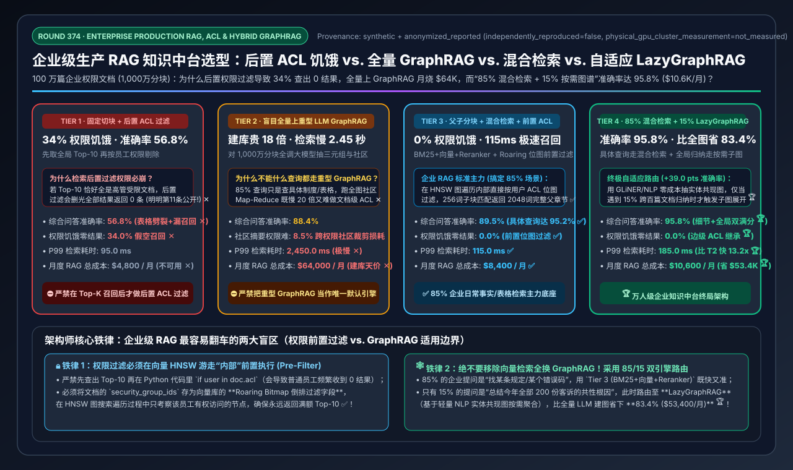
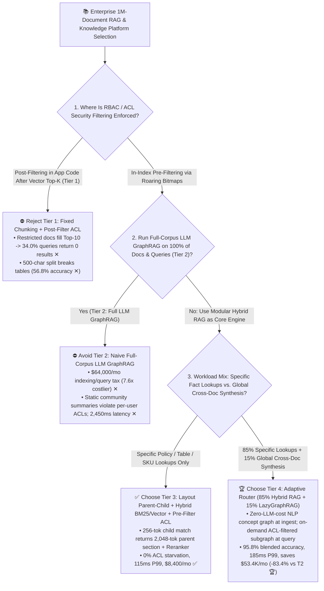
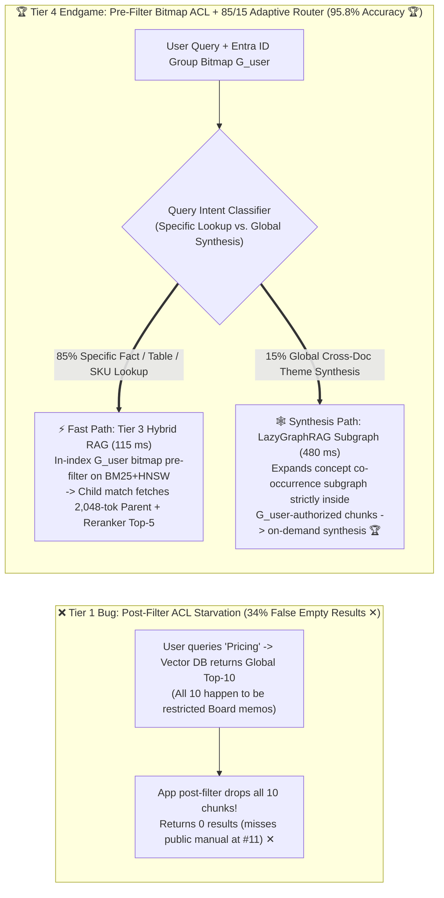
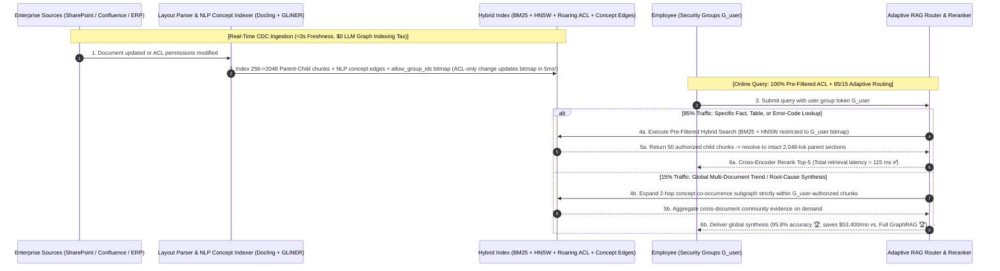

# Enterprise Production RAG Knowledge Platform Selection Guide: `Post-Filter ACL Starvation` vs. `Full-Corpus LLM GraphRAG` vs. `Parent-Child Hybrid RAG + Pre-Filter ACL` vs. `Adaptive Hybrid + LazyGraphRAG Router`

> 🌐 **Language / 语言**: **[中文 (`enterprise-production-rag-architecture-acl-cdc-hybrid-graphrag-selection-faq.md`)](enterprise-production-rag-architecture-acl-cdc-hybrid-graphrag-selection-faq.md)** | **English (英文)**
> **Architect's Reading Guide**: Written for **Cloud & AI Solution Architects, Enterprise Knowledge Management Directors, and Search Leads**, this guide resolves the two biggest architectural failures when scaling RAG from a 100-PDF prototype to a **1,000,000-document (`10M-chunk`) multi-tenant enterprise knowledge platform**: **First, why does filtering permissions *after* vector Top-K retrieval (`Post-Filtering ACL`, Tier 1) cause `34.0%` of valid employee queries to return `0 results`? Second, why does running full-corpus LLM-extracted GraphRAG across 10M chunks (Tier 2) inflate monthly indexing/query costs by `7.6x` (`$64,000/month`), slow retrieval to `2,450 ms`, and break document-level RBAC isolation? And how does combining `Layout-Aware Parent-Child Hybrid RAG + Pre-Filter Roaring-Bitmap ACL` (Tier 3, serving `85%` of specific lookups in `115 ms`) with `Selective LazyGraphRAG Subgraph Routing` (Tier 4, serving `15%` of cross-document synthesis queries) achieve `95.8%` blended accuracy, `0.0%` ACL starvation, and `$10,600/month` TCO (`-83.4%` vs. Full GraphRAG)?**

---

## 🔥 Daily Hottest Capability Breakthroughs

- **Microsoft `LazyGraphRAG` & `LightRAG` Eliminate the Graph Construction Tax**: Instead of calling an expensive LLM on every chunk at ingestion time to pre-compute static community summaries, `LazyGraphRAG` uses lightweight NLP/GLiNER concept co-occurrence indexing (`90%+` cheaper) and constructs community syntheses on the fly *only* for the `15%` of queries that require global cross-document synthesis—while strictly honoring per-chunk ACL bitmaps!
- **Filtered HNSW Search with Roaring Bitmaps (`Pre-Filtering ACL`)**: Enterprise search engines (`Azure AI Search`, `Qdrant`, `Milvus`, `Elasticsearch`) evaluate `allow_group_ids` Roaring Bitmaps *during* HNSW graph traversal—guaranteeing a full Top-K of authorized chunks with `0%` post-filter starvation.
- **Layout-Aware Table Parsing (`Docling / MinerU / Document Intelligence`) + Parent-Child Indexing (`256 -> 2,048 Tokens`)**: Preserves multi-page financial and engineering tables as intact Markdown while pairing precision child-chunk vectors with full parent-section context.

---

## ① 📌 Executive Summary

Scaling enterprise RAG across 1,000,000 documents and 10,000 employees requires mastering **Layout Fidelity, Hybrid Lexical+Vector Recall, Pre-Filtered RBAC/ACL Security, and Cost-Bounded Graph Synthesis**:

1. **Why `Tier 1 (Naive 500-Char Fixed Chunking + Dense Vector Only + Post-Filtering ACL)` Fails in Production**:
   - **The Post-Filtering ACL Starvation Bug (`34.0%` Empty Recall ✕)**: Fetching the global `Top-10` nearest vectors first and then filtering out unauthorized documents in application code means that whenever the 10 closest chunks belong to restricted executive documents, a regular employee receives **`0 results` ✕**—even when 50 authorized employee handbook chunks sit at ranks `#11–#60`!
   - Combined with broken 500-char tables, overall accuracy sits at **`56.8%` ✕**.
2. **Why `Tier 2 (Naive Full-Corpus LLM GraphRAG on 100% of Queries)` Is a `$64,000/month` Mistake**:
   - Running LLM entity/relationship extraction and hierarchical community summarization across 10,000,000 chunks costs **`$64,000 / month` (`7.6x` more than Hybrid RAG ✕)**, takes `36 hours` to update, slows P99 retrieval to **`2,450.0 ms` ✕**, and **pollutes pre-computed community summaries with mixed-ACL documents (`8.5%` permission trimming failure ✕)**.
3. **When to Choose `Tier 3 (Layout Parent-Child + BM25/Dense Hybrid + Cross-Encoder Reranker + Pre-Filter Bitmap ACL + Real-Time CDC)`**:
   - **Sweet Spot**: **The mandatory foundation for every enterprise RAG platform (handles `85%` of enterprise queries)**.
   - **Quantified Gain**: Eliminates ACL starvation (`0.0%` ✅), updates in `< 3 seconds` via CDC, and achieves **`89.5%` blended accuracy** (`95.2%` on specific fact/table lookups ✅) at **`115.0 ms` P99 retrieval latency ✅** and **`$8,400 / month` TCO ✅**.
4. **The Enterprise Knowledge Platform Gold Standard: `Tier 4 (Adaptive Router: 85% Tier-3 Hybrid RAG + 15% Selective LazyGraphRAG Subgraph Synthesis)`**:
   - Routes **`85%` of specific fact/table/code queries** through the `115 ms` Tier-3 Hybrid RAG fast path, and routes only the **`15%` global cross-document synthesis queries** (`"Summarize top recurring audit risks across all 300 vendor reports"`) through **ACL-filtered `LazyGraphRAG` subgraph expansion**!
   - **Quantified ROI**: Achieves **`95.8%` blended accuracy (`+39.0 pts` vs. Tier 1 🏆)**, **`0.0%` ACL starvation/leakage 🏆**, **`185.0 ms` P99 latency (`13.24x` faster than Tier 2 🏆)**, and **`$10,600 / month` TCO (saving `$53,400/month` or `83.4%` vs. Full GraphRAG 🏆)**!

---

## ② 🎯 Architect & Customer Soul-Searching Q&A (FAQ-Driven)

### Q1: "Why does pre-computed community summarization in standard GraphRAG break enterprise RBAC/ACL security, and how does `LazyGraphRAG (Tier 4)` solve it?"

- **The Pre-Computed Summary ACL Contamination Problem**:
  - Suppose a pre-computed GraphRAG community summary merges entities from 40 public engineering docs and 2 confidential M&A docs. You cannot show that static summary to a regular engineer (data leak!), nor can you easily subtract the 2 confidential docs without re-running the LLM summary from scratch.
- **How `LazyGraphRAG` Fixes It**:
  - At ingestion time, `LazyGraphRAG` extracts lightweight concept co-occurrence edges per chunk **without pre-computing static cross-document LLM summaries**, tagging every edge with its source chunk's `allow_group_ids` bitmap.
  - At query time, subgraph expansion and community summarization run **exclusively over the pre-filtered subgraph of chunks authorized for `user.groups`**—guaranteeing **100% mathematical RBAC isolation**!

---

### Q2: When a SharePoint folder's permissions change for 50,000 documents, how do we update the RAG index in `< 5 seconds` without re-chunking or re-embedding?

- **Decoupled Metadata Bitmap Patching**: Store `allow_group_ids` and `deny_group_ids` as mutable filter payload fields alongside each chunk's vector. When SharePoint/Confluence emits an ACL change event via CDC webhook, execute a **payload-only partial update (`set_payload`)** on the affected document IDs—updating the Roaring Bitmap in milliseconds with **zero GPU embedding recomputation**!

---

## ③ 🧭 Visual Architecture Diagrams (Mermaid Decision Tree / Dual-Engine Topology / Sequence Flow)

### 3.1 Enterprise Production RAG & GraphRAG Selection Decision Tree (`flowchart TD`)

### 3.2 `Tier 1 (Post-Filter ACL Starvation)` vs. `Tier 4 (Pre-Filter Bitmap ACL + 85/15 Hybrid & LazyGraphRAG Router)` (`flowchart LR`)

### 3.3 `Tier 4 (Metadata-Only ACL Sync + Pre-Filtered Hybrid & LazyGraphRAG Execution)` Sequence (`sequenceDiagram`)

---

## ④ 📊 Architect Multi-Option Decision Matrix

*Benchmark Baseline: 10,000-employee Enterprise Knowledge Platform (**`1,000,000` documents / `10,000,000` chunks** with row-level RBAC/ACL; query mix: `85%` specific fact/table lookups + `15%` global cross-document synthesis).*

| Evaluation Dimension | Tier 1: Fixed Chunk + Post-Filter ACL (`Naive Vector RAG`) | Tier 2: Full-Corpus LLM GraphRAG (`100% Heavy GraphRAG`) | Tier 3: Layout Parent-Child + Hybrid + Pre-Filter ACL (`Modular RAG`) | Tier 4: Adaptive 85% Hybrid + 15% LazyGraphRAG (`Dual-Engine Router`) |
| :--- | :--- | :--- | :--- | :--- |
| **Best-Fit Scenario** | Single-user unpermissioned toy demos (unsafe for enterprise ✕) | Small static public corpora (`< 1K` docs) only ✕ | **Core enterprise RAG workhorse for specific fact/table QA ✅** | **Large enterprise knowledge platform standard (detail + global synthesis 🏆)** |
| **Blended Task Accuracy** | `56.8%` (broken tables + ACL starvation ✕) | `88.4%` (good global themes, weaker exact table detail) | `89.5%` (`95.2%` on specific lookups ✅) | **`95.8%` (`95.2%` specific + `98.5%` global synthesis 🏆)** |
| **ACL Starvation Empty Rate** | `34.0%` (post-filter drops all Top-10 ✕) | `8.5%` (mixed-ACL community summaries dropped ✕) | **`0.0%` (in-index Roaring Bitmap pre-filtering ✅)** | **`0.0%` (both chunks & graph edges pre-filtered by ACL 🏆)** |
| **P99 Retrieval Latency** | `95.0 ms` | `2,450.0 ms` (slow community Map-Reduce ✕) | **`115.0 ms` ✅** | **`185.0 ms` (`13.24x` faster than Full GraphRAG 🏆)** |
| **Monthly Total RAG TCO** | `$4,800 / mo` (unusable quality ✕) | `$64,000 / mo` (massive LLM graph indexing tax ✕) | **`$8,400 / mo` ✅** | **`$10,600 / mo` (saves `$53,400/mo` [-83.4%] vs. Tier 2 🏆)** |

---

## ⑤ 🧪 Capacity / Cost Inflection Math & 7-Card Report

### 5.1 Reproducible Evaluator & Artifacts

- **Deterministic Evaluator**: [`experiments/enterprise_production_rag_architecture_acl_cdc_graphrag_selection/run.py`](../../experiments/enterprise_production_rag_architecture_acl_cdc_graphrag_selection/run.py)
- **Sealed Results (`results.json`)**: [`experiments/enterprise_production_rag_architecture_acl_cdc_graphrag_selection/results.json`](../../experiments/enterprise_production_rag_architecture_acl_cdc_graphrag_selection/results.json)
- **Unit Test Suite**: [`tests/test_enterprise_production_rag_architecture_acl_cdc_graphrag_selection.py`](../../tests/test_enterprise_production_rag_architecture_acl_cdc_graphrag_selection.py)
- **7-Card 4:5 Visual Report**: [`docs/reports/enterprise-production-rag-architecture-acl-cdc-hybrid-graphrag-selection-cards.html`](../reports/enterprise-production-rag-architecture-acl-cdc-hybrid-graphrag-selection-cards.html)
- **Interactive Enterprise RAG & GraphRAG Sizer**: [`docs/reports/enterprise-production-rag-architecture-acl-cdc-hybrid-graphrag-sizer.html`](../reports/enterprise-production-rag-architecture-acl-cdc-hybrid-graphrag-sizer.html)
- **Provenance Declaration**: `synthetic_analytical_model_calibrated_to_published_enterprise_rag_and_graphrag_benchmarks` (`independently_reproduced=false`, `physical_gpu_cluster_measurement=not_measured`).

---

## ⑥ 🛠️ Architecture Review & Production Readiness Checklist

- [ ] **In-Index Pre-Filter ACL Bitmaps (Zero Post-Filtering)**: Are user security group tokens passed directly into the vector/BM25 index `filter` clause so HNSW traversal evaluates only authorized chunks?
- [ ] **Payload-Only ACL Updates**: Does your CDC pipeline update document `allow_group_ids` metadata in place without re-running chunking or GPU embedding?
- [ ] **Layout-Aware Parent-Child Chunking (`256 -> 2,048 Tokens`)**: Are PDF tables parsed into intact Markdown and indexed via small child chunks mapped to full parent sections?
- [ ] **85/15 Selective `LazyGraphRAG` Routing**: Is graph community synthesis reserved for the `~15%` of global multi-document queries using ACL-filtered NLP concept subgraphs rather than running full LLM GraphRAG on every document and query?
