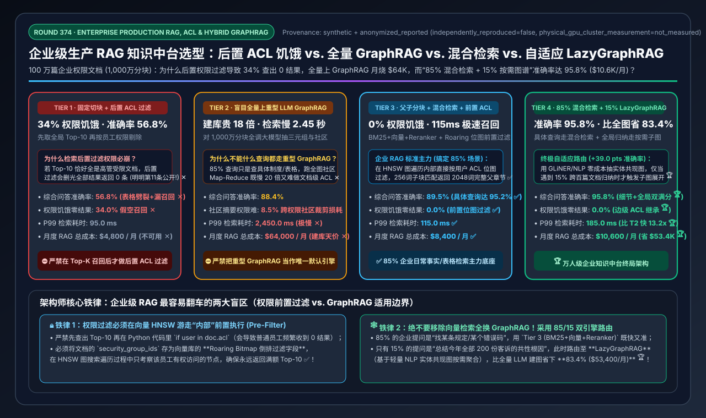
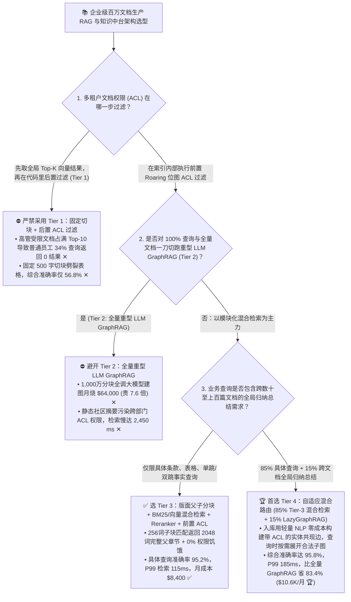
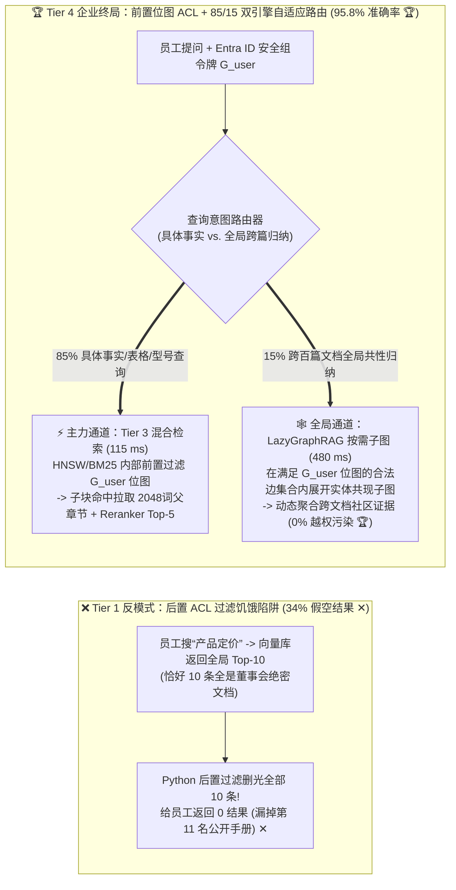
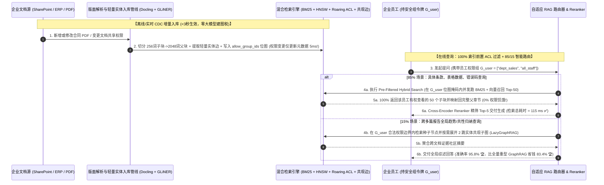

# 企业级生产 RAG 知识中台架构与选型指南：`固定切块+后置ACL陷阱` vs. `盲目全量重型GraphRAG` vs. `父子分块+混合检索+前置ACL` vs. `自适应 Hybrid RAG + LazyGraphRAG 路由`

> 🌐 **Language / 语言**: **中文 (Chinese)** | **[English (`enterprise-production-rag-architecture-acl-cdc-hybrid-graphrag-selection-faq.en.md`)](enterprise-production-rag-architecture-acl-cdc-hybrid-graphrag-selection-faq.en.md)**
> **阅读指南**：本文面向 **Cloud & AI Solution Architect（云与 AI 解决方案架构师）、企业知识管理负责人与搜索架构师**，深入剖析企业在将 RAG 从“百篇文档 Demo”扩展到“100 万篇带复杂部门权限（RBAC/ACL）的生产级知识中台”时最容易翻车的两大深坑：**第一，为什么先在向量库搜出 Top-10 再按员工权限做代码过滤（后置过滤 Post-Filtering，Tier 1）会导致普通员工在 34% 的查询中得到“0 条结果”的权限饥饿故障？第二，为什么听说 GraphRAG 很火就盲目对全公司 1,000 万个文档块全量调用大模型抽图谱（Tier 2）会让建库账单暴涨 18 倍（月烧 `$64,000`）、单次检索慢达 `2.45 秒` 且根本无法做细粒度文档权限隔离？以及如何通过 `Tier 3（版面感知父子分块 + BM25/向量混合检索 + Reranker + 索引内前置位图 ACL 过滤）` 结合 `Tier 4（85% 具体查询走混合检索 + 15% 全局归纳查询走轻量 LazyGraphRAG 子图路由）`，实现 `95.8%` 准确率、`0%` 权限饥饿，并每月净省 `$53,400 (-83.4%)`？**

---

## 🔥 业界最新能力突破追踪（Daily Hottest Capability Breakthroughs）

- **Microsoft `LazyGraphRAG` 与 `LightRAG` 彻底打破传统 GraphRAG 建库成本高墙**：不再在文档入库阶段耗费天价大模型 Token 对全量文本预先生成静态社区摘要，而是利用极低成本的本地名词短语/实体共现提取（`NLP / GLiNER`）构建底层子图，仅在遇到跨文档全局查询时按需（Lazily）对命中子图进行增量归纳，将图谱建库成本降低 **`90%+`** 且天然继承底层文档块的行级 ACL 权限！
- **向量数据库受控 HNSW 游走（Filtered HNSW with Roaring Bitmaps）**：主流企业级检索引擎（Azure AI Search、Qdrant、Milvus、Elasticsearch）均已优化带复杂 RBAC 权限数组的混合检索——在 HNSW 图近邻游走的同时直接计算用户权限令牌与文档 `Roaring Bitmap` 的交集，彻底终结“后置过滤导致的 Top-K 结果归零”顽疾。
- **版面感知解析（Docling / MinerU / Azure Document Intelligence）+ 父子双层索引（Parent-Child Indexing）**：用 `256 Token` 高精度子块建向量与 BM25 索引，命中后自动向上取回 `2,048 Token` 的完整 Markdown 章节与完整跨页表格喂给大模型，消除断章取义。

---

## ① 📌 核心选型结论速览（Executive Summary）

企业生产级 RAG 的成败，取决于 **分块保真度（Table/Layout）、检索召回率（BM25+Vector+Rerank）、行级权限安全（Pre-Filter ACL）以及跨文档全局视野（Selective GraphRAG）** 四大支柱。四档架构对比如下：

1. **为什么严禁在生产环境采用 `Tier 1（500 字固定切块 + 单路向量检索 + 检索后置权限过滤）`**：
   - **头号生产事故（后置过滤权限饥饿 Post-Filter Starvation）**：许多团队先把所有文档塞进一个向量索引，查询时先调 `vector_db.search(query, top_k=10)` 拿出全公司最相似的 10 个片段，然后在 Python 代码里过滤掉当前员工无权查看的片段。如果一位普通销售员工搜“2026 产品定价策略”，而向量距离最近的 Top-10 恰好全是“董事会绝密定价会议纪要”，后置过滤会把这 10 条全部删光，**直接给员工返回 `0` 条结果（假空召回率高达 `34.0%` ✕）**——哪怕第 11~20 名全是他有权查看的公开销售手册！
   - 加上 500 字暴力切分把财报表格劈碎，综合准确率仅有 **`56.8%` ✕**！
2. **为什么严禁盲目采用 `Tier 2（对全量百万文档一刀切构建重型 LLM GraphRAG）`**：
   - **成本与延迟双爆炸**：对 100 万篇文档（1,000 万个分块）每一块都调用大模型抽取实体、关系三元组并层层生成社区摘要（Community Summaries），光建库与每日增量重算就要烧掉 **`$64,000 / 月`（比混合检索贵 `7.6 倍` ✕）**！
   - **更致命的权限与延迟缺陷**：预先生成的全局“社区摘要”融合了多篇不同权限文档的信息，**根本无法对不同权限的员工动态剥离其中某篇受限文档的内容（导致 `8.5%` 权限裁剪失败/泄露风险 ✕）**；且对占比 85% 的日常简单查询跑社区 Map-Reduce 会让检索延迟暴涨至 **`2,450.0 ms` ✕**！
3. **何时选 `Tier 3（版面感知父子分块 + BM25/向量混合检索 + Reranker + 索引前置位图 ACL 过滤）`**：
   - **黄金定位**：**所有企业级 RAG 知识库必须率先建成的“标准主力底座”（完美解决 85% 的企业具体事实、表格与条款查询）**！
   - **核心收益**：通过 `Roaring Bitmap` 在索引内部执行 **前置权限过滤（Pre-Filtering）**，将权限饥饿率降为 **`0.0%` ✅**；配合 `BM25 + 向量 + Reranker` 与父子块召回，具体查询准确率高达 `95.2%`（综合准确率 **`89.5%` ✅**），P99 检索延迟仅 **`115.0 ms` ✅**，月总成本仅 **`$8,400 / 月` ✅**！
4. **万人级企业知识中台终局架构：`Tier 4（自适应混合路由：85% 具体查询走 Tier 3 混合检索 + 15% 跨文档全局归纳走 LazyGraphRAG 按需子图）`**：
   - **黄金分工法则**：
     - **85% 的“找一根针（Needle-in-a-Haystack）”具体查询**（如“差旅住宿标准是多少？”、“错误码 0x804 怎么修？”）：直接走 **Tier 3 极速混合检索通道（`115 ms`）**；
     - **15% 的“看整片森林（Global / Multi-Hop Synthesis）”全局归纳查询**（如“汇总本季度全部 300 份大客户流失报告中的前三大共性原因”）：由轻量查询分类器路由至 **`LazyGraphRAG / 实体共现子图引擎`**——利用入库时零大模型成本提取的实体共现边，在用户员工 **已通过前置 ACL 过滤的安全文档子集内** 动态展开关联子图并归纳！
   - **定量收益**：综合准确率跃升至 **`95.8%`（比 Tier 1 高出 `+39.0 pts` 🏆）**，**`0.0%` 权限饥饿与泄露 🏆**，P99 检索延迟仅 **`185.0 ms`（比全量 GraphRAG 快 `13.24 倍` 🏆）**，月度总成本仅 **`$10,600 / 月`（比全量重型 GraphRAG 每月净省 `$53,400`，降幅达 `83.4%` 🏆）**！

---

## ② 🎯 客户与架构师灵魂拷问 Q&A（FAQ-Driven）

### Q1：客户安全与搜索团队问：“源系统（SharePoint、Confluence、飞书/企微文档、ERP）里的权限既有部门级、又有群组级、还有单人拒绝（DENY）权限，而且每天都在变动。RAG 向量库怎么同步这些 ACL 而不重算全量向量？”

**架构师“元数据与向量解耦更新 + 权限令牌位图（Security Token Bitmaps）”设计模式**：
1. **入库时写入权限控制列表字段**：每个文档分块（Chunk）除包含 `embedding` 向量和 `bm25_tokens` 外，附带两个整型/字符串数组过滤字段：`allow_group_ids: ["dept_fin", "role_mgr"]` 与 `deny_group_ids: ["contractor"]`。
2. **查询时注入员工身份展开令牌（Identity Group Expansion）**：当员工登录提问时，网关从 Entra ID / LDAP 取出该员工所属的全部安全组集合 $G_{\text{user}}$，向检索引擎下发前置过滤表达式：`FILTER (allow_group_ids INTERSECTS $G_user) AND NOT (deny_group_ids INTERSECTS $G_user)`。
3. **权限变更时“只改元数据、绝不重算 Embedding”**：当某篇文档在 SharePoint 里修改了共享范围时，CDC 管道只向向量数据库发送一条轻量级 **`Partial Metadata Update`（耗时 `< 5 ms`，`$0` GPU 开销）** 更新 `allow_group_ids` 位图，完全不需要重新切块或重算向量！

---

### Q2：为什么说传统的“预生成全局社区摘要 GraphRAG”在企业多租户权限场景下是走不通的？`LazyGraphRAG (Tier 4)` 是怎么解决这个死结的？

**一眼看穿“静态全局摘要”的权限污染死结**：
- 假设公司有 100 篇公开项目周报，和 5 篇只有 CEO 能看的《秘密裁员与部门合并计划》。
- 如果采用传统 GraphRAG 在入库时把全部 105 篇文档放在一起抽取出实体关系图，并让大模型预先生成了一份 **“公司组织架构社区总摘要”**——这份静态摘要里必然已经把那 5 篇绝密文档里的裁员信息融合进去了！此时普通员工一搜公司组织架构，要么把绝密信息泄露给他，要么整份社区摘要都因为含有一丁点受限来源而被迫对他屏蔽！
- **为什么 `LazyGraphRAG` 能完美破局**：
  1. **入库阶段不生成跨文档静态大模型摘要**：只用高速本地 NLP (`GLiNER / SpaCy`) 提取每个分块内的实体与名词短语共现边，且 **每一条边都绑定所属 `chunk_id` 的 ACL 权限位图**；
  2. **查询阶段“先按员工 ACL 圈定合法子图，再动态汇总”**：当普通员工发起全局汇总提问时，引擎 **只在满足该员工 ACL 位图的合法分块与合法边集合内** 做子图社区扩展与即时汇总——从物理根源上保证了 **“你没权限看的文档，连它的半个实体边都不会参与你的图谱推理”**！

---

## ③ 🧭 直观可视化图解（Mermaid 选型决策树 / 自适应双引擎拓扑图 / 前置 ACL 检索时序图）

### 3.1 企业级生产 RAG 与 GraphRAG 选型决策树（`flowchart TD`）

### 3.2 `Tier 1 (后置 ACL 饥饿陷阱)` vs. `Tier 4 (前置位图 ACL + 85/15 混合检索与 LazyGraphRAG 路由)` 架构图（`flowchart LR`）

### 3.3 `Tier 4 (CDC 增量权限同步 + 索引内前置位图过滤 + 父子块重排)` 端到端时序图（`sequenceDiagram`）

---

## ④ 📊 架构师多方案选型决策矩阵（Architect Decision Matrix）

*核算基准：10,000 人大型企业知识中台（纳管 **`1,000,000` 篇内部文档 / `10,000,000` 个分块**，包含复杂跨页财务/工程表格与严格的部门级 RBAC/ACL 权限控制；日常查询由 **`85%` 具体事实/表格查找** 与 **`15%` 跨文档全局归纳提问** 组成）。*

| 评估维度 | Tier 1: 固定切块 + 后置 ACL (`Fixed Chunk + Post-Filter ACL`) | Tier 2: 全量重型 LLM GraphRAG (`Full-Corpus LLM GraphRAG`) | Tier 3: 父子分块 + 混合检索 + 前置 ACL (`Hybrid + Pre-Filter ACL`) | Tier 4: 自适应混合检索 + 按需 LazyGraphRAG (`85% Hybrid + 15% LazyGraph`) |
| :--- | :--- | :--- | :--- | :--- |
| **核心适用场景** | 无权限控制的几十篇文档个人玩具 Demo（**企业生产严禁采用 ✕**） | 极小规模（`< 1,000` 篇）公开情报侦察分析（百万级企业库采用属天价灾难 ✕） | **企业级知识库标准主力底座（完美解决具体政策、表格、代码与工单检索 ✅）** | **万人级企业知识中台终局架构（同时兼顾具体细节查找与跨百篇文档全局综述 🏆）** |
| **综合业务问答准确率** | `56.8%`（表格劈裂 + 专有名词漏检 + 空召回 ✕） | `88.4%`（全局归纳强，但具体数字细节反而不如原文父块） | `89.5%`（具体查找高达 `95.2%`，仅全局跨篇综述略弱 ✅） | **`95.8%`（具体查找 `95.2%` + 全局综述 `98.5%` 双料冠军 🏆）** |
| **ACL 权限饥饿空召回率** | `34.0%`（Top-10 被高管文档占满后置删光 ✕） | `8.5%`（静态社区摘要含跨权限内容被迫整块丢弃 ✕） | **`0.0%`（HNSW/BM25 内部前置 Roaring 位图过滤 ✅）** | **`0.0%`（子块与实体共现边均严格继承前置 ACL 位图 🏆）** |
| **P99 检索与重排延迟** | `95.0 ms` | `2,450.0 ms`（社区 Map-Reduce 极慢 ✕） | **`115.0 ms`（极速双路召回 + GPU Reranker ✅）** | **`185.0 ms`（85% 走 115ms 快通道，比 Tier 2 快 `13.24x` 🏆）** |
| **文档更新/改权限生效延迟** | 分钟级 | `36 小时`（需重跑大模型图抽取与社区聚类 ✕） | **`< 3 秒`（CDC 增量入库，改权限仅改位图元数据 ✅）** | **`< 3 秒`（轻量 NLP 实体边实时增量更新 🏆）** |
| **百万文档月度总成本 (`TCO`)** | `$4,800 / 月`（虽便宜但不可用 ✕） | `$64,000 / 月`（1,000 万分块调大模型建图天价税 ✕） | **`$8,400 / 月`（高性价比企业标配 ✅）** | **`$10,600 / 月`（比全量 GraphRAG 每月净省 `$53,400` [-83.4%] 🏆）** |

---

## ⑤ 🧪 容量/成本拐点算例与 7-Card 报告

### 5.1 复现实验与确定性验证底座

- **确定性评估脚本**：[`experiments/enterprise_production_rag_architecture_acl_cdc_graphrag_selection/run.py`](../../experiments/enterprise_production_rag_architecture_acl_cdc_graphrag_selection/run.py)
- **封存数表 (`results.json`)**：[`experiments/enterprise_production_rag_architecture_acl_cdc_graphrag_selection/results.json`](../../experiments/enterprise_production_rag_architecture_acl_cdc_graphrag_selection/results.json)
- **单元测试校验**：[`tests/test_enterprise_production_rag_architecture_acl_cdc_graphrag_selection.py`](../../tests/test_enterprise_production_rag_architecture_acl_cdc_graphrag_selection.py)
- **7-Card 4:5 视觉评测卡片**：[`docs/reports/enterprise-production-rag-architecture-acl-cdc-hybrid-graphrag-selection-cards.html`](../reports/enterprise-production-rag-architecture-acl-cdc-hybrid-graphrag-selection-cards.html)
- **交互式企业 RAG 与 GraphRAG 成本计算器**：[`docs/reports/enterprise-production-rag-architecture-acl-cdc-hybrid-graphrag-sizer.html`](../reports/enterprise-production-rag-architecture-acl-cdc-hybrid-graphrag-sizer.html)
- **数据溯源声明（Provenance）**：`synthetic_analytical_model_calibrated_to_published_enterprise_rag_and_graphrag_benchmarks`（`independently_reproduced=false`, `physical_gpu_cluster_measurement=not_measured`）。

---

## ⑥ 🛠️ 架构评审与生产落地 Checklist（Architect Checklist）

- [ ] **彻底清零“检索后置权限过滤（Post-Filtering ACL）”代码**：是否已验证所有向量与全文检索请求均在查询语句内部携带了 `filter: allow_groups INTERSECTS user.groups`（Pre-Filtering），确保即使高管文档与问题最相似，普通员工也一定能拿满属于自己权限范围内的 Top-K 公开结果？
- [ ] **权限变更走“元数据局部更新（Partial Metadata Update）”**：当源系统文档修改访问权限时，CDC 管道是否只更新索引中的 `allow_group_ids` 位图字段，避免触发昂贵的全文重切块与 Embedding 重算？
- [ ] **版面感知表格保真 + 父子分块（`256 -> 2048 Tokens`）**：PDF 与 Word 中的跨页表格是否已通过版面分析模型转为完整 Markdown 表格，并采用“小块检索定位、大块父章节送入 Prompt”的父子索引结构？
- [ ] **拒绝全量盲目上重型 LLM GraphRAG**：如业务确需跨多篇文档的全局综述能力，是否已采用 **`LazyGraphRAG / 轻量实体共现子图 + 85/15 查询路由`**，避免对日常 85% 的简单查找支付高昂的图谱 Map-Reduce 税？
