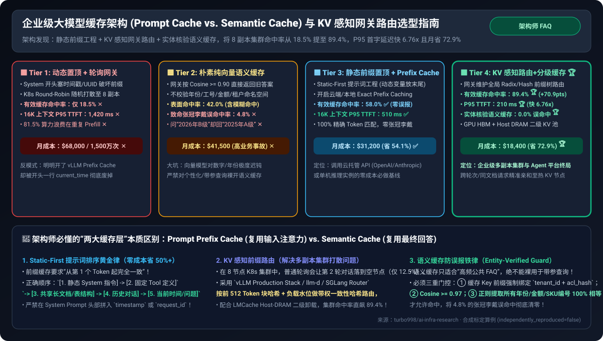
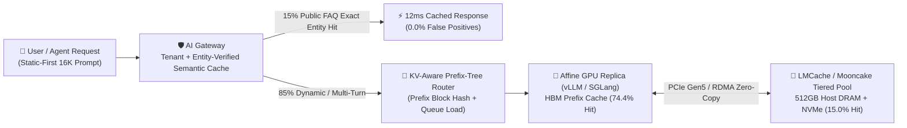

# Enterprise LLM Caching Architecture (Prompt Caching vs. Semantic Caching) & KV-Aware Gateway Routing Selection Guide: Dynamic Round-Robin vs. Naive Vector Semantic Cache vs. Static-First Prefix Caching vs. KV-Aware Prefix-Tree Router + Entity-Verified Semantic Cache & Tiered KV Offload

> **Document Type**: Cloud & AI Solution Architect Decision Guide (FAQ)  
> **Target Audience**: AI Gateway Architects, Inference Platform Leads, FinOps & Cloud Cost Governance Teams, Multi-Agent Application Leads  
> **Core Goal**: Demystify the architectural difference between **Prompt Prefix Caching (reusing input prefill KV tensors)** and **Semantic Response Caching (returning a cached completion for a similar query)**, and answer three critical production questions: **"Why is our prefix cache hit rate under 20% even after enabling vLLM APC / Cloud Prompt Caching?", "Why did our Redis vector semantic cache return 2025 Tier-A pricing when a customer asked for 2026 Tier-B pricing?", and "How do we route multi-turn and shared-document queries to the exact GPU replica holding the hot KV cache across an 8-node Kubernetes cluster?"**  
> **Calibration Notice**: Cache hit rates, false-positive rates, P95 TTFT latencies, and monthly cost models are synthetic analytical estimates calibrated to published prompt caching and KV-routing benchmarks (vLLM Automatic Prefix Caching, SGLang RadixAttention, LMCache tiered KV offloading, llm-d KV-aware routing, and cloud provider Prompt Caching pricing) (`provenance: synthetic + anonymized_reported`, `independently_reproduced=false`, `physical_gpu_cluster_measurement=not_measured`). See [`experiments/enterprise_prompt_caching_semantic_cache_kv_aware_routing_selection/results.json`](../../experiments/enterprise_prompt_caching_semantic_cache_kv_aware_routing_selection/results.json).

---

## Executive Visual Summary

> 🔗 **Companion Interactive Reports & Tools**:
> - 🃏 **[7-Card 4:5 Visual Benchmark Report (`enterprise-prompt-caching-semantic-cache-kv-aware-routing-selection-cards.html`)](../reports/enterprise-prompt-caching-semantic-cache-kv-aware-routing-selection-cards.html)**
> - 🧮 **[Interactive Cache Hit & Inference Cost Sizer (`enterprise-prompt-caching-semantic-cache-kv-aware-routing-sizer.html`)](../reports/enterprise-prompt-caching-semantic-cache-kv-aware-routing-sizer.html)**
> - 🌐 **[中文版指南 (`enterprise-prompt-caching-semantic-cache-kv-aware-routing-selection-faq.md`)](./enterprise-prompt-caching-semantic-cache-kv-aware-routing-selection-faq.md)**

---

## ① 📌 Executive Summary

In enterprise document Q&A, multi-step tool-calling agents, and multi-turn Copilots, **input prompts average `16,000 tokens` while outputs average `250 tokens`** — meaning **over 90% of GPU compute and API spend is consumed by input prefill**.

Evaluated on **15,000,000 requests/month (16,000-token average prompt context across an 8-replica cluster / cloud API)**:

| Tier | Architecture Pattern | Effective Cache Hit Rate | False-Positive Wrong Answer Rate | 16K Context P95 TTFT | Monthly Cost (15M Reqs) | Architect Verdict |
| :--- | :--- | :--- | :--- | :--- | :--- | :--- |
| **🟥 Tier 1: Dynamic-Top Prompt + Round-Robin** | Timestamp at top of System Prompt + K8s Round-Robin | `18.5%` ✕ | `0.0%` | `1,420 ms` ✕ | `$68,000 / mo` ✕ | **Common Anti-Pattern**: 81.5% prefill compute wasted |
| **🟨 Tier 2: Naive Vector Semantic Cache** | Gateway returns cached text when `Cosine >= 0.90` | `42.0%` | **`4.8%` ✕ (Fatal)** | `680 ms` | `$41,500 / mo` | **Dangerous in Prod**: Confuses years, numbers, and SKUs |
| **🟦 Tier 3: Static-First + Exact Prefix Cache** | **Static-First prompt ordering** + Cloud/Local Prefix Cache | `58.0%` ✅ | `0.0%` ✅ | `510 ms` ✅ | `$31,200 / mo` (-54.1%) | **Cloud API Baseline**: Zero false-positives, 54% cheaper |
| **🟩 Tier 4: KV-Aware Router + Verified Tiered Cache** | **Static-First + KV-Aware Prefix Router + Entity-Verified Semantic Cache + Host-DRAM KV Pool** | **`89.4%` 🏆** | **`0.0%` 🏆** | **`210 ms` 🏆 (6.76x faster)** | **`$18,400 / mo` 🏆 (-72.9%)** | **Multi-Replica Cluster Gold Standard**: 89.4% hit rate, zero false hits |

### 💡 Three Golden Rules for Enterprise LLM Caching
1. **Default to Exact Prompt Prefix Caching Everywhere; Restrict Semantic Response Caching to Entity-Verified Public FAQs**: Prefix Caching reuses exact input KV tensors without skipping reasoning (`0.0%` hallucination risk). Naive vector semantic caching skips the LLM altogether and suffers a `4.8%` false-positive rate unless guarded by strict tenant isolation and deterministic number/entity equality verification.
2. **Enforce `Static-First, Dynamic-Last` Prompt Ordering**: Placing a dynamic timestamp or user ID at the start of the system prompt invalidates 100% of downstream KV blocks.
3. **Replace Round-Robin Load Balancing with KV-Aware Prefix-Tree Routing (`llm-d / vLLM Production Stack / SGLang Router`) + Host-DRAM KV Offloading (`LMCache`)**: In an 8-replica cluster, Round-Robin scatters multi-turn requests across cold nodes; KV-aware routing drives cluster-wide prefix hit rate up to **`89.4%`**.

---

## ② 🎯 Architect Deep-Dive Q&A

### Q1: Why did our naive vector Semantic Cache (Tier 2) return wrong answers on `4.8%` of customer queries?
* **Answer (Embedding Blindness to Numbers, Dates, and Negations)**:
  - Dense embeddings map `"What is the 2025 refund cap for Tier A?"` and `"What is the 2026 refund cap for Tier B?"` to vectors with `0.958` cosine similarity.
  - **Tier 4 Fix (Entity-Exact Guard)**: Scope keys by `(tenant_id, acl_hash)`, require `cosine >= 0.97`, and run a deterministic regex/NER check verifying that all **years, numbers, currencies, SKU codes, and negations match 100%** before serving a cached response.

### Q2: How does KV-Aware Routing solve the multi-replica Kubernetes cache-scattering problem?
* **Answer**:
  - Standard Kubernetes Services distribute requests randomly across `N` pods (`1/N` locality).
  - A **KV-Aware Router** hashes 64-token prefix blocks and routes requests to the replica already holding the longest matching prefix in GPU HBM or **LMCache Host-DRAM**, falling back to a secondary replica only when the primary replica's queue depth exceeds a saturation threshold.

---

## ③ 🧭 Architecture Diagrams

### 3.1 Tier 4 KV-Aware Routing + Dual-Layer Cache Architecture

---

## ④ 📊 Architect Decision Matrix

| Dimension | 🟥 Tier 1: Dynamic + Round-Robin | 🟨 Tier 2: Naive Semantic Cache | 🟦 Tier 3: Static-First + Prefix Cache | 🟩 Tier 4: KV-Aware Router + Tiered Cache |
| :--- | :--- | :--- | :--- | :--- |
| **Effective Cluster Hit Rate** | `18.5%` ✕ | `42.0%` | `58.0%` ✅ | **`89.4%` 🏆 (`+70.9 pts` vs. Tier 1)** |
| **False-Positive Wrong Answer Rate** | `0.0%` | **`4.8%` ✕ (Dangerous)** | `0.0%` ✅ | **`0.0%` 🏆 (Entity-Exact Guard)** |
| **16K Context P95 TTFT** | `1,420 ms` ✕ | `680 ms` | `510 ms` ✅ | **`210 ms` 🏆 (`6.76x` faster)** |
| **Monthly Cost (15M Reqs)** | `$68,000 / mo` ✕ | `$41,500 / mo` | `$31,200 / mo` ✅ | **`$18,400 / mo` 🏆 (`-72.9%` vs. Tier 1)** |

---

## ⑤ 🛠️ Production Readiness Checklist

- [ ] **1. Refactor All Prompt Templates to `Static-First, Dynamic-Last` Ordering**.
- [ ] **2. Canonically Sort `tools` JSON Arrays and Keys Before Prompt Serialization**.
- [ ] **3. Keep Multi-Step Agent Histories Strictly `Append-Only`**.
- [ ] **4. Deploy a KV-Aware Gateway Router (`vLLM Production Stack / llm-d / SGLang Router`) for Multi-Replica Clusters**.
- [ ] **5. Configure Queue-Depth Spillover Thresholds to Prevent Single-Pod Hotspots**.
- [ ] **6. Enable Host-DRAM Tiered KV Offloading (`LMCache / Mooncake`) for Long-Context Workloads**.
- [ ] **7. Partition Any Semantic Cache by `(tenant_id, acl_group_hash, model_version)`**.
- [ ] **8. Enforce Deterministic Number/Date/SKU Exact Equality Checks Before Serving Semantic Cache Hits**.
