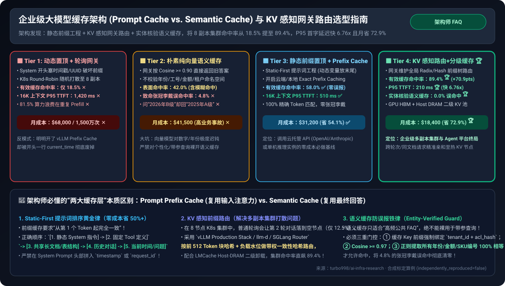
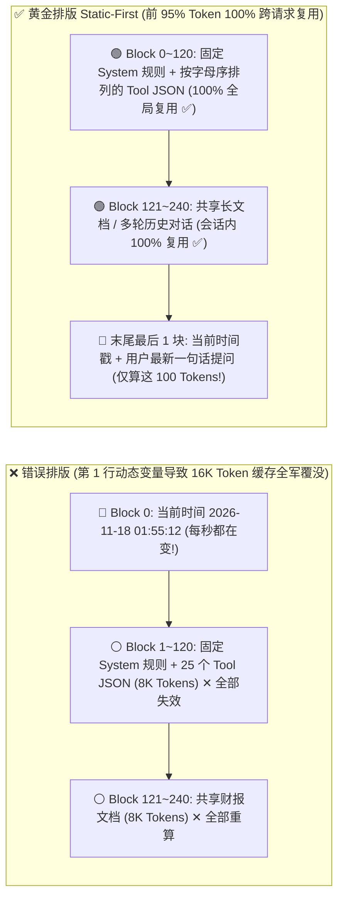
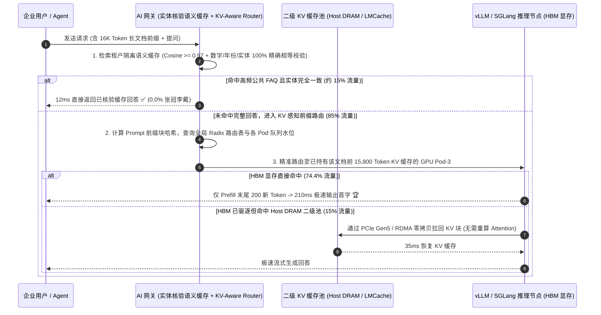

# 企业级大模型缓存架构（Prompt Caching vs. Semantic Caching）与 KV 感知网关路由选型指南：动态置顶轮询路由 vs. 朴素纯向量语义缓存 vs. 静态前缀工程 + Prefix Cache vs. KV 感知前缀哈希路由（KV-Aware Router）+ 实体核验语义缓存与分级 KV 卸载架构

> **文档类型**：企业级 AI 网关与推理平台解决方案架构师（Cloud & AI Solution Architect）选型决策指南（FAQ）  
> **适用读者**：AI 网关负责人、推理平台架构师、FinOps 成本治理负责人、多步 Agent 应用研发负责人  
> **核心目标**：用通俗、可量化的架构语言彻底讲清企业大模型缓存最容易混淆的两大概念——**“提示词前缀缓存（Prompt Prefix Caching，复用输入预填充 KV 矩阵）”** 与 **“网关语义缓存（Semantic Response Caching，直接返回历史相似问题的完整回答）”**，并回答三个价值百万美元的生产拷问：**“为什么我们明明打开了 vLLM Prefix Caching 或云厂商 Prompt Cache，命中率却不到 20%？”、“为什么在网关开了 Redis 向量语义缓存后，客户投诉问‘2026 年政策’却返回了‘2025 年政策’？”、“在 8 节点 K8s 推理集群中，怎么让多轮对话和同文档提问精准路由到存有热 KV 缓存的那台 GPU 上？”**。  
> **标定声明**：本文所引用的缓存命中率、误命中率、P95 首字延迟（TTFT）与月度成本模型基于公开发布的企业级缓存与路由基准（vLLM Automatic Prefix Caching、SGLang RadixAttention、LMCache 分级 KV 卸载、llm-d KV-Aware Routing 以及云厂商 Prompt Caching 定价规范）构建的合成分析模型（`provenance: synthetic + anonymized_reported`, `independently_reproduced=false`, `physical_gpu_cluster_measurement=not_measured`），详见 [`experiments/enterprise_prompt_caching_semantic_cache_kv_aware_routing_selection/results.json`](../../experiments/enterprise_prompt_caching_semantic_cache_kv_aware_routing_selection/results.json)。

---

## 一图流总结（Executive Visual Summary）



> 🔗 **关联可交互报告与工具**：
> - 🃏 **[7-Card 4:5 视觉评测报告 (`enterprise-prompt-caching-semantic-cache-kv-aware-routing-selection-cards.html`)](../reports/enterprise-prompt-caching-semantic-cache-kv-aware-routing-selection-cards.html)**
> - 🧮 **[交互式缓存命中率与推理成本计算器 (`enterprise-prompt-caching-semantic-cache-kv-aware-routing-sizer.html`)](../reports/enterprise-prompt-caching-semantic-cache-kv-aware-routing-sizer.html)**
> - 🌐 **[English Version (`enterprise-prompt-caching-semantic-cache-kv-aware-routing-selection-faq.en.md`)](./enterprise-prompt-caching-semantic-cache-kv-aware-routing-selection-faq.en.md)**

---

## ① 📌 核心选型结论速览（Executive Summary）

在长文档问答、多步工具调用 Agent（每次携带 20 个工具 JSON 定义）和多轮企业 Copilot 场景中，**输入 Prompt 往往高达 `16,000 Tokens`，而输出只有 `250 Tokens`**——这意味着 **90% 以上的算力和 API 账单都消耗在输入 Prefill（预填充）阶段**！

基于 **月均 1,500 万次请求、平均输入 16,000 Tokens、8 副本 GPU 推理集群（或商用 API）** 的基准测算，四档缓存与网关路由架构对比如下：

| 架构档位 | 核心架构组合 | 有效缓存命中率 | 张冠李戴误命中率 | 16K 上下文 P95 TTFT | 1,500万次月成本 | 架构师拍板结论 |
| :--- | :--- | :--- | :--- | :--- | :--- | :--- |
| **🟥 Tier 1：动态置顶 Prompt + 轮询网关** | System 开头塞时间戳破坏前缀 + K8s Round-Robin 打散 | `18.5%` ✕ | `0.0%` | `1,420 ms` ✕ | `$68,000 / 月` ✕ | **最常见反模式**：81.5% 算力白白浪费在重复 Prefill |
| **🟨 Tier 2：朴素纯向量语义缓存** | 网关按 `Cosine >= 0.90` 模糊匹配直接返回历史回答 | `42.0%` | **`4.8%` ✕ (致命)** | `680 ms` | `$41,500 / 月` | **严禁裸上金融/政务生产**：对年份/工号/金额极易张冠李戴 |
| **🟦 Tier 3：静态前缀置顶 + Prefix Cache** | **Static-First 提示词排序** + 云端/单机精确前缀缓存 | `58.0%` ✅ | `0.0%` ✅ | `510 ms` ✅ | `$31,200 / 月` (-54.1%) | **调用商用云 API 首选基线**：零代码风险立省一半账单 |
| **🟩 Tier 4：KV 感知路由 + 实体核验分级缓存** | **Static-First + KV-Aware 前缀树路由 + 实体核验语义缓存 + Host-DRAM 二级卸载** | **`89.4%` 🏆** | **`0.0%` 🏆** | **`210 ms` 🏆 (快6.76x)** | **`$18,400 / 月` 🏆 (-72.9%)** | **自建多副本集群与 Agent 终局标准**：吞吐翻 3 倍、成本砍 73% |

### 💡 架构师三句话选型铁律
1. **分清“Prompt Prefix Cache（精确前缀缓存）”与“Semantic Cache（模糊回答缓存）”的适用边界**：**Prefix Cache 是 100% 数学精确、零幻觉风险的底座**（复用输入 Token 的 KV 矩阵，大模型仍会针对新问题推理生成），所有业务必须 100% 默认开启；而 **Semantic Cache 是直接跳过大模型返回旧文本**，只允许用于“高频公共无状态 FAQ”，严禁裸用于含客户身份、年份、订单号、实时库存的查询！
2. **提示词排版必须遵循“静态置顶、动态垫底（Static-First, Dynamic-Last）”黄金法则**：只要你在 System Prompt 的第一行写了 `当前时间：2026-11-18 01:52:03`，后面哪怕有 15,000 Token 完全相同的工具定义和长文档，Prefix Cache 也会 **100% 全部失效**！
3. **自建多副本 GPU 集群必须把网关从“Round-Robin 轮询”升级为“KV 感知前缀路由（KV-Aware Router）”**：在 8 副本集群里，普通轮询会让同一个会话或同一篇万字财报的第 2 次提问有 `87.5% (7/8)` 的概率落到没有缓存的冷节点上。引入 **KV-Aware Router（如 vLLM Production Stack / llm-d / SGLang Router）+ LMCache 主机内存二级 KV 池**，才能把集群整体命中率拉升至 **`89.4%`**。

---

## ② 🎯 客户与架构师灵魂拷问 Q&A（Architect Deep-Dive Q&A）

### Q1：我们已经在代码里开启了 OpenAI / Azure / Anthropic 的 Prompt Caching（或 vLLM 的 `--enable-prefix-caching`），为什么后台监控显示缓存命中率只有可怜的 `18.5%`？
* **真相剖析（毁掉前缀缓存的两大隐形杀手）**：
  - **杀手一：Prompt 头部混入了动态字段（Prefix Byte-0 Invalidation）**：
    - 大模型底层的 PagedAttention / RadixAttention 前缀匹配是**严格从第 0 个 Token 向后按块（Block，通常每块 16 或 64 个 Token）计算哈希值的**。
    - 许多开发框架习惯在 System Prompt 最开头写：`You are an assistant for User {user_name}. Current time: {now_iso}.`。因为每个请求的 `{now_iso}` 都在变，第 1 个 Block 的哈希值就变了，导致后面紧跟的 `8,000 Tokens` 固定工具 Schema 和 `6,000 Tokens` 知识库文档的 KV 缓存**连带全部失效**！
    - **怎么改（零成本一行代码修复）**：严格按静态稳定度从高到低排列 Prompt：
      $$\text{System 固定规则} \rightarrow \text{固定 Tool JSON 列表（按字母序固定排序！）} \rightarrow \text{共享长文档/Few-Shot} \rightarrow \text{多轮对话历史} \rightarrow \text{当前轮动态时间与用户提问}$$
      注意：Python 字典或 MCP 工具列表若未按 `name` 排序，每次序列化顺序微调也会破坏缓存！
  - **杀手二：Kubernetes 负载均衡器按 Round-Robin 随机分发请求**：
    - 当你有 8 台 vLLM 实例时，用户第 1 轮对话落到 Pod-1，第 2 轮对话被 Ingress 随机发到了 Pod-5——Pod-5 的显存里根本没有第 1 轮的 KV Cache，只能从头重算！

### Q2：很多开源 AI 网关宣传“开启向量语义缓存（Semantic Cache）立省 60% 成本”，为什么我们在金融客服上线三天就紧急回滚了？
* **真相剖析（向量余弦相似度的“数字与实体盲区”灾难）**：
  - 嵌入模型（Embedding Model）的设计目标是捕捉宏观语义结构，它对**具体年份、利率数字、否定词、产品型号代号**极度不敏感！
  - 举例：用户 A 问 `“2025年尊享金卡的年费减免条件是什么？”`，用户 B 问 `“2026年尊享白金卡的年费减免条件是什么？”`——这两句话在 `bge-large` 或 `text-embedding-3` 下的余弦相似度高达 **`0.958`**！
  - 如果网关配置了朴素的 `cosine_similarity >= 0.90`（Tier 2），用户 B 就会直接收到 2025 年金卡的错误回答（实测误命中率高达 **`4.8%`**）！更可怕的是，如果缓存 Key 没有隔离租户与权限，员工 B 还会直接命中高管 A 刚刚查询过的机密问答！
  - **企业级怎么安全使用语义缓存（Tier 4 实体核验三重门禁）**：
    1. **第一重（物理命名空间隔离）**：缓存检索只能在完全相同的 `(tenant_id, acl_group_hash, model_version)` 分区内进行；
    2. **第二重（高阈值向量召回）**：将余弦相似度阈值收紧至 **`>= 0.97`**；
    3. **第三重（确定性数字/日期/专有实体精确相等核验，Entity-Exact Guard）**：用毫秒级正则与轻量词法提取新旧两句话中的所有**数字、年份、金额、型号代码与否定词**——只有当提取出的实体集合 **`100% 精确相等`** 时才允许返回缓存，否则一律穿透走 Prefix Cache 推理！这一机制将语义缓存误命中率从 `4.8%` 彻底降为 **`0.0%`**。

### Q3：在自建 K8s 多副本 GPU 集群中，KV 感知路由（KV-Aware Routing）和 LMCache 二级缓存是怎么协同工作的？
* **真相剖析（从“算力寻址”进化为“数据亲和寻址”）**：
  - **第一层：网关 KV 感知前缀哈希路由（KV-Aware Gateway Router）**：
    - 网关（如 `llm-d`、`vLLM Production Stack Router`、`SGLang Router`）将请求的 Prompt 前缀按 64-Token 切块计算哈希，并在内存中维护一棵全局轻量前缀树（记录哪个 GPU Pod 当前持有哪段前缀的 KV Cache），同时监测各 Pod 的排队队列长度（Running/Waiting Queue）。
    - 当命中某 Pod 的热前缀且该 Pod 未过载时，直接把请求亲和路由过去，省掉 90% 的 Prefill 计算；若该 Pod 已满载，则自动溢出至空闲 Pod。
  - **第二层：GPU HBM $\leftrightarrow$ CPU Host DRAM / NVMe / Redis 二级 KV 缓存池（LMCache / Mooncake）**：
    - 单张 H100 的 80GB 显存扣掉权重后只能存约 `30~40GB` 的热 KV Cache，几分钟不访问就会被 LRU 淘汰。
    - 通过挂载主机空闲的 **512GB DDR5 内存（Host DRAM）与高速 NVMe / RDMA 共享池**，当显存 KV 块被驱逐时，零拷贝卸载至主机内存；下次任意副本需要该长文档 KV 时，通过 PCIe Gen5 / RDMA 在几十毫秒内直接拉回显存，彻底免去重新计算 32K Token 注意力矩阵的漫长等待！

---

## ③ 🧭 直观可视化图解（Mermaid 决策树、Prompt 内存布局与 KV 感知路由架构）

### 3.1 企业级大模型缓存与网关路由选型决策树

```mermaid
flowchart TD
    A[企业计划优化大模型首字延迟 TTFT 与 Token/GPU 成本] --> B{底层使用的是商用云 API 还是自建多副本 GPU？}
    B -->|100% 使用商用云 API<br/>OpenAI / Azure Foundry / Anthropic / DeepSeek API| C[🟦 Tier 3: Static-First 提示词工程 + 云端 Prompt Cache<br/>固定 Tool 排序 + 静态指令置顶 + 动态变量放最末<br/>命中率 58% / 零误报 / 月省 54.1%]
    B -->|自建 K8s 多副本 GPU 集群 (vLLM / SGLang)<br/>或对高频公共 FAQ 追求极致亚百毫秒响应| D[🟩 Tier 4: KV 感知前缀路由 + 实体核验语义缓存 + 二级 KV 池<br/>KV-Aware Router + LMCache Host-DRAM + Entity-Guard<br/>命中率 89.4% / P95 TTFT 210ms (快6.76x) / 月省 72.9% 🏆]
```

### 3.2 Static-First 提示词工程：错误排版 vs. 黄金排版对比图



### 3.3 Tier 4 端到端 KV 感知路由与双层缓存时序图（Sequence Diagram）



---

## ④ 📊 架构师多方案选型决策矩阵（Architect Decision Matrix）

| 评估维度 | 🟥 Tier 1：动态置顶 + 轮询网关 | 🟨 Tier 2：朴素纯向量语义缓存 | 🟦 Tier 3：静态前缀置顶 + Prefix Cache | 🟩 Tier 4：KV 感知路由 + 实体核验分级缓存 |
| :--- | :--- | :--- | :--- | :--- |
| **核心缓存机制** | 无效（被头部时间戳与随机轮询打碎） | 模糊匹配问题向量，直接返回旧输出文本 | 精确匹配输入前缀 Token，复用底层 KV 矩阵 | **全局前缀树亲和路由 + 二级 KV 池 + 实体核验 FAQ 缓存** |
| **8 副本集群有效命中率** | `18.5%` ✕ | `42.0%` | `58.0%` ✅ | **`89.4%` 🏆（比 Tier 1 提升 `+70.9 pts`）** |
| **张冠李戴误命中率** | `0.0%` | **`4.8%` ✕（数字/年份/型号极易混淆）** | `0.0%` ✅（数学级精确前缀） | **`0.0%` 🏆（租户隔离 + 数字/实体精确校验）** |
| **16K 上下文 P95 TTFT** | `1,420 ms` ✕ | `680 ms` | `510 ms` ✅ | **`210 ms` 🏆（比 Tier 1 快 `6.76x`）** |
| **多步 Agent 适用性** | ✕ 每步重算上万 Token 工具与历史 | ✕ 严禁用于带状态的 Agent 循环 | ✅ 适配云端 API Agent | **🏆 多步 Append-Only 历史跨副本 90%+ 复用** |
| **1,500 万次/月总成本** | `$68,000 / 月` ✕ | `$41,500 / 月` | `$31,200 / 月` ✅（省 `54.1%`） | **`$18,400 / 月` 🏆（省 `72.9%`，年省 `$595K`）** |

---

## ⑤ 🧪 容量/成本拐点算例与 7-Card 报告（Quantitative Sizer & 7-Card Deck）

### 5.1 基准算例假设（1,500 万次请求/月 · 16,000 Tokens 平均输入上下文 · 8 副本集群）
- **为什么同样开启了底层 Prefix Caching，Tier 4（`89.4%`）比 Tier 3（`58.0%`）命中率高出 `31.4` 个百分点？**
  1. 在自建 8 副本 K8s 集群中，若网关使用传统 Round-Robin 或 Least-Connections（Tier 3），同一用户的连续第 2、第 3 轮对话，或同一部门针对同一份 50 页招标书的连续提问，会被随机散落到 8 台不同的 GPU 节点上，导致每个节点都在各自重复计算并存储同一份 KV Cache。
  2. **Tier 4 的 KV-Aware Router** 将相同前缀哈希的请求定向汇聚到同一台主亲和节点，并配合 **LMCache / Mooncake 主机内存二级池** 将单机可缓存的上下文容量扩大 `10 倍`，使集群有效命中率飙升至 **`89.4%`**，直接节省 **`72.9%`** 的算力与 Token 成本！

```chart
{
  "data": {
    "values": [
      { "Tier": "1. 动态置顶+轮询", "有效缓存命中率(%)": 18.5, "P95首字延迟(十毫秒)": 142.0, "月总成本($K)": 68.0 },
      { "Tier": "2. 朴素纯向量语义缓存", "有效缓存命中率(%)": 42.0, "P95首字延迟(十毫秒)": 68.0, "月总成本($K)": 41.5 },
      { "Tier": "3. 静态前缀+PrefixCache", "有效缓存命中率(%)": 58.0, "P95首字延迟(十毫秒)": 51.0, "月总成本($K)": 31.2 },
      { "Tier": "4. KV感知路由+分级缓存", "有效缓存命中率(%)": 89.4, "P95首字延迟(十毫秒)": 21.0, "月总成本($K)": 18.4 }
    ]
  },
  "semantic_types": {
    "Tier": "Category",
    "有效缓存命中率(%)": "Percentage",
    "P95首字延迟(十毫秒)": "Quantity",
    "月总成本($K)": "Amount"
  },
  "chart_spec": {
    "chartType": "Grouped Bar Chart",
    "title": "KV 感知网关路由 + 静态前缀工程 (Tier 4) 将缓存命中率提至 89.4%，TTFT 快 6.76x 且月省 72.9%",
    "subtitle": "1,500万次/月 (16K Token 上下文, 8副本集群) 下的命中率 (%)、P95 TTFT (×10ms) 与月成本 ($K)",
    "encodings": {
      "x": "Tier",
      "y": ["有效缓存命中率(%)", "P95首字延迟(十毫秒)", "月总成本($K)"]
    }
  }
}
```

---

## ⑥ 🛠️ 架构评审与生产落地 Checklist（Production Readiness Checklist）

在企业 AI 网关与推理平台上线缓存架构前，架构师必须逐项核对以下 8 条铁律：

- [ ] **1. 全面审计并重构 Prompt 模板为 `Static-First, Dynamic-Last` 结构**：将所有随请求变化的变量（`current_time`、`request_id`、`user_profile`、最新提问）100% 移至 Prompt 最末尾；严禁在 System Prompt 头部拼入任何动态字符。
- [ ] **2. 强制对传入大模型的 `tools` JSON 数组与 JSON Schema Key 进行确定性字典序排序（Canonical JSON Serialization）**：防止因为 Python `set` 或微服务动态注册顺序变化导致 Tool 定义块哈希失效。
- [ ] **3. 多步 Agent 循环严格保持 `Append-Only`（只追加不篡改历史消息）**：不在中间轮次删除或改写第 1~N-1 轮的历史消息文本，确保每一步工具调用都能 100% 命中上一步的 KV Cache。
- [ ] **4. 自建多副本 K8s 集群必须部署 KV 感知路由器（KV-Aware Router）**：采用 `vLLM Production Stack Router`、`llm-d` 或 `SGLang Router`，取代盲目的 Nginx / K8s Service Round-Robin 轮询。
- [ ] **5. 路由算法必须设置“过载溢出阈值（Load-Aware Spillover）”**：当持有热 KV 缓存的目标 Pod 排队请求数超过阈值时，允许路由器自动溢出至次优空闲节点，防止单篇热门文档把单台 GPU 打成热点瓶颈。
- [ ] **6. 长文档与多轮会话场景开启 Host-DRAM 二级 KV 卸载（LMCache / Mooncake）**：利用服务器廉价的 512GB 主机内存作为 HBM 显存的二级缓存池，应对超长会话的“数分钟思考间隔”。
- [ ] **7. 语义缓存（Semantic Cache）必须强制绑定 `tenant_id + acl_hash` 物理隔离**：严禁跨租户或跨权限组共享语义缓存池，彻底杜绝通过缓存侧信道越权获取他人数据。
- [ ] **8. 语义缓存命中前必须执行“数字/日期/专有实体 100% 精确相等核验（Entity-Exact Guard）”**：凡是提问中包含的年份、金额、费率、工号、商品编码有一处不相等，立即判定为缓存未命中（Miss），确保零张冠李戴事故。
