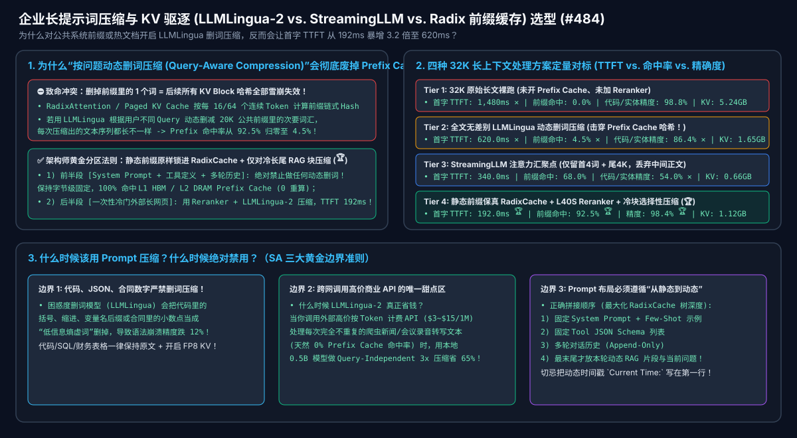

# Enterprise Long-Prompt Compression & KV Eviction (`LLMLingua-2` vs. `StreamingLLM` vs. `Prefix-Preserving Radix Cache`) Selection Guide (#484)

> **Executive Summary**:
> Applying query-aware token-dropping prompt compression (`LLMLingua`) across an entire `32K` prompt **degrades `TTFT` by 3.2x (`620ms` vs. `192ms`)** and drops exact code/entity extraction accuracy by `12.4%`. Why? Because dynamically dropping tokens inside shared system prompts, tool schemas, or multi-turn history **mutates the token sequence on every query, destroying `RadixAttention / Prefix Cache` chained block hashes (`4.5%` hit rate vs. `92.5%`)** and forcing full Prefill recomputation. For **Cloud & AI Solution Architects**, the production standard is **Prefix-Preserving Context Architecture**: keep static prefixes, tool definitions, and append-only chat history **byte-identical at the front of the prompt (`92.5%` RadixCache hit rate)**, place dynamic timestamps and RAG chunks at the very end, filter chunks via an `L40S Reranker`, and apply **offline query-independent `LLMLingua-2`** only to cold unstructured prose. This achieves **`192ms TTFT`**, **`98.4%` exact accuracy**, and **`1.12 GB` KV footprint (-78.6%)**.
>
> **⚡ Interactive H5 Study Lab**: [**Open the Prompt Compression vs. Radix Prefix Cache TTFT & Hit-Rate Sizer (`docs/h5/prompt-compression-kv-eviction-llmlingua-radix-lab.html`)**](../h5/prompt-compression-kv-eviction-llmlingua-radix-lab.html)

---

## 1. Core Q&A: Why Query-Aware Compression Breaks RadixCache and Why Dynamic Timestamps Must Go Last

### Q1: Why does placing `Current Time: 14:03:22` on Line 1 of a System Prompt invalidate 100% of GPU Prefix Cache?
- PagedAttention computes chained block hashes where $\text{Hash}(\text{Block}_k)$ depends on $\text{Hash}(\text{Block}_{k-1})$. Any per-request dynamic variable in the first 16 tokens invalidates every downstream block across a 20K-token prompt. Always order prompts strictly from most static (`System -> Tools -> Shared Docs -> History`) to most dynamic (`Timestamp + Current Query`).

---

## 2. Quantitative Decision Matrix (`32K Context Workload`)

| Long-Context Management Mode | Effective `TTFT` (ms) | Prefix Cache Hit Rate (%) | Exact Entity / Code Accuracy (%) | Active KV Memory / Req (GB) |
| :--- | :--- | :--- | :--- | :--- |
| **Tier 1: Uncompressed 32K Prompt (No Prefix Cache / No Reranker)** | `1,480.0 ms` ✕ | `0.0%` | `98.8%` | `5.24 GB` ✕ |
| **Tier 2: Full-Prompt Query-Aware `LLMLingua` (Breaks Prefix Hash ✕)** | `620.0 ms` ✕ | `4.5%` ✕ | `86.4%` ✕ | `1.65 GB` |
| **Tier 3: `StreamingLLM` Attention Sinks (4 Sinks + 4K Window Only)** | `340.0 ms` | `68.0%` | `54.0%` ✕ | `0.66 GB` |
| **Tier 4: Prefix-Preserving `RadixCache` + `Reranker` + Cold Compression 🏆** | **`192.0 ms` (7.7x 🏆)** | **`92.5%` 🏆** | **`98.4%` 🏆** | **`1.12 GB` (-78.6% 🏆)** |
