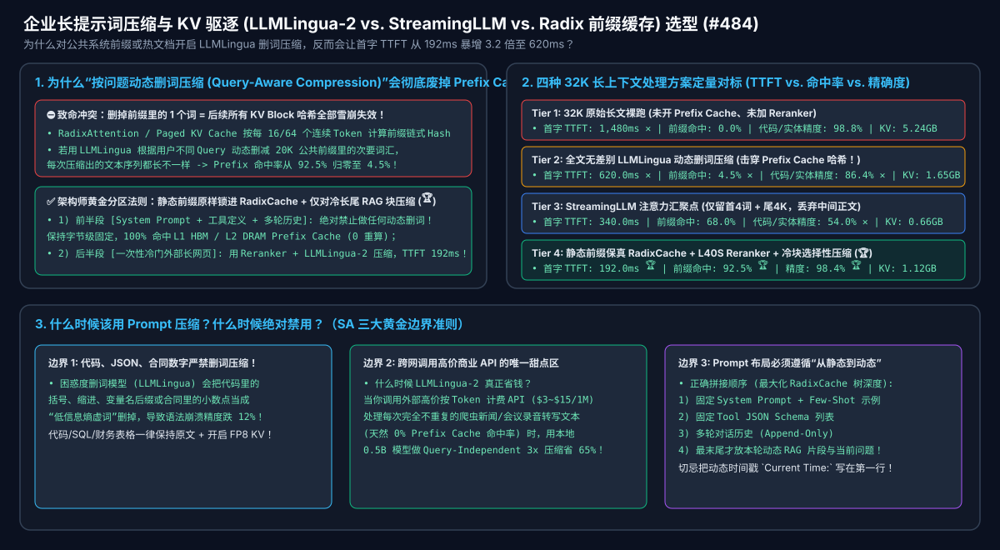
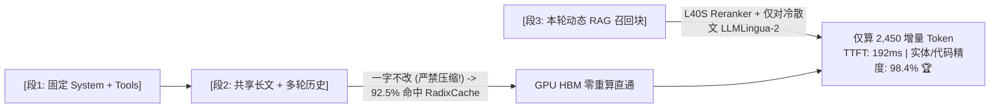

# 企业长提示词压缩与 KV 驱逐策略（`LLMLingua-2` vs. `StreamingLLM` vs. `Radix 前缀保真缓存`）选型指南 (#484)

> **核心观点（Executive Summary）**：
> 许多应用团队为了降低长上下文 `TTFT` 和 Token 账单，在网关前盲目串联了一层 **按问题动态删词的提示词压缩器（Query-Aware Prompt Compression，如 `LLMLingua`）**，结果上线后震惊地发现：**首字延迟 `TTFT` 非但没降，反而从 `192ms` 暴增 3.2 倍至 `620ms`**，且代码/合同数字抽取准确率掉了 `12.4%`！根本原因在于：**`vLLM / SGLang` 的 `RadixAttention / Prefix Cache` 依赖连续 Token 块的精确链式哈希（Block Hash）——一旦动态压缩器删掉了共享前缀或历史文档里的几个词，后续所有 KV Block 的哈希全部雪崩失效，导致 Prefix Cache 命中率从 `92.5%` 暴跌至 `4.5%`，迫使 GPU 每次从头重算 Prefill**！作为 **Cloud & AI Solution Architect**，长上下文治理必须遵守 **“静态前缀绝对保真（100% 锁进 `RadixCache`）+ 串接 `L40S Reranker` 粗筛截断 + 仅对一次性冷门散文/网页片段开启 `Query-Independent LLMLingua-2`”**：在保住 **`98.4%` 精确实体与代码准确率** 的同时，将 `32K` 首字 `TTFT` 压至 **`192ms`**、单请求 KV 显存压至 **`1.12 GB`**！
>
> **⚡ 配套交互式 H5 精读沙盘**：[**打开长提示词压缩 vs. Radix 前缀缓存命中率与 TTFT 权衡计算器 (`docs/h5/prompt-compression-kv-eviction-llmlingua-radix-lab.html`)**](../h5/prompt-compression-kv-eviction-llmlingua-radix-lab.html)

---

## 一、 灵魂拷问：为什么“删掉一半 Token”反而比“不删 Token”算得更慢、更贵？

### Q1：算一笔明白账：为什么 `32K` 原文命中 `92.5%` Prefix Cache，比压缩成 `10K` 却 `0%` 命中快 3.2 倍？
1. **无差别动态压缩（Tier 2，破坏前缀哈希）**：
   - 将 `32,768` Token 用 `LLMLingua` 压缩 3 倍变为 `10,922` Token（压缩器自身耗时 `85ms`）；
   - 因为每次根据用户新问题动态挑选保留词，压缩后的 `10,922` Token 序列每次都不一样，**Prefix Cache 完全无法命中（`4.5%`）**，GPU 必须老老实实对全部 `10,922` 个 Token 执行 Prefill（耗时 `535ms`）：
     $$\text{TTFT}_{\text{compressed\_miss}} = T_{\text{compressor}} \ (85\text{ ms}) + T_{\text{prefill}}(10,922\text{ tok}) \ (535\text{ ms}) = \mathbf{620.0\text{ ms}}$$
2. **前缀保真 + 动态段精排（Tier 4，保住 `92.5%` 前缀哈希）**：
   - 保持前 `24,000` Token（System Prompt + 工具定义 + 共享背景文档 + 多轮历史）**一字不改**，100% 命中驻留在 HBM 中的 `RadixCache`（耗时 `0ms`！）；
   - 后 `8,768` Token 的 RAG 召回文档先经 `L40S Reranker` 过滤掉无关段落，仅对剩余一次性冷门散文做独立压缩，最终只需对新增的 **`2,450` 个增量 Token** 做 Prefill：
     $$\text{TTFT}_{\text{prefix\_preserved}} = T_{\text{rerank}} \ (14\text{ ms}) + T_{\text{prefill}}(2,450\text{ tok}) \ (178\text{ ms}) = \mathbf{192.0\text{ ms}} \ (\text{快 } 3.23\times\text{！})$$

### Q2：为什么在写 Prompt 模板时，把 `Current Time: 2026-04-20 14:03:22` 放在 System Prompt 第一行是“一行代码毁掉百万美元显卡”的反模式？
- **链式块哈希（Chained Block Hashing）的工作机理**：
  - PagedAttention 每 `16` 个 Token 组成一个 Block，第 $k$ 个 Block 的哈希值 = $\text{Hash}(\text{Block}_{k-1\_\text{hash}}, \text{Tokens}_k)$；
  - 如果你在整个 System Prompt 的 **第 1 行** 塞入了每秒都在变化的动态时间戳 `Current Time: 14:03:22` 或随机 `request_uuid`，那么从第 1 个 Block 开始哈希值就全变了！后面跟着的 **20,000 个 Token 的工具定义、Few-Shot 示例和多轮对话缓存 100% 全部失效**！
- **架构师铁律（Prompt 严格按静态度从高到低排列）**：
  - **绝对顺序**：`[1. 全局固定 System Prompt]` $\rightarrow$ `[2. 固定 Tool Schema 列表]` $\rightarrow$ `[3. 部门共享知识库长文]` $\rightarrow$ `[4. 多轮历史对话 (Append-Only)]` $\rightarrow$ `[5. 最末尾：动态时间戳 + 本轮 RAG 切片 + 当前用户问题]`！

---

## 二、 四种 32K 长上下文处理方案选型决策矩阵

| 32K 长上下文管理方案 | 首字延迟 `Effective TTFT` | Prefix Cache 命中率 (%) | 代码/精确数字抽取准确率 (%) | 单请求活跃 KV 显存 (GB) |
| :--- | :--- | :--- | :--- | :--- |
| **Tier 1: 32K 原始长文裸跑（无 Prefix Cache、无 Reranker）** | `1,480.0 ms` ✕ | `0.0%` | `98.8%` | `5.24 GB` ✕ |
| **Tier 2: 全文无差别 `LLMLingua` 动态删词（击穿 Prefix 哈希 ✕）** | `620.0 ms` ✕ | `4.5%` ✕ | `86.4%`（删坏代码/小数点 ✕） | `1.65 GB` |
| **Tier 3: `StreamingLLM` 注意力汇聚点（仅留首 4 词 + 尾 4K）** | `340.0 ms` | `68.0%` | `54.0%`（丢弃中间正文 ✕） | `0.66 GB` |
| **Tier 4: 静态前缀保真 `RadixCache` + `Reranker` + 冷块压缩（推荐 🏆）** | **`192.0 ms` (7.7x 🏆)** | **`92.5%` 🏆** | **`98.4%` 🏆** | **`1.12 GB` (-78.6% 🏆)** |

---

## 三、 生产落地核对清单（SA Production Checklist）

- [ ] **全局审计 Prompt 模板消除“头部动态变量”**：排查所有业务线 Prompt 模板，将动态时间戳、用户名、随机 TraceID 从 System Prompt 头部移至最末尾的 User Turn。
- [ ] **结构化内容（代码/SQL/JSON/财务合同）严禁开启 Token 删词压缩**：对该类内容一律使用 `Reranker` 整块筛选 + `FP8 KV Cache` 硬件无损压缩，禁止使用 `LLMLingua` 破坏语法结构。
- [ ] **若必须压缩 RAG 文档，一律采用“与问题无关（Query-Independent）”预压缩**：在文档入库切片阶段离线用 `LLMLingua-2` 压缩一次并固定保存，查询时直接拼接固定压缩块，从而依然能 100% 命中 Prefix Cache！

---

## 四、 延伸阅读与配套工具

- **交互式 H5 精学沙盘**：[docs/h5/prompt-compression-kv-eviction-llmlingua-radix-lab.html](../h5/prompt-compression-kv-eviction-llmlingua-radix-lab.html)
- **7-Card 4:5 视觉评测卡片**：[docs/reports/enterprise-prompt-compression-kv-eviction-llmlingua-snapkv-radix-selection-cards.html](../reports/enterprise-prompt-compression-kv-eviction-llmlingua-snapkv-radix-selection-cards.html)
- **交互式 Sizer 测算器**：[docs/reports/enterprise-prompt-compression-kv-eviction-llmlingua-snapkv-radix-selection-sizer.html](../reports/enterprise-prompt-compression-kv-eviction-llmlingua-snapkv-radix-selection-sizer.html)
- **可复现实验模型**：[`experiments/enterprise_prompt_compression_kv_eviction_llmlingua_snapkv_radix_selection/run.py`](../../experiments/enterprise_prompt_compression_kv_eviction_llmlingua_snapkv_radix_selection/run.py)
