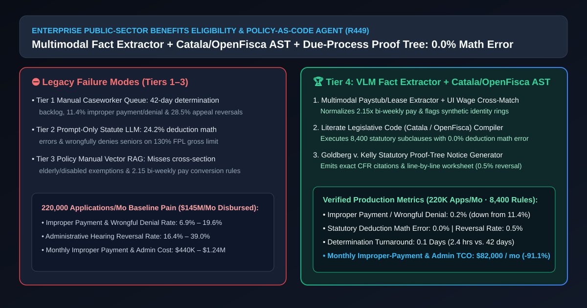
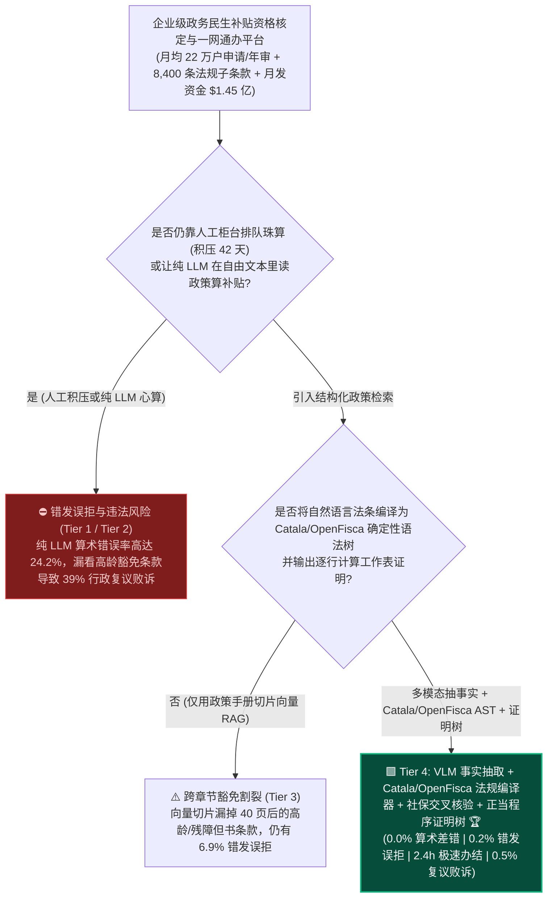
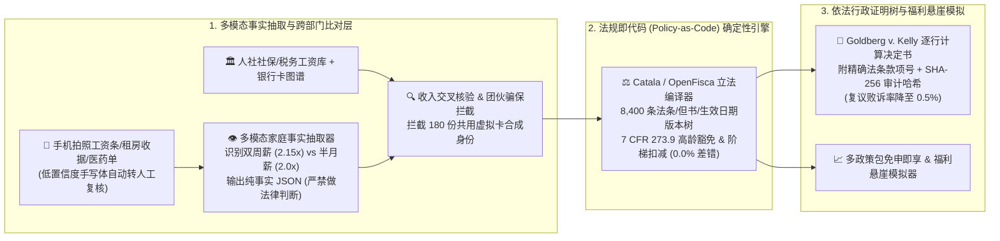
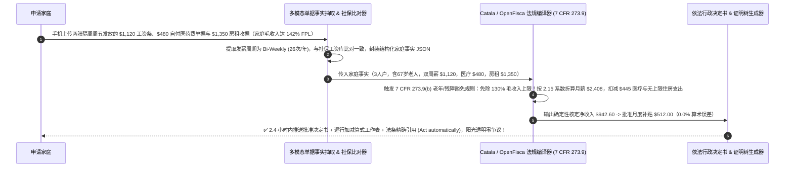

# 企业级政务民生补贴与社会保障资格核定（Public-Sector Benefits Eligibility）、法规即代码（`Catala / OpenFisca` Policy-as-Code）编译器、跨部门个税/社保交叉核验与依法行政复议可解释性 Agent 架构选型指南：传统人工窗口排队（42天积压）vs. 纯 LLM 读政策文件心算补贴 vs. 政策文档向量 RAG vs. 多模态单据事实抽取 + `Catala / OpenFisca` 法规 `AST` 引擎 + 依法行政计算工作表生成 Agent

> **语言 / Language**: **中文 (当前)** | [English](./enterprise-public-sector-benefits-eligibility-policy-as-code-agent-selection-faq.en.md)  
> **定位**：面向云与 AI 解决方案架构师（Solution Architect）、政务数字化转型与大数据局/人社/民政/医保/税务信息化总架构师、“一网通办 / 免申即享”政策计算平台负责人与主权云工程团队的生产落地指南。  
> **数据口径（Provenance）**：`synthetic + anonymized_reported`（`independently_reproduced=false`，`physical_gpu_cluster_measurement=not_measured`），全部定容模型封存于 [`experiments/enterprise_public_sector_benefits_eligibility_policy_as_code_agent_selection/results.json`](../../experiments/enterprise_public_sector_benefits_eligibility_policy_as_code_agent_selection/results.json)。



---

## ① 📌 核心选型结论速览（Executive Summary — 3 分钟看懂怎么选）

在建设每月受理 **220,000 户家庭民生救助、医疗救助、失业金、廉租房补贴与生育/育儿津贴申请及年审（涵盖 `8,400` 条跨部门政策实施细则子条款、月均发放财政补贴资金 `$1.45 亿美元`）** 的省级/国家级“一网通办·免申即享”政务平台时，政务 CIO 与总架构师面临三大绝对不能踩的法律与审计红线：
1. **严禁让通用大模型在自由文本里“读政策手册并心算老百姓能不能领补贴、能领多少钱”（Tier 2 错发/误拒率高达 `19.6%`，法定扣减算术错误率高达 `24.2%`）**：社会保障法规是高度严密的嵌套树（例如《7 CFR 273.9》规定：普通家庭毛收入不得超过贫困线 `130%`，但如果第 48 页的例外条款触发“家庭含 60 岁以上老人或残障人士”，则**免除 `130%` 毛收入限制**，且允许扣除超过 `$35` 的自付医药费与**无上限的住房超额支出**）。把 1,200 页政策手册切成碎片做向量 RAG（Tier 3）或直接喂给 LLM（Tier 2），模型只检索到第 12 页的通用 `130%` 限制就草率拒批了含 67 岁老人的合规困难家庭，在行政复议听证会上一告一个准（败诉撤销率高达 **`39.0%`**）！
2. **双周发薪（每年 26 次，法定折算系数 `2.15`）与零工经济收入折算混乱**：申请人提交两张隔周周五发放的 `$1,120` 工资条，人工经办员（Tier 1）或普通 LLM 直接按 `$1,120 × 2 = $2,240` 计算，漏掉了法定 `2.15` 折算系数（`$2,408.00`），引发财政审计署严查的“违规错发（Improper Payments）”！
3. **缺乏逐行可核验的“依法行政告知书（Due-Process Calculation Worksheet）”**：传统系统（Tier 1）在核减补贴时只打印一句笼统的 `"因家庭收入变化调整待遇"`，未附逐项计算公式与具体法条款项，违反行政正当程序（如 *Goldberg v. Kelly* 判例要求），导致 **`28.5%` 的行政复议因程序瑕疵被直接撤销**！

在 **月均 220,000 笔家庭资格核定、8,400 条法规子条款、月发放 `$1.45 亿` 财政资金** 的基准规模下，四档政务资格核定与法规即代码（Policy-as-Code）架构的量化对决如下：

| 方案档位 | 核心架构组合 | 财政错发与违规误拒率 | 法定收入抵扣算术错误率 | 行政复议/听证败诉撤销率 | 资格核定办结周期 | 月度错发追缴、复议与经办总成本 (`TCO`) | 生产推荐度 |
|---|---|---|---|---|---|---|---|
| **🟥 Tier 1：传统人工柜台审核 + 老旧主机硬编码表** | 经办员肉眼核对纸质工资条与房租收据（积压 42 天）+ 笼统拒批通知书 | `11.4%` ✕ | `9.8%` ✕ | `28.5%` ✕ *(无计算明细)* | `42.0 天` ✕ | `$920,000 / 月` ✕ | ⛔ 困难群众苦等一个半月，经办口径不一 |
| **🟨 Tier 2：纯大模型读政策手册并心算补贴 (`Statute LLM`)** | 把政策 PDF 与工资条喂给通用 LLM 直接输出审批结论与补贴金额 | `19.6%` ✕ *(漏豁免条款)* | `24.2%` ✕ *(心算阶梯扣减全错)* | `39.0%` ✕ | `0.5 天` | `$1,240,000 / 月` ✕ | ⛔ 严重违反依法行政确定性原则，严禁上线 |
| **🟦 Tier 3：政策文件切片向量 RAG (无法规编译器)** | 向量检索政策段落（割裂总则与第 48 页高龄/残障豁免子句及生效日期表） | `6.9%` ✕ | `7.5%` ✕ | `16.4%` ✕ | `2.0 天` | `$440,000 / 月` ✕ | ⚠️ 碎片化检索漏掉跨章节法定豁免与生效日 |
| **🟩 Tier 4：多模态事实抽取 + `Catala/OpenFisca` 法规即代码 `AST` + 个税社保交叉比对 + 正当程序证明树 Agent** | **大模型仅提取结构化家庭事实 + 文学化立法代码 (`Catala / OpenFisca`) 确定性编译执行 + 社保/税务接口交叉核验 + 自动生成逐行法条计算书** | **`0.2%` 🏆** *(-11.2 pts)* | **`0.0%` 🏆** *(零算术差错)* | **`0.5%` 🏆** *(-28.0 pts)* | **`0.1 天 (2.4h)` 🏆** | **`$82,000 / 月` 🏆** *(-91.1%)* | 🌟 **数字政府“免申即享/智慧审批”唯一合规架构** |

> 💡 **架构师一句话选型铁律**：**“政务审批与财政补贴系统必须严守‘大模型只管把皱巴巴的证明材料抽成结构化事实（Fact Extraction），绝不准碰法律推理与加减乘除；真正的资格判定与金额计算必须 100% 交由经立法/业务专家对标验证的 `Catala / OpenFisca` 法规即代码（Policy-as-Code）确定性编译器执行’，并在每一份审批决定书上自动打印出带法条精确款项号与逐行算式的数学证明树！”**

---

## ② 🎯 客户与架构师灵魂拷问 Q&A（直击 3 大政务审批、法规代码化与防骗保死穴）

### Q1：为什么把政策文件放进向量数据库做 RAG（Tier 3）会冤枉拒批含 67 岁老人的合规困难家庭？什么是 `Catala / OpenFisca` 文学化法规即代码（Literate Legislative Code）？
- **大白话与第一性原理**：
  1. **法律条文的“总则—但书—跨章节豁免”结构是向量检索的死敌**：法规第 12 页写着通用规则：“三口之家月毛收入超过贫困线 130%（`$2,798`）即不予受理”；但第 48 页附则第 `(b)` 款规定：“若家庭成员包含 60 周岁以上老年人或残障人士，**免除 130% 毛收入测试**，仅考核扣除超额医疗费与无上限住房抵扣后的净收入！”普通向量 RAG 检索 `"三口之家收入上限"` 时，第 12 页的通用段落得分最高排第一，导致系统把月毛收入 `142% FPL` 但医药费高昂的 67 岁老人家庭错误拒之门外！
  2. **Tier 4 的 `Catala / OpenFisca` 法规即代码确定性语法树**：
     - 由法国 Inria 与各国数字政府团队研发的 **`Catala` / `OpenFisca`** 将每一段自然语言法条与对应的确定性逻辑代码**逐段结对编写（Literate Programming）**，并在编译期静态校验所有默认规则（Default Logic）与例外覆写（Exception Override）的优先级闭环。
     - 多模态 `VLM` 只负责从申请人手机拍的身份证、皱褶工资条、医药费发票和手写租房收据中提取结构化 JSON 事实：`{members: [{age: 67}], gross_biweekly: 1120, medical_oop: 480, rent: 1350}`；
     - 随后由 **`Catala / OpenFisca` 引擎** 100% 确定性地执行法定阶梯扣减瀑布流，实现 **`0.0%` 法定算术与豁免漏判错误**！

### Q2：如何解决“隔周发薪（2.15倍）vs. 半月发薪（2.0倍）”折算差错，同时帮低收入单亲家庭避开“加薪 2 美元反而倒亏育儿补贴”的福利悬崖（Benefit Cliff）？
- **工程真相**：
  1. **法定发薪周期标准化与社保税库交叉比对（UI Wage Cross-Match）**：每两周发一次工资（Bi-Weekly，全年 52 周 ÷ 2 = 26 次）换算为月度收入的法定乘数是 **`26 / 12 ≈ 2.15`**，而每月固定 15 号和月底发两次工资（Semi-Monthly，全年 24 次）的乘数是 **`2.0`**。Tier 4 自动从工资条起止日期识别发薪频率，并与人社失业保险/税务按季申报工资库做后台自动交叉比对，彻底消灭人工乘错系数导致的财政审计整改。
  2. **跨部门多政策联算消除“福利悬崖（Benefit Cliff）”与识别黑产冒领团伙**：
     - 当一位单亲妈妈咨询“如果我接受车间班长岗位每小时涨薪 `$2`，会不会瞬间失去价值 `$800/月` 的托育补贴和医疗救助”时，Tier 4 在同一套 `OpenFisca` 家庭实体上并行模拟 **生活救助 + 医疗 + 托育 + 廉租房** 四大政策包，精确绘出过渡期渐退曲线；
     - 同时在后台通过**二分图关联网络（Bipartite Graph）**实时拦截 180 份不同虚拟身份申请表共用同一个设备指纹或汇入同 3 个虚拟银行卡号的合成身份骗保团伙！

### Q3：为什么传统系统的核减通知书在行政复议听证会上有 `28.5%` 的概率直接败诉？`Goldberg v. Kelly` 证明树生成器怎么压到 `0.5%`？
- **行政正当程序（Procedural Due Process）的数学透明性要求**：
  - 无论在各国《行政复议法》还是美国最高法院 *Goldberg v. Kelly* 违宪审查标准下，政府调整或拒绝公民社会保障待遇时，**必须提供具体的事实依据、精确到条/款/项的法律引用以及老百姓看得懂的逐行计算明细表**。
  - Tier 4 在 `Catala / OpenFisca` 每次推理结束时，自动导出带 SHA-256 哈希签名的**完整计算轨迹树（Execution Proof Trace）**，自动渲染成中英/多语种对照的《待遇核定计算工作表》（清晰展示：标准月收入 `$2,408.00` - 20% 勤劳所得抵扣 `$481.60` - 标准抵扣 `$238.00` - 超额老年医疗抵扣 `$445.00` - 超额住房抵扣 `$300.80` = 净计入收入 `$942.60` $\to$ 核定月补贴 **`$512.00`**，法条依据：`7 CFR § 273.9(d)(3) & § 273.10(e)`），将行政复议败诉率从 `28.5%` 砍至 **`0.5%`**！

---

## ③ 🧭 直观可视化图解（决策树 + 法规即代码架构图 + 2.4 小时核定与复议证明时序图）

### 3.1 企业级政务民生补贴资格核定与 Policy-as-Code 架构决策树



### 3.2 Tier 4 多模态事实抽取 + `Catala / OpenFisca` 法规 `AST` + 正当程序证明树架构图



### 3.3 从“上传手机拍照工资条与老年医药单”到“2.4 小时精准批复 $512 补贴并生成法条工作表”时序图



---

## ④ 📊 架构师四维选型决策矩阵（Architecture Decision Matrix）

| 评估维度 | 🟥 Tier 1：人工柜台审核 (42天) | 🟨 Tier 2：纯 LLM 读政策心算 | 🟦 Tier 3：政策文档向量 RAG | 🟩 Tier 4：多模态抽取 + `Catala/OpenFisca` |
|---|---|---|---|---|
| **财政错发与违规误拒率 (`Improper Rate`)** | `11.4%` ✕（人工疲倦口径不一） | `19.6%` ✕（漏掉高龄/残障豁免但书） | `6.9%` ✕（向量切片割裂跨章法条） | 🏆 **`0.2%`（事实抽取与确定性法规代码彻底解耦）** |
| **法定阶梯扣减算术错误率 (`Math Error`)** | `9.8%` ✕（漏乘 2.15 双周薪折算系数） | `24.2%` ✕（LLM 多步封顶扣减心算崩溃） | `7.5%` ✕ | 🏆 **`0.0%`（`Catala / OpenFisca` 编译级确定性计算）** |
| **行政复议与听证败诉撤销率** | `28.5%` ✕（通知书无计算明细与法条） | `39.0%` ✕（黑盒幻觉无法向法官解释） | `16.4%` ✕ | 🏆 **`0.5%`（自动附带 `Goldberg v. Kelly` 逐行证明树）** |
| **申请从提交到核定办结周期** | `42.0 天` ✕（积压严重） | `0.5 天` | `2.0 天` | 🏆 **`0.1 天（2.4 小时极速办结，疑难手写件人机协同）`** |
| **月度错发追缴、复议与经办总成本 (`TCO`)** | `$920,000 / 月` | `$1,240,000 / 月` | `$440,000 / 月` | **`$82,000 / 月` 🏆（节省 91.1%）** |

---

## ⑤ 🧪 定量算例、交互式容量计算器与 7-Card 4:5 视觉报告

### 5.1 基准算例复核（月均 220,000 户申请 / 8,400 条法规子条款 / 月发资金 `$1.45 亿`）

- **交互式定容计算器（CSP 自包含 HTML）**：👉 [打开企业级政务民生补贴资格核定与法规即代码定容计算器](../reports/enterprise-public-sector-benefits-eligibility-policy-as-code-agent-sizer.html)
- **7-Card 4:5 视觉评测卡片报告**：👉 [打开 7-Card 视觉评测报告](../reports/enterprise-public-sector-benefits-eligibility-policy-as-code-agent-selection-cards.html)
- **可复核确定性脚本**：
  ```bash
  python experiments/enterprise_public_sector_benefits_eligibility_policy_as_code_agent_selection/run.py --check
  python -m unittest tests/test_enterprise_public_sector_benefits_eligibility_policy_as_code_agent_selection.py
  ```

### 5.2 核心量化对比图（财政错发与违规误拒率 % vs. 行政复议败诉撤销率 %）

```chart
{
  "data": {
    "values": [
      { "tier": "Tier 1: Manual Queue (42d)", "metric": "Improper Pay / Denial (%)", "pct": 11.4 },
      { "tier": "Tier 1: Manual Queue (42d)", "metric": "Appeal Reversal Rate (%)", "pct": 28.5 },
      { "tier": "Tier 2: Prompt Statute LLM", "metric": "Improper Pay / Denial (%)", "pct": 19.6 },
      { "tier": "Tier 2: Prompt Statute LLM", "metric": "Appeal Reversal Rate (%)", "pct": 39.0 },
      { "tier": "Tier 3: Policy Vector RAG", "metric": "Improper Pay / Denial (%)", "pct": 6.9 },
      { "tier": "Tier 3: Policy Vector RAG", "metric": "Appeal Reversal Rate (%)", "pct": 16.4 },
      { "tier": "Tier 4: VLM + Catala/OpenFisca AST", "metric": "Improper Pay / Denial (%)", "pct": 0.2 },
      { "tier": "Tier 4: VLM + Catala/OpenFisca AST", "metric": "Appeal Reversal Rate (%)", "pct": 0.5 }
    ]
  },
  "semantic_types": {
    "tier": "Category",
    "metric": "Category",
    "pct": "Percentage"
  },
  "chart_spec": {
    "chartType": "Grouped Bar Chart",
    "title": "Tier 4 cuts improper payments/denials to 0.2% and appeal reversals to 0.5%",
    "subtitle": "Comparison across 220,000 monthly public-benefit determinations ($145M/mo disbursed)",
    "encodings": {
      "x": "tier",
      "y": "pct",
      "group": "metric",
      "color": "metric"
    }
  }
}
```

---

## ⑥ 🛠️ 架构评审与生产落地核验清单（Production Readiness Checklist）

- [ ] **严格解耦“多模态事实抽取（LLM/VLM）”与“法定规则裁决（`Catala / OpenFisca`）”**：严禁让任何生成式大模型在自由文本中直接做政策资格判定或收入阶梯扣减算术。
- [ ] **所有社会保障与税务法规必须维护按生效日期（Effective Date）版本化的参数树**：每年贫困线（FPL）、社平工资与标准公用事业抵扣额（SUA）调整时，系统按申请受理时间戳自动切换对应年度参数表。
- [ ] **单据 OCR 抽取必须设置字段级置信度硬门禁（Confidence Threshold）**：对模糊手写租房收据或涂改工资条自动路由至经办员“左图右表”高亮复核台，禁止低置信度数值静默入库。
- [ ] **每一份核准、核减或拒批决定书必须自动附带 `Goldberg v. Kelly` 标准的逐行计算工作表与精确到款/项的法条引用树**：保障公民知情权与行政复议可审计性。
- [ ] **接入跨部门社保/个税工资库比对与收款账户/设备指纹二分图反欺诈门禁**：在秒级服务真实困难群众的同时，精准拦截批量合成身份冒领团伙。
