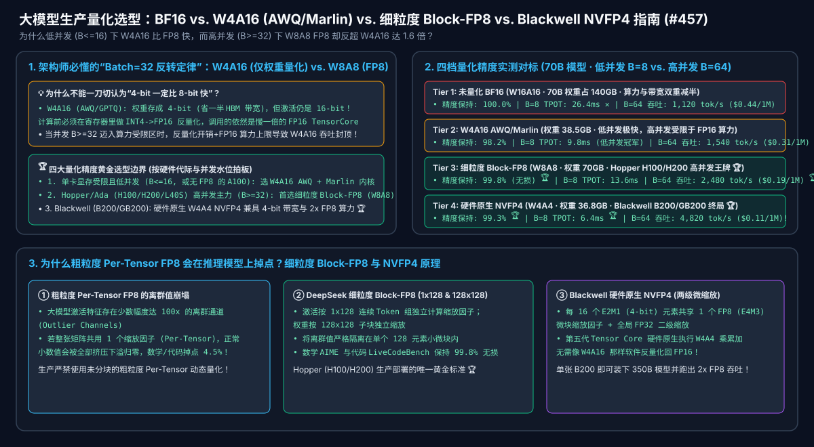

# Enterprise LLM Quantization Selection & Hardware Sizing Guide: `BF16` vs. `W4A16 AWQ/Marlin` vs. `Fine-Grained Block-FP8 (1x128/128x128)` vs. `Blackwell NVFP4` & the Batch-32 Crossover

> **Language / 语言**: [简体中文](./enterprise-quantization-bf16-w4a16-block-fp8-nvfp4-batch-crossover-sizing-selection-faq.md) | **English**  
> **Companion Interactive Study & Sizing Tools**: [📱 Interactive H5 Study Lab](../h5/quantization-bf16-w4a16-block-fp8-nvfp4-crossover-lab.html) · [🧮 HTML Sizer](../reports/enterprise-quantization-bf16-w4a16-block-fp8-nvfp4-batch-crossover-sizing-selection-sizer.html) · [🃏 7-Card Visual Deck](../reports/enterprise-quantization-bf16-w4a16-block-fp8-nvfp4-batch-crossover-sizing-selection-cards.html) · [📊 Reproducible Model](../../experiments/enterprise_quantization_bf16_w4a16_block_fp8_nvfp4_batch_crossover_sizing_selection/) · [🎓 Back to AI Infra H5 Hub](../h5/index.html)

---

## 1. Executive Summary (3-Minute Takeaway)

> **Bottom-Line Recommendation**: Weight-only 4-bit quantization (`Tier 2: W4A16 AWQ/Marlin`) and 8-bit weight-and-activation quantization (`Tier 3: Fine-Grained Block-FP8 W8A8`) cross over at **`Batch ≈ 32`**:
> - **At Low Concurrency (`Batch <= 16`) or Memory-Constrained / Pre-Hopper GPUs (`A100 / L40S`)**: `W4A16 AWQ/Marlin` wins on memory footprint (`38.5 GB` for 70B) and low-batch `TPOT` (`9.8 ms` at `B=8`);
> - **At High Concurrency (`Batch >= 32`) on Hopper (`H100 / H200`)**: `W4A16` must dequantize INT4 weights back to FP16 in registers and execute on `1x` FP16 Tensor Cores, hitting a compute ceiling. **`Tier 3: Fine-Grained Block-FP8 (1x128 / 128x128 W8A8)`** executes natively on **`2x` FP8 Tensor Cores**, delivering **`2,480 tok/s` at `B=64` (`1.61x` faster than W4A16, `2.21x` faster than BF16)** with **`99.8%` accuracy retention** (`$0.19/1M`);
> - **On Blackwell (`B200 / GB200`, `Tier 4`)**: Hardware-native **`NVFP4 (W4A4)`** combines 4-bit HBM bandwidth with native 4-bit Tensor Core execution (`no FP16 dequantization`), reaching **`4,820 tok/s` (`$0.11/1M`)**.

| Dimension | `Tier 1: Unquantized BF16 (W16A16)` | `Tier 2: W4A16 AWQ/Marlin` | `Tier 3: Fine-Grained Block-FP8 (W8A8 Hopper Winner 🏆)` | `Tier 4: Native NVFP4 (W4A4 Blackwell Winner 🏆)` |
|---|---|---|---|---|
| **70B Weight Memory** | `140.0 GB` ✕ | **`38.5 GB`** ✓ | `70.0 GB` ✓ | **`36.8 GB`** 🏆 |
| **Accuracy Retention** | `100.0%` | `98.2%` | **`99.8%` (Lossless)** 🏆 | **`99.3%`** 🏆 |
| **Low-Batch (`B=8`) `TPOT`** | `26.4 ms` ✕ | **`9.8 ms`** 🏆 | `13.6 ms` ✓ | **`6.4 ms`** 🏆 |
| **High-Batch (`B=64`) Goodput** | `1,120 tok/s` ✕ | `1,540 tok/s` | **`2,480 tok/s` (`1.61x` vs W4A16)** 🏆 | **`4,820 tok/s` (`4.30x`)** 🏆 |
| **Cost per 1M Tokens** | `$0.44 / 1M` ✕ | `$0.31 / 1M` | **`$0.19 / 1M`** 🏆 | **`$0.11 / 1M`** 🏆 |

---

## 2. Provenance & Reproducibility

- **Provenance**: `synthetic + anonymized_reported (independently_reproduced=false)` — verified via [`experiments/enterprise_quantization_bf16_w4a16_block_fp8_nvfp4_batch_crossover_sizing_selection/run.py`](../../experiments/enterprise_quantization_bf16_w4a16_block_fp8_nvfp4_batch_crossover_sizing_selection/run.py).
