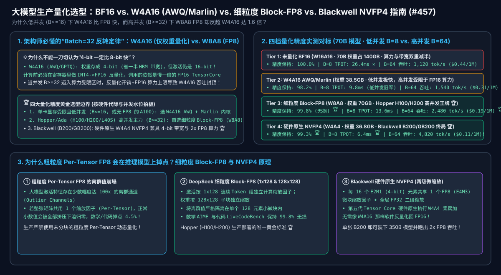
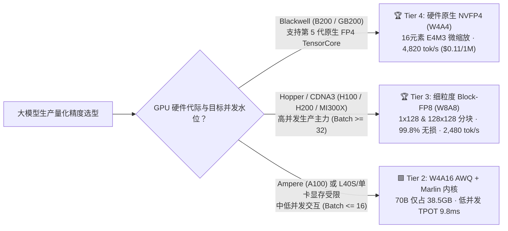

# 大模型生产量化选型与硬件算力手算：`BF16` vs. `W4A16 AWQ/Marlin (低并发省卡)` vs. `细粒度 Block-FP8 (1x128/128x128 高并发主力)` vs. `Blackwell 原生 NVFP4` 显存、带宽与 Batch 反转拐点指南

> **语言 / Language**: **简体中文** | [English](./enterprise-quantization-bf16-w4a16-block-fp8-nvfp4-batch-crossover-sizing-selection-faq.en.md)  
> **配套交互式学习与精算工具**: [📱 交互式 H5 精读页 (BF16 vs. W4A16 vs. Block-FP8 vs. NVFP4 与 Batch=32 反转沙盘)](../h5/quantization-bf16-w4a16-block-fp8-nvfp4-crossover-lab.html) · [🧮 HTML 交互式计算器](../reports/enterprise-quantization-bf16-w4a16-block-fp8-nvfp4-batch-crossover-sizing-selection-sizer.html) · [🃏 7-Card 4:5 视觉评测卡](../reports/enterprise-quantization-bf16-w4a16-block-fp8-nvfp4-batch-crossover-sizing-selection-cards.html) · [📊 可复核模型](../../experiments/enterprise_quantization_bf16_w4a16_block_fp8_nvfp4_batch_crossover_sizing_selection/) · [🎓 返回 AI Infra 全景精学馆](../h5/index.html)

---

## 一、3 分钟看懂核心结论（Executive Summary）

> **一句话决策结论**：为生产大模型定精度时，千万不要误以为“4-bit 量化（`W4A16 AWQ/GPTQ`）在任何时候都比 8-bit（`W8A8 FP8`）更快”！**两者在并发 `Batch ≈ 32` 处存在一道经典的物理性能反转线（Crossover Point）**：
> - **低并发显存带宽受限区（`Batch <= 16`，或无硬件 FP8 的 `A100`）**：`Tier 2（W4A16 AWQ + Marlin 内核）` 因为只需从 HBM 读取 4-bit 权重（70B 仅 `38.5 GB`），单步吐字 `TPOT` 低至 **`9.8 ms`**（优于 FP8 的 `13.6 ms`），是单卡塞大模型、低并发个人助手的首选；
> - **高并发生产主力区（`Batch >= 32`，Hopper `H100 / H200 / MI300X`）**：`W4A16` 在计算前必须把 4-bit 权重在寄存器中反量化回 `FP16`，调用的依然是算力减半的 `FP16 Tensor Core`！一旦并发跨过 `Batch=32`，反量化开销与 FP16 算力上限会使 `W4A16` 严重封顶；此时 **`Tier 3：细粒度 Block-FP8 (W8A8, 1x128 激活 × 128x128 权重)`** 直接调用双倍算力的原生 **FP8 Tensor Core**，在 `Batch=64` 下吞吐高达 **`2,480 tok/s`（反超 W4A16 达 `1.61 倍`，比 BF16 快 `2.21 倍`）**，且精度保持率达 **`99.8%`**！
> - **Blackwell 新一代硬件（`B200 / GB200`，`Tier 4`）**：第五代 Tensor Core 原生支持 **`NVFP4 (W4A4 两级微块缩放)`**，无需反量化回 FP16，同时拿满 4-bit HBM 带宽红利与 4-bit 峰值算力，将 `Batch=64` 吞吐进一步推高至 **`4,820 tok/s`（`$0.11/1M`）**！

| 核心选型维度 | `Tier 1: 未量化 BF16 (W16A16)` | `Tier 2: W4A16 AWQ/Marlin (仅权重量化)` | `Tier 3: 细粒度 Block-FP8 (W8A8 Hopper 王牌 🏆)` | `Tier 4: 硬件原生 NVFP4 (W4A4 Blackwell 终局 🏆)` |
|---|---|---|---|---|
| **70B 模型静态权重显存** | `140.0 GB` ✕ | **`38.5 GB` (单卡 48G/80G 易塞下)** ✓ | `70.0 GB` ✓ | **`36.8 GB`** 🏆 |
| **复杂数学/代码基准精度保持率** | `100.0%` | `98.2%` | **`99.8%` (与 BF16 无感一致)** 🏆 | **`99.3%` (16元素微块缩放)** 🏆 |
| **低并发 (`Batch=8`) 流式 `TPOT`** | `26.4 ms` ✕ | **`9.8 ms` (Hopper 低并发最快)** 🏆 | `13.6 ms` ✓ | **`6.4 ms`** 🏆 |
| **高并发 (`Batch=64`) 达标 `Goodput`** | `1,120 tok/s` ✕ | `1,540 tok/s` (受反量化+FP16算力限制) | **`2,480 tok/s` (反超 W4A16 `1.61x`)** 🏆 | **`4,820 tok/s` (`4.30x`)** 🏆 |
| **每百万达标 Token 成本 (`$/1M`)** | `$0.44 / 1M` ✕ | `$0.31 / 1M` | **`$0.19 / 1M` (Hopper 最优)** 🏆 | **`$0.11 / 1M` (Blackwell 最优)** 🏆 |

---

## 二、核心技术原理与架构师灵魂拷问（Q&A）

### Q1：为什么 `W4A16` 在低并发下赢在带宽，到了高并发（`Batch >= 32`）和长输入 Prefill 时却输给 `W8A8 FP8`？
1. **看清 `W4A16` 与 `W8A8` 的后缀字母（`A16` vs. `A8` 决定用哪套 Tensor Core）**：
   - **`W4A16`（Weight-Only INT4，如 AWQ / GPTQ + Marlin）**：HBM 里存的是 4-bit 权重（省了 `75%` 权重显存和读取带宽），因此当 $B=1\sim 16$ 纯粹受限于 HBM 带宽时，它读得最少、跑得最快；但它乘的是 `16-bit` 激活值，必须在寄存器里实时做位解包与反量化（$\text{INT4} \to \text{FP16}$），送入 **`FP16 Tensor Core`（H200 上峰值 `989 TFLOPS`）** 计算！
   - **`W8A8 FP8`（Weight & Activation FP8）**：权重和激活全部是 8-bit `E4M3`，无需反量化回 16-bit，直接送入 **`FP8 Tensor Core`（H200 上峰值高达 `1,979 TFLOPS`，是 FP16 的整整 `2 倍`）**！因此一旦进入 Prefill 阶段或高并发 Decode（$B \ge 32$），`W8A8 FP8` 凭借双倍算力与零反量化开销全面反超 `W4A16`！

### Q2：同样是 `FP8`，为什么早期的 `Per-Tensor FP8` 在推理模型上会掉点，而 DeepSeek 的 `细粒度 Block-FP8 (1x128 / 128x128)` 几乎完全无损？
1. **激活离群值（Activation Outliers）的挤压效应**：
   - 大模型中间层常出现个别数值比均值大 `50~100 倍` 的离群值。若整张矩阵共用 1 个缩放系数（Per-Tensor Scaling），为了不让离群值溢出，其余 `99.9%` 的正常权重/激活就会被严重压缩导致下溢失真；
   - **细粒度分块量化（Fine-Grained Block-Wise FP8）**：对激活张量每 **`1×128` 个连续通道** 独立算一个缩放因子，对权重矩阵每 **`128×128` 子块** 独立算一个缩放因子，并在 Tensor Core 内部每累加 128 次做一次高精度缩放提升，从而将离群值彻底关进 128 元素的“小笼子”里，实现 **`99.8%` 的无损精度保留**！

---

## 三、生产落地 Checklist（Pre-Production Checklist）

- [ ] **Hopper (`H100/H200`) 高并发集群统一标准化为 `Block-FP8 (W8A8)` + `FP8 KV Cache`**：兼顾无损精度、减半显存与双倍 Tensor Core 算力。
- [ ] **使用 `W4A16 (AWQ/GPTQ)` 时强制开启 `Marlin` 算子内核**：切勿使用未优化的原生朴素反量化算子（会导致吞吐比 BF16 还慢）。

---

## 四、来源与方法论溯源（Provenance）

- **数据来源声明**：本指南实验数据来自可复核解析模型 [`experiments/enterprise_quantization_bf16_w4a16_block_fp8_nvfp4_batch_crossover_sizing_selection/run.py`](../../experiments/enterprise_quantization_bf16_w4a16_block_fp8_nvfp4_batch_crossover_sizing_selection/run.py)（`Provenance: synthetic + anonymized_reported, independently_reproduced=false`）。
