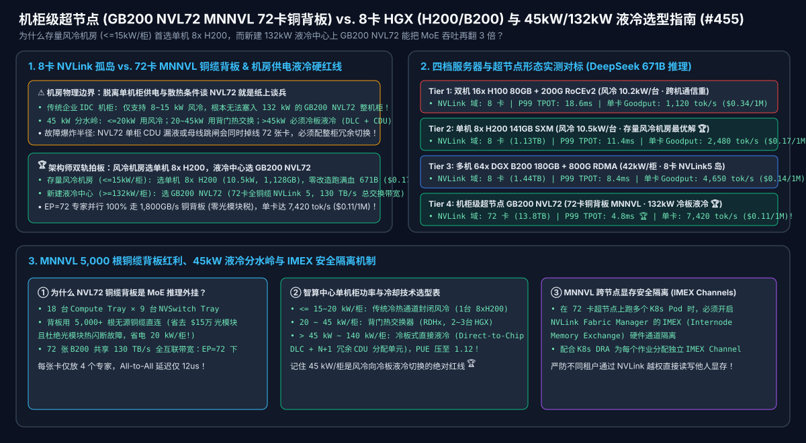

# Enterprise Rack-Scale `GB200 / GB300 NVL72` (`MNNVL` 72-GPU Copper Backplane) vs. 8-GPU `HGX H200 / B200` + `RDMA` Selection Guide: `EP=72` Copper Fabric, `45kW/132kW` Liquid Cooling Boundaries & Token TCO

> **Language / 语言**: [简体中文](./enterprise-rack-scale-gb200-nvl72-mnnvl-vs-hgx-rdma-liquid-cooling-sizing-selection-faq.md) | **English**  
> **Companion Interactive Study & Sizing Tools**: [📱 Interactive H5 Study Lab](../h5/rack-scale-gb200-nvl72-mnnvl-vs-hgx-rdma-tco-lab.html) · [🧮 HTML Sizer](../reports/enterprise-rack-scale-gb200-nvl72-mnnvl-vs-hgx-rdma-liquid-cooling-sizing-selection-sizer.html) · [🃏 7-Card Visual Deck](../reports/enterprise-rack-scale-gb200-nvl72-mnnvl-vs-hgx-rdma-liquid-cooling-sizing-selection-cards.html) · [📊 Reproducible Model](../../experiments/enterprise_rack_scale_gb200_nvl72_mnnvl_vs_hgx_rdma_liquid_cooling_sizing_selection/) · [🎓 Back to AI Infra H5 Hub](../h5/index.html)

---

## 1. Executive Summary (3-Minute Takeaway)

> **Bottom-Line Recommendation**: Choosing between 8-GPU nodes (`HGX H200 / DGX B200`) and 72-GPU rack-scale supernodes (`GB200 / GB300 NVL72`) is governed by the **`45 kW/rack` facility cooling boundary**:
> - **For Air-Cooled Enterprise Data Centers (`<= 15–20 kW/rack`, `Tier 2: Single-Node 8x H200 141GB SXM at 10.5 kW`)**: Fits full `DeepSeek 671B + 14B MTP (685 GB FP8)` inside a single 8-GPU NVLink domain (`1,128 GB HBM3e`), avoiding the 2-node H100 RoCE penalty (`Tier 1`) and delivering **`11.4 ms` `P99 TPOT`** and **`2,480 tok/s/GPU` (`$0.17 / 1M`)** with zero liquid plumbing retrofit;
> - **For Liquid-Cooled AI Factories (`132–140 kW/rack` Direct-to-Chip DLC, `Tier 4: GB200 NVL72 with 72-GPU Copper NVLink 5 MNNVL`)**: Connects all 72 GPUs across a `130 TB/s` copper backplane (`1,800 GB/s/GPU`). Running `EP=72` places only ~4 experts per GPU with 100% copper `All-to-All`, cutting `P99 TPOT` to **`4.8 ms`**, lifting per-GPU Goodput **`6.62x` (`7,420 tok/s`)**, and lowering token cost to **`$0.11 / 1M` (`-67.6%`)**.

| Dimension | `Tier 1: 2-Node 16x H100 80GB (Air)` | `Tier 2: Single-Node 8x H200 141GB (Air Winner 🏆)` | `Tier 3: Multi-Node 64x B200 (800G RDMA)` | `Tier 4: Rack-Scale GB200 NVL72 (132kW DLC Winner 🏆)` |
|---|---|---|---|---|
| **Scale-Up NVLink Domain** | `8 GPUs (640 GB)` | **`8 GPUs (1,128 GB · Fits 671B)`** 🏆 | `8 GPUs (1,440 GB)` | **`72 GPUs (13.8 TB · 130 TB/s Copper)`** 🏆 |
| **Rack Power & Cooling** | `10.2 kW / node` (Air) | **`10.5 kW / node` (Air Drop-In)** 🏆 | `42.0 kW / rack` (RDHx/DLC) | **`132.0 kW / rack` (Mandatory DLC)** |
| **P99 TPOT** | `18.6 ms` | **`11.4 ms`** 🏆 | `8.4 ms` ✓ | **`4.8 ms`** 🏆 |
| **Per-GPU Goodput (`tok/s`)** | `1,120 tok/s` ✕ | **`2,480 tok/s` (`2.21x`)** 🏆 | `4,650 tok/s` (`4.15x`) ✓ | **`7,420 tok/s` (`6.62x`)** 🏆 |
| **Cost per 1M Goodput Tokens** | `$0.34 / 1M` | **`$0.17 / 1M` (-50.0%)** 🏆 | `$0.14 / 1M` ✓ | **`$0.11 / 1M` (-67.6%)** 🏆 |

---

## 2. Provenance & Reproducibility

- **Provenance**: `synthetic + anonymized_reported (independently_reproduced=false)` — verified via [`experiments/enterprise_rack_scale_gb200_nvl72_mnnvl_vs_hgx_rdma_liquid_cooling_sizing_selection/run.py`](../../experiments/enterprise_rack_scale_gb200_nvl72_mnnvl_vs_hgx_rdma_liquid_cooling_sizing_selection/run.py).
