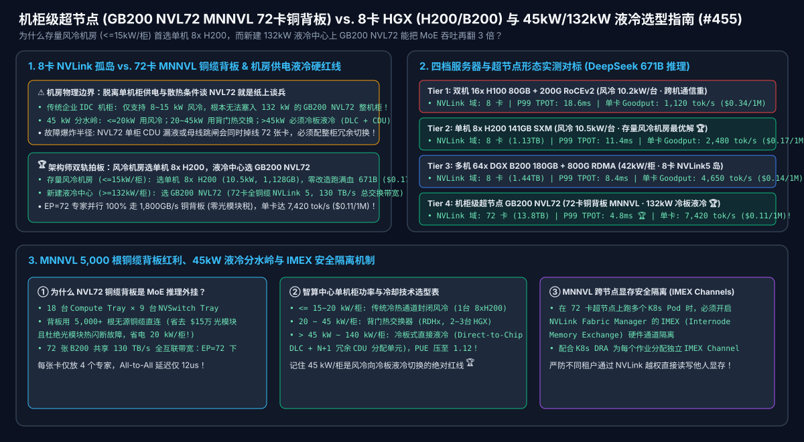
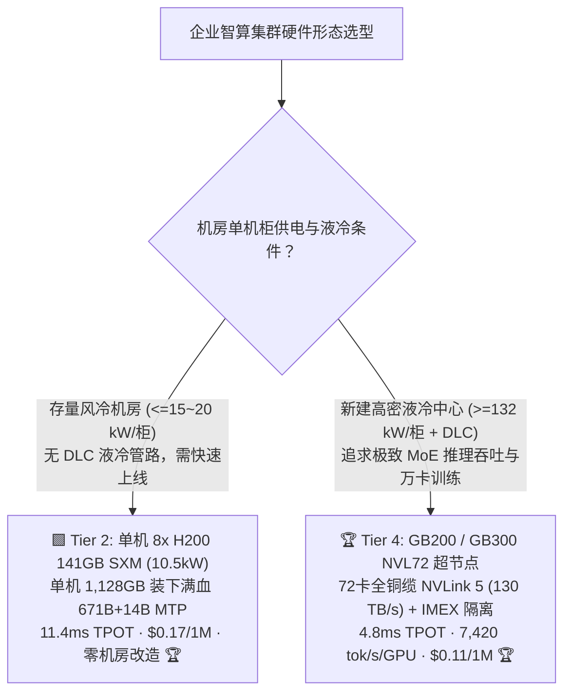

# 机柜级超节点（`GB200 / GB300 NVL72` 多节点 NVLink `MNNVL` 72卡铜背板）vs. 8 卡 `HGX H200 / B200` + `RDMA` 选型：`EP=72` 全铜缆通信、`45kW/132kW` 液冷边界与单百万 Token 成本指南

> **语言 / Language**: **简体中文** | [English](./enterprise-rack-scale-gb200-nvl72-mnnvl-vs-hgx-rdma-liquid-cooling-sizing-selection-faq.en.md)  
> **配套交互式学习与精算工具**: [📱 交互式 H5 精读页 (单机 8xH200 vs. 多机 RDMA vs. GB200 NVL72 超节点与液冷沙盘)](../h5/rack-scale-gb200-nvl72-mnnvl-vs-hgx-rdma-tco-lab.html) · [🧮 HTML 交互式计算器](../reports/enterprise-rack-scale-gb200-nvl72-mnnvl-vs-hgx-rdma-liquid-cooling-sizing-selection-sizer.html) · [🃏 7-Card 4:5 视觉评测卡](../reports/enterprise-rack-scale-gb200-nvl72-mnnvl-vs-hgx-rdma-liquid-cooling-sizing-selection-cards.html) · [📊 可复核模型](../../experiments/enterprise_rack_scale_gb200_nvl72_mnnvl_vs_hgx_rdma_liquid_cooling_sizing_selection/) · [🎓 返回 AI Infra 全景精学馆](../h5/index.html)

---

## 一、3 分钟看懂核心结论（Executive Summary）

> **一句话决策结论**：为企业规划万亿参数或 `DeepSeek 671B` 智算底座时，选 **标准 8 卡服务器（`HGX H200 / DGX B200`）** 还是 **整机柜 72 卡超节点（`GB200 / GB300 NVL72`）**，第一道决定性分水岭是**机房单机柜供电与液冷能力（`45 kW` 红线）**：
> - **存量风冷机房（单柜供电 `<= 15~20 kW`，无冷板液冷管路）首选 `Tier 2：单机 8x H200 141GB SXM (10.5 kW/台)`**：无需改造机房水路，单台机器 `1,128 GB` HBM3e 刚好在 8 卡机内 NVLink 域装下满血 `671B+14B MTP (685GB FP8)`，避免双机 `16x H100`（`Tier 1`）的跨机 RoCE 通信损耗，将 `P99 TPOT` 压至 **`11.4 ms`**、单卡吞吐达 **`2,480 tok/s`（`$0.17/1M`）**；
> - **新建高密液冷智算中心（单柜支持 `132~140 kW` 冷板式液冷 DLC）首选 `Tier 4：GB200 NVL72 机柜级超节点 (72 卡 MNNVL 铜缆背板)`**：通过机柜背部 5,000+ 根无源铜缆将 **72 张 B200 GPU 织成一个高达 `13.8 TB` 显存、`130 TB/s` 全互联带宽的巨型 Scale-Up 域**！运行 `EP=72` 专家并行时，每张卡仅需驻留 `4` 个路由专家且 100% 走 `1,800 GB/s` 铜缆 NVLink 5，将 `P99 TPOT` 压至惊人的 **`4.8 ms`**，单卡有效吞吐飙升至 **`7,420 tok/s`（是 H100 的 `6.62 倍`）**，单百万 Token 成本降至 **`$0.11`（立省 `67.6%`）**！

| 核心选型维度 | `Tier 1: 双机 16x H100 80GB (风冷)` | `Tier 2: 单机 8x H200 141GB (风冷首选 🏆)` | `Tier 3: 多机 64x DGX B200 (800G RDMA)` | `Tier 4: 机柜级 GB200 NVL72 (132kW 液冷首选 🏆)` |
|---|---|---|---|---|
| **Scale-Up NVLink 域大小** | `8 卡 (640 GB)` | **`8 卡 (1,128 GB · 单机装下 671B)`** 🏆 | `8 卡 (1,440 GB)` | **`72 卡 (13.8 TB · 130 TB/s 铜背板)`** 🏆 |
| **单机柜功率与散热门槛** | `10.2 kW / 台` (风冷) | **`10.5 kW / 台` (存量风冷即插即用)** 🏆 | `42.0 kW / 柜` (RDHx/DLC) | **`132.0 kW / 柜` (强制冷板液冷 DLC)** |
| **流式吐字延迟 (`P99 TPOT`)** | `18.6 ms` | **`11.4 ms`** 🏆 | `8.4 ms` ✓ | **`4.8 ms` (单用户 `>200 tok/s`)** 🏆 |
| **单张 GPU 达标吞吐 (`Goodput`)** | `1,120 tok/s` ✕ | **`2,480 tok/s` (`2.21x`)** 🏆 | `4,650 tok/s` (`4.15x`) ✓ | **`7,420 tok/s` (`6.62x`)** 🏆 |
| **每百万达标 Token 成本 (`$/1M`)** | `$0.34 / 1M` | **`$0.17 / 1M` (-50.0%)** 🏆 | `$0.14 / 1M` ✓ | **`$0.11 / 1M` (-67.6%)** 🏆 |

---

## 二、核心技术原理与架构师灵魂拷问（Q&A）

### Q1：为什么 `GB200 NVL72` 的 72 卡铜背板（`MNNVL`）在跑 `DeepSeek 671B` 大规模 MoE Decode 时，单卡吞吐能比 8 卡服务器高出近 3 倍？
1. **打破“8 卡 NVLink 墙”与 Decode HBM 权重读取摊薄效应**：
   - 在传统 8 卡服务器（`HGX H200 / B200`）上，NVLink 只限于机箱内 8 张卡。若要用 64 张卡做 `EP=64` 专家并行，其中 `7/8` 的专家 `All-to-All` 流量必须降速走 `50~100 GB/s` 的跨机 RDMA 光模块；
   - 而在 `GB200 NVL72` 中，18 台计算托盘（Compute Trays，每台含 2 颗 Grace CPU + 4 颗 B200 GPU）通过机柜背部 **5,000 多根无源高速铜缆（Copper Cartridges）** 直连 9 台 NVSwitch 托盘，使 **72 张 GPU 全部享有 `1,800 GB/s` 双向 NVLink 5 带宽（是 400G RDMA 的 `18 倍`）**！
   - 更重要的是：在 `EP=72` 下，256 个路由专家分摊到 72 张卡上，**每张 GPU 每层只需存储和读取 $256 / 72 \approx 4$ 个专家（而 8 卡机器每张卡每步要读取 20~32 个激活专家）**！每卡每步 HBM 权重读取量直接缩小 `5~6 倍`，从而在大 Batch 下依然轻松保住 **`4.8 ms` 的极致 `TPOT`**！

### Q2：智算中心机房从风冷向液冷切换的物理功率红线是多少？72 卡超节点在多租户 K8s 下怎么防止跨节点显存越权访问？
1. **三大机柜功率与散热分水岭**：
   - **`<= 15 ~ 20 kW / 机柜`**：传统冷热通道封闭精密空调风冷即可满足（适合单柜放置 1~2 台 `8x H200 / L40S`）；
   - **`20 ~ 45 kW / 机柜`**：风冷达物理极限，需加装 **背门热交换器（Rear-Door Heat Exchanger, RDHx）**；
   - **`> 45 kW ~ 140 kW / 机柜`（绝对分水岭）**：必须采用 **冷板式直接液冷（Direct-to-Chip Liquid Cooling, DLC）+ 冗余冷却液分配单元（CDU）**，由冷板直接带走 `80%~85%` 的 CPU/GPU/NVSwitch 热量，将机房 PUE 从风冷的 `1.45` 压降至 **`1.10 ~ 1.15`**。
2. **`MNNVL` 多节点显存硬件隔离（`IMEX Channels`）**：
   - 因为 72 张卡跨 18 台物理 OS 节点共享同一片 NVLink 物理地址空间，必须通过 `NVLink Fabric Manager` 与 **K8s `DRA` 动态分配独立的 `IMEX (Internode Memory Exchange) Channel`**，只有持有相同 IMEX 通道令牌的容器进程才能建立跨节点 P2P 显存映射，实现硬件级零信任租户隔离。

---

## 三、生产落地 Checklist（Pre-Production Checklist）

- [ ] **立项前先核查机房单柜承重（`NVL72` 满配重达 `1.36 吨`）与 `>45 kW` 冷板液冷 CDU 冗余度**：严禁在未完成水路与承重改造的传统楼宇机房盲目采购整机柜超节点。
- [ ] **以整机柜 Clique + CDU 回路为单位配置 K8s 故障域（Failure Domain）**：确保同一服务的多个高可用副本分散在不同 NVL72 机柜与不同 CDU 支路上。

---

## 四、来源与方法论溯源（Provenance）

- **数据来源声明**：本指南实验数据来自可复核解析模型 [`experiments/enterprise_rack_scale_gb200_nvl72_mnnvl_vs_hgx_rdma_liquid_cooling_sizing_selection/run.py`](../../experiments/enterprise_rack_scale_gb200_nvl72_mnnvl_vs_hgx_rdma_liquid_cooling_sizing_selection/run.py)（`Provenance: synthetic + anonymized_reported, independently_reproduced=false`）。
