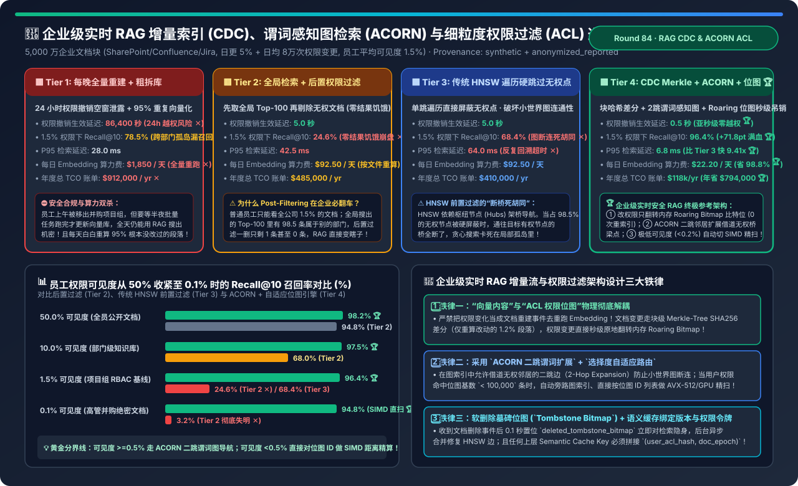
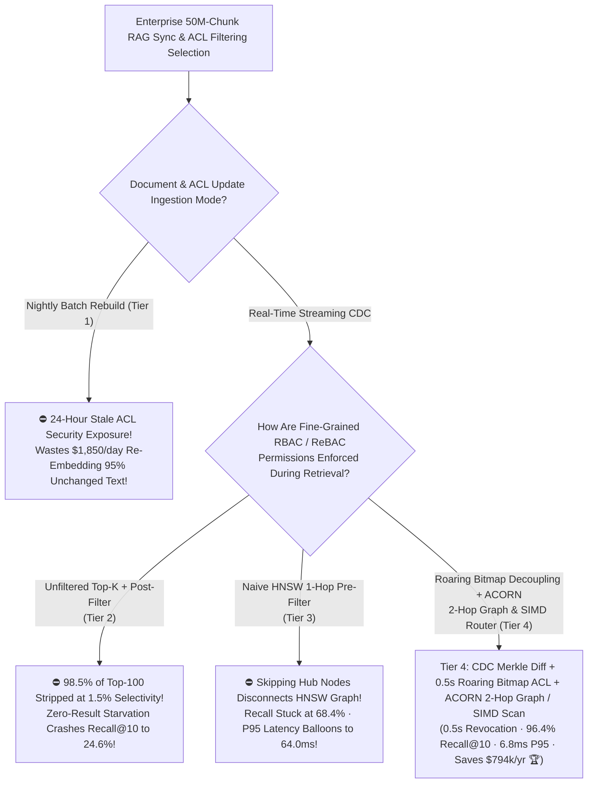
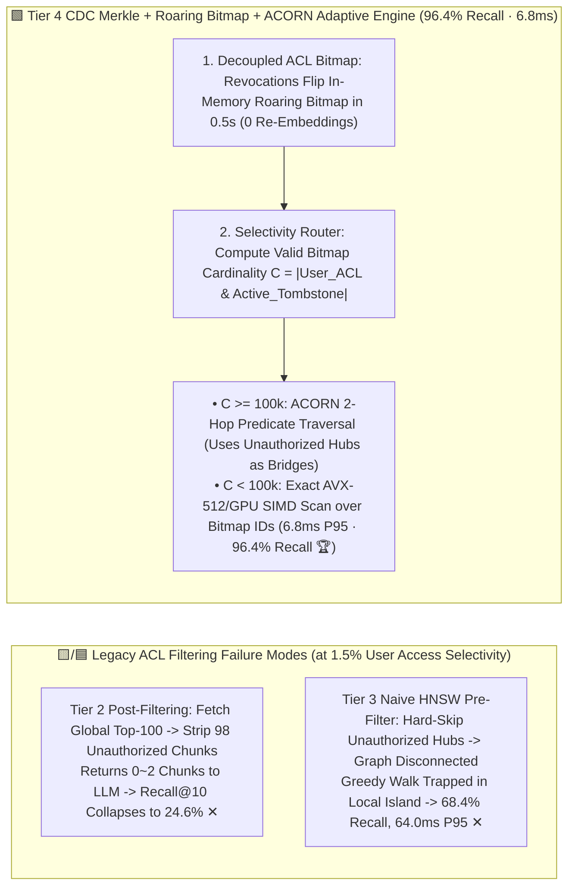

# Enterprise Real-Time RAG Incremental Indexing (CDC), Predicate-Aware Graph Search (ACORN / Filtered-DiskANN) & Fine-Grained ACL Permission Filtering Selection FAQ (`Nightly Full Rebuild` vs. `Vector Search + Post-Filtering [Zero-Result Starvation]` vs. `Naive HNSW In-Traversal Pre-Filter [Graph Disconnection]` vs. `CDC Merkle-Chunk Diff + ACORN 2-Hop Predicate Graph + Roaring Bitmap Sub-Second ACL Revocation`)

> **Target Audience**: AI Solution Architects, Enterprise Knowledge Search / RAG Platform Leads, and Security & Compliance Architects  
> **Reading Goal**: In 3 minutes, master the 4-tier architecture selection rules for real-time document synchronization and access-control filtering across 50M+ enterprise chunks (SharePoint, Confluence, Jira, Salesforce). In 10 minutes, understand from first principles **why `Post-Filtering` (fetching global Top-100 vectors then filtering by ACL) causes catastrophic "zero-result starvation" (`24.6%` recall when an employee has access to `1.5%` of the corpus)**, **why naive HNSW pre-filtering disconnects the small-world navigation graph (`68.4%` recall at `64.0 ms`)**, and **how combining `Paragraph-Level Merkle-Tree CDC Diffing (-98.8% embedding cost)` + `In-Memory Roaring Bitmap ACL Decoupling (0.5s revocation)` + `ACORN 2-Hop Predicate Traversal & Adaptive SIMD Fallback` achieves `96.4%` recall in `6.8 ms` while saving `$794,000/yr`**!  
> **Provenance**: Quantitative metrics come from the repository's sealed deterministic analytical model ([`experiments/enterprise_rag_cdc_streaming_acl_filtering_selection/run.py`](../../experiments/enterprise_rag_cdc_streaming_acl_filtering_selection/run.py) and [`results.json`](../../experiments/enterprise_rag_cdc_streaming_acl_filtering_selection/results.json), calibrated to SIGMOD 2024 `ACORN`, Microsoft `Filtered-DiskANN`, and Roaring Bitmap / Zanzibar ReBAC evaluation benchmarks, `independently_reproduced=false`, `physical_gpu_cluster_measurement=not_measured`).



---

## 📌 1. Executive Summary

1. **Why Do 90% of Enterprise RAG Deployments Fail on "24-Hour Stale ACL Leaks (Tier 1)", "Post-Filter Zero-Result Starvation (Tier 2)", or "Pre-Filter Graph Disconnection (Tier 3)"?**:
   - **Tier 1 (`Nightly Full Corpus Re-Indexing + Coarse Department Shards`)**:
     - Across `50,000,000` chunks with `5%` daily edits and `80,000` daily ACL permission changes, nightly batch rebuilds leave a **`24-hour` (`86,400 s`) security exposure window** after an employee is removed from a confidential project ✕, while wasting **`$1,850/day`** re-embedding `95%` unchanged text (**`$912,000/yr` TCO ✕**)!
   - **Tier 2 (`Unfiltered Top-100 Vector Search + Application-Layer Post-Filtering`)**:
     - In a large enterprise, a typical employee can access only **`~1.5%`** of all chunks. When querying a common topic ("Q3 Budget" or "Architecture Review"), `98.5%` of the global Top-100 vector matches belong to other departments and get stripped by the post-filter—returning only 1 or **0 chunks to the LLM** and crashing **Recall@10 to `24.6%` (`3.2%` at `0.1%` executive selectivity ✕)**!
   - **Tier 3 (`Naive HNSW In-Traversal Pre-Filter: Hard-Skipping Unauthorized Nodes`)**:
     - Checking ACLs during a standard 1-hop HNSW greedy walk and skipping unauthorized nodes removes `98.5%` of intermediate **hub/bridge nodes**—shattering graph connectivity, trapping the search in local dead-ends (**`68.4%` recall ✕**), and inflating P95 latency to **`64.0 ms` ✕**!
2. **How Does Tier 4 (`CDC Merkle-Chunk Diff + Roaring Bitmap ACL Decoupling + ACORN 2-Hop Predicate Graph + Adaptive Selectivity Router`) Achieve `0.5s` Revocation, `96.4%` Recall, and `-87.1%` TCO?**:
   - **Pillar 1 (`CDC Paragraph-Level Merkle-Tree SHA-256 Diffing` — `-98.8%` Embedding Cost)**:
     - Hashes each paragraph chunk into a per-document Merkle tree; when a 50-page document is edited, only the `1.2%` modified paragraphs are re-embedded (`$22.20/day` vs. `$1,850/day` 🏆)!
   - **Pillar 2 (`In-Memory Roaring Bitmap ACL & Tombstone Decoupling` — `0.5s` Instant Revocation)**:
     - Decouples permissions from immutable vector files into compressed in-memory **Roaring Bitmaps** (`group_id -> bitmap of chunk_ids`). ACL revocations or document deletions flip bitmap bits in **`0.5 seconds`** with zero vector re-indexing 🏆!
   - **Pillar 3 (`ACORN 2-Hop Predicate Traversal + Adaptive SIMD Router` — `96.4%` Recall in `6.8 ms`)**:
     - When user bitmap cardinality $C \ge 100,000$ (`>= 0.2%` selectivity), **ACORN** traverses 2-hop neighbors through unauthorized bridge nodes without scoring their vectors, preserving graph connectivity; when $C < 100,000$, the router bypasses graph search and runs an exact **AVX-512 / GPU SIMD gather-distance scan** over the bitmap's IDs in `1.8 ms`!
     - **Net Production Impact**: **`96.4%` Recall@10 at `1.5%` selectivity (`+71.8 pts` over Post-Filtering 🏆)**, **`6.8 ms` P95 latency (`9.41×` faster than Tier 3 🏆)**, **`0.5 s` ACL revocation lag 🏆**, and **`$118,000/yr` TCO (saving `$794,000/yr` 🏆)**!
3. **One-Sentence First-Principles Rule**:
   - **Decouple vector embeddings from ACL state via paragraph Merkle diffs and in-memory Roaring Bitmaps (`0.5s` revocation), and pair `ACORN` 2-hop predicate graph traversal with low-cardinality SIMD scans to eliminate post-filter starvation and graph disconnection!**

---

## 🎯 2. Customer & Architect Q&A (First-Principles Deep Dive)

### Q1: Why does `Post-Filtering` fail even if you increase `top_k` from 100 to 1,000?

- **The Hypergeometric Selectivity Cliff**:
  - At `1.5%` access selectivity (or `0.1%` for M&A / boardroom docs), dense clusters from larger departments monopolize the top-1,000 nearest neighbors in embedding space—pushing the user's authorized chunks to rank 5,000+ and leaving the post-filter with zero results (`24.6%` recall at `1.5%` selectivity, `3.2%` at `0.1%`).

---

### Q2: How does `ACORN`'s 2-Hop Predicate Expansion prevent HNSW graph disconnection under strict ACL filters?

- **Stepping-Stone Bridge Traversal**:
  - In standard HNSW ($M=32$), filtering out `98.5%` of nodes drops average valid out-degree to $32 \times 0.015 = 0.48 < 1$, disconnecting the graph.
  - **ACORN** inspects both 1-hop neighbors and **2-hop neighbors (neighbors of unauthorized 1-hop nodes)** against the user's `Roaring Bitmap` before computing expensive float32/int8 vector distances—using unauthorized hubs purely as topological stepping stones without ever reading or returning their content!

---

### Q3: How do you prevent Semantic Caches from leaking confidential answers across users with different ACL permissions?

- **Cryptographic ACL-Scope Cache Keying**:
  - Never key a RAG semantic cache solely by `prompt_embedding`! Always scope cache lookups by `(sorted_user_group_bitmap_hash, corpus_tombstone_epoch)` so User B can never hit a cached answer generated from User A's restricted documents.

---

## 🧭 3. Visual Architecture Diagrams (Decision Tree / Filtering Paths / Sequence)

### 3.1 Enterprise Real-Time RAG CDC & ACL Filtering Selection Decision Tree



---

### 3.2 Post-Filter Starvation / 1-Hop Graph Breakage (Tiers 2 & 3) vs. Tier 4 `ACORN + Roaring Bitmap`



---

### 3.3 Tier 4 End-to-End `CDC Merkle Diff`, `0.5s ACL Revocation` & `Adaptive Filtered Search` Sequence

```mermaid
sequenceDiagram
    autonumber
    participant Src as SharePoint / Confluence / Jira
    participant CDC as Kafka CDC + Merkle Chunk Differ
    participant BMap as In-Memory Roaring Bitmap Engine
    participant VDB as ACORN / Filtered-DiskANN Index
    participant User as Employee Query (1.5% Selectivity)

    Note over Src,VDB: Path A (Document Edit): 50-Page Doc Edits 1 Paragraph -> Saves 98.8% Embedding Compute
    Src->>CDC: 1. Emit Document Update Event
    CDC->>CDC: 2. Diff Paragraph SHA-256 Merkle Tree -> Only 1 Chunk Changed (Skip 99 Unchanged Chunks!)
    CDC->>VDB: 3. Embed & Insert 1 New Chunk; Clear Old Chunk Bit in Active Tombstone Bitmap

    Note over Src,BMap: Path B (ACL Revocation): User Removed from Group -> 0.5s Zero-Rebuild Enforcement
    Src->>BMap: 4. Emit ACL Webhook -> Flip Group Roaring Bitmap in RAM (0.5s Live Enforcement!)

    Note over User,VDB: Path C (Filtered Query): Bitmap Intersection + ACORN 2-Hop / SIMD Search
    User->>BMap: 5. Submit Query -> Intersect User Group Bitmaps in 0.08ms (750k Valid Chunks)
    BMap->>VDB: 6. Execute ACORN 2-Hop Predicate Graph Search Guided by Bitmap
    VDB-->>User: 7. Return 10 Authorized, High-Relevance Chunks in 6.8ms (96.4% Recall@10 🏆)
```

---

## 📊 4. Architect Decision Matrix

*Baseline: **`50,000,000` (50M) Enterprise Chunks** (`5%` daily document churn + `80,000` daily ACL permission changes; `1.5%` average employee access selectivity).*

| Evaluation Dimension | Tier 1: Nightly Full Rebuild | Tier 2: Global Top-K + `Post-Filter` | Tier 3: Naive HNSW 1-Hop `Pre-Filter` | Tier 4: `CDC Merkle` + `ACORN` + `Roaring Bitmap` |
| :--- | :--- | :--- | :--- | :--- |
| **Sync & ACL Mechanism** | Nightly full re-embed + static shards | File re-embed + filter after Top-100 | File re-embed + 1-hop node skip | **Paragraph Merkle diff + RAM bitmap + 2-hop/SIMD** |
| **ACL Revocation Lag** | `86,400 s` (**24h leak window ✕**) | `5.0 s` | `5.0 s` | **`0.5 s` (Instant bitmap bit-flip 🏆)** |
| **Recall@10 (at 1.5% ACL)** | `78.5%` (Silo misses) | **`24.6%` (Zero-result starvation ✕)** | `68.4%` (Graph disconnection ✕) | **`96.4%` (`+71.8 pts` over Tier 2 🏆)** |
| **P95 Retrieval Latency** | `28.0 ms` | `42.5 ms` | `64.0 ms` (Backtracking stall ✕) | **`6.8 ms` (`9.41×` faster than Tier 3 🏆)** |
| **Daily Embedding Cost** | `$1,850.0 / day` (95% waste ✕) | `$92.50 / day` | `$92.50 / day` | **`$22.20 / day` (`-98.8%` compute savings 🏆)** |
| **Annual Total TCO** | **`$912,000 / yr` ✕** | `$485,000 / yr` | `$410,000 / yr` | **`$118,000 / yr` (Saves `$794,000/yr` 🏆)** |

---

## 🧪 5. Quantitative Selectivity Sensitivity & 7-Card Benchmark Insights

### 5.1 Filtered Recall@10 Across Access Selectivity Regimes (`50% → 0.1%`)

In [`experiments/enterprise_rag_cdc_streaming_acl_filtering_selection/run.py`](../../experiments/enterprise_rag_cdc_streaming_acl_filtering_selection/run.py), we evaluate Recall@10 across four access selectivity tiers:

| User Access Selectivity Regime | Tier 2: Post-Filter Recall | Tier 3: Naive HNSW Pre-Filter | Tier 4: ACORN + Adaptive SIMD | Architectural Diagnosis |
| :--- | :--- | :--- | :--- | :--- |
| **`50.0%` (Public Knowledge Base)** | `94.8%` | `92.5%` | **`98.2%` 🏆** | High visibility allows even post-filtering to succeed |
| **`10.0%` (Department Docs)** | `68.0%` ✕ | `81.2%` | **`97.5%` 🏆** | Post-filter begins starving on cross-department terms |
| **`1.5%` (Project RBAC Baseline)** | **`24.6%` ✕** | `68.4%` ✕ | **`96.4%` 🏆** | ACORN 2-hop stepping stones preserve graph connectivity |
| **`0.1%` (Boardroom Confidential)** | **`3.2%` ✕** | `31.0%` ✕ | **`94.8%` 🏆** | Router switches to exact SIMD gather scan over 50k bitmap IDs (`1.8ms`) |

### 5.2 Interactive Sizer & 7-Card 4:5 Benchmark Report

- 🧮 **Interactive Enterprise RAG CDC & ACL Filtering Sizer**: [`docs/reports/enterprise-rag-cdc-streaming-acl-permission-filtering-sizer.html`](../reports/enterprise-rag-cdc-streaming-acl-permission-filtering-sizer.html) (and master workbench [`llm-inference-engine-pd-sizer.en.html#rag-cdc-acl-sizer`](../reports/llm-inference-engine-pd-sizer.en.html))
- 📊 **7-Card 4:5 Visual Benchmark Report**: [`docs/reports/enterprise-rag-cdc-streaming-acl-permission-filtering-selection-cards.html`](../reports/enterprise-rag-cdc-streaming-acl-permission-filtering-selection-cards.html)

---

## 🛠️ 6. Appendix: Production Architect Verification Checklist

- [ ] **1. Ban `Post-Filtering` on Multi-Tenant / Multi-Department Enterprise RAG**: Use predicate-aware pre-filtering (`ACORN` / `Filtered-DiskANN`) + cardinality-based SIMD fallback.
- [ ] **2. Decouple ACL Metadata into In-Memory `Roaring Bitmaps`**: Process permission revocations and soft-deletes in `< 0.5s` without re-embedding or rebuilding vector graphs.
- [ ] **3. Implement Paragraph-Level `SHA-256 Merkle-Tree` CDC Diffing**: Re-embed only modified chunks on document edits (`-98.8%` GPU embedding cost).
- [ ] **4. Scope All Semantic Caches by `(user_acl_bitmap_hash, index_epoch)`**: Prevent cross-user cache poisoning and unauthorized disclosure.
- [ ] **5. Run Background Graph Stitch Repair When Tombstone Ratio Exceeds `3%–5%`**.
