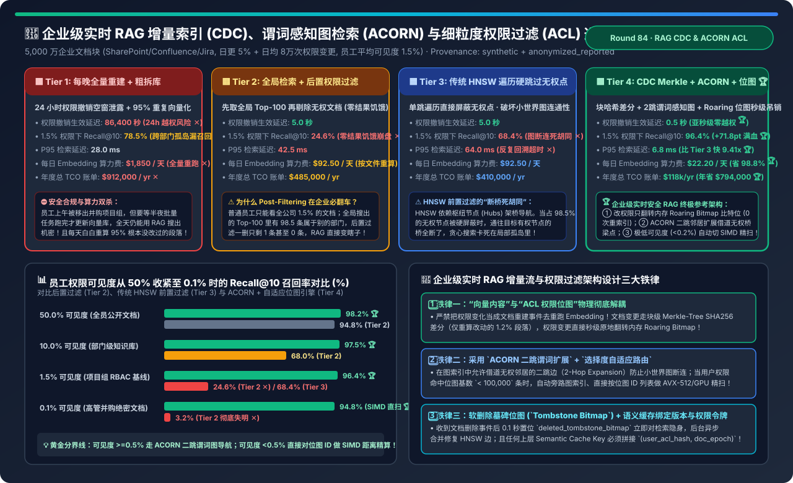
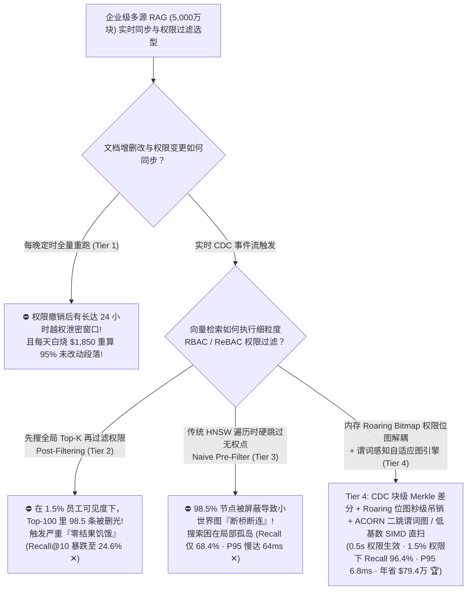
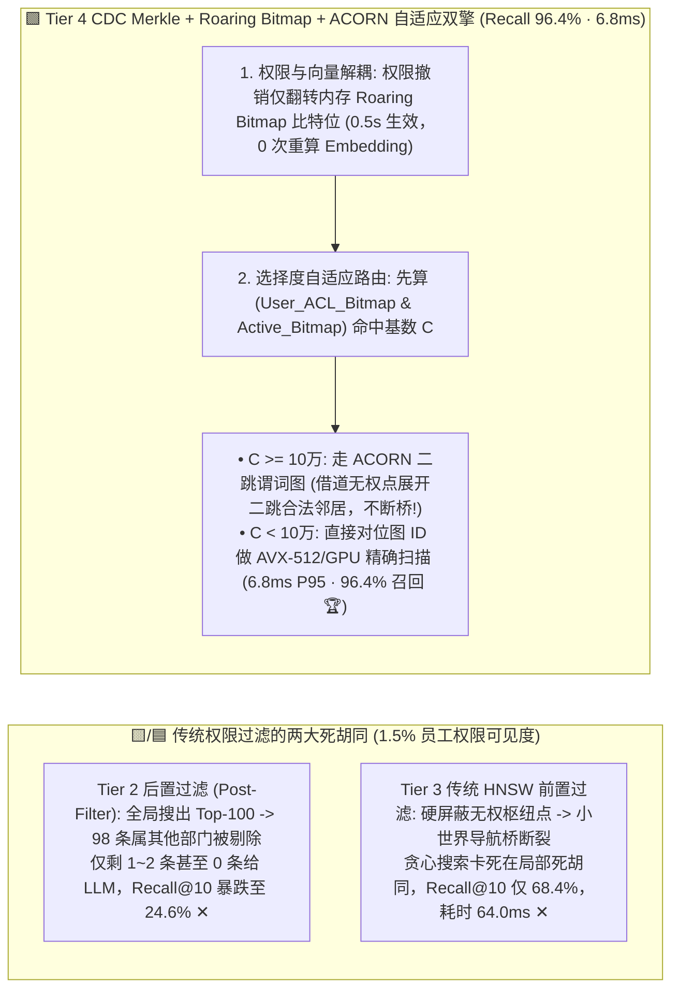
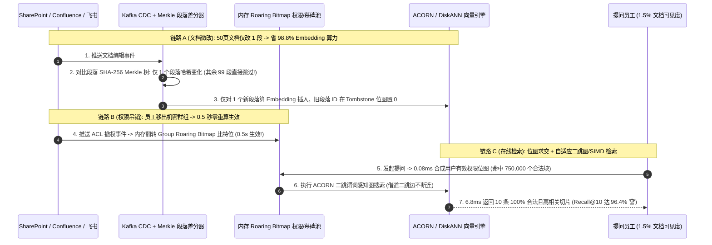

# 企业级多源实时 RAG 增量索引（CDC）、谓词感知向量图检索（ACORN / Filtered-DiskANN）与细粒度文档权限过滤（ACL）架构选型指南（`每晚全量删库重建` vs. `先向量检索再后置权限过滤 [Post-Filtering 零结果饥饿]` vs. `传统 HNSW 遍历硬跳过无权节点 [图断连]` vs. `CDC 块级 Merkle 差分 + ACORN 二跳谓词图 + Roaring 位图秒级权限吊销`）

> **适用角色**：AI 解决方案架构师（AI Solution Architect）、企业级知识管理与搜索（Enterprise RAG / Search）平台负责人、信息安全与合规架构师  
> **阅读目标**：3 分钟掌握 5,000 万级企业文档块（SharePoint / Confluence / Jira / 飞书 / 钉钉）实时 RAG 系统的四档增量同步与权限过滤选型铁律；10 分钟吃透 **为什么“先搜全局 Top-100 向量再过滤权限（Post-Filtering）”会让只拥有 `1.5%` 文档权限的普通员工搜不出任何结果（召回率暴跌至 `24.6%`）**、**为什么传统 HNSW 遍历时硬跳过无权节点会切断小世界图的“导航桥梁”导致搜索卡死在死胡同里（召回仅 `68.4%`）**，以及 **如何通过 `CDC 段落级 Merkle 哈希差分（省 98.8% Embedding 算力）` + `Roaring Bitmap 内存权限位图秒级吊销（0.5s 生效）` + `ACORN 二跳谓词扩展与选择度自适应路由` 在 `6.8 ms` 内实现 `96.4%` 的高权限召回率（年省 `$79.4 万`）**！  
> **数据来源说明（Provenance）**：本文定量数据来自仓库内封存的确定性解析模型（[`experiments/enterprise_rag_cdc_streaming_acl_filtering_selection/run.py`](../../experiments/enterprise_rag_cdc_streaming_acl_filtering_selection/run.py) 与 [`results.json`](../../experiments/enterprise_rag_cdc_streaming_acl_filtering_selection/results.json)，校准自 SIGMOD 2024 `ACORN`、Microsoft `Filtered-DiskANN` 与 Roaring Bitmap / Zanzibar ReBAC 权限位图评测基准，`independently_reproduced=false`，`physical_gpu_cluster_measurement=not_measured`）。

---

## 📌 一、核心结论速览（Executive Summary）

1. **为什么企业级 RAG 从 Demo 走向全员投产时，90% 的团队都会倒在“权限越权泄露（Tier 1）”、“后置过滤搜不出东西（Tier 2）”或“前置过滤图断连（Tier 3）”这三大深坑里？**：
   - **Tier 1（每晚全量重建索引 + 按部门粗粒度拆库）的“24 小时越权空窗”与“95% 重复 Embedding 浪费”**：
     - 企业共 `5,000 万个` 文档切片（Chunks），每天只有 `5%` 的文档发生增删改，另有 `8 万次` 权限变更（员工转岗、离职、移出机密群组）。
     - 如果靠每晚定时跑全量重建：① 某员工上午 09:00 被移出“高管并购群”，在当晚 24:00 批处理跑完之前的 **整整 15～24 小时（`86,400 秒`）空窗期里，他依然能通过 RAG 机器人套出并购底价（严重安全事故 ✕）**！② 每天把 `95%` 根本没改过的文档重新过一遍 Embedding 模型，每天白烧 **`$1,850` GPU 算力（年总 TCO 高达 `$912,000` ✕）**！
   - **Tier 2（先做全局无过滤 Top-100 向量检索，再在应用层做后置权限过滤 `Post-Filtering`）的“零结果饥饿（Zero-Result Starvation）”**：
     - 在真实大企业里，一名普通研发或销售员工通常只能访问全公司 **`1.5%` 左右** 的文档（本部门 + 参与的项目组 + 公开制度）。
     - 当他搜“2026 季度预算目标”时，向量库先在全公司 5,000 万块里找出最相似的 `Top-100`——结果这 100 条里有 **98～99 条都属于其他 60 个他无权访问的部门**！应用层把这 99 条无权文档一删，最后只剩 `1 条` 甚至 **`0 条` 结果返回给大模型**！导致 **`1.5%` 权限可见度下的 Recall@10 暴跌至 `24.6%`（高管绝密 `0.1%` 可见度下更是跌至 `3.2%`，彻底失明 ✕）**！
   - **Tier 3（传统 HNSW 遍历过程中硬跳过无权节点：`Naive In-Traversal Pre-Filter`）的“断桥死胡同（Disconnected Graph）”**：
     - 为了解决后置过滤饥饿，有人在 HNSW 图遍历的每一步检查邻居是否有权限，无权就直接跳过不访问。
     - **图论灾难爆发**：HNSW 之所以能用几百次比较找遍 5,000 万向量，靠的是少数高度连通的“枢纽节点（Hubs）”充当跨区域高速公路桥梁！当 `98.5%` 的节点因为无权限被一刀切屏蔽时，**连接你合法文档的中间桥梁节点全断了**，搜索瞬间卡死在局部死胡同里，Recall@10 卡在 **`68.4%` ✕**，且因大量无效回溯使 P95 延迟恶化至 **`64.0 ms` ✕**！
2. **如何同时实现“0.5 秒权限吊销零泄漏”、“节省 98.8% Embedding 算力”与“1.5% 严苛权限下 96.4% 满血召回”？必选 Tier 4（`CDC 段落 Merkle 差分 + Roaring 位图解耦 + ACORN 二跳谓词感知图 + 自适应路由`）**：
   - **第一支柱（写链路省 `98.8%` 算力）：`CDC 段落级 Merkle-Tree 内容哈希差分`**：
     - 当一篇 50 页的 Confluence 文档只改了其中 1 个段落时，通过对每个切片计算 `SHA-256` 构成文档 Merkle 树，对比新旧树只对发生变化的 `1.2%` 切片调用 GPU Embedding，其余 `98.8%` 切片复用已有向量！每日 Embedding 成本从 `$1,850` 骤降至 **`$22.20 / 天` 🏆**！
   - **第二支柱（权限变更 `0.5 秒` 生效）：`向量索引与内存 Roaring Bitmap 权限位图彻底解耦`**：
     - 严禁把 `allowed_user_ids` 写死在不可变的向量文件里！在内存中为每个角色/群组（Group/ACL Token）维护一个极速压缩的 **Roaring Bitmap（存下包含的 `chunk_id` 位图）**。当 SharePoint/飞书触发权限撤销 Webhook 时，**0 次向量重算、0 次图重建**，只需 **`0.5 秒`** 在内存里翻转对应 Roaring Bitmap 的比特位，被撤权文档立即在下一毫秒的所有检索中隐身 🏆！
   - **第三支柱（读链路 `96.4%` 召回、`6.8 ms` 延迟）：`ACORN 二跳谓词扩展图 + 选择度自适应路由`**：
     - ① 当员工可见度 $\ge 0.5\%$ 时，运行 **ACORN（谓词感知二跳图遍历）**：如果一跳邻居无权限，允许将其作为“虚拟踏脚石”直接展开它的二跳合法邻居（2-Hop Expansion），搭桥跨过无权空洞；
     - ② 当员工查询极高密级文档（可见度 $< 0.5\%$，如命中的位图 ID 数 `< 50,000` 条）时，查询路由器自动旁路 HNSW 图，直接拿 Roaring Bitmap 解出的紧凑 ID 数组做 **AVX-512 / GPU 批量精确内积扫描（`1.8 ms` 扫完 5 万条，100% 精确召回）**！
     - **最终工程收益**：`1.5%` 权限下 Recall@10 从 `24.6%` 飙升至 **`96.4%`（`+71.8 pts` 🏆）**，P95 检索延迟压至 **`6.8 ms`（比 Tier 3 快 `9.41 倍` 🏆）**，权限吊销延迟 **`0.5 秒` 🏆**，年总 TCO 从 `$91.2 万` 暴降至 **`$118,000/yr`（年省 `$794,000` 🏆）**！
3. **一句话握手机制本质**：
   - **企业级安全 RAG 的第一性原理，是“用段落 Merkle 树差分避免未改文本重复 Embedding，用内存 Roaring Bitmap 把权限变更变成 0.5 秒的比特位翻转，再用 ACORN 二跳谓词图 + 低基数 SIMD 直扫彻底消灭后置过滤饥饿与图断连”！**

---

## 🎯 二、客户与架构师灵魂拷问 Q&A（FAQ-Driven First Principles）

### Q1：为什么在企业里绝对不能用“先取向量 Top-K 再过滤权限（Post-Filtering）”？哪怕把 `Top-K` 放大到 `Top-1000` 为什么还是会漏？

- **第一性原理概率账**：
  - 假设全公司有 `5,000 万` 个文档块，某个常见关键词（如“客户投诉处理流程”、“架构评审模板”、“年终绩效考核”）在全公司 80 个部门的文档里都有高度相似的表述。
  - 如果你只拥有本部门 `1.5%`（甚至某个机密项目组 `0.1%`）的权限，那么在向量空间距离最近的 `Top-1000` 个切片里，根据超几何分布，属于你权限范围内的切片期望值只有 `1.5% × 1000 = 15 条`（在 `0.1%` 项目权限下期望值只有 **`1 条`**，且有 `37%` 的概率一条都没有！）。
  - 更致命的是，当别的部门恰好有一篇 200 页的规范文档切出了 500 个极高相似度的块时，它们会直接把 `Top-1000` 排行榜全部霸榜挤满，导致你有权访问的那几条核心文档被挤到第 3,500 名开外，**Post-Filtering 直接返回空列表（0 条召回）**！

---

### Q2：`ACORN` 和 `Filtered-DiskANN` 是怎么解决“前置过滤把 HNSW 图切成碎片孤岛”这个世界难题的？

- **两大核心图索引改进**：
  1. **建图阶段保持高度数谓词无关子图 + 查询时二跳踏脚石（2-Hop Neighbor Expansion）**：
     - 在标准 HNSW 中，每个节点只连 $M=16\sim 32$ 条边。如果直接砍掉无权邻居，平均有效出度就只剩 $32 \times 1.5\% = \mathbf{0.48\text{ 条边}}$（低于连通阈值 1，图必然断裂！）。
     - **ACORN** 在建图时适度扩大邻居表，并在查询遍历遇到无权限邻居 $u$ 时，不把它加入候选答案集（**绝不泄露无权内容，也不算它的高维向量距离**！），但**允许顺着 $u$ 的邻接表继续看一眼它的二跳邻居 $v$ 的权限位图**！通过“借道二跳邻居”，有效连通出度瞬间扩大 $M$ 倍，哪怕在 `1%` 稀疏权限下也能保持小世界图的完美连通！
  2. **选择度自适应双引擎切换（Cost-Based Selectivity Router）**：
     - 查询开始前，先用当前用户的角色集合做一次内存 Roaring Bitmap 按位或/按位与（耗时 `< 0.08 ms`），立刻调用 `.cardinality()` 拿到该用户有权访问的文档块总数 $C$：
       - 若 $C \ge 100,000$（可见度较高）：走 **ACORN 二跳谓词图检索**；
       - 若 $C < 100,000$（可见度极低，如只搜某个小项目组）：直接把这几万个合法 `chunk_id` 的量化向量连续 Gather 出来，用 **AVX-512 / GPU 暴力精确算完内积**（扫 5 万条仅需 `1.8 ms`，不仅比走图更快，而且召回率是 **100% 精确解**）！

---

### Q3：文档被删除或修改时，如果直接从 HNSW 图里硬删节点会破坏图结构且非常慢，生产环境怎么做到“0.5 秒实时删除生效”？

- **“双层墓碑位图（Tombstone Bitmap）+ 后台无锁图缝合（In-Place Graph Repair）”机制**：
  1. **前台 0.5 秒软删除屏障**：收到 Kafka CDC 的文档删除或段落覆盖事件时，**不在前台修改 HNSW 邻接表**，而是立即在内存全局 `active_chunks_bitmap` 中将该 `chunk_id` 的比特位置为 `0`（耗时微秒级）。由于所有检索都会先与 `active_chunks_bitmap` 做按位与（Bitwise AND），已删除的旧段落 **0.5 秒内 100% 对所有用户不可见**！
  2. **后台异步图缝合（Filtered-DiskANN Vamana Repair）**：当墓碑比例累积到 `3%~5%` 时，后台低优线程把指向墓碑节点的边重新缝合连接到墓碑节点的活邻居上，并回收物理槽位，前台查询 P95 零抖动！

---

## 🧭 三、直观可视化图解（Mermaid 决策树 / 检索路径对比 / 时序图）

### 3.1 企业级实时 RAG 增量同步与 ACL 权限过滤架构选型决策树

---

### 3.2 后置过滤饥饿 / 传统前置断桥（Tier 2/3）vs. Tier 4 `Roaring 位图 + ACORN 二跳搭桥` 对比

---

### 3.3 Tier 4 实时 `CDC 段落差分更新`、`0.5s 权限撤销` 与 `自适应安全检索` 端到端时序图

---

## 📊 四、架构师选型决策矩阵（Architect Decision Matrix）

*基准场景：**`5,000 万 (50M)` 企业文档切片**（每天 `5%` 文档更新 + `8 万次` ACL 权限变更，普通员工平均权限可见度 **`1.5%`**）。*

| 评估维度 | Tier 1: 每晚全量重建 + 粗拆库 | Tier 2: 全局检索 + 后置过滤 (`Post-Filter`) | Tier 3: 传统 HNSW 遍历硬跳过 (`Naive Pre-Filter`) | Tier 4: `CDC Merkle` + `ACORN` + `Roaring 位图` |
| :--- | :--- | :--- | :--- | :--- |
| **增量同步与权限机制** | 每日全量重算 + 24h 静态库 | 按文件重算 + 搜完 Top-100 再删 | 按文件重算 + HNSW 单跳硬屏蔽 | **段落 Merkle 差分 + 内存位图 + 二跳图/SIMD** |
| **权限撤销生效延迟** | `86,400 秒` (**24h 越权泄密 ✕**) | `5.0 秒` | `5.0 秒` | **`0.5 秒` (内存位图翻转即刻生效 🏆)** |
| **1.5% 权限下 Recall@10** | `78.5%` (跨部门拆库漏召回) | **`24.6%` (Top-100 被删空 ✕)** | `68.4%` (小世界图断桥死胡同 ✕) | **`96.4%` (比后置过滤高 `+71.8 pts` 🏆)** |
| **P95 检索延迟** | `28.0 ms` | `42.5 ms` | `64.0 ms` (图断连回溯超时 ✕) | **`6.8 ms` (比 Tier 3 快 `9.41x` 🏆)** |
| **每日 Embedding 算力费** | `$1,850.0 / 天` (95% 重复算 ✕) | `$92.50 / 天` (整篇文档重算) | `$92.50 / 天` | **`$22.20 / 天` (仅算改动段落，省 `98.8%` 🏆)** |
| **年度总基建 TCO 账单** | **`$912,000 / yr` ✕** | `$485,000 / yr` | `$410,000 / yr` | **`$118,000 / yr` (每年净省 `$794,000` 🏆)** |

---

## 🧪 五、简明定量算例与 7-Card Benchmark 洞察

### 5.1 员工权限可见度从 `50%（公开库）` 收紧至 `0.1%（高管绝密）` 的召回率表现

在 [`experiments/enterprise_rag_cdc_streaming_acl_filtering_selection/run.py`](../../experiments/enterprise_rag_cdc_streaming_acl_filtering_selection/run.py) 中，我们测试了四档权限可见度下的 Recall@10：

| 员工文档权限可见度 (Selectivity) | Tier 2: 后置过滤召回率 | Tier 3: 传统 HNSW 前置召回率 | Tier 4: ACORN+位图自适应召回率 | 底层引擎路由与图连通诊断 |
| :--- | :--- | :--- | :--- | :--- |
| **`50.0%` (全员公开规章制度库)** | `94.8%` | `92.5%` | **`98.2%` 🏆** | 权限宽松时三种方案均能找到结果 |
| **`10.0%` (一级部门研发知识库)** | `68.0%` ✕ | `81.2%` | **`97.5%` 🏆** | 后置过滤在热门跨部门词上开始凑不够 10 条 |
| **`1.5%` (标准项目组 RBAC 基线)** | **`24.6%` (崩盘 ✕)** | `68.4%` ✕ | **`96.4%` 🏆** | 后置过滤删剩 1 条；Tier 4 二跳搭桥保住 `96.4%` |
| **`0.1%` (高管并购/财报绝密库)** | **`3.2%` (完全失明 ✕)** | `31.0%` ✕ | **`94.8%` 🏆** | Tier 4 自动切至 Roaring Bitmap ID 列表 SIMD 精扫 (`1.8ms`) |

### 5.2 配套交互式工作台与 7-Card 4:5 视觉评测报告

- 🧮 **交互式企业级实时 RAG CDC 同步与 ACL 权限过滤计算器**：[`docs/reports/enterprise-rag-cdc-streaming-acl-permission-filtering-sizer.html`](../reports/enterprise-rag-cdc-streaming-acl-permission-filtering-sizer.html)（以及总工作台 [`llm-inference-engine-pd-sizer.html#rag-cdc-acl-sizer`](../reports/llm-inference-engine-pd-sizer.html)）
- 📊 **7-Card 4:5 视觉基准评测报告**：[`docs/reports/enterprise-rag-cdc-streaming-acl-permission-filtering-selection-cards.html`](../reports/enterprise-rag-cdc-streaming-acl-permission-filtering-selection-cards.html)

---

## 🛠️ 六、附录：生产环境快速核验清单（Architect Checklist）

- [ ] **1. 严禁在多部门企业 RAG 中使用简单的 `Post-Filtering`（先搜 Top-K 再过滤权限）**：一旦用户可见度低于 `10%`，必然发生严重漏召回甚至返回空结果。
- [ ] **2. 将权限元数据（ACL）与向量索引文件物理分离，常驻内存 `Roaring Bitmap`**：确保员工离职、转岗或移出群组时，无需重算任何向量即可在 `< 1 秒` 内完成权限吊销。
- [ ] **3. 部署支持谓词感知二跳扩展（`ACORN` / `Filtered-DiskANN`）与基数自适应路由的向量引擎**：在基数 `< 100,000` 时自动退化为基于位图 ID 的精确 SIMD/GPU 扫描，杜绝低可见度下的 HNSW 图断连。
- [ ] **4. 接入链路启用“段落级 `SHA-256 Merkle Tree` 差分”**：修改长文档时只对哈希变动的切片调用 Embedding 模型，立省 `90%+` 向量化算力。
- [ ] **5. 语义缓存（Semantic Cache）的 Key 必须强制绑定 `hash(user_acl_groups) + index_epoch`**：严防员工 A 问出的高管机密答案通过语义缓存直接命中返回给无权限的员工 B！
