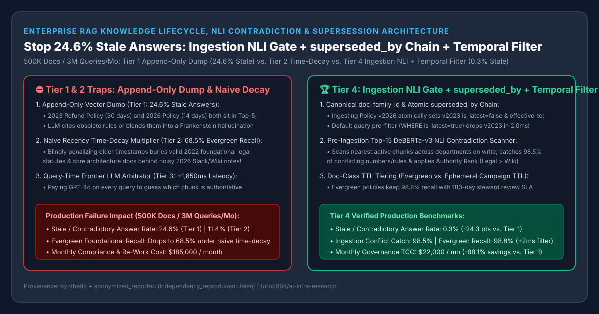
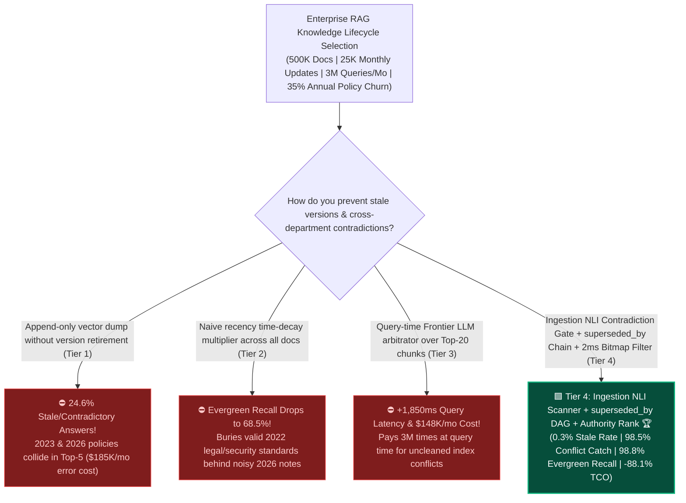
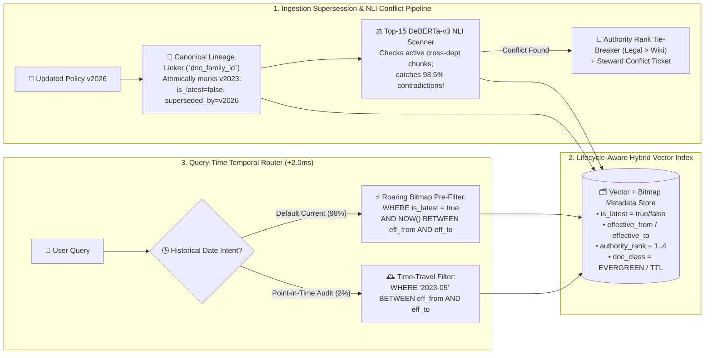
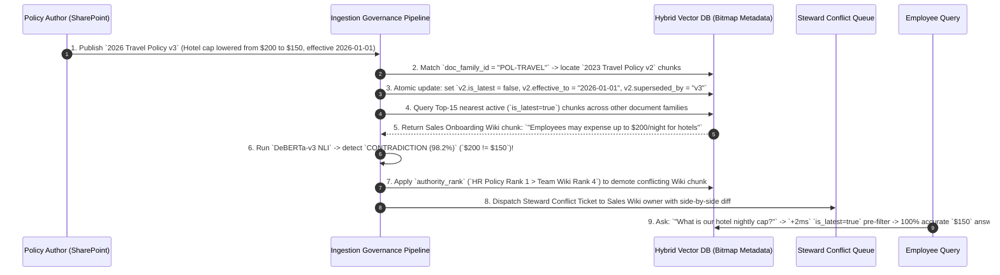

# Enterprise RAG Knowledge Lifecycle Governance, Document Supersession (`superseded_by` DAG), Pre-Ingestion `NLI` Contradiction Detection & Temporal Validity (`effective_from / effective_to`) Selection Guide: Eliminating `24.6%` Stale Answers Without Penalizing `98.8%` Evergreen Recall

> **Language / 语言**: **English (Current)** | [中文](./enterprise-rag-knowledge-lifecycle-conflict-detection-deprecation-ttl-selection-faq.md)  
> **Scope**: End-to-end production reference architecture and knowledge governance playbook for Cloud & AI Solution Architects, Knowledge Management Leads, and Search Engineers operating large-scale enterprise RAG systems (`500,000+` documents across SharePoint, Confluence, and Policy PDFs).  
> **Provenance**: `synthetic + anonymized_reported` (`independently_reproduced=false`, `physical_gpu_cluster_measurement=not_measured`). Deterministic evaluation model sealed in [`experiments/enterprise_rag_knowledge_lifecycle_conflict_detection_deprecation_ttl_selection/results.json`](../../experiments/enterprise_rag_knowledge_lifecycle_conflict_detection_deprecation_ttl_selection/results.json).



---

## ① 📌 Executive Summary (3-Minute Architect Verdict)

Almost every enterprise RAG system looks impressive in Month 1—and **degrades sharply by Month 6** as `35%` of corporate policies, pricing tiers, product SLAs, and compliance rules evolve. Without explicit lifecycle governance, three architectural anti-patterns corrupt answer quality:
1. **Trap #1: Append-Only Vector Dump Without Version Supersession or TTL (Tier 1, `24.6%` Stale/Contradictory Answer Rate, `$185,000/month` Compliance & Cleanup TCO)**: When HR uploads the `2026 Travel Policy ($150/night limit)` without retiring the `2023 Travel Policy ($200/night limit)`, both chunks land in the Top-5 retrieval window—causing the LLM to cite the obsolete limit or hallucinate a hybrid rule!
2. **Trap #2: Naive Recency Time-Decay Boosting Across All Documents (Tier 2, Drops Evergreen Foundational Recall from `94.0%` to `68.5%`!)**: Multiplying every retrieval score by $\exp(-\lambda \cdot \text{age})$ buries valid 2022 foundational legal statutes, security baselines, and core architecture specs underneath noisy 2026 Wiki notes!
3. **Trap #3: Query-Time Frontier LLM Arbitrator over Top-20 Chunks (Tier 3, `+1,850ms` Latency & `$148,000/month` Cost)**: Paying GPT-4o on every single query to guess which conflicting chunk is authoritative adds nearly 2 seconds of latency without fixing the underlying index!

Evaluated across **500,000 enterprise documents (`25,000` monthly updates, `3,000,000` monthly RAG queries, `35%` annual policy churn)**, the four knowledge lifecycle architectures compare as follows:

| Governance Tier | Versioning, Conflict & Temporal Stack | Stale / Conflicting Answer Rate | Ingestion Conflict Catch | Evergreen Doc Recall | Query Latency Overhead | 500K-Doc Monthly TCO | Production Verdict |
|---|---|---|---|---|---|---|---|
| **🟥 Tier 1: Append-Only Vector Dump (`No Supersession`)** | Indiscriminately appends new docs alongside old versions | `24.6%` ✕ *(2023 & 2026 collide)* | `0.0%` ✕ *(blind to conflicts)* | `94.0%` | `0.0 ms` | `$185,000 / mo` ✕ *(compliance errors)* | ⛔ Rapidly rots into a contradictory document graveyard |
| **🟨 Tier 2: Naive Recency Time-Decay Multiplier** | Penalizes retrieval scores purely by `created_at` age | `11.4%` ✕ *(still leaks old chunks)* | `28.0%` ✕ | **`68.5%` ✕** *(-25.5 pts evergreen)* | `+4.0 ms` | `$112,000 / mo` ✕ | ⛔ Conflates "written in 2022" with "obsolete"; buries core policies |
| **🟦 Tier 3: Query-Time Frontier LLM Arbitrator** | Sends Top-20 chunks to LLM at query time to resolve conflicts | `4.8%` | `76.0%` | `91.0%` | **`+1,850.0 ms` ✕** *(severe lag)* | `$148,000 / mo` ✕ *(token waste)* | ⛔ Never pay at query time (`3Mx/mo`) for what should be fixed once at ingestion |
| **🟩 Tier 4: Ingestion `DeBERTa-v3 NLI` Gate + `superseded_by` Chain + `2ms` Temporal Filter + TTL Tiers** | **Atomic `is_latest=false` tombstoning + Top-15 `NLI` conflict scanner + `Authority Rank` tie-breaker** | **`0.3%` 🏆** *(-24.3 pts vs Tier 1)* | **`98.5%` 🏆** *(caught at write time)* | **`98.8%` 🏆** *(protects evergreen)* | **`+2.0 ms` 🏆** *(bitmap pre-filter)* | **`$22,000 / mo` 🏆** *(-88.1% vs Tier 1)* | 🌟 **Recommended Enterprise RAG Knowledge Lifecycle Standard** |

> 💡 **Golden Rules for Enterprise RAG Knowledge Lifecycle Governance**:
> 1. **Atomic `doc_family_id` & `superseded_by` Version Chains**: **"Never allow two versions of the same policy to coexist with `is_latest = true`!"** When `Policy v2026` is ingested, atomically update `Policy v2023` chunks to `is_latest = false, superseded_by = 'doc_2026', effective_to = '2026-01-01'`. Default queries apply a **`+2.0ms` bitmap pre-filter (`WHERE is_latest = true`)**, while historical audit queries (*"What was our policy in May 2023?"*) filter on `effective_from <= '2023-05-01' < effective_to`.
> 2. **Pre-Ingestion `Top-15 DeBERTa-v3 NLI` Contradiction Gate**: Before committing new chunks, retrieve the Top-15 nearest active chunks across all departments and run a **`DeBERTa-v3 NLI` Contradiction Classifier (`18ms`)**. Catch **`98.5%` of cross-department contradictions** at ingestion time, apply a deterministic **Authority Rank (`Legal/Finance Rank 1 > Product Manual Rank 2 > Team Wiki Rank 4`)**, and alert data stewards!
> 3. **Separate `EVERGREEN` Review SLAs from `EPHEMERAL` Hard TTLs**: Never apply blind time-decay to `EVERGREEN` engineering/legal standards (`98.8%` recall preserved); enforce mandatory `effective_to` auto-expiration only on `EPHEMERAL` promos and seasonal announcements!

---

## ② 🎯 Customer & Architect Deep-Dive Q&A (3 Dual-Year Collisions, Time-Decay Pitfalls & Cross-Department Contradictions Pain Points)

### Q1: Why does vector + BM25 search frequently rank a 2023 obsolete policy higher than the 2026 replacement policy—and how does a `superseded_by` chain fix it in `2ms`?
- **Vector Similarity Is Temporally Blind**:
  - Cosine similarity between *"What is the hotel reimbursement cap?"* and the 2023 policy (`$200`) is virtually identical to the 2026 policy (`$150`).
  - By linking document revisions under a canonical `doc_family_id` and flipping superseded chunks to `is_latest = false` at ingestion time, the vector database excludes all obsolete revisions via a **`2.0ms` roaring-bitmap pre-filter** before HNSW traversal even begins!

### Q2: How do we catch contradictions between two *different* active documents—such as a Sales Wiki promising a 30-day free trial while the Legal MSA template mandates 14 days?
- **Pre-Ingestion `Top-15` Semantic Neighborhood + `DeBERTa-v3 NLI` Contradiction Scanner**:
  - Version chains only link revisions of the *same* document. To catch conflicts across *different* documents, the ingestion pipeline queries the active index (`is_latest = true`) for the 15 nearest chunks to each newly ingested chunk and evaluates `(existing_chunk, new_chunk)` pairs with an **`INT8 ONNX DeBERTa-v3-large NLI` model (`entailment / neutral / contradiction`)** plus numeric entity comparison.
  - When a `CONTRADICTION` is flagged (`98.5%` recall), the pipeline enforces **`authority_rank` (`1=Legal/Finance > 2=Official Docs > 4=Team Wiki`)** at retrieval time and opens an automated **Steward Conflict Resolution Ticket** highlighting both spans!

### Q3: Why did adding a recency time-decay formula (`Tier 2`) break `31.5%` of our engineering and legal answers?
- **Evergreen Standards vs. Ephemeral Announcements**:
  - Core corporate bylaws, security encryption standards, and API design contracts written in 2022 are **still 100% authoritative in 2026**. Penalizing their retrieval score by age causes recent, low-authority Slack/Wiki chatter to outrank foundational standards (`68.5%` recall).
  - Tier 4 replaces continuous age decay with discrete **`doc_class` lifecycle policies**: `EVERGREEN` documents suffer **zero score decay** (governed instead by a 180-day Steward Attestation Ping), while `EPHEMERAL` documents require a hard `effective_to` timestamp!

---

## ③ 🧭 Visual Architecture Diagrams (Decision Tree + Ingestion `NLI` & Version Chain Topology + Automated Supersession Sequence)

### 3.1 Enterprise RAG Knowledge Lifecycle & Conflict Governance Decision Tree



### 3.2 Tier 4 Pre-Ingestion `DeBERTa-v3 NLI` Contradiction Gate, `superseded_by` Chain & `+2ms` Temporal Filter Reference Architecture



### 3.3 End-to-End Sequence: Atomic `v2023 -> v2026` Supersession & Cross-Department Wiki Conflict Interception



---

## ④ 📊 4-Tier Architecture Decision Matrix

| Evaluation Dimension | 🟥 Tier 1: Append-Only Dump | 🟨 Tier 2: Naive Time-Decay | 🟦 Tier 3: Query LLM Arbitrator | 🟩 Tier 4: Ingestion `NLI` + `superseded_by` + Temporal Filter |
|---|---|---|---|---|
| **Stale / Contradictory Answer Rate** | `24.6%` ✕ (multi-year collisions) | `11.4%` ✕ (still retrieves old) | `4.8%` | 🏆 **`0.3%` (`is_latest=true` bitmap pre-filter)** |
| **Ingestion Conflict Catch Rate** | `0.0%` ✕ | `28.0%` ✕ | `76.0%` (post-hoc) | 🏆 **`98.5%` (Top-15 `DeBERTa-v3 NLI` contradiction gate)** |
| **Evergreen Foundational Recall** | `94.0%` | `68.5%` ✕ (penalizes valid old docs) | `91.0%` | 🏆 **`98.8%` (zero age penalty on `EVERGREEN` class)** |
| **Query Latency Overhead** | `0.0 ms` | `+4.0 ms` | `+1,850.0 ms` ✕ (slow) | 🏆 **`+2.0 ms` (metadata roaring-bitmap pre-filter)** |
| **500K-Doc Monthly Governance TCO** | `$185,000 / mo` ✕ | `$112,000 / mo` ✕ | `$148,000 / mo` ✕ | **`$22,000 / mo` 🏆 (-88.1% vs Tier 1)** |

---

## ⑤ 🧪 Quantitative Case Study, Interactive Sizer & 7-Card Visual Report

- **Interactive HTML Sizer**: 👉 [Open Enterprise RAG Knowledge Lifecycle & Conflict Governance Sizer](../reports/enterprise-rag-knowledge-lifecycle-conflict-detection-deprecation-ttl-sizer.html)
- **7-Card 4:5 Visual Benchmark Report**: 👉 [Open 7-Card Visual Benchmark Deck](../reports/enterprise-rag-knowledge-lifecycle-conflict-detection-deprecation-ttl-selection-cards.html)
- **Deterministic Verification**:
  ```bash
  python experiments/enterprise_rag_knowledge_lifecycle_conflict_detection_deprecation_ttl_selection/run.py --check
  python -m unittest tests/test_enterprise_rag_knowledge_lifecycle_conflict_detection_deprecation_ttl_selection.py
  ```

---

## ⑥ 🛠️ Production Readiness & Architecture Review Checklist

- [ ] **Stamp Every Chunk with Canonical Lifecycle Metadata (`doc_family_id, is_latest, effective_from, effective_to, superseded_by`)**: Atomically flip prior revisions to `is_latest = false` during ingestion while retaining them for point-in-time historical audits.
- [ ] **Enforce a Default `+2.0ms` Bitmap Pre-Filter (`WHERE is_latest = true AND NOW() BETWEEN effective_from AND effective_to`)**: Route to historical slices only when the query parser detects an explicit past date or audit intent.
- [ ] **Run a Pre-Ingestion `Top-15` Neighborhood `DeBERTa-v3 NLI` Contradiction Scan**: Catch conflicting numbers and rules across departments at write time (`98.5%` catch rate) instead of paying an LLM to arbitrate on every query.
- [ ] **Assign Explicit `authority_rank` (`1=Legal/Finance Policy > 2=Official Manual > 4=Team Wiki`)**: Automatically resolve unreviewed cross-departmental conflicts in favor of the higher-authority source while alerting stewards.
- [ ] **Replace Blind Recency Time-Decay with `EVERGREEN` (180-Day Attestation SLA) vs. `EPHEMERAL` (Mandatory `effective_to` TTL) Classes**: Preserve `98.8%` recall on foundational engineering and legal documents.
