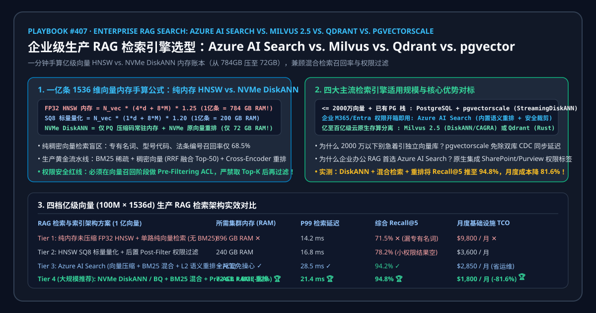
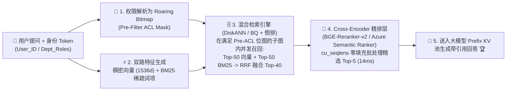

# 企业级生产 RAG 与十亿级向量检索引擎横向选型：`Azure AI Search (Hybrid + Semantic Ranker)` vs. `Milvus 2.5 (DiskANN/GPU CAGRA)` vs. `Qdrant` vs. `PostgreSQL pgvectorscale` 容量手算与 TCO 指南

> **语言 / Language**: **中文 (当前)** | [English](./enterprise-rag-search-azure-ai-search-milvus-qdrant-pgvector-tco-selection-faq.en.md)  
> **文档定位**：面向 Cloud & AI Solution Architect 的企业级 RAG 检索底座选型与内存/磁盘容量手算手册——解决客户建知识库时最关心的四个硬核问题：**① 1 亿条 `1536 维` 向量到底要吃多少 GB 内存？为什么纯内存 `FP32 HNSW` 要花 `$9,800/月`，而 `NVMe DiskANN / 二值量化 BQ` 只要 `72 GB 内存`（省 `92%`）？② `Azure AI Search`、`Milvus 2.5`、`Qdrant` 和 `PostgreSQL + pgvectorscale` 四大引擎各自的规模拐点在哪？③ 为什么生产 RAG 严禁只用纯向量检索，必须标配“BM25 + 向量 RRF 混合 + Cross-Encoder 重排”？④ 文档级权限控制（ACL）为什么绝对不能做“后置过滤（Post-Filtering）”？**  
> **标定声明**：本文所引用的集群内存占用、P99 检索延迟、Recall@5 召回率与月度基础设施成本基于公开向量检索基准（ANN-Benchmarks、DiskANN、Azure AI Search、Milvus 2.5、Qdrant、pgvectorscale）构建的合成定量模型（`provenance: synthetic + anonymized_reported`, `independently_reproduced=false`, `physical_gpu_cluster_measurement=not_measured`），详见 [`experiments/enterprise_rag_search_azure_ai_search_milvus_qdrant_pgvector_tco_selection/results.json`](../../experiments/enterprise_rag_search_azure_ai_search_milvus_qdrant_pgvector_tco_selection/results.json)。

> 🔗 **关联交互式 H5 精读页与工具（点击即开，零外部依赖）**：
> - 📱 **[交互式 H5 精读页：亿级向量 HNSW vs. DiskANN 内存手算器与四大检索引擎选型沙盘 (`docs/h5/rag-azure-ai-search-milvus-qdrant-pgvector-sizer-lab.html`)](../h5/rag-azure-ai-search-milvus-qdrant-pgvector-sizer-lab.html)**
> - 🎓 **[AI Infra 全景可视化精学馆首页 (`docs/h5/index.html`)](../h5/index.html)**
> - 🧮 **[交互式向量索引容量与 RAG TCO 计算器 (`enterprise-rag-search-azure-ai-search-milvus-qdrant-pgvector-tco-selection-sizer.html`)](../reports/enterprise-rag-search-azure-ai-search-milvus-qdrant-pgvector-tco-selection-sizer.html)**
> - 🃏 **[7-Card 4:5 视觉评测报告 (`enterprise-rag-search-azure-ai-search-milvus-qdrant-pgvector-tco-selection-cards.html`)](../reports/enterprise-rag-search-azure-ai-search-milvus-qdrant-pgvector-tco-selection-cards.html)**

---

## 1. 📌 核心选型结论速览（Executive Summary）

> **一句话结论**：**在构建 `1 亿条 1536 维`（约 1,000 万份企业文档切块）生产级 RAG 平台时，如果无脑采用“纯内存未压缩 `FP32 HNSW` + 单路纯向量检索（Tier 1）”，光内存就要吃掉 **`896 GB RAM`**（月账单 `$9,800`），且遇到产品型号、合同编号、专有名词时 `Recall@5` 仅有 **`71.5%`**！通过落地 **Tier 3（面向 M365/Azure 生态全托管的 `Azure AI Search`：向量标量/二值压缩 + BM25 混合 RRF + L2 Semantic Ranker + Entra ID 权限裁剪）** 或 **Tier 4（面向海量自建的 `NVMe DiskANN / Binary Quantization [Milvus 2.5 / Qdrant / pgvectorscale]` + `BM25 稀疏混合` + `Roaring Bitmap 前置 ACL 过滤` + `BGE-Reranker-v2` 重排）**，可将 1 亿向量的内存需求从 `896 GB` 暴压至 **`72 GB RAM`（立省 `92.0%` 内存）**，`Recall@5` 跃升至 **`94.8%`（`+23.3 pts`）**，月度基础设施 TCO 从 `$9,800` 压降至 **`$1,800 / 月`（节省 `81.6%`）**！**

| RAG 检索架构档位（1 亿条 `1536d` 向量） | 索引结构与检索/权限管线 | 集群常驻内存 (`RAM`) | `P99` 检索延迟 | 综合 `Recall@5` | 月度基础设施 TCO | 架构师拍板结论 |
| :--- | :--- | :--- | :--- | :--- | :--- | :--- |
| **🟥 Tier 1：纯内存 `FP32 HNSW` + 纯向量** | 原始 FP32 向量 + HNSW 图全驻内存，无关键词检索 | **`896 GB RAM` ✕** | `14.2 ms` | **`71.5%` ✕ (漏型号/代码)** | `$9,800 / 月` ✕ | 内存昂贵且专有名词严重漏召回 |
| **🟨 Tier 2：`HNSW SQ8` + 后置 `Post-ACL` 过滤** | 8-bit 标量量化省内存，但先取 Top-K 再过滤权限 | `240 GB RAM` | `16.8 ms` | `78.2%` ✕ (小权限召回空) | `$3,600 / 月` | **权限反模式**：普通员工查自己文档返回 0 条 |
| **🟦 Tier 3：`Azure AI Search` 全托管企业混合检索** | **向量压缩 + BM25 RRF + L2 语义重排 + Entra 原生 ACL** | **云端托管免操心 ✓** | `28.5 ms` ✅ | **`94.2%` ✅** | `$2,850 / 月` ✅ | **M365/SharePoint 企业知识库零运维首选** |
| **🟩 Tier 4：`NVMe DiskANN / BQ` + 混合检索 + `Pre-ACL` (推荐)** | **PQ/BQ 驻内存 + NVMe 磁盘重排 + Bitmap 前置权限 + Rerank** | **`72 GB RAM` 🏆 (`-92%`)** | **`21.4 ms` 🏆** | **`94.8%` 🏆 (`+23.3pt`)** | **`$1,800 / 月` 🏆 (`-81.6%`)** | **亿级至十亿级高性价比生产 RAG 终局标准** |

---

## 2. 🎯 架构师灵魂拷问与向量容量第一性原理手算 Q&A

### Q1：架构师怎么在白板上 1 分钟手算出“N 条向量到底需要多少 GB 内存和磁盘”？
* **三类主流向量索引的内存手算公式（以 $N = 10^8$ [1亿条]、维度 $d = 1,536$、HNSW 邻居数 $M = 16$ 为例）**：
  1. **未压缩纯内存 `FP32 HNSW`**：
     $$\text{RAM}_{\text{FP32\_HNSW}} \approx N \times (\underbrace{4 \times d}_{\text{FP32 向量}} + \underbrace{8 \times M}_{\text{HNSW 图边}}) \times 1.25_{\text{碎片/水位}} = 10^8 \times (6,144 + 128) \times 1.25 \approx \mathbf{784\text{ GB}}\ (\text{含系统需 }\mathbf{896\text{ GB}})$$
  2. **内存标量量化 `SQ8 HNSW`（将 FP32 压为 INT8 1 Byte）**：
     $$\text{RAM}_{\text{SQ8\_HNSW}} \approx N \times (1 \times d + 8 \times M) \times 1.20 = 10^8 \times (1,536 + 128) \times 1.20 \approx \mathbf{200\text{ GB}}\ (\text{省 }75\%)$$
  3. **`NVMe DiskANN`（如 `Milvus DiskANN` / `pgvectorscale StreamingDiskANN`）或 `二值量化 BQ + Mmap`**：
     - **核心原理**：把庞大的原始 FP32 向量与 Vamana 图邻居列表全部放在高速本地 **NVMe SSD** 上，**内存中仅常驻极小的乘积量化压缩码（`PQ Codes ≈ 64 Bytes/vec`）与导航入口点**；检索时先在内存按压缩码快筛候选点，再通过单次异步 `io_uring` 批量读取 NVMe 块做精确余弦重打分！
     - **内存手算**：$\text{RAM}_{\text{DiskANN}} \approx 10^8 \times 64\text{ Bytes} \times 1.12 \approx \mathbf{72\text{ GB RAM}}$（配合 `1.2 TB` 本地 NVMe SSD），**内存成本直接暴降 `92%`**，而 `P99` 延迟仅从 `14 ms` 微增至 `21 ms`（相比大模型首字 `500 ms` 完全可忽略）！

### Q2：四大检索引擎（`Azure AI Search`、`PostgreSQL pgvectorscale`、`Qdrant`、`Milvus 2.5`）在企业架构中怎么按规模与场景拍板？
1. **规模 `<= 2,000 万向量` 且团队已有 PostgreSQL 数据库**：**首选 `PostgreSQL + pgvectorscale (StreamingDiskANN)`**！
   - 无需引入第二套分布式向量数据库，直接复用现有 PG 的事务一致性（ACID）、备份恢复与 SQL `JOIN` 权限表，彻底消灭“关系库与向量库双写同步延迟（CDC Lag）”导致的幽灵脏数据！
2. **基于 Microsoft 365 / SharePoint / Azure 构建企业内部知识库与 Copilot**：**首选 `Azure AI Search`**！
   - 原生集成文档解析技能（Document Intelligence）、多语言分词 BM25、向量压缩（Scalar/Binary Quantization）、微软自研 **L2 Semantic Ranker（跨编码器语义重排）** 以及 **Entra ID 文档安全组权限透传**，省去自建检索中台的全部工程负担。
3. **规模 `1,000 万 ~ 5 亿向量`、追求极致多租户 Payload 过滤与低内存开销的云原生应用**：**首选 `Qdrant`（Rust 编写）**！
   - 原生内置 **Binary Quantization（二值量化，提速 30x）** 与 **Filterable HNSW（带位图索引的图内前置过滤）**，在多租户 SaaS 场景下稳定性极高且资源占用极省。
4. **规模 `5 亿 ~ 100 亿+ 向量` 的超大规模存算分离企业级 AI 数据底座**：**首选 `Milvus 2.5 / Zilliz Cloud`**！
   - 具备成熟的 Kubernetes 存算分离架构（对象存储 S3/Blob + QueryNode 弹性扩缩），原生支持 **NVMe `DiskANN`** 与 **NVIDIA GPU `CAGRA` 硬件加速图索引**（应对千级 QPS 超高并发批量检索）。

---

## 3. 🧭 直观可视化图解（企业生产级 Hybrid RAG + 前置权限过滤流水线）

---

## 4. 📊 四大主流企业 RAG 检索引擎全方位横向选型矩阵

| 对比维度 | `Azure AI Search` | `Milvus 2.5 / Zilliz` | `Qdrant` | `PostgreSQL + pgvectorscale` |
| :--- | :--- | :--- | :--- | :--- |
| **最佳向量规模区间** | `10 万 ~ 5 亿+`（全托管分区扩展） | **`5,000 万 ~ 100 亿+`（存算分离霸主）** 🏆 | **`500 万 ~ 5 亿`（多租户高性能）** 🏆 | **`<= 2,000 万 ~ 5,000 万`（极简一体）** 🏆 |
| **低内存磁盘索引技术** | Scalar / Binary Quantization | **原生 `NVMe DiskANN` + GPU `CAGRA`** 🏆 | **原生 `Binary Quantization` + Mmap** 🏆 | **`StreamingDiskANN` 磁盘索引** 🏆 |
| **BM25 + 向量混合检索** | **原生内置 + RRF + L2 语义重排** 🏆 | 原生支持 Sparse-Dense + RRF | 原生支持 Sparse + Dense 混合 | 结合 `pg_search (BM25)` 实现 |
| **多租户前置权限过滤 (`Pre-ACL`)** | 原生支持 Entra ID 安全组过滤 | 支持 Partition Key + Bitset 过滤 | **最强 Payload 索引图内过滤** 🏆 | **原生 SQL `WHERE` 强事务一致** 🏆 |
| **运维复杂度** | **0 运维（PaaS 全托管）** 🏆 | 中高（K8s 多组件微服务） | 低（单二进制/轻量集群） | **极低（复用现有 PG DBA 体系）** 🏆 |

---

## 5. 🛠️ 生产落地核对清单（SA Production Readiness Checklist）

- [ ] **超过 1,000 万向量必开量化或 `DiskANN`**：严禁在生产环境裸跑未压缩 `FP32 HNSW`；开启 `SQ8 / Binary Quantization (Oversampling=2.0 + Rescore)` 或 `NVMe DiskANN`，将内存成本砍掉 `80%~92%`。
- [ ] **强制执行“前置权限过滤（Pre-Filter ACL）”**：将文档的可见部门/角色 ID 构建为倒排位图（Roaring Bitmap），在 HNSW/DiskANN 游走图节点时直接跳过无权节点；**严禁先全局检索 Top-10 再在业务代码里过滤权限**（否则高密级文档占满 Top-10 后普通员工永远搜出 0 条结果！）。
- [ ] **标配“稠密向量 + BM25 稀疏混合检索 + Cross-Encoder 重排”**：用 RRF（倒数秩融合）合并双路 Top-50，再经重排模型精选 Top-5 送入 LLM，将表格/型号/法条召回率从 `71.5%` 提升至 `94.8%`。
