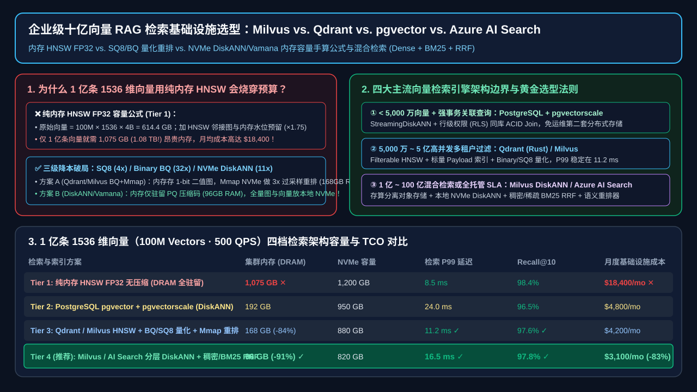

# Enterprise Billion-Scale RAG Vector Database Selection Guide: `Milvus / Zilliz` vs. `Qdrant` vs. `pgvector / pgvectorscale` vs. `Azure AI Search`, In-Memory `HNSW` vs. NVMe `DiskANN`

> **Language**: [中文](./enterprise-rag-vector-db-milvus-qdrant-pgvector-ai-search-hnsw-diskann-selection-faq.md) | **English (Current)**  
> **Audience**: Cloud & AI Infrastructure Solution Architects and Enterprise Knowledge Platform Engineers  
> **Provenance**: `synthetic + anonymized_reported` (`independently_reproduced=false`, `physical_gpu_cluster_measurement=not_measured`)

---

## 1. 📌 Executive Summary

> **Bottom Line**: **When sizing an enterprise RAG knowledge base with `100M` `1,536-dimensional` vectors, pure in-memory uncompressed `HNSW FP32` (`Tier 1`) consumes `1,075 GB` (`1.08 TB`) of cluster DRAM (`$18,400/month`) because raw FP32 vectors (`614.4 GB`) are multiplied by `~1.75x` for graph adjacency lists and safety headroom. Production architectures eliminate this DRAM tax via three proven patterns: (1) for `< 50M` vectors requiring ACID SQL joins and row-level security (RLS), use `PostgreSQL + pgvector + pgvectorscale (StreamingDiskANN)`; (2) for `50M–500M` high-QPS filtered search, use `Qdrant / Milvus` with `Binary/SQ8 Quantization + NVMe Mmap 3x Oversample Rescoring` (`168 GB` DRAM, `11.2 ms` P99); and (3) for `100M–10B+` hybrid corpora, deploy `Milvus Tiered DiskANN` or `Azure AI Search` (`96 GB` DRAM, `-91.1%` RAM reduction, `16.5 ms` P99, and `$3,100/month` TCO, `-83.2%`).**

- **Interactive Vector DB Memory & NVMe Capacity Sizer**: [Open Interactive Sizer (`enterprise-rag-vector-db-milvus-qdrant-pgvector-ai-search-hnsw-diskann-sizer.html`)](../reports/enterprise-rag-vector-db-milvus-qdrant-pgvector-ai-search-hnsw-diskann-sizer.html)
- **7-Card 4:5 Visual Report**: [Open 7-Card Report (`enterprise-rag-vector-db-milvus-qdrant-pgvector-ai-search-hnsw-diskann-selection-cards.html`)](../reports/enterprise-rag-vector-db-milvus-qdrant-pgvector-ai-search-hnsw-diskann-selection-cards.html)

---

## 2. 📊 4-Tier Vector Database Capacity & TCO Matrix (`100M Vectors` · `1536d` · `500 QPS`)

| Metric | Tier 1: Pure In-Memory `HNSW FP32` | Tier 2: `PostgreSQL pgvector + pgvectorscale` | Tier 3: `Qdrant / Milvus` `HNSW + BQ/SQ8 + Mmap` | Tier 4 (Recommended): `Milvus / AI Search` `DiskANN + RRF` |
| :--- | :--- | :--- | :--- | :--- |
| **Cluster DRAM Footprint** | `1,075.0 GB` ✕ | `192.0 GB` ✓ | `168.0 GB` ✓ (`-84.4%`) | **`96.0 GB` ✓ (`-91.1%`)** |
| **Local NVMe SSD Storage** | `1,200.0 GB` | `950.0 GB` | `880.0 GB` | **`820.0 GB` ✓** |
| **Search P99 Latency** | `8.5 ms` | `24.0 ms` | `11.2 ms` ✓ | **`16.5 ms` ✓** |
| **`Recall@10` Accuracy** | `98.4%` | `96.5%` | `97.6%` ✓ | **`97.8%` ✓ (Hybrid RRF)** |
| **Monthly Infra TCO** | `$18,400 / mo` ✕ | `$4,800 / mo` | `$4,200 / mo` | **`$3,100 / mo` ✓ (`-83.2%`)** |

---

## 3. 🛠️ Production Readiness Checklist

- [ ] **Never Use Post-Filtering After Top-K ANN on Multi-Tenant ACL Queries**: Enforce single-stage filterable HNSW/DiskANN predicate pushdown so `0.5%` selectivity queries maintain `>96%` recall.
- [ ] **Always Pair Dense Embeddings with Sparse BM25 + RRF + Cross-Encoder Reranking** to capture exact SKUs, error codes, and legal clauses alongside semantic similarity.
