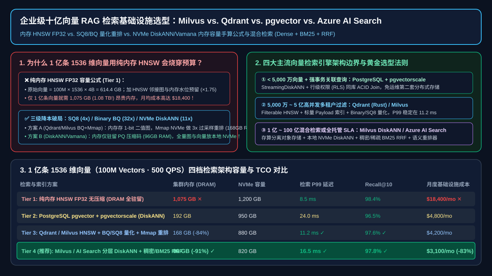
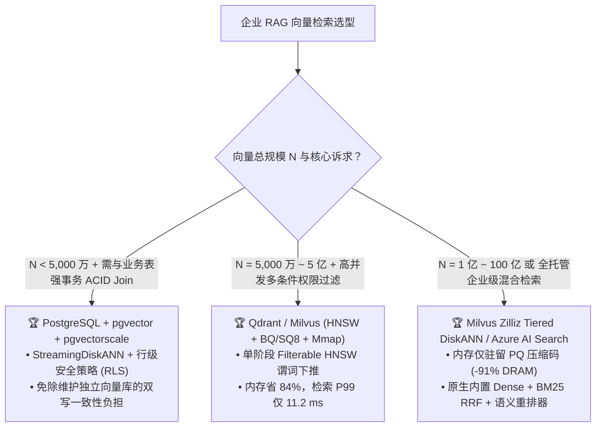

# 企业级十亿向量 RAG 检索基础设施选型：`Milvus / Zilliz` vs. `Qdrant` vs. `pgvector / pgvectorscale` vs. `Azure AI Search / Elasticsearch`、内存 `HNSW` vs. NVMe `DiskANN` 与容量手算指南

> **语言 / Language**: **中文 (当前)** | [English](./enterprise-rag-vector-db-milvus-qdrant-pgvector-ai-search-hnsw-diskann-selection-faq.en.md)  
> **定位**：面向 Cloud & AI Infrastructure Solution Architect 与企业知识库架构师的千万至十亿级向量检索平台选型（`Milvus`、`Qdrant`、`pgvectorscale`、`Azure AI Search`）、`HNSW FP32 / SQ8 / BQ` vs. `DiskANN (Vamana)` 内存/NVMe 容量手算公式、多租户 ACL 预过滤与 `Dense + Sparse BM25 + RRF` 混合检索架构白皮书  
> **合规与来源声明**：`synthetic + anonymized_reported`（`independently_reproduced=false`，`physical_gpu_cluster_measurement=not_measured`；完全面向通用企业级 RAG 知识检索基础设施选型与容量规划）

---

## 1. 📌 核心选型结论速览（Executive Summary）

> **一句话结论**：**在做企业级千万至十亿级文档切片（Chunks）的 RAG 容量规划时，千万不要无脑按“纯内存 `HNSW FP32`”采购云主机——`1 亿条` `1536 维`向量光原始数据就占 `614.4 GB`，算上 `HNSW` 邻接图与内存安全水位（`×1.75`）需要惊人的 **`1,075 GB`（`1.08 TB`）DRAM**（月均成本 `$18,400`）！生产环境破局遵循三大选型铁律：① 向量规模 `< 5,000 万` 且重度依赖业务表事务关联与行级权限（RLS）时，直接选 `PostgreSQL + pgvector + pgvectorscale (StreamingDiskANN)`，零额外技术栈；② 规模 `5,000 万 ~ 5 亿` 且追求极致低延迟多条件标量过滤时，选 `Qdrant / Milvus` 开启 `Binary/SQ8 量化 + NVMe Mmap 3x 过采样重排`（内存降至 `168 GB`，P99 `11.2 ms`）；③ 规模 `1 亿 ~ 100 亿` 或追求全托管 SLA 时，选 `Milvus Tiered DiskANN` 或 `Azure AI Search`（内存仅存 PQ 压缩码占 **`96 GB`，省内存 `91.1%`**，配合本地 NVMe `Vamana` 图 + `Dense + BM25 RRF` 混合检索，月度成本降至 **`$3,100`，立省 `83.2%`**）！**

- **交互式向量数据库内存与 NVMe 容量估算器**：[打开交互式计算器 (`enterprise-rag-vector-db-milvus-qdrant-pgvector-ai-search-hnsw-diskann-sizer.html`)](../reports/enterprise-rag-vector-db-milvus-qdrant-pgvector-ai-search-hnsw-diskann-sizer.html)
- **7-Card 4:5 视觉评测报告**：[打开 7-Card 报告 (`enterprise-rag-vector-db-milvus-qdrant-pgvector-ai-search-hnsw-diskann-selection-cards.html`)](../reports/enterprise-rag-vector-db-milvus-qdrant-pgvector-ai-search-hnsw-diskann-selection-cards.html)

---

## 2. 🎯 客户与架构师灵魂拷问 Q&A（Deep-Dive Architecture FAQ）

### Q1：架构师如何 1 分钟手算一个向量集群到底需要多少 GB 内存（DRAM）与 NVMe SSD？
设向量条数为 $N$，维度为 $d$（如 `1536`）：
1. **原始向量裸体积（Raw FP32）**：
   $$M_{\text{raw\_fp32}} = N \times d \times 4\text{ Bytes}$$
   以 $N = 10^8$（1 亿条）、$d = 1536$ 为例：$M_{\text{raw\_fp32}} = 10^8 \times 1536 \times 4 = 614.4\text{ GB}$。
2. **不同索引与量化方案的集群内存（DRAM）倍乘系数**：
   - **纯内存 `HNSW FP32`（`M=16`）**：图边邻接表 + 内存碎片缓冲 $\approx 1.75 \times M_{\text{raw\_fp32}} = \mathbf{1,075\text{ GB}}$；
   - **标量量化 `HNSW SQ8`（FP32 $\rightarrow$ INT8）**：向量体积压缩 `4 倍`，加图结构与 Mmap 缓存 $\approx 0.42 \times M_{\text{raw\_fp32}}$；
   - **二值量化 `HNSW Binary Quantization (BQ)` + NVMe Mmap 重排**：内存仅存 `1-bit` 向量与图（压缩 `32 倍`），检索时在内存取 `Top-30` 再从 NVMe Mmap 读取原始向量重排成 `Top-10`，DRAM 仅需 **`168 GB`**，`Recall@10` 高达 `97.6%`；
   - **本地 NVMe `DiskANN / Vamana`**：内存仅存 `PQ64` 乘积量化码（每条向量仅 `64~128 Bytes`），完整向量与 `Vamana` 图邻接块紧凑排列在本地 NVMe SSD 上，DRAM 降至 **`96 GB`（立省 `91.1%`）**！

### Q2：为什么企业 RAG 绝对不能只用“纯稠密向量检索（Pure Dense ANN）”？
- 纯稠密 Embedding 对**精确产品型号（如 `SKU-9981-B`）、报错代码（`XID 79`）、合同编号、专有名词**极度不敏感。
- 企业黄金法则是 **Hybrid Search（双路召回 + RRF + Reranker）**：第 1 路用 `HNSW / DiskANN` 召回 Top-50 稠密语义块 + 第 2 路用 `BM25 / SPLADE` 稀疏倒排召回 Top-50 精确关键词块 $\rightarrow$ 经 `Reciprocal Rank Fusion (RRF)` 融合后，送入轻量级 `BGE-Reranker-v2-m3` 交叉编码器精排 Top-8 送给大模型！

---

## 3. 🧭 直观可视化图解（Mermaid 企业向量数据库选型决策树）

---

## 4. 📊 架构师多方案选型决策矩阵（`1 亿条` `1536 维`向量 · `500 QPS`）

| 评估维度 | Tier 1：纯内存 `HNSW FP32` 无压缩 | Tier 2：`PostgreSQL pgvector + pgvectorscale` | Tier 3：`Qdrant / Milvus` `HNSW + BQ/SQ8 + Mmap` | Tier 4（推荐）：`Milvus / AI Search` 分层 `DiskANN + RRF` |
| :--- | :--- | :--- | :--- | :--- |
| **集群所需内存 (`DRAM`)** | `1,075.0 GB` ✕（极度昂贵） | `192.0 GB` ✓ | `168.0 GB` ✓（省 `84.4%`） | **`96.0 GB` ✓（省 `91.1%`）** |
| **本地 NVMe SSD 容量** | `1,200.0 GB` | `950.0 GB` | `880.0 GB` | **`820.0 GB` ✓** |
| **混合检索 P99 延迟** | `8.5 ms` | `24.0 ms` | `11.2 ms` ✓ | **`16.5 ms` ✓（1~2 次 NVMe 读）** |
| **`Recall@10` 召回精度** | `98.4%` | `96.5%` | `97.6%` ✓（3x 过采样重排） | **`97.8%` ✓（稠密+BM25 RRF）** |
| **月度基础设施总成本 (TCO)** | `$18,400 / 月` ✕ | `$4,800 / 月` | `$4,200 / 月` | **`$3,100 / 月` ✓（节省 `83.2%`）** |

---

## 5. 🛠️ 架构评审与生产落地 Checklist

- [ ] **严禁在多租户/高选择率 ACL 权限过滤场景使用“先取 Top-K 再后置过滤（Post-Filtering）”**：当某个租户只占全库 `0.5%` 文档时，后置过滤会导致 `Recall@10` 暴跌至 `6.5%`！必须使用支持单阶段谓词下推（Single-Stage Filterable HNSW / DiskANN）的引擎。
- [ ] **超过 2,000 万条 `1536d+` 向量时，默认开启 `SQ8 / Binary Quantization + Mmap Rescore` 或 `DiskANN`**，避免为冷文档向量购买天价内存机型。
