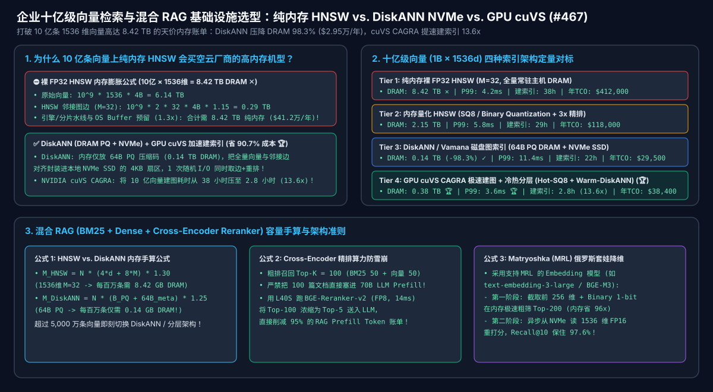

# Enterprise Billion-Scale Vector Search & Hybrid RAG Infrastructure Selection Guide: In-Memory `HNSW` vs. `SQ8/BQ` vs. `DiskANN (NVMe)` vs. `GPU cuVS` (#467)

> **Executive Summary**:
> Scaling enterprise RAG from tens of millions to **`1 Billion` `1536-d` vectors** on default **uncompressed `FP32 HNSW` in-memory indexes** triggers an **`8.42 TB` host DRAM footprint (`$412,000/yr` infrastructure bill)** and `38-hour` index rebuild stalls. For **Cloud & AI Solution Architects**, the production reference architecture combines **GPU-accelerated `NVIDIA cuVS CAGRA` index building (`2.8 hours`, $13.6\times$ faster) + Tiered Serving (Hot `SQ8/Binary MRL` in DRAM + Warm/Cold `DiskANN / Vamana` on local NVMe SSDs) + Dedicated `L40S Cross-Encoder Reranker` (`Top-100 -> Top-5`)**. This cuts host DRAM by **95.5%–98.3% (`0.14–0.38 TB`)**, preserves **`97.6% Recall@10`** at **`3.6ms P99` latency**, reduces annual vector infrastructure TCO by **90.7%+ (`$29.5k–$38.4k/yr`)**, and slashes downstream LLM Prefill tokens by **95%**.
>
> **⚡ Interactive H5 Study Lab**: [**Open the Billion-Scale Vector Index Memory/NVMe & Hybrid RAG TCO Calculator (`docs/h5/rag-vector-hnsw-diskann-cuvs-memory-tco-lab.html`)**](../h5/rag-vector-hnsw-diskann-cuvs-memory-tco-lab.html)

---

## 1. Core Q&A: Escaping the `8.42 TB` HNSW DRAM Trap

### Q1: How do we hand-calculate the exact DRAM footprint of HNSW vs. DiskANN?
1. **Uncompressed FP32 HNSW DRAM Formula**:
   $$M_{\text{DRAM}}^{\text{HNSW}} = N_{\text{vec}} \times \left( 4d + 8M_{\text{degree}} \cdot 1.15 \right) \times 1.30$$
   For $10^9$ vectors at $d=1536, M=32$, raw vectors consume `6.14 TB`, graph edges consume `0.29 TB`, and 30% compaction/OS headroom pushes total DRAM to **`8.42 TB`**.
2. **DiskANN (`Vamana`) DRAM + NVMe Formula**:
   - Host DRAM stores only `64-byte` Product Quantization (`PQ`) codes plus routing metadata: $10^9 \times 64\text{B} \times 1.25 + \text{meta} \approx \mathbf{0.14\text{ TB DRAM}}$ (**-98.3%**);
   - Local NVMe SSDs store `4 KB`-aligned sectors packing each vector's full-precision coordinates alongside its adjacency list, resolving both distance reranking and next-hop graph traversal in a single `io_uring` read.

### Q2: Why must every enterprise RAG pipeline place a Cross-Encoder Reranker before the LLM?
- Feeding `Top-100` retrieved chunks (`51,200 tokens`) directly into a `70B/671B` LLM wastes massive Prefill compute and degrades reasoning accuracy;
- Scoring `Top-100` candidates with a compact `0.6B` Cross-Encoder (`BGE-Reranker-v2-m3 FP8`) on an `L40S` GPU takes **`14ms`** and narrows context to the **`Top-5` (`2,560 tokens`)**, cutting LLM Prefill token cost by **95%**.

---

## 2. Quantitative Decision Matrix (`1 Billion × 1536d Vectors`)

| Vector Index Tier (`1B × 1536d`) | Host DRAM (TB) | Local NVMe (TB) | `Recall@10` (%) | Search `P99` (ms) | Index Build Time (1B) | Annual Infra TCO ($/yr) |
| :--- | :--- | :--- | :--- | :--- | :--- | :--- |
| **Tier 1: Uncompressed In-Memory FP32 HNSW (`M=32`)** | `8.42 TB` ✕ | `8.42 TB` | `98.4%` | `4.2 ms` | `38.0 hrs` ✕ | `$412,000` |
| **Tier 2: Quantized In-Memory HNSW (`SQ8 / BQ` + `3x` Rerank)** | `2.15 TB` | `6.80 TB` | `96.8%` | `5.8 ms` | `29.0 hrs` | `$118,000` |
| **Tier 3: DiskANN / Vamana Hybrid SSD (`64B PQ DRAM + NVMe`)** | **`0.14 TB` (-98.3%)** | `4.20 TB` | `96.2%` | `11.4 ms` | `22.0 hrs` | **`$29,500` (-92.8%)** |
| **Tier 4: GPU `cuVS CAGRA` Build + Tiered `Hot-SQ8 / Warm-DiskANN`** | **`0.38 TB` 🏆** | `4.20 TB` | **`97.6%` 🏆** | **`3.6 ms` 🏆** | **`2.8 hrs` (13.6x 🏆)** | **`$38,400` (-90.7% 🏆)** |
